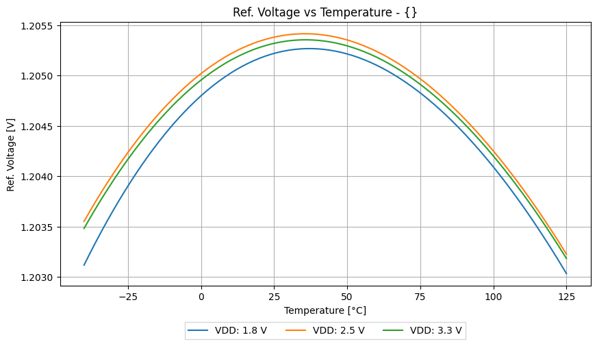
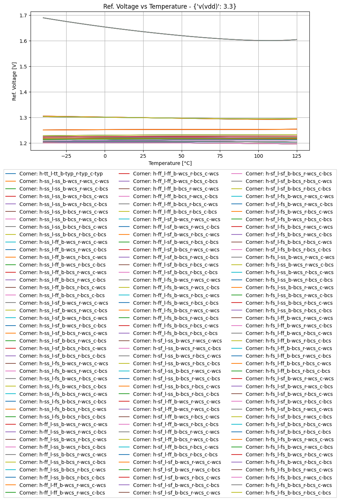
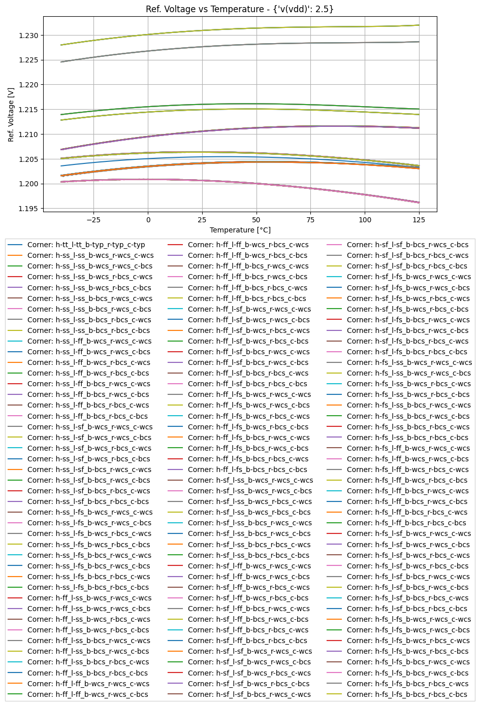
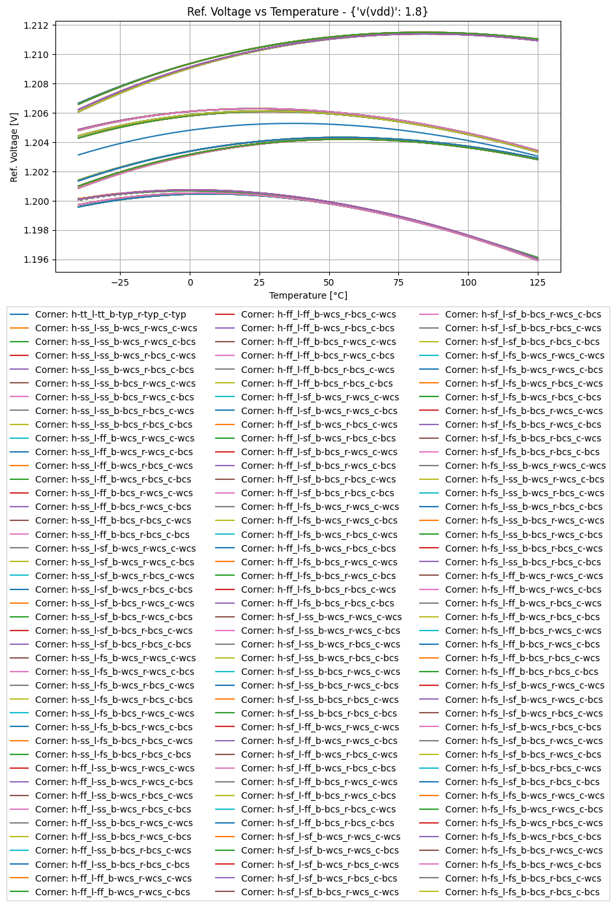
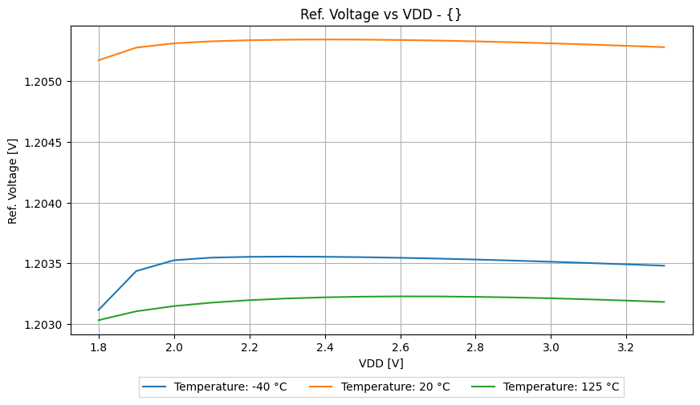
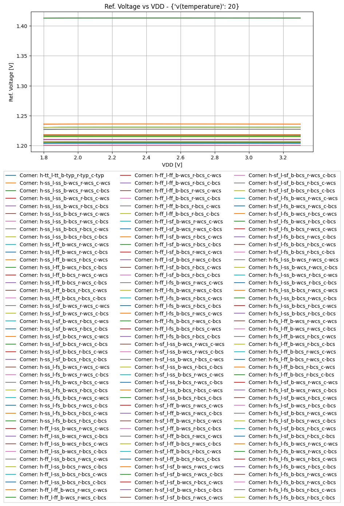
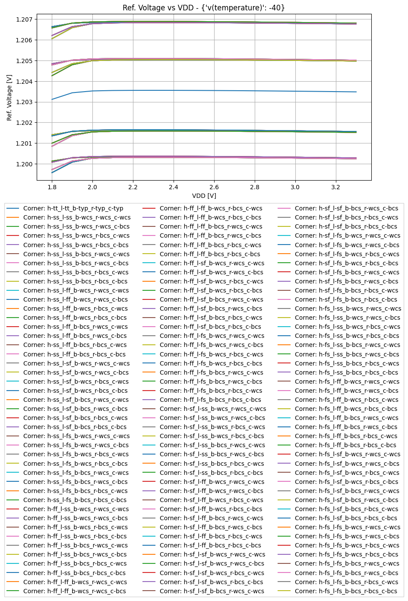
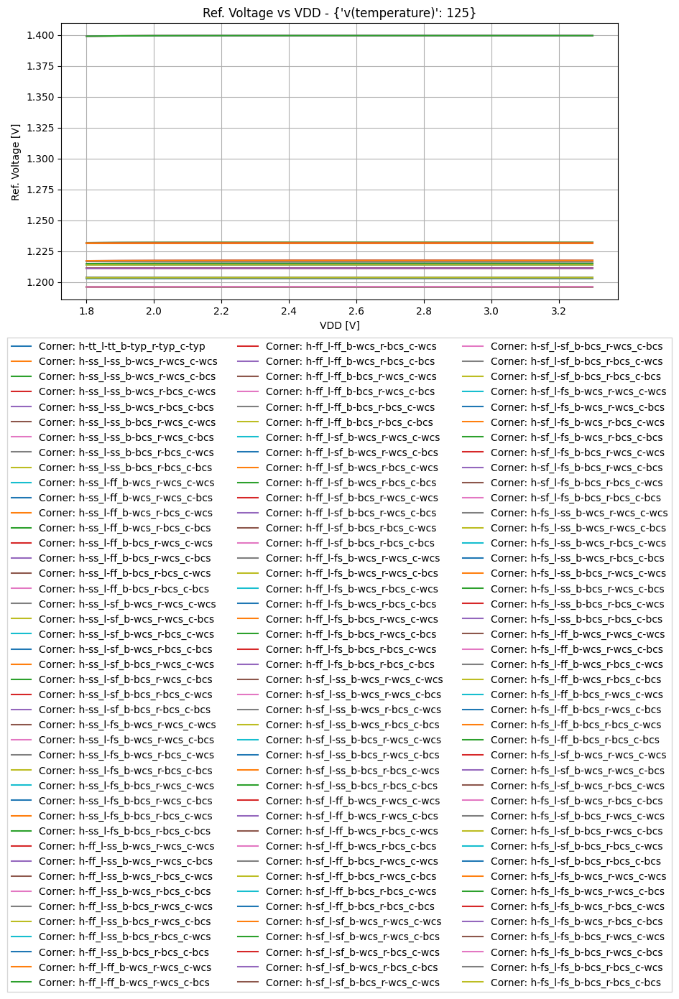
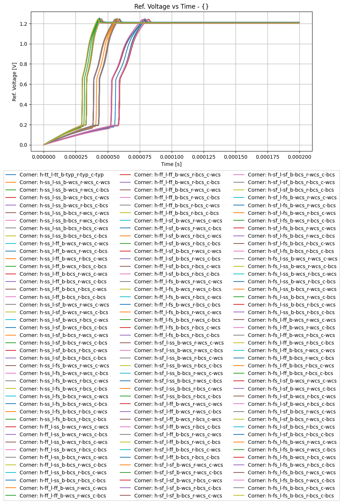

# Voltage Curvature vs Temperature Performance 

|  |
| :-- |
|  |

|  |
| :-- |
|  |

...

|  |
| :-- |
|  |

 

...

|  |
| :-- |
|  |

 

# Voltage Curvature vs Temperature Performance (Monte Carlo) 

| ,_('tt_typ_mismatch_mc',_-2)__4bad6d1905fbbefa1d385e2bb6476bdd.png "") |
| :-- |
|  |

| ,_('tt_typ_mismatch_mc',_-2)__4bad6d1905fbbefa1d385e2bb6476bdd.png "") |
| :-- |
|  |

| ,_('tt_typ_mismatch_mc',_-2)__4bad6d1905fbbefa1d385e2bb6476bdd.png "") |
| :-- |
|  |

| ,_('tt_typ_mismatch_mc',_-2)__4bad6d1905fbbefa1d385e2bb6476bdd.png "") |
| :-- |
|  |

# Voltage Curvature vs VDD Performance 

|  |
| :-- |
|  |

|  |
| :-- |
|  |

...

|  |
| :-- |
|  |

 

...

|  |
| :-- |
|  |

 

# Voltage Curvature vs VDD Performance (Monte Carlo) 

| ,_('tt_typ_mismatch_mc',_-2)__74e752a5f239baa9fb3dbba97862329f.png "") |
| :-- |
|  |

| ,_('tt_typ_mismatch_mc',_-2)__74e752a5f239baa9fb3dbba97862329f.png "") |
| :-- |
|  |

| ,_('tt_typ_mismatch_mc',_-2)__74e752a5f239baa9fb3dbba97862329f.png "") |
| :-- |
|  |

| ,_('tt_typ_mismatch_mc',_-2)__74e752a5f239baa9fb3dbba97862329f.png "") |
| :-- |
|  |

# Transient Startup Performance 

|  |
| :-- |
|  |

# Transient Startup Performance (Monte Carlo) 

| ,_('tt_typ_mismatch_mc',_-2)__eea99a3fef46309d8b190a99e2d1f21d.png "") |
| :-- |
|  |

# Voltage Curvature vs Temperature Performance (Monte Carlo) [PEX] 

| ,_('tt_typ_mismatch_mc',_-2)__ed81016942202407dd031a0d5a690811.png "") |
| :-- |
|  |

| ,_('tt_typ_mismatch_mc',_-2)__ed81016942202407dd031a0d5a690811.png "") |
| :-- |
|  |

| ,_('tt_typ_mismatch_mc',_-2)__ed81016942202407dd031a0d5a690811.png "") |
| :-- |
|  |

| ,_('tt_typ_mismatch_mc',_-2)__ed81016942202407dd031a0d5a690811.png "") |
| :-- |
|  |

# Voltage Curvature vs VDD Performance (Monte Carlo) [PEX] 

| ,_('tt_typ_mismatch_mc',_-2)__7cfc739290794806c30719776e97637b.png "") |
| :-- |
|  |

| ,_('tt_typ_mismatch_mc',_-2)__7cfc739290794806c30719776e97637b.png "") |
| :-- |
|  |

| ,_('tt_typ_mismatch_mc',_-2)__7cfc739290794806c30719776e97637b.png "") |
| :-- |
|  |

| ,_('tt_typ_mismatch_mc',_-2)__7cfc739290794806c30719776e97637b.png "") |
| :-- |
|  |

