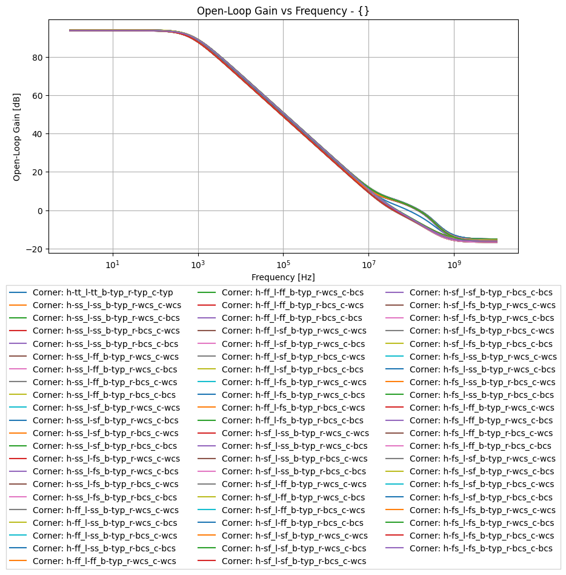
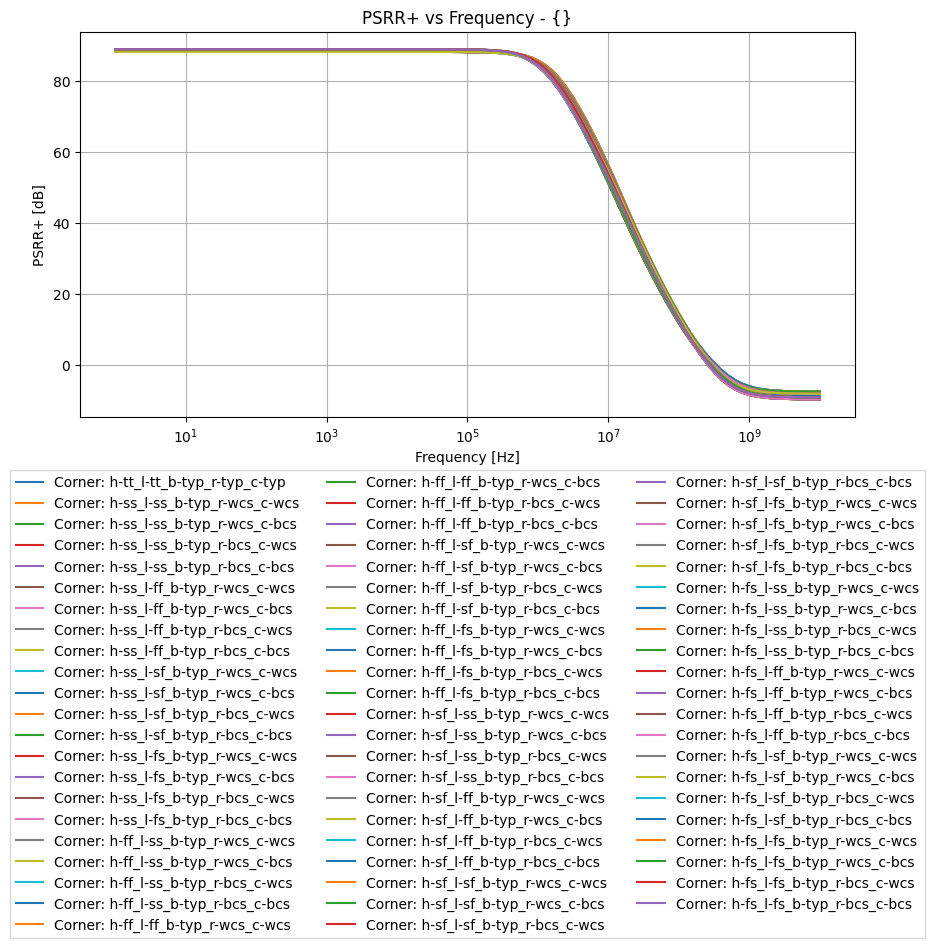
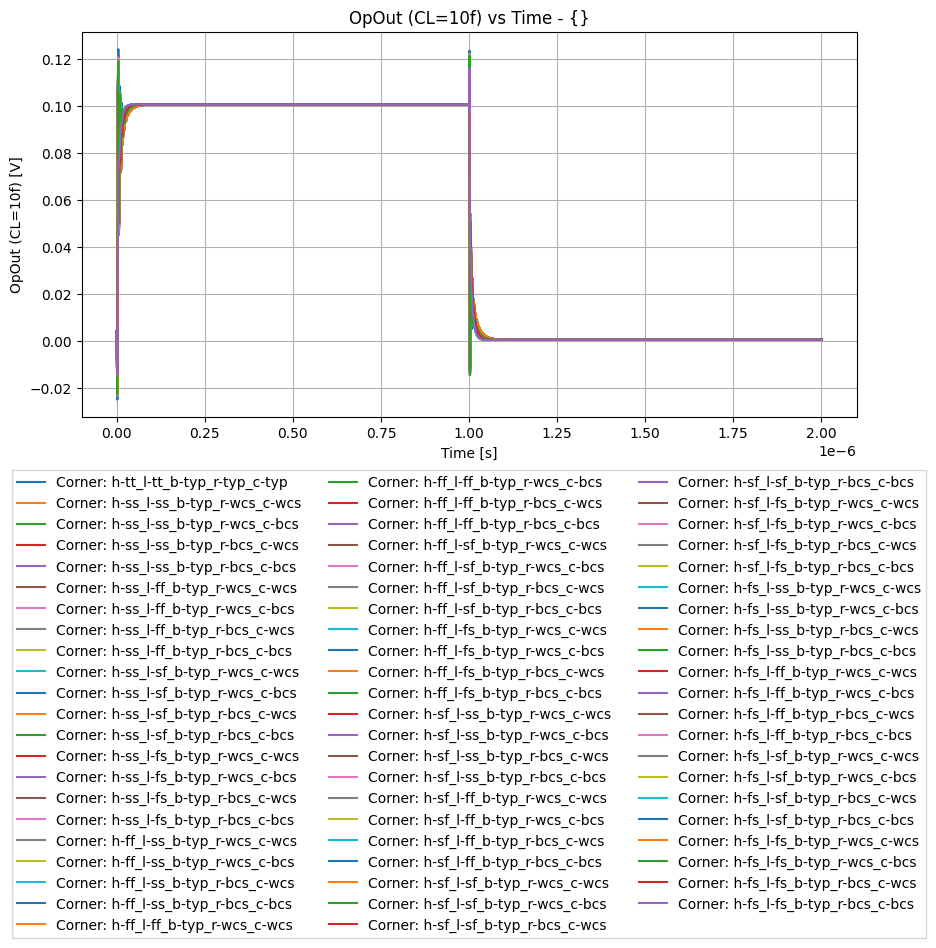
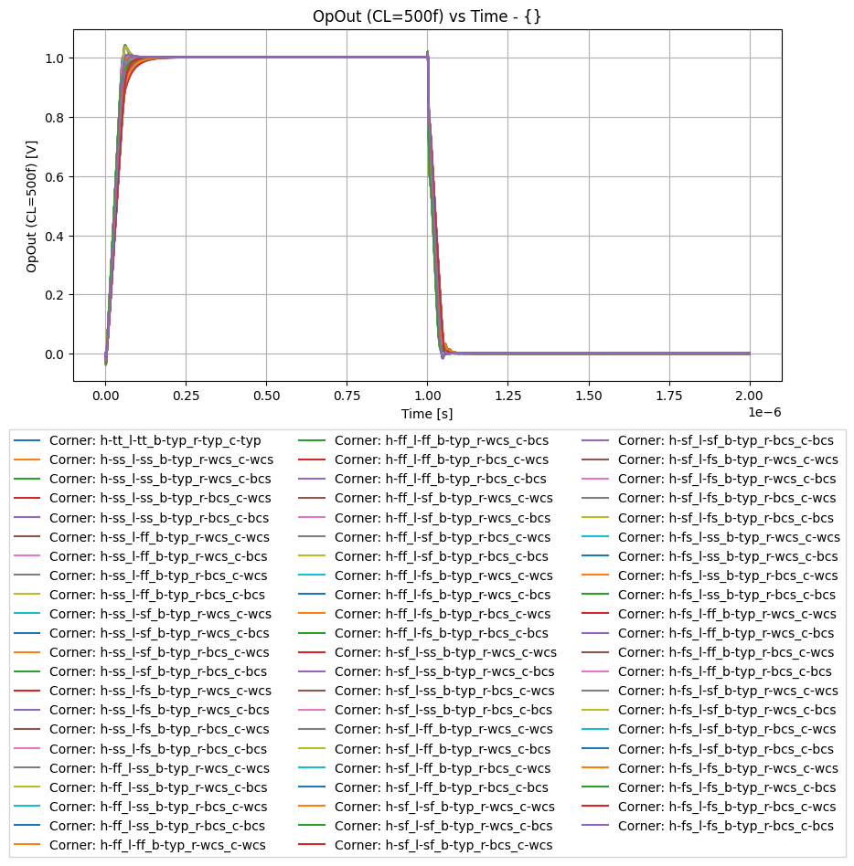
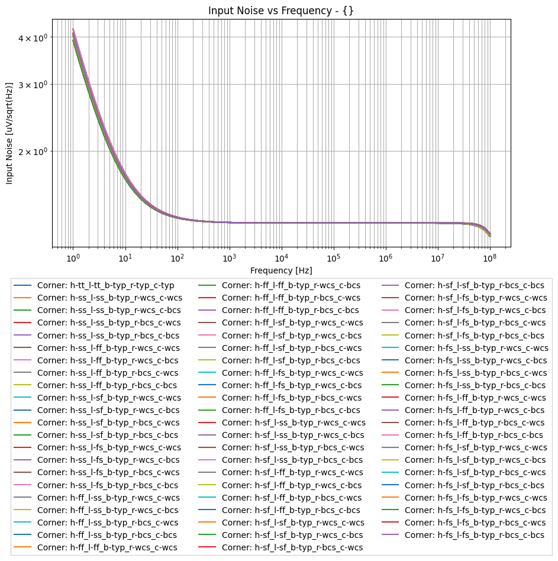

11.09.2025, 23:20:30

# Beta-Multiplier Bandgap OTA

OTA for Beta-Multiplier Bandgap.

 

[🔗 Schematics](bmbgota_sch.pdf) 

Show Tool Versions...

> xschem: 3.4.6 
> ngspice: 44.2 
> magic: 8.3.541 
> netgen: 1.5.293 
> ihpopenpdk: dev 

 

# LVS
LVS-state: Netlists match uniquely. 

[🔗 LVS-report](bmbgota_bmbgota_netgen_comp.out) 

# SPECIFICATIONS

## AC Open-Loop Specification  

| Parameter | Min (Spec. / Sim.) |      | Max (Sim. / Spec.) | Unit | Checks (total/pass/fail/NaN) | Comment |
| :-------- | -----------------: | :--: | :----------------- | :--- | :--------------------------- | ------- |
| Open-Loop Gain | 90 / 93.598 | <svg height="20" width="150"><polyline points="3.0,3,3.0,17,147.0,17,147.0,3" style="fill:none;stroke:gray;stroke-width:1" /><polyline points="75.0,10.0,75.0,17" style="fill:none;stroke:gray;stroke-width:1" /><polyline points="28.90646399999996,10.0,31.894536000000027,10.0" style="stroke:green;stroke-width:2" /><circle cx="28.90646399999996" cy="10.0" r="3" style="fill:green;stroke:green;stroke-width:0" /><circle cx="31.894536000000027" cy="10.0" r="3" style="fill:green;stroke:green;stroke-width:0" /></svg> | 94.013 / 110 | dB | 65/100.0%/0.0%/0.0% | Gain at 1Hz |
| Phase Margin | 60 / 51.936 | <svg height="20" width="150"><polyline points="22.999431664061795,3,22.999431664061795,17,147.0,17,147.0,3" style="fill:none;stroke:gray;stroke-width:1" /><polyline points="84.99971583203089,10.0,84.99971583203089,17" style="fill:none;stroke:gray;stroke-width:1" /><polyline points="3.0,10.0,117.99800307418076,10.0" style="stroke:red;stroke-width:2" /><circle cx="3.0" cy="10.0" r="3" style="fill:red;stroke:red;stroke-width:0" /><circle cx="117.99800307418076" cy="10.0" r="3" style="fill:red;stroke:red;stroke-width:0" /></svg> | 98.306 / 110 | deg | 65/50.7692%/49.2308%/0.0% | Open-Loop |
| Unity-Gain Bandwidth | 25.0 / 37.499 | <svg height="20" width="150"><polyline points="3.0,3,3.0,17,96.64642659313688,17,96.64642659313688,3" style="fill:none;stroke:gray;stroke-width:1" /><polyline points="49.82321329656844,10.0,49.82321329656844,17" style="fill:none;stroke:gray;stroke-width:1" /><polyline points="16.769891755748084,10.0,147.0,10.0" style="stroke:red;stroke-width:2" /><circle cx="16.769891755748084" cy="10.0" r="3" style="fill:red;stroke:red;stroke-width:0" /><circle cx="147.0" cy="10.0" r="3" style="fill:red;stroke:red;stroke-width:0" /></svg> | 155.704 / 110.0 | MHz | 65/50.7692%/49.2308%/0.0% |  |
| 3-dB Bandwidth | 0.1 / 0.553 | <svg height="20" width="150"><polyline points="3.0,3,3.0,17,147.0,17,147.0,3" style="fill:none;stroke:gray;stroke-width:1" /><polyline points="75.0,10.0,75.0,17" style="fill:none;stroke:gray;stroke-width:1" /><polyline points="9.592795636363636,10.0,12.206494545454545,10.0" style="stroke:green;stroke-width:2" /><circle cx="9.592795636363636" cy="10.0" r="3" style="fill:green;stroke:green;stroke-width:0" /><circle cx="12.206494545454545" cy="10.0" r="3" style="fill:green;stroke:green;stroke-width:0" /></svg> | 0.733 / 10.0 | kHz | 65/100.0%/0.0%/0.0% |  |

Show specification violation details...

> **FAIL:** Specification violation for parameter "Phase Margin": 
> **FAIL:** group:h-ss_l-ss_b-typ_r-wcs_c-wcs file:work/sim/bmbgota/bmbgota_tb.1_bmbgota/batch_0/h-ss_l-ss_b-typ_r-wcs_c-wcs/ac_ol.csv Index:0  
> **FAIL:** group:h-ss_l-ss_b-typ_r-wcs_c-bcs file:work/sim/bmbgota/bmbgota_tb.1_bmbgota/batch_0/h-ss_l-ss_b-typ_r-wcs_c-bcs/ac_ol.csv Index:0  
> **FAIL:** group:h-ss_l-ff_b-typ_r-wcs_c-wcs file:work/sim/bmbgota/bmbgota_tb.1_bmbgota/batch_0/h-ss_l-ff_b-typ_r-wcs_c-wcs/ac_ol.csv Index:0  
> **FAIL:** group:h-ss_l-ff_b-typ_r-wcs_c-bcs file:work/sim/bmbgota/bmbgota_tb.1_bmbgota/batch_0/h-ss_l-ff_b-typ_r-wcs_c-bcs/ac_ol.csv Index:0  
> **FAIL:** group:h-ss_l-sf_b-typ_r-wcs_c-wcs file:work/sim/bmbgota/bmbgota_tb.1_bmbgota/batch_0/h-ss_l-sf_b-typ_r-wcs_c-wcs/ac_ol.csv Index:0  
> **FAIL:** group:h-ss_l-sf_b-typ_r-wcs_c-bcs file:work/sim/bmbgota/bmbgota_tb.1_bmbgota/batch_0/h-ss_l-sf_b-typ_r-wcs_c-bcs/ac_ol.csv Index:0  
> **FAIL:** group:h-ss_l-fs_b-typ_r-wcs_c-wcs file:work/sim/bmbgota/bmbgota_tb.1_bmbgota/batch_0/h-ss_l-fs_b-typ_r-wcs_c-wcs/ac_ol.csv Index:0  
> **FAIL:** group:h-ss_l-fs_b-typ_r-wcs_c-bcs file:work/sim/bmbgota/bmbgota_tb.1_bmbgota/batch_0/h-ss_l-fs_b-typ_r-wcs_c-bcs/ac_ol.csv Index:0  
> **FAIL:** group:h-ff_l-ss_b-typ_r-wcs_c-wcs file:work/sim/bmbgota/bmbgota_tb.1_bmbgota/batch_0/h-ff_l-ss_b-typ_r-wcs_c-wcs/ac_ol.csv Index:0  
> **FAIL:** group:h-ff_l-ss_b-typ_r-wcs_c-bcs file:work/sim/bmbgota/bmbgota_tb.1_bmbgota/batch_0/h-ff_l-ss_b-typ_r-wcs_c-bcs/ac_ol.csv Index:0  
> **FAIL:** group:h-ff_l-ff_b-typ_r-wcs_c-wcs file:work/sim/bmbgota/bmbgota_tb.1_bmbgota/batch_0/h-ff_l-ff_b-typ_r-wcs_c-wcs/ac_ol.csv Index:0  
> **FAIL:** group:h-ff_l-ff_b-typ_r-wcs_c-bcs file:work/sim/bmbgota/bmbgota_tb.1_bmbgota/batch_0/h-ff_l-ff_b-typ_r-wcs_c-bcs/ac_ol.csv Index:0  
> **FAIL:** group:h-ff_l-sf_b-typ_r-wcs_c-wcs file:work/sim/bmbgota/bmbgota_tb.1_bmbgota/batch_0/h-ff_l-sf_b-typ_r-wcs_c-wcs/ac_ol.csv Index:0  
> **FAIL:** group:h-ff_l-sf_b-typ_r-wcs_c-bcs file:work/sim/bmbgota/bmbgota_tb.1_bmbgota/batch_0/h-ff_l-sf_b-typ_r-wcs_c-bcs/ac_ol.csv Index:0  
> **FAIL:** group:h-ff_l-fs_b-typ_r-wcs_c-wcs file:work/sim/bmbgota/bmbgota_tb.1_bmbgota/batch_0/h-ff_l-fs_b-typ_r-wcs_c-wcs/ac_ol.csv Index:0  
> **FAIL:** group:h-ff_l-fs_b-typ_r-wcs_c-bcs file:work/sim/bmbgota/bmbgota_tb.1_bmbgota/batch_0/h-ff_l-fs_b-typ_r-wcs_c-bcs/ac_ol.csv Index:0  
> **FAIL:** group:h-sf_l-ss_b-typ_r-wcs_c-wcs file:work/sim/bmbgota/bmbgota_tb.1_bmbgota/batch_0/h-sf_l-ss_b-typ_r-wcs_c-wcs/ac_ol.csv Index:0  
> **FAIL:** group:h-sf_l-ss_b-typ_r-wcs_c-bcs file:work/sim/bmbgota/bmbgota_tb.1_bmbgota/batch_0/h-sf_l-ss_b-typ_r-wcs_c-bcs/ac_ol.csv Index:0  
> **FAIL:** group:h-sf_l-ff_b-typ_r-wcs_c-wcs file:work/sim/bmbgota/bmbgota_tb.1_bmbgota/batch_0/h-sf_l-ff_b-typ_r-wcs_c-wcs/ac_ol.csv Index:0  
> **FAIL:** group:h-sf_l-ff_b-typ_r-wcs_c-bcs file:work/sim/bmbgota/bmbgota_tb.1_bmbgota/batch_0/h-sf_l-ff_b-typ_r-wcs_c-bcs/ac_ol.csv Index:0  
> **FAIL:** group:h-sf_l-sf_b-typ_r-wcs_c-wcs file:work/sim/bmbgota/bmbgota_tb.1_bmbgota/batch_0/h-sf_l-sf_b-typ_r-wcs_c-wcs/ac_ol.csv Index:0  
> **FAIL:** group:h-sf_l-sf_b-typ_r-wcs_c-bcs file:work/sim/bmbgota/bmbgota_tb.1_bmbgota/batch_0/h-sf_l-sf_b-typ_r-wcs_c-bcs/ac_ol.csv Index:0  
> **FAIL:** group:h-sf_l-fs_b-typ_r-wcs_c-wcs file:work/sim/bmbgota/bmbgota_tb.1_bmbgota/batch_0/h-sf_l-fs_b-typ_r-wcs_c-wcs/ac_ol.csv Index:0  
> **FAIL:** group:h-sf_l-fs_b-typ_r-wcs_c-bcs file:work/sim/bmbgota/bmbgota_tb.1_bmbgota/batch_0/h-sf_l-fs_b-typ_r-wcs_c-bcs/ac_ol.csv Index:0  
> **FAIL:** group:h-fs_l-ss_b-typ_r-wcs_c-wcs file:work/sim/bmbgota/bmbgota_tb.1_bmbgota/batch_0/h-fs_l-ss_b-typ_r-wcs_c-wcs/ac_ol.csv Index:0  
> **FAIL:** group:h-fs_l-ss_b-typ_r-wcs_c-bcs file:work/sim/bmbgota/bmbgota_tb.1_bmbgota/batch_0/h-fs_l-ss_b-typ_r-wcs_c-bcs/ac_ol.csv Index:0  
> **FAIL:** group:h-fs_l-ff_b-typ_r-wcs_c-wcs file:work/sim/bmbgota/bmbgota_tb.1_bmbgota/batch_0/h-fs_l-ff_b-typ_r-wcs_c-wcs/ac_ol.csv Index:0  
> **FAIL:** group:h-fs_l-ff_b-typ_r-wcs_c-bcs file:work/sim/bmbgota/bmbgota_tb.1_bmbgota/batch_0/h-fs_l-ff_b-typ_r-wcs_c-bcs/ac_ol.csv Index:0  
> **FAIL:** group:h-fs_l-sf_b-typ_r-wcs_c-wcs file:work/sim/bmbgota/bmbgota_tb.1_bmbgota/batch_0/h-fs_l-sf_b-typ_r-wcs_c-wcs/ac_ol.csv Index:0  
> **FAIL:** group:h-fs_l-sf_b-typ_r-wcs_c-bcs file:work/sim/bmbgota/bmbgota_tb.1_bmbgota/batch_0/h-fs_l-sf_b-typ_r-wcs_c-bcs/ac_ol.csv Index:0  
> **FAIL:** group:h-fs_l-fs_b-typ_r-wcs_c-wcs file:work/sim/bmbgota/bmbgota_tb.1_bmbgota/batch_0/h-fs_l-fs_b-typ_r-wcs_c-wcs/ac_ol.csv Index:0  
> **FAIL:** group:h-fs_l-fs_b-typ_r-wcs_c-bcs file:work/sim/bmbgota/bmbgota_tb.1_bmbgota/batch_0/h-fs_l-fs_b-typ_r-wcs_c-bcs/ac_ol.csv Index:0  

> **FAIL:** Specification violation for parameter "Unity-Gain Bandwidth": 
> **FAIL:** group:h-ss_l-ss_b-typ_r-wcs_c-wcs file:work/sim/bmbgota/bmbgota_tb.1_bmbgota/batch_0/h-ss_l-ss_b-typ_r-wcs_c-wcs/ac_ol.csv Index:0  
> **FAIL:** group:h-ss_l-ss_b-typ_r-wcs_c-bcs file:work/sim/bmbgota/bmbgota_tb.1_bmbgota/batch_0/h-ss_l-ss_b-typ_r-wcs_c-bcs/ac_ol.csv Index:0  
> **FAIL:** group:h-ss_l-ff_b-typ_r-wcs_c-wcs file:work/sim/bmbgota/bmbgota_tb.1_bmbgota/batch_0/h-ss_l-ff_b-typ_r-wcs_c-wcs/ac_ol.csv Index:0  
> **FAIL:** group:h-ss_l-ff_b-typ_r-wcs_c-bcs file:work/sim/bmbgota/bmbgota_tb.1_bmbgota/batch_0/h-ss_l-ff_b-typ_r-wcs_c-bcs/ac_ol.csv Index:0  
> **FAIL:** group:h-ss_l-sf_b-typ_r-wcs_c-wcs file:work/sim/bmbgota/bmbgota_tb.1_bmbgota/batch_0/h-ss_l-sf_b-typ_r-wcs_c-wcs/ac_ol.csv Index:0  
> **FAIL:** group:h-ss_l-sf_b-typ_r-wcs_c-bcs file:work/sim/bmbgota/bmbgota_tb.1_bmbgota/batch_0/h-ss_l-sf_b-typ_r-wcs_c-bcs/ac_ol.csv Index:0  
> **FAIL:** group:h-ss_l-fs_b-typ_r-wcs_c-wcs file:work/sim/bmbgota/bmbgota_tb.1_bmbgota/batch_0/h-ss_l-fs_b-typ_r-wcs_c-wcs/ac_ol.csv Index:0  
> **FAIL:** group:h-ss_l-fs_b-typ_r-wcs_c-bcs file:work/sim/bmbgota/bmbgota_tb.1_bmbgota/batch_0/h-ss_l-fs_b-typ_r-wcs_c-bcs/ac_ol.csv Index:0  
> **FAIL:** group:h-ff_l-ss_b-typ_r-wcs_c-wcs file:work/sim/bmbgota/bmbgota_tb.1_bmbgota/batch_0/h-ff_l-ss_b-typ_r-wcs_c-wcs/ac_ol.csv Index:0  
> **FAIL:** group:h-ff_l-ss_b-typ_r-wcs_c-bcs file:work/sim/bmbgota/bmbgota_tb.1_bmbgota/batch_0/h-ff_l-ss_b-typ_r-wcs_c-bcs/ac_ol.csv Index:0  
> **FAIL:** group:h-ff_l-ff_b-typ_r-wcs_c-wcs file:work/sim/bmbgota/bmbgota_tb.1_bmbgota/batch_0/h-ff_l-ff_b-typ_r-wcs_c-wcs/ac_ol.csv Index:0  
> **FAIL:** group:h-ff_l-ff_b-typ_r-wcs_c-bcs file:work/sim/bmbgota/bmbgota_tb.1_bmbgota/batch_0/h-ff_l-ff_b-typ_r-wcs_c-bcs/ac_ol.csv Index:0  
> **FAIL:** group:h-ff_l-sf_b-typ_r-wcs_c-wcs file:work/sim/bmbgota/bmbgota_tb.1_bmbgota/batch_0/h-ff_l-sf_b-typ_r-wcs_c-wcs/ac_ol.csv Index:0  
> **FAIL:** group:h-ff_l-sf_b-typ_r-wcs_c-bcs file:work/sim/bmbgota/bmbgota_tb.1_bmbgota/batch_0/h-ff_l-sf_b-typ_r-wcs_c-bcs/ac_ol.csv Index:0  
> **FAIL:** group:h-ff_l-fs_b-typ_r-wcs_c-wcs file:work/sim/bmbgota/bmbgota_tb.1_bmbgota/batch_0/h-ff_l-fs_b-typ_r-wcs_c-wcs/ac_ol.csv Index:0  
> **FAIL:** group:h-ff_l-fs_b-typ_r-wcs_c-bcs file:work/sim/bmbgota/bmbgota_tb.1_bmbgota/batch_0/h-ff_l-fs_b-typ_r-wcs_c-bcs/ac_ol.csv Index:0  
> **FAIL:** group:h-sf_l-ss_b-typ_r-wcs_c-wcs file:work/sim/bmbgota/bmbgota_tb.1_bmbgota/batch_0/h-sf_l-ss_b-typ_r-wcs_c-wcs/ac_ol.csv Index:0  
> **FAIL:** group:h-sf_l-ss_b-typ_r-wcs_c-bcs file:work/sim/bmbgota/bmbgota_tb.1_bmbgota/batch_0/h-sf_l-ss_b-typ_r-wcs_c-bcs/ac_ol.csv Index:0  
> **FAIL:** group:h-sf_l-ff_b-typ_r-wcs_c-wcs file:work/sim/bmbgota/bmbgota_tb.1_bmbgota/batch_0/h-sf_l-ff_b-typ_r-wcs_c-wcs/ac_ol.csv Index:0  
> **FAIL:** group:h-sf_l-ff_b-typ_r-wcs_c-bcs file:work/sim/bmbgota/bmbgota_tb.1_bmbgota/batch_0/h-sf_l-ff_b-typ_r-wcs_c-bcs/ac_ol.csv Index:0  
> **FAIL:** group:h-sf_l-sf_b-typ_r-wcs_c-wcs file:work/sim/bmbgota/bmbgota_tb.1_bmbgota/batch_0/h-sf_l-sf_b-typ_r-wcs_c-wcs/ac_ol.csv Index:0  
> **FAIL:** group:h-sf_l-sf_b-typ_r-wcs_c-bcs file:work/sim/bmbgota/bmbgota_tb.1_bmbgota/batch_0/h-sf_l-sf_b-typ_r-wcs_c-bcs/ac_ol.csv Index:0  
> **FAIL:** group:h-sf_l-fs_b-typ_r-wcs_c-wcs file:work/sim/bmbgota/bmbgota_tb.1_bmbgota/batch_0/h-sf_l-fs_b-typ_r-wcs_c-wcs/ac_ol.csv Index:0  
> **FAIL:** group:h-sf_l-fs_b-typ_r-wcs_c-bcs file:work/sim/bmbgota/bmbgota_tb.1_bmbgota/batch_0/h-sf_l-fs_b-typ_r-wcs_c-bcs/ac_ol.csv Index:0  
> **FAIL:** group:h-fs_l-ss_b-typ_r-wcs_c-wcs file:work/sim/bmbgota/bmbgota_tb.1_bmbgota/batch_0/h-fs_l-ss_b-typ_r-wcs_c-wcs/ac_ol.csv Index:0  
> **FAIL:** group:h-fs_l-ss_b-typ_r-wcs_c-bcs file:work/sim/bmbgota/bmbgota_tb.1_bmbgota/batch_0/h-fs_l-ss_b-typ_r-wcs_c-bcs/ac_ol.csv Index:0  
> **FAIL:** group:h-fs_l-ff_b-typ_r-wcs_c-wcs file:work/sim/bmbgota/bmbgota_tb.1_bmbgota/batch_0/h-fs_l-ff_b-typ_r-wcs_c-wcs/ac_ol.csv Index:0  
> **FAIL:** group:h-fs_l-ff_b-typ_r-wcs_c-bcs file:work/sim/bmbgota/bmbgota_tb.1_bmbgota/batch_0/h-fs_l-ff_b-typ_r-wcs_c-bcs/ac_ol.csv Index:0  
> **FAIL:** group:h-fs_l-sf_b-typ_r-wcs_c-wcs file:work/sim/bmbgota/bmbgota_tb.1_bmbgota/batch_0/h-fs_l-sf_b-typ_r-wcs_c-wcs/ac_ol.csv Index:0  
> **FAIL:** group:h-fs_l-sf_b-typ_r-wcs_c-bcs file:work/sim/bmbgota/bmbgota_tb.1_bmbgota/batch_0/h-fs_l-sf_b-typ_r-wcs_c-bcs/ac_ol.csv Index:0  
> **FAIL:** group:h-fs_l-fs_b-typ_r-wcs_c-wcs file:work/sim/bmbgota/bmbgota_tb.1_bmbgota/batch_0/h-fs_l-fs_b-typ_r-wcs_c-wcs/ac_ol.csv Index:0  
> **FAIL:** group:h-fs_l-fs_b-typ_r-wcs_c-bcs file:work/sim/bmbgota/bmbgota_tb.1_bmbgota/batch_0/h-fs_l-fs_b-typ_r-wcs_c-bcs/ac_ol.csv Index:0  

 

## AC Open-Loop Specification (Monte Carlo)  

| Parameter | Min (Spec. / Sim.) |      | Max (Sim. / Spec.) | Unit | Checks (total/pass/fail/NaN) | Comment |
| :-------- | -----------------: | :--: | :----------------- | :--- | :--------------------------- | ------- |
| Open-Loop Gain | 90 / 93.618 | <svg height="20" width="150"><polyline points="3.0,3,3.0,17,147.0,17,147.0,3" style="fill:none;stroke:gray;stroke-width:1" /><polyline points="75.0,10.0,75.0,17" style="fill:none;stroke:gray;stroke-width:1" /><polyline points="29.046143999999995,10.0,32.05603200000003,10.0" style="stroke:green;stroke-width:2" /><circle cx="29.046143999999995" cy="10.0" r="3" style="fill:green;stroke:green;stroke-width:0" /><circle cx="32.05603200000003" cy="10.0" r="3" style="fill:green;stroke:green;stroke-width:0" /></svg> | 94.036 / 110 | dB | 400/100.0%/0.0%/0.0% | Gain at 1Hz |
| Phase Margin | 60 / 60.122 | <svg height="20" width="150"><polyline points="3.0,3,3.0,17,147.0,17,147.0,3" style="fill:none;stroke:gray;stroke-width:1" /><polyline points="75.0,10.0,75.0,17" style="fill:none;stroke:gray;stroke-width:1" /><polyline points="3.3516480000000093,10.0,110.80473599999998,10.0" style="stroke:green;stroke-width:2" /><circle cx="3.3516480000000093" cy="10.0" r="3" style="fill:green;stroke:green;stroke-width:0" /><circle cx="110.80473599999998" cy="10.0" r="3" style="fill:green;stroke:green;stroke-width:0" /></svg> | 97.432 / 110 | deg | 400/100.0%/0.0%/0.0% | Open-Loop |
| Unity-Gain Bandwidth | 25.0 / 50.767 | <svg height="20" width="150"><polyline points="3.0,3,3.0,17,110.7488501067365,17,110.7488501067365,3" style="fill:none;stroke:gray;stroke-width:1" /><polyline points="56.87442505336825,10.0,56.87442505336825,17" style="fill:none;stroke:gray;stroke-width:1" /><polyline points="35.6631765663857,10.0,147.0,10.0" style="stroke:red;stroke-width:2" /><circle cx="35.6631765663857" cy="10.0" r="3" style="fill:red;stroke:red;stroke-width:0" /><circle cx="147.0" cy="10.0" r="3" style="fill:red;stroke:red;stroke-width:0" /></svg> | 138.598 / 110.0 | MHz | 400/93.75%/6.25%/0.0% |  |
| 3-dB Bandwidth | 0.1 / 0.586 | <svg height="20" width="150"><polyline points="3.0,3,3.0,17,147.0,17,147.0,3" style="fill:none;stroke:gray;stroke-width:1" /><polyline points="75.0,10.0,75.0,17" style="fill:none;stroke:gray;stroke-width:1" /><polyline points="10.067332363636364,10.0,13.486789818181819,10.0" style="stroke:green;stroke-width:2" /><circle cx="10.067332363636364" cy="10.0" r="3" style="fill:green;stroke:green;stroke-width:0" /><circle cx="13.486789818181819" cy="10.0" r="3" style="fill:green;stroke:green;stroke-width:0" /></svg> | 0.683 / 10.0 | kHz | 400/100.0%/0.0%/0.0% |  |

Show specification violation details...

> **FAIL:** Specification violation for parameter "Unity-Gain Bandwidth": 
> **FAIL:** group:tt_typ_mismatch_mc file:work/sim/bmbgota/bmbgota_tb.1_bmbgota/batch_6/tt_typ_mismatch_mc/ac_ol.csv Index:12  
> **FAIL:** group:tt_typ_stat_mc file:work/sim/bmbgota/bmbgota_tb.1_bmbgota/batch_6/tt_typ_stat_mc/ac_ol.csv Index:7  
> **FAIL:** group:tt_typ_stat_mc file:work/sim/bmbgota/bmbgota_tb.1_bmbgota/batch_6/tt_typ_stat_mc/ac_ol.csv Index:17  
> **FAIL:** group:tt_typ_stat_mc file:work/sim/bmbgota/bmbgota_tb.1_bmbgota/batch_5/tt_typ_stat_mc/ac_ol.csv Index:2  
> **FAIL:** group:tt_typ_stat_mc file:work/sim/bmbgota/bmbgota_tb.1_bmbgota/batch_5/tt_typ_stat_mc/ac_ol.csv Index:9  
> **FAIL:** group:tt_typ_stat_mc file:work/sim/bmbgota/bmbgota_tb.1_bmbgota/batch_5/tt_typ_stat_mc/ac_ol.csv Index:11  
> **FAIL:** group:tt_typ_stat_mc file:work/sim/bmbgota/bmbgota_tb.1_bmbgota/batch_5/tt_typ_stat_mc/ac_ol.csv Index:17  
> **FAIL:** group:tt_typ_mismatch_mc file:work/sim/bmbgota/bmbgota_tb.1_bmbgota/batch_3/tt_typ_mismatch_mc/ac_ol.csv Index:8  
> **FAIL:** group:tt_typ_stat_mc file:work/sim/bmbgota/bmbgota_tb.1_bmbgota/batch_3/tt_typ_stat_mc/ac_ol.csv Index:8  
> **FAIL:** group:tt_typ_stat_mc file:work/sim/bmbgota/bmbgota_tb.1_bmbgota/batch_3/tt_typ_stat_mc/ac_ol.csv Index:14  
> **FAIL:** group:tt_typ_stat_mc file:work/sim/bmbgota/bmbgota_tb.1_bmbgota/batch_3/tt_typ_stat_mc/ac_ol.csv Index:16  
> **FAIL:** group:tt_typ_stat_mc file:work/sim/bmbgota/bmbgota_tb.1_bmbgota/batch_4/tt_typ_stat_mc/ac_ol.csv Index:12  
> **FAIL:** group:tt_typ_stat_mc file:work/sim/bmbgota/bmbgota_tb.1_bmbgota/batch_4/tt_typ_stat_mc/ac_ol.csv Index:15  
> **FAIL:** group:tt_typ_stat_mc file:work/sim/bmbgota/bmbgota_tb.1_bmbgota/batch_0/tt_typ_stat_mc/ac_ol.csv Index:1  
> **FAIL:** group:tt_typ_stat_mc file:work/sim/bmbgota/bmbgota_tb.1_bmbgota/batch_0/tt_typ_stat_mc/ac_ol.csv Index:11  
> **FAIL:** group:tt_typ_stat_mc file:work/sim/bmbgota/bmbgota_tb.1_bmbgota/batch_8/tt_typ_stat_mc/ac_ol.csv Index:2  
> **FAIL:** group:tt_typ_stat_mc file:work/sim/bmbgota/bmbgota_tb.1_bmbgota/batch_8/tt_typ_stat_mc/ac_ol.csv Index:7  
> **FAIL:** group:tt_typ_stat_mc file:work/sim/bmbgota/bmbgota_tb.1_bmbgota/batch_8/tt_typ_stat_mc/ac_ol.csv Index:10  
> **FAIL:** group:tt_typ_stat_mc file:work/sim/bmbgota/bmbgota_tb.1_bmbgota/batch_8/tt_typ_stat_mc/ac_ol.csv Index:11  
> **FAIL:** group:tt_typ_stat_mc file:work/sim/bmbgota/bmbgota_tb.1_bmbgota/batch_1/tt_typ_stat_mc/ac_ol.csv Index:3  
> **FAIL:** group:tt_typ_stat_mc file:work/sim/bmbgota/bmbgota_tb.1_bmbgota/batch_1/tt_typ_stat_mc/ac_ol.csv Index:7  
> **FAIL:** group:tt_typ_stat_mc file:work/sim/bmbgota/bmbgota_tb.1_bmbgota/batch_2/tt_typ_stat_mc/ac_ol.csv Index:17  
> **FAIL:** group:tt_typ_stat_mc file:work/sim/bmbgota/bmbgota_tb.1_bmbgota/batch_7/tt_typ_stat_mc/ac_ol.csv Index:14  
> **FAIL:** group:tt_typ_stat_mc file:work/sim/bmbgota/bmbgota_tb.1_bmbgota/batch_7/tt_typ_stat_mc/ac_ol.csv Index:16  
> **FAIL:** group:tt_typ_mismatch_mc file:work/sim/bmbgota/bmbgota_tb.1_bmbgota/batch_9/tt_typ_mismatch_mc/ac_ol.csv Index:0  

 

## CMRR/PSRR Specification  

| Parameter | Min (Spec. / Sim.) |      | Max (Sim. / Spec.) | Unit | Checks (total/pass/fail/NaN) | Comment |
| :-------- | -----------------: | :--: | :----------------- | :--- | :--------------------------- | ------- |
| CMRR at 10Hz | 50 / 86.064 | <svg height="20" width="150"><polyline points="3.0,3,3.0,17,147.0,17,147.0,3" style="fill:none;stroke:gray;stroke-width:1" /><polyline points="75.0,10.0,75.0,17" style="fill:none;stroke:gray;stroke-width:1" /><polyline points="54.93191519999999,10.0,58.13052799999999,10.0" style="stroke:green;stroke-width:2" /><circle cx="54.93191519999999" cy="10.0" r="3" style="fill:green;stroke:green;stroke-width:0" /><circle cx="58.13052799999999" cy="10.0" r="3" style="fill:green;stroke:green;stroke-width:0" /></svg> | 86.896 / 150 | dB | 65/100.0%/0.0%/0.0% |  |
| CMRR at 10MHz | 35 / 64.745 | <svg height="20" width="150"><polyline points="3.0,3,3.0,17,147.0,17,147.0,3" style="fill:none;stroke:gray;stroke-width:1" /><polyline points="75.0,10.0,75.0,17" style="fill:none;stroke:gray;stroke-width:1" /><polyline points="80.87695418181818,10.0,117.85913890909092,10.0" style="stroke:green;stroke-width:2" /><circle cx="80.87695418181818" cy="10.0" r="3" style="fill:green;stroke:green;stroke-width:0" /><circle cx="117.85913890909092" cy="10.0" r="3" style="fill:green;stroke:green;stroke-width:0" /></svg> | 78.87 / 90 | dB | 65/100.0%/0.0%/0.0% |  |
| PSRR+ at 10Hz | 40 / 88.125 | <svg height="20" width="150"><polyline points="3.0,3,3.0,17,147.0,17,147.0,3" style="fill:none;stroke:gray;stroke-width:1" /><polyline points="75.0,10.0,75.0,17" style="fill:none;stroke:gray;stroke-width:1" /><polyline points="78.00054399999999,10.0,81.171904,10.0" style="stroke:green;stroke-width:2" /><circle cx="78.00054399999999" cy="10.0" r="3" style="fill:green;stroke:green;stroke-width:0" /><circle cx="81.171904" cy="10.0" r="3" style="fill:green;stroke:green;stroke-width:0" /></svg> | 88.857 / 130 | dB | 65/100.0%/0.0%/0.0% |  |
| PSRR+ at 10MHz | 35 / 51.109 | <svg height="20" width="150"><polyline points="3.0,3,3.0,17,147.0,17,147.0,3" style="fill:none;stroke:gray;stroke-width:1" /><polyline points="75.0,10.0,75.0,17" style="fill:none;stroke:gray;stroke-width:1" /><polyline points="69.27694628571429,10.0,90.31481142857142,10.0" style="stroke:green;stroke-width:2" /><circle cx="69.27694628571429" cy="10.0" r="3" style="fill:green;stroke:green;stroke-width:0" /><circle cx="90.31481142857142" cy="10.0" r="3" style="fill:green;stroke:green;stroke-width:0" /></svg> | 56.222 / 70 | dB | 65/100.0%/0.0%/0.0% |  |
| PSRR- at 10Hz | 40 / 90.306 | <svg height="20" width="150"><polyline points="3.0,3,3.0,17,147.0,17,147.0,3" style="fill:none;stroke:gray;stroke-width:1" /><polyline points="75.0,10.0,75.0,17" style="fill:none;stroke:gray;stroke-width:1" /><polyline points="91.55069200000001,10.0,93.876816,10.0" style="stroke:green;stroke-width:2" /><circle cx="91.55069200000001" cy="10.0" r="3" style="fill:green;stroke:green;stroke-width:0" /><circle cx="93.876816" cy="10.0" r="3" style="fill:green;stroke:green;stroke-width:0" /></svg> | 90.487 / 120 | dB | 65/100.0%/0.0%/0.0% |  |
| PSRR- at 10MHz | 5 / 9.193 | <svg height="20" width="150"><polyline points="3.0,3,3.0,17,147.0,17,147.0,3" style="fill:none;stroke:gray;stroke-width:1" /><polyline points="75.0,10.0,75.0,17" style="fill:none;stroke:gray;stroke-width:1" /><polyline points="43.2506016,10.0,71.085504,10.0" style="stroke:green;stroke-width:2" /><circle cx="43.2506016" cy="10.0" r="3" style="fill:green;stroke:green;stroke-width:0" /><circle cx="71.085504" cy="10.0" r="3" style="fill:green;stroke:green;stroke-width:0" /></svg> | 12.092 / 20 | dB | 65/100.0%/0.0%/0.0% |  |

 

## CMRR/PSRR Specification (Monte Carlo)  

| Parameter | Min (Spec. / Sim.) |      | Max (Sim. / Spec.) | Unit | Checks (total/pass/fail/NaN) | Comment |
| :-------- | -----------------: | :--: | :----------------- | :--- | :--------------------------- | ------- |
| CMRR at 10Hz | 50 / 83.518 | <svg height="20" width="150"><polyline points="3.0,3,3.0,17,147.0,17,147.0,3" style="fill:none;stroke:gray;stroke-width:1" /><polyline points="75.0,10.0,75.0,17" style="fill:none;stroke:gray;stroke-width:1" /><polyline points="51.265992000000004,10.0,72.6376368,10.0" style="stroke:green;stroke-width:2" /><circle cx="51.265992000000004" cy="10.0" r="3" style="fill:green;stroke:green;stroke-width:0" /><circle cx="72.6376368" cy="10.0" r="3" style="fill:green;stroke:green;stroke-width:0" /></svg> | 98.359 / 150 | dB | 400/100.0%/0.0%/0.0% |  |
| CMRR at 10MHz | 35 / 63.678 | <svg height="20" width="150"><polyline points="3.0,3,3.0,17,147.0,17,147.0,3" style="fill:none;stroke:gray;stroke-width:1" /><polyline points="75.0,10.0,75.0,17" style="fill:none;stroke:gray;stroke-width:1" /><polyline points="78.08311854545454,10.0,102.71837672727271,10.0" style="stroke:green;stroke-width:2" /><circle cx="78.08311854545454" cy="10.0" r="3" style="fill:green;stroke:green;stroke-width:0" /><circle cx="102.71837672727271" cy="10.0" r="3" style="fill:green;stroke:green;stroke-width:0" /></svg> | 73.087 / 90 | dB | 400/100.0%/0.0%/0.0% |  |
| PSRR+ at 10Hz | 40 / 77.015 | <svg height="20" width="150"><polyline points="3.0,3,3.0,17,147.0,17,147.0,3" style="fill:none;stroke:gray;stroke-width:1" /><polyline points="75.0,10.0,75.0,17" style="fill:none;stroke:gray;stroke-width:1" /><polyline points="62.22430400000001,10.0,105.86352,10.0" style="stroke:green;stroke-width:2" /><circle cx="62.22430400000001" cy="10.0" r="3" style="fill:green;stroke:green;stroke-width:0" /><circle cx="105.86352" cy="10.0" r="3" style="fill:green;stroke:green;stroke-width:0" /></svg> | 104.29 / 130 | dB | 400/100.0%/0.0%/0.0% |  |
| PSRR+ at 10MHz | 35 / 51.792 | <svg height="20" width="150"><polyline points="3.0,3,3.0,17,147.0,17,147.0,3" style="fill:none;stroke:gray;stroke-width:1" /><polyline points="75.0,10.0,75.0,17" style="fill:none;stroke:gray;stroke-width:1" /><polyline points="72.08585142857142,10.0,82.50713142857141,10.0" style="stroke:green;stroke-width:2" /><circle cx="72.08585142857142" cy="10.0" r="3" style="fill:green;stroke:green;stroke-width:0" /><circle cx="82.50713142857141" cy="10.0" r="3" style="fill:green;stroke:green;stroke-width:0" /></svg> | 54.325 / 70 | dB | 400/100.0%/0.0%/0.0% |  |
| PSRR- at 10Hz | 50 / 87.445 | <svg height="20" width="150"><polyline points="3.0,3,3.0,17,147.0,17,147.0,3" style="fill:none;stroke:gray;stroke-width:1" /><polyline points="75.0,10.0,75.0,17" style="fill:none;stroke:gray;stroke-width:1" /><polyline points="80.02973485714284,10.0,100.08938742857141,10.0" style="stroke:green;stroke-width:2" /><circle cx="80.02973485714284" cy="10.0" r="3" style="fill:green;stroke:green;stroke-width:0" /><circle cx="100.08938742857141" cy="10.0" r="3" style="fill:green;stroke:green;stroke-width:0" /></svg> | 97.196 / 120 | dB | 400/100.0%/0.0%/0.0% |  |
| PSRR- at 10MHz | 5 / 9.89 | <svg height="20" width="150"><polyline points="3.0,3,3.0,17,147.0,17,147.0,3" style="fill:none;stroke:gray;stroke-width:1" /><polyline points="75.0,10.0,75.0,17" style="fill:none;stroke:gray;stroke-width:1" /><polyline points="49.9447776,10.0,61.217376,10.0" style="stroke:green;stroke-width:2" /><circle cx="49.9447776" cy="10.0" r="3" style="fill:green;stroke:green;stroke-width:0" /><circle cx="61.217376" cy="10.0" r="3" style="fill:green;stroke:green;stroke-width:0" /></svg> | 11.064 / 20 | dB | 400/100.0%/0.0%/0.0% |  |

 

## Output Range Specification  

| Parameter | Min (Spec. / Sim.) |      | Max (Sim. / Spec.) | Unit | Checks (total/pass/fail/NaN) | Comment |
| :-------- | -----------------: | :--: | :----------------- | :--- | :--------------------------- | ------- |
| Negative Output Bound | -2.5 / -1.402 | <svg height="20" width="150"><polyline points="3.0,3,3.0,17,67.95088089632216,17,67.95088089632216,3" style="fill:none;stroke:gray;stroke-width:1" /><polyline points="35.47544044816108,10.0,35.47544044816108,17" style="fill:none;stroke:gray;stroke-width:1" /><polyline points="143.60225704311114,10.0,147.0,10.0" style="stroke:red;stroke-width:2" /><circle cx="143.60225704311114" cy="10.0" r="3" style="fill:red;stroke:red;stroke-width:0" /><circle cx="147.0" cy="10.0" r="3" style="fill:red;stroke:red;stroke-width:0" /></svg> | -1.391 / -2 | V | 65/0.0%/100.0%/0.0% |  |
| Positive Output Bound | 2 / 1.294 | <svg height="20" width="150"><polyline points="87.2828601855876,3,87.2828601855876,17,147.0,17,147.0,3" style="fill:none;stroke:gray;stroke-width:1" /><polyline points="117.1414300927938,10.0,117.1414300927938,17" style="fill:none;stroke:gray;stroke-width:1" /><polyline points="3.0,10.0,6.089121195935238,10.0" style="stroke:red;stroke-width:2" /><circle cx="3.0" cy="10.0" r="3" style="fill:red;stroke:red;stroke-width:0" /><circle cx="6.089121195935238" cy="10.0" r="3" style="fill:red;stroke:red;stroke-width:0" /></svg> | 1.303 / 2.5 | V | 65/0.0%/100.0%/0.0% |  |

Show specification violation details...

> **FAIL:** Specification violation for parameter "Negative Output Bound": 
> **FAIL:** group:h-tt_l-tt_b-typ_r-typ_c-typ file:work/sim/bmbgota/bmbgota_tb.3_bmbgota/batch_0/h-tt_l-tt_b-typ_r-typ_c-typ/tran_outrng.csv Index:0  
> **FAIL:** group:h-ss_l-ss_b-typ_r-wcs_c-wcs file:work/sim/bmbgota/bmbgota_tb.3_bmbgota/batch_0/h-ss_l-ss_b-typ_r-wcs_c-wcs/tran_outrng.csv Index:0  
> **FAIL:** group:h-ss_l-ss_b-typ_r-wcs_c-bcs file:work/sim/bmbgota/bmbgota_tb.3_bmbgota/batch_0/h-ss_l-ss_b-typ_r-wcs_c-bcs/tran_outrng.csv Index:0  
> **FAIL:** group:h-ss_l-ss_b-typ_r-bcs_c-wcs file:work/sim/bmbgota/bmbgota_tb.3_bmbgota/batch_0/h-ss_l-ss_b-typ_r-bcs_c-wcs/tran_outrng.csv Index:0  
> **FAIL:** group:h-ss_l-ss_b-typ_r-bcs_c-bcs file:work/sim/bmbgota/bmbgota_tb.3_bmbgota/batch_0/h-ss_l-ss_b-typ_r-bcs_c-bcs/tran_outrng.csv Index:0  
> **FAIL:** group:h-ss_l-ff_b-typ_r-wcs_c-wcs file:work/sim/bmbgota/bmbgota_tb.3_bmbgota/batch_0/h-ss_l-ff_b-typ_r-wcs_c-wcs/tran_outrng.csv Index:0  
> **FAIL:** group:h-ss_l-ff_b-typ_r-wcs_c-bcs file:work/sim/bmbgota/bmbgota_tb.3_bmbgota/batch_0/h-ss_l-ff_b-typ_r-wcs_c-bcs/tran_outrng.csv Index:0  
> **FAIL:** group:h-ss_l-ff_b-typ_r-bcs_c-wcs file:work/sim/bmbgota/bmbgota_tb.3_bmbgota/batch_0/h-ss_l-ff_b-typ_r-bcs_c-wcs/tran_outrng.csv Index:0  
> **FAIL:** group:h-ss_l-ff_b-typ_r-bcs_c-bcs file:work/sim/bmbgota/bmbgota_tb.3_bmbgota/batch_0/h-ss_l-ff_b-typ_r-bcs_c-bcs/tran_outrng.csv Index:0  
> **FAIL:** group:h-ss_l-sf_b-typ_r-wcs_c-wcs file:work/sim/bmbgota/bmbgota_tb.3_bmbgota/batch_0/h-ss_l-sf_b-typ_r-wcs_c-wcs/tran_outrng.csv Index:0  
> **FAIL:** group:h-ss_l-sf_b-typ_r-wcs_c-bcs file:work/sim/bmbgota/bmbgota_tb.3_bmbgota/batch_0/h-ss_l-sf_b-typ_r-wcs_c-bcs/tran_outrng.csv Index:0  
> **FAIL:** group:h-ss_l-sf_b-typ_r-bcs_c-wcs file:work/sim/bmbgota/bmbgota_tb.3_bmbgota/batch_0/h-ss_l-sf_b-typ_r-bcs_c-wcs/tran_outrng.csv Index:0  
> **FAIL:** group:h-ss_l-sf_b-typ_r-bcs_c-bcs file:work/sim/bmbgota/bmbgota_tb.3_bmbgota/batch_0/h-ss_l-sf_b-typ_r-bcs_c-bcs/tran_outrng.csv Index:0  
> **FAIL:** group:h-ss_l-fs_b-typ_r-wcs_c-wcs file:work/sim/bmbgota/bmbgota_tb.3_bmbgota/batch_0/h-ss_l-fs_b-typ_r-wcs_c-wcs/tran_outrng.csv Index:0  
> **FAIL:** group:h-ss_l-fs_b-typ_r-wcs_c-bcs file:work/sim/bmbgota/bmbgota_tb.3_bmbgota/batch_0/h-ss_l-fs_b-typ_r-wcs_c-bcs/tran_outrng.csv Index:0  
> **FAIL:** group:h-ss_l-fs_b-typ_r-bcs_c-wcs file:work/sim/bmbgota/bmbgota_tb.3_bmbgota/batch_0/h-ss_l-fs_b-typ_r-bcs_c-wcs/tran_outrng.csv Index:0  
> **FAIL:** group:h-ss_l-fs_b-typ_r-bcs_c-bcs file:work/sim/bmbgota/bmbgota_tb.3_bmbgota/batch_0/h-ss_l-fs_b-typ_r-bcs_c-bcs/tran_outrng.csv Index:0  
> **FAIL:** group:h-ff_l-ss_b-typ_r-wcs_c-wcs file:work/sim/bmbgota/bmbgota_tb.3_bmbgota/batch_0/h-ff_l-ss_b-typ_r-wcs_c-wcs/tran_outrng.csv Index:0  
> **FAIL:** group:h-ff_l-ss_b-typ_r-wcs_c-bcs file:work/sim/bmbgota/bmbgota_tb.3_bmbgota/batch_0/h-ff_l-ss_b-typ_r-wcs_c-bcs/tran_outrng.csv Index:0  
> **FAIL:** group:h-ff_l-ss_b-typ_r-bcs_c-wcs file:work/sim/bmbgota/bmbgota_tb.3_bmbgota/batch_0/h-ff_l-ss_b-typ_r-bcs_c-wcs/tran_outrng.csv Index:0  
> **FAIL:** group:h-ff_l-ss_b-typ_r-bcs_c-bcs file:work/sim/bmbgota/bmbgota_tb.3_bmbgota/batch_0/h-ff_l-ss_b-typ_r-bcs_c-bcs/tran_outrng.csv Index:0  
> **FAIL:** group:h-ff_l-ff_b-typ_r-wcs_c-wcs file:work/sim/bmbgota/bmbgota_tb.3_bmbgota/batch_0/h-ff_l-ff_b-typ_r-wcs_c-wcs/tran_outrng.csv Index:0  
> **FAIL:** group:h-ff_l-ff_b-typ_r-wcs_c-bcs file:work/sim/bmbgota/bmbgota_tb.3_bmbgota/batch_0/h-ff_l-ff_b-typ_r-wcs_c-bcs/tran_outrng.csv Index:0  
> **FAIL:** group:h-ff_l-ff_b-typ_r-bcs_c-wcs file:work/sim/bmbgota/bmbgota_tb.3_bmbgota/batch_0/h-ff_l-ff_b-typ_r-bcs_c-wcs/tran_outrng.csv Index:0  
> **FAIL:** group:h-ff_l-ff_b-typ_r-bcs_c-bcs file:work/sim/bmbgota/bmbgota_tb.3_bmbgota/batch_0/h-ff_l-ff_b-typ_r-bcs_c-bcs/tran_outrng.csv Index:0  
> **FAIL:** group:h-ff_l-sf_b-typ_r-wcs_c-wcs file:work/sim/bmbgota/bmbgota_tb.3_bmbgota/batch_0/h-ff_l-sf_b-typ_r-wcs_c-wcs/tran_outrng.csv Index:0  
> **FAIL:** group:h-ff_l-sf_b-typ_r-wcs_c-bcs file:work/sim/bmbgota/bmbgota_tb.3_bmbgota/batch_0/h-ff_l-sf_b-typ_r-wcs_c-bcs/tran_outrng.csv Index:0  
> **FAIL:** group:h-ff_l-sf_b-typ_r-bcs_c-wcs file:work/sim/bmbgota/bmbgota_tb.3_bmbgota/batch_0/h-ff_l-sf_b-typ_r-bcs_c-wcs/tran_outrng.csv Index:0  
> **FAIL:** group:h-ff_l-sf_b-typ_r-bcs_c-bcs file:work/sim/bmbgota/bmbgota_tb.3_bmbgota/batch_0/h-ff_l-sf_b-typ_r-bcs_c-bcs/tran_outrng.csv Index:0  
> **FAIL:** group:h-ff_l-fs_b-typ_r-wcs_c-wcs file:work/sim/bmbgota/bmbgota_tb.3_bmbgota/batch_0/h-ff_l-fs_b-typ_r-wcs_c-wcs/tran_outrng.csv Index:0  
> **FAIL:** group:h-ff_l-fs_b-typ_r-wcs_c-bcs file:work/sim/bmbgota/bmbgota_tb.3_bmbgota/batch_0/h-ff_l-fs_b-typ_r-wcs_c-bcs/tran_outrng.csv Index:0  
> **FAIL:** group:h-ff_l-fs_b-typ_r-bcs_c-wcs file:work/sim/bmbgota/bmbgota_tb.3_bmbgota/batch_0/h-ff_l-fs_b-typ_r-bcs_c-wcs/tran_outrng.csv Index:0  
> **FAIL:** group:h-ff_l-fs_b-typ_r-bcs_c-bcs file:work/sim/bmbgota/bmbgota_tb.3_bmbgota/batch_0/h-ff_l-fs_b-typ_r-bcs_c-bcs/tran_outrng.csv Index:0  
> **FAIL:** group:h-sf_l-ss_b-typ_r-wcs_c-wcs file:work/sim/bmbgota/bmbgota_tb.3_bmbgota/batch_0/h-sf_l-ss_b-typ_r-wcs_c-wcs/tran_outrng.csv Index:0  
> **FAIL:** group:h-sf_l-ss_b-typ_r-wcs_c-bcs file:work/sim/bmbgota/bmbgota_tb.3_bmbgota/batch_0/h-sf_l-ss_b-typ_r-wcs_c-bcs/tran_outrng.csv Index:0  
> **FAIL:** group:h-sf_l-ss_b-typ_r-bcs_c-wcs file:work/sim/bmbgota/bmbgota_tb.3_bmbgota/batch_0/h-sf_l-ss_b-typ_r-bcs_c-wcs/tran_outrng.csv Index:0  
> **FAIL:** group:h-sf_l-ss_b-typ_r-bcs_c-bcs file:work/sim/bmbgota/bmbgota_tb.3_bmbgota/batch_0/h-sf_l-ss_b-typ_r-bcs_c-bcs/tran_outrng.csv Index:0  
> **FAIL:** group:h-sf_l-ff_b-typ_r-wcs_c-wcs file:work/sim/bmbgota/bmbgota_tb.3_bmbgota/batch_0/h-sf_l-ff_b-typ_r-wcs_c-wcs/tran_outrng.csv Index:0  
> **FAIL:** group:h-sf_l-ff_b-typ_r-wcs_c-bcs file:work/sim/bmbgota/bmbgota_tb.3_bmbgota/batch_0/h-sf_l-ff_b-typ_r-wcs_c-bcs/tran_outrng.csv Index:0  
> **FAIL:** group:h-sf_l-ff_b-typ_r-bcs_c-wcs file:work/sim/bmbgota/bmbgota_tb.3_bmbgota/batch_0/h-sf_l-ff_b-typ_r-bcs_c-wcs/tran_outrng.csv Index:0  
> **FAIL:** group:h-sf_l-ff_b-typ_r-bcs_c-bcs file:work/sim/bmbgota/bmbgota_tb.3_bmbgota/batch_0/h-sf_l-ff_b-typ_r-bcs_c-bcs/tran_outrng.csv Index:0  
> **FAIL:** group:h-sf_l-sf_b-typ_r-wcs_c-wcs file:work/sim/bmbgota/bmbgota_tb.3_bmbgota/batch_0/h-sf_l-sf_b-typ_r-wcs_c-wcs/tran_outrng.csv Index:0  
> **FAIL:** group:h-sf_l-sf_b-typ_r-wcs_c-bcs file:work/sim/bmbgota/bmbgota_tb.3_bmbgota/batch_0/h-sf_l-sf_b-typ_r-wcs_c-bcs/tran_outrng.csv Index:0  
> **FAIL:** group:h-sf_l-sf_b-typ_r-bcs_c-wcs file:work/sim/bmbgota/bmbgota_tb.3_bmbgota/batch_0/h-sf_l-sf_b-typ_r-bcs_c-wcs/tran_outrng.csv Index:0  
> **FAIL:** group:h-sf_l-sf_b-typ_r-bcs_c-bcs file:work/sim/bmbgota/bmbgota_tb.3_bmbgota/batch_0/h-sf_l-sf_b-typ_r-bcs_c-bcs/tran_outrng.csv Index:0  
> **FAIL:** group:h-sf_l-fs_b-typ_r-wcs_c-wcs file:work/sim/bmbgota/bmbgota_tb.3_bmbgota/batch_0/h-sf_l-fs_b-typ_r-wcs_c-wcs/tran_outrng.csv Index:0  
> **FAIL:** group:h-sf_l-fs_b-typ_r-wcs_c-bcs file:work/sim/bmbgota/bmbgota_tb.3_bmbgota/batch_0/h-sf_l-fs_b-typ_r-wcs_c-bcs/tran_outrng.csv Index:0  
> **FAIL:** group:h-sf_l-fs_b-typ_r-bcs_c-wcs file:work/sim/bmbgota/bmbgota_tb.3_bmbgota/batch_0/h-sf_l-fs_b-typ_r-bcs_c-wcs/tran_outrng.csv Index:0  
> **FAIL:** group:h-sf_l-fs_b-typ_r-bcs_c-bcs file:work/sim/bmbgota/bmbgota_tb.3_bmbgota/batch_0/h-sf_l-fs_b-typ_r-bcs_c-bcs/tran_outrng.csv Index:0  
> **FAIL:** group:h-fs_l-ss_b-typ_r-wcs_c-wcs file:work/sim/bmbgota/bmbgota_tb.3_bmbgota/batch_0/h-fs_l-ss_b-typ_r-wcs_c-wcs/tran_outrng.csv Index:0  
> **FAIL:** group:h-fs_l-ss_b-typ_r-wcs_c-bcs file:work/sim/bmbgota/bmbgota_tb.3_bmbgota/batch_0/h-fs_l-ss_b-typ_r-wcs_c-bcs/tran_outrng.csv Index:0  
> **FAIL:** group:h-fs_l-ss_b-typ_r-bcs_c-wcs file:work/sim/bmbgota/bmbgota_tb.3_bmbgota/batch_0/h-fs_l-ss_b-typ_r-bcs_c-wcs/tran_outrng.csv Index:0  
> **FAIL:** group:h-fs_l-ss_b-typ_r-bcs_c-bcs file:work/sim/bmbgota/bmbgota_tb.3_bmbgota/batch_0/h-fs_l-ss_b-typ_r-bcs_c-bcs/tran_outrng.csv Index:0  
> **FAIL:** group:h-fs_l-ff_b-typ_r-wcs_c-wcs file:work/sim/bmbgota/bmbgota_tb.3_bmbgota/batch_0/h-fs_l-ff_b-typ_r-wcs_c-wcs/tran_outrng.csv Index:0  
> **FAIL:** group:h-fs_l-ff_b-typ_r-wcs_c-bcs file:work/sim/bmbgota/bmbgota_tb.3_bmbgota/batch_0/h-fs_l-ff_b-typ_r-wcs_c-bcs/tran_outrng.csv Index:0  
> **FAIL:** group:h-fs_l-ff_b-typ_r-bcs_c-wcs file:work/sim/bmbgota/bmbgota_tb.3_bmbgota/batch_0/h-fs_l-ff_b-typ_r-bcs_c-wcs/tran_outrng.csv Index:0  
> **FAIL:** group:h-fs_l-ff_b-typ_r-bcs_c-bcs file:work/sim/bmbgota/bmbgota_tb.3_bmbgota/batch_0/h-fs_l-ff_b-typ_r-bcs_c-bcs/tran_outrng.csv Index:0  
> **FAIL:** group:h-fs_l-sf_b-typ_r-wcs_c-wcs file:work/sim/bmbgota/bmbgota_tb.3_bmbgota/batch_0/h-fs_l-sf_b-typ_r-wcs_c-wcs/tran_outrng.csv Index:0  
> **FAIL:** group:h-fs_l-sf_b-typ_r-wcs_c-bcs file:work/sim/bmbgota/bmbgota_tb.3_bmbgota/batch_0/h-fs_l-sf_b-typ_r-wcs_c-bcs/tran_outrng.csv Index:0  
> **FAIL:** group:h-fs_l-sf_b-typ_r-bcs_c-wcs file:work/sim/bmbgota/bmbgota_tb.3_bmbgota/batch_0/h-fs_l-sf_b-typ_r-bcs_c-wcs/tran_outrng.csv Index:0  
> **FAIL:** group:h-fs_l-sf_b-typ_r-bcs_c-bcs file:work/sim/bmbgota/bmbgota_tb.3_bmbgota/batch_0/h-fs_l-sf_b-typ_r-bcs_c-bcs/tran_outrng.csv Index:0  
> **FAIL:** group:h-fs_l-fs_b-typ_r-wcs_c-wcs file:work/sim/bmbgota/bmbgota_tb.3_bmbgota/batch_0/h-fs_l-fs_b-typ_r-wcs_c-wcs/tran_outrng.csv Index:0  
> **FAIL:** group:h-fs_l-fs_b-typ_r-wcs_c-bcs file:work/sim/bmbgota/bmbgota_tb.3_bmbgota/batch_0/h-fs_l-fs_b-typ_r-wcs_c-bcs/tran_outrng.csv Index:0  
> **FAIL:** group:h-fs_l-fs_b-typ_r-bcs_c-wcs file:work/sim/bmbgota/bmbgota_tb.3_bmbgota/batch_0/h-fs_l-fs_b-typ_r-bcs_c-wcs/tran_outrng.csv Index:0  
> **FAIL:** group:h-fs_l-fs_b-typ_r-bcs_c-bcs file:work/sim/bmbgota/bmbgota_tb.3_bmbgota/batch_0/h-fs_l-fs_b-typ_r-bcs_c-bcs/tran_outrng.csv Index:0  

> **FAIL:** Specification violation for parameter "Positive Output Bound": 
> **FAIL:** group:h-tt_l-tt_b-typ_r-typ_c-typ file:work/sim/bmbgota/bmbgota_tb.3_bmbgota/batch_0/h-tt_l-tt_b-typ_r-typ_c-typ/tran_outrng.csv Index:0  
> **FAIL:** group:h-ss_l-ss_b-typ_r-wcs_c-wcs file:work/sim/bmbgota/bmbgota_tb.3_bmbgota/batch_0/h-ss_l-ss_b-typ_r-wcs_c-wcs/tran_outrng.csv Index:0  
> **FAIL:** group:h-ss_l-ss_b-typ_r-wcs_c-bcs file:work/sim/bmbgota/bmbgota_tb.3_bmbgota/batch_0/h-ss_l-ss_b-typ_r-wcs_c-bcs/tran_outrng.csv Index:0  
> **FAIL:** group:h-ss_l-ss_b-typ_r-bcs_c-wcs file:work/sim/bmbgota/bmbgota_tb.3_bmbgota/batch_0/h-ss_l-ss_b-typ_r-bcs_c-wcs/tran_outrng.csv Index:0  
> **FAIL:** group:h-ss_l-ss_b-typ_r-bcs_c-bcs file:work/sim/bmbgota/bmbgota_tb.3_bmbgota/batch_0/h-ss_l-ss_b-typ_r-bcs_c-bcs/tran_outrng.csv Index:0  
> **FAIL:** group:h-ss_l-ff_b-typ_r-wcs_c-wcs file:work/sim/bmbgota/bmbgota_tb.3_bmbgota/batch_0/h-ss_l-ff_b-typ_r-wcs_c-wcs/tran_outrng.csv Index:0  
> **FAIL:** group:h-ss_l-ff_b-typ_r-wcs_c-bcs file:work/sim/bmbgota/bmbgota_tb.3_bmbgota/batch_0/h-ss_l-ff_b-typ_r-wcs_c-bcs/tran_outrng.csv Index:0  
> **FAIL:** group:h-ss_l-ff_b-typ_r-bcs_c-wcs file:work/sim/bmbgota/bmbgota_tb.3_bmbgota/batch_0/h-ss_l-ff_b-typ_r-bcs_c-wcs/tran_outrng.csv Index:0  
> **FAIL:** group:h-ss_l-ff_b-typ_r-bcs_c-bcs file:work/sim/bmbgota/bmbgota_tb.3_bmbgota/batch_0/h-ss_l-ff_b-typ_r-bcs_c-bcs/tran_outrng.csv Index:0  
> **FAIL:** group:h-ss_l-sf_b-typ_r-wcs_c-wcs file:work/sim/bmbgota/bmbgota_tb.3_bmbgota/batch_0/h-ss_l-sf_b-typ_r-wcs_c-wcs/tran_outrng.csv Index:0  
> **FAIL:** group:h-ss_l-sf_b-typ_r-wcs_c-bcs file:work/sim/bmbgota/bmbgota_tb.3_bmbgota/batch_0/h-ss_l-sf_b-typ_r-wcs_c-bcs/tran_outrng.csv Index:0  
> **FAIL:** group:h-ss_l-sf_b-typ_r-bcs_c-wcs file:work/sim/bmbgota/bmbgota_tb.3_bmbgota/batch_0/h-ss_l-sf_b-typ_r-bcs_c-wcs/tran_outrng.csv Index:0  
> **FAIL:** group:h-ss_l-sf_b-typ_r-bcs_c-bcs file:work/sim/bmbgota/bmbgota_tb.3_bmbgota/batch_0/h-ss_l-sf_b-typ_r-bcs_c-bcs/tran_outrng.csv Index:0  
> **FAIL:** group:h-ss_l-fs_b-typ_r-wcs_c-wcs file:work/sim/bmbgota/bmbgota_tb.3_bmbgota/batch_0/h-ss_l-fs_b-typ_r-wcs_c-wcs/tran_outrng.csv Index:0  
> **FAIL:** group:h-ss_l-fs_b-typ_r-wcs_c-bcs file:work/sim/bmbgota/bmbgota_tb.3_bmbgota/batch_0/h-ss_l-fs_b-typ_r-wcs_c-bcs/tran_outrng.csv Index:0  
> **FAIL:** group:h-ss_l-fs_b-typ_r-bcs_c-wcs file:work/sim/bmbgota/bmbgota_tb.3_bmbgota/batch_0/h-ss_l-fs_b-typ_r-bcs_c-wcs/tran_outrng.csv Index:0  
> **FAIL:** group:h-ss_l-fs_b-typ_r-bcs_c-bcs file:work/sim/bmbgota/bmbgota_tb.3_bmbgota/batch_0/h-ss_l-fs_b-typ_r-bcs_c-bcs/tran_outrng.csv Index:0  
> **FAIL:** group:h-ff_l-ss_b-typ_r-wcs_c-wcs file:work/sim/bmbgota/bmbgota_tb.3_bmbgota/batch_0/h-ff_l-ss_b-typ_r-wcs_c-wcs/tran_outrng.csv Index:0  
> **FAIL:** group:h-ff_l-ss_b-typ_r-wcs_c-bcs file:work/sim/bmbgota/bmbgota_tb.3_bmbgota/batch_0/h-ff_l-ss_b-typ_r-wcs_c-bcs/tran_outrng.csv Index:0  
> **FAIL:** group:h-ff_l-ss_b-typ_r-bcs_c-wcs file:work/sim/bmbgota/bmbgota_tb.3_bmbgota/batch_0/h-ff_l-ss_b-typ_r-bcs_c-wcs/tran_outrng.csv Index:0  
> **FAIL:** group:h-ff_l-ss_b-typ_r-bcs_c-bcs file:work/sim/bmbgota/bmbgota_tb.3_bmbgota/batch_0/h-ff_l-ss_b-typ_r-bcs_c-bcs/tran_outrng.csv Index:0  
> **FAIL:** group:h-ff_l-ff_b-typ_r-wcs_c-wcs file:work/sim/bmbgota/bmbgota_tb.3_bmbgota/batch_0/h-ff_l-ff_b-typ_r-wcs_c-wcs/tran_outrng.csv Index:0  
> **FAIL:** group:h-ff_l-ff_b-typ_r-wcs_c-bcs file:work/sim/bmbgota/bmbgota_tb.3_bmbgota/batch_0/h-ff_l-ff_b-typ_r-wcs_c-bcs/tran_outrng.csv Index:0  
> **FAIL:** group:h-ff_l-ff_b-typ_r-bcs_c-wcs file:work/sim/bmbgota/bmbgota_tb.3_bmbgota/batch_0/h-ff_l-ff_b-typ_r-bcs_c-wcs/tran_outrng.csv Index:0  
> **FAIL:** group:h-ff_l-ff_b-typ_r-bcs_c-bcs file:work/sim/bmbgota/bmbgota_tb.3_bmbgota/batch_0/h-ff_l-ff_b-typ_r-bcs_c-bcs/tran_outrng.csv Index:0  
> **FAIL:** group:h-ff_l-sf_b-typ_r-wcs_c-wcs file:work/sim/bmbgota/bmbgota_tb.3_bmbgota/batch_0/h-ff_l-sf_b-typ_r-wcs_c-wcs/tran_outrng.csv Index:0  
> **FAIL:** group:h-ff_l-sf_b-typ_r-wcs_c-bcs file:work/sim/bmbgota/bmbgota_tb.3_bmbgota/batch_0/h-ff_l-sf_b-typ_r-wcs_c-bcs/tran_outrng.csv Index:0  
> **FAIL:** group:h-ff_l-sf_b-typ_r-bcs_c-wcs file:work/sim/bmbgota/bmbgota_tb.3_bmbgota/batch_0/h-ff_l-sf_b-typ_r-bcs_c-wcs/tran_outrng.csv Index:0  
> **FAIL:** group:h-ff_l-sf_b-typ_r-bcs_c-bcs file:work/sim/bmbgota/bmbgota_tb.3_bmbgota/batch_0/h-ff_l-sf_b-typ_r-bcs_c-bcs/tran_outrng.csv Index:0  
> **FAIL:** group:h-ff_l-fs_b-typ_r-wcs_c-wcs file:work/sim/bmbgota/bmbgota_tb.3_bmbgota/batch_0/h-ff_l-fs_b-typ_r-wcs_c-wcs/tran_outrng.csv Index:0  
> **FAIL:** group:h-ff_l-fs_b-typ_r-wcs_c-bcs file:work/sim/bmbgota/bmbgota_tb.3_bmbgota/batch_0/h-ff_l-fs_b-typ_r-wcs_c-bcs/tran_outrng.csv Index:0  
> **FAIL:** group:h-ff_l-fs_b-typ_r-bcs_c-wcs file:work/sim/bmbgota/bmbgota_tb.3_bmbgota/batch_0/h-ff_l-fs_b-typ_r-bcs_c-wcs/tran_outrng.csv Index:0  
> **FAIL:** group:h-ff_l-fs_b-typ_r-bcs_c-bcs file:work/sim/bmbgota/bmbgota_tb.3_bmbgota/batch_0/h-ff_l-fs_b-typ_r-bcs_c-bcs/tran_outrng.csv Index:0  
> **FAIL:** group:h-sf_l-ss_b-typ_r-wcs_c-wcs file:work/sim/bmbgota/bmbgota_tb.3_bmbgota/batch_0/h-sf_l-ss_b-typ_r-wcs_c-wcs/tran_outrng.csv Index:0  
> **FAIL:** group:h-sf_l-ss_b-typ_r-wcs_c-bcs file:work/sim/bmbgota/bmbgota_tb.3_bmbgota/batch_0/h-sf_l-ss_b-typ_r-wcs_c-bcs/tran_outrng.csv Index:0  
> **FAIL:** group:h-sf_l-ss_b-typ_r-bcs_c-wcs file:work/sim/bmbgota/bmbgota_tb.3_bmbgota/batch_0/h-sf_l-ss_b-typ_r-bcs_c-wcs/tran_outrng.csv Index:0  
> **FAIL:** group:h-sf_l-ss_b-typ_r-bcs_c-bcs file:work/sim/bmbgota/bmbgota_tb.3_bmbgota/batch_0/h-sf_l-ss_b-typ_r-bcs_c-bcs/tran_outrng.csv Index:0  
> **FAIL:** group:h-sf_l-ff_b-typ_r-wcs_c-wcs file:work/sim/bmbgota/bmbgota_tb.3_bmbgota/batch_0/h-sf_l-ff_b-typ_r-wcs_c-wcs/tran_outrng.csv Index:0  
> **FAIL:** group:h-sf_l-ff_b-typ_r-wcs_c-bcs file:work/sim/bmbgota/bmbgota_tb.3_bmbgota/batch_0/h-sf_l-ff_b-typ_r-wcs_c-bcs/tran_outrng.csv Index:0  
> **FAIL:** group:h-sf_l-ff_b-typ_r-bcs_c-wcs file:work/sim/bmbgota/bmbgota_tb.3_bmbgota/batch_0/h-sf_l-ff_b-typ_r-bcs_c-wcs/tran_outrng.csv Index:0  
> **FAIL:** group:h-sf_l-ff_b-typ_r-bcs_c-bcs file:work/sim/bmbgota/bmbgota_tb.3_bmbgota/batch_0/h-sf_l-ff_b-typ_r-bcs_c-bcs/tran_outrng.csv Index:0  
> **FAIL:** group:h-sf_l-sf_b-typ_r-wcs_c-wcs file:work/sim/bmbgota/bmbgota_tb.3_bmbgota/batch_0/h-sf_l-sf_b-typ_r-wcs_c-wcs/tran_outrng.csv Index:0  
> **FAIL:** group:h-sf_l-sf_b-typ_r-wcs_c-bcs file:work/sim/bmbgota/bmbgota_tb.3_bmbgota/batch_0/h-sf_l-sf_b-typ_r-wcs_c-bcs/tran_outrng.csv Index:0  
> **FAIL:** group:h-sf_l-sf_b-typ_r-bcs_c-wcs file:work/sim/bmbgota/bmbgota_tb.3_bmbgota/batch_0/h-sf_l-sf_b-typ_r-bcs_c-wcs/tran_outrng.csv Index:0  
> **FAIL:** group:h-sf_l-sf_b-typ_r-bcs_c-bcs file:work/sim/bmbgota/bmbgota_tb.3_bmbgota/batch_0/h-sf_l-sf_b-typ_r-bcs_c-bcs/tran_outrng.csv Index:0  
> **FAIL:** group:h-sf_l-fs_b-typ_r-wcs_c-wcs file:work/sim/bmbgota/bmbgota_tb.3_bmbgota/batch_0/h-sf_l-fs_b-typ_r-wcs_c-wcs/tran_outrng.csv Index:0  
> **FAIL:** group:h-sf_l-fs_b-typ_r-wcs_c-bcs file:work/sim/bmbgota/bmbgota_tb.3_bmbgota/batch_0/h-sf_l-fs_b-typ_r-wcs_c-bcs/tran_outrng.csv Index:0  
> **FAIL:** group:h-sf_l-fs_b-typ_r-bcs_c-wcs file:work/sim/bmbgota/bmbgota_tb.3_bmbgota/batch_0/h-sf_l-fs_b-typ_r-bcs_c-wcs/tran_outrng.csv Index:0  
> **FAIL:** group:h-sf_l-fs_b-typ_r-bcs_c-bcs file:work/sim/bmbgota/bmbgota_tb.3_bmbgota/batch_0/h-sf_l-fs_b-typ_r-bcs_c-bcs/tran_outrng.csv Index:0  
> **FAIL:** group:h-fs_l-ss_b-typ_r-wcs_c-wcs file:work/sim/bmbgota/bmbgota_tb.3_bmbgota/batch_0/h-fs_l-ss_b-typ_r-wcs_c-wcs/tran_outrng.csv Index:0  
> **FAIL:** group:h-fs_l-ss_b-typ_r-wcs_c-bcs file:work/sim/bmbgota/bmbgota_tb.3_bmbgota/batch_0/h-fs_l-ss_b-typ_r-wcs_c-bcs/tran_outrng.csv Index:0  
> **FAIL:** group:h-fs_l-ss_b-typ_r-bcs_c-wcs file:work/sim/bmbgota/bmbgota_tb.3_bmbgota/batch_0/h-fs_l-ss_b-typ_r-bcs_c-wcs/tran_outrng.csv Index:0  
> **FAIL:** group:h-fs_l-ss_b-typ_r-bcs_c-bcs file:work/sim/bmbgota/bmbgota_tb.3_bmbgota/batch_0/h-fs_l-ss_b-typ_r-bcs_c-bcs/tran_outrng.csv Index:0  
> **FAIL:** group:h-fs_l-ff_b-typ_r-wcs_c-wcs file:work/sim/bmbgota/bmbgota_tb.3_bmbgota/batch_0/h-fs_l-ff_b-typ_r-wcs_c-wcs/tran_outrng.csv Index:0  
> **FAIL:** group:h-fs_l-ff_b-typ_r-wcs_c-bcs file:work/sim/bmbgota/bmbgota_tb.3_bmbgota/batch_0/h-fs_l-ff_b-typ_r-wcs_c-bcs/tran_outrng.csv Index:0  
> **FAIL:** group:h-fs_l-ff_b-typ_r-bcs_c-wcs file:work/sim/bmbgota/bmbgota_tb.3_bmbgota/batch_0/h-fs_l-ff_b-typ_r-bcs_c-wcs/tran_outrng.csv Index:0  
> **FAIL:** group:h-fs_l-ff_b-typ_r-bcs_c-bcs file:work/sim/bmbgota/bmbgota_tb.3_bmbgota/batch_0/h-fs_l-ff_b-typ_r-bcs_c-bcs/tran_outrng.csv Index:0  
> **FAIL:** group:h-fs_l-sf_b-typ_r-wcs_c-wcs file:work/sim/bmbgota/bmbgota_tb.3_bmbgota/batch_0/h-fs_l-sf_b-typ_r-wcs_c-wcs/tran_outrng.csv Index:0  
> **FAIL:** group:h-fs_l-sf_b-typ_r-wcs_c-bcs file:work/sim/bmbgota/bmbgota_tb.3_bmbgota/batch_0/h-fs_l-sf_b-typ_r-wcs_c-bcs/tran_outrng.csv Index:0  
> **FAIL:** group:h-fs_l-sf_b-typ_r-bcs_c-wcs file:work/sim/bmbgota/bmbgota_tb.3_bmbgota/batch_0/h-fs_l-sf_b-typ_r-bcs_c-wcs/tran_outrng.csv Index:0  
> **FAIL:** group:h-fs_l-sf_b-typ_r-bcs_c-bcs file:work/sim/bmbgota/bmbgota_tb.3_bmbgota/batch_0/h-fs_l-sf_b-typ_r-bcs_c-bcs/tran_outrng.csv Index:0  
> **FAIL:** group:h-fs_l-fs_b-typ_r-wcs_c-wcs file:work/sim/bmbgota/bmbgota_tb.3_bmbgota/batch_0/h-fs_l-fs_b-typ_r-wcs_c-wcs/tran_outrng.csv Index:0  
> **FAIL:** group:h-fs_l-fs_b-typ_r-wcs_c-bcs file:work/sim/bmbgota/bmbgota_tb.3_bmbgota/batch_0/h-fs_l-fs_b-typ_r-wcs_c-bcs/tran_outrng.csv Index:0  
> **FAIL:** group:h-fs_l-fs_b-typ_r-bcs_c-wcs file:work/sim/bmbgota/bmbgota_tb.3_bmbgota/batch_0/h-fs_l-fs_b-typ_r-bcs_c-wcs/tran_outrng.csv Index:0  
> **FAIL:** group:h-fs_l-fs_b-typ_r-bcs_c-bcs file:work/sim/bmbgota/bmbgota_tb.3_bmbgota/batch_0/h-fs_l-fs_b-typ_r-bcs_c-bcs/tran_outrng.csv Index:0  

 

## Output Range Specification (Monte Carlo)  

| Parameter | Min (Spec. / Sim.) |      | Max (Sim. / Spec.) | Unit | Checks (total/pass/fail/NaN) | Comment |
| :-------- | -----------------: | :--: | :----------------- | :--- | :--------------------------- | ------- |
| Negative Output Bound | -2.5 / -1.4 | <svg height="20" width="150"><polyline points="3.0,3,3.0,17,68.07180492918921,17,68.07180492918921,3" style="fill:none;stroke:gray;stroke-width:1" /><polyline points="35.535902464594606,10.0,35.535902464594606,17" style="fill:none;stroke:gray;stroke-width:1" /><polyline points="144.19831536327234,10.0,146.99999999999997,10.0" style="stroke:red;stroke-width:2" /><circle cx="144.19831536327234" cy="10.0" r="3" style="fill:red;stroke:red;stroke-width:0" /><circle cx="146.99999999999997" cy="10.0" r="3" style="fill:red;stroke:red;stroke-width:0" /></svg> | -1.394 / -2 | V | 400/0.0%/100.0%/0.0% |  |
| Positive Output Bound | 2 / 1.296 | <svg height="20" width="150"><polyline points="87.20306044058718,3,87.20306044058718,17,147.0,17,147.0,3" style="fill:none;stroke:gray;stroke-width:1" /><polyline points="117.1015302202936,10.0,117.1015302202936,17" style="fill:none;stroke:gray;stroke-width:1" /><polyline points="3.0,10.0,6.04596806677324,10.0" style="stroke:red;stroke-width:2" /><circle cx="3.0" cy="10.0" r="3" style="fill:red;stroke:red;stroke-width:0" /><circle cx="6.04596806677324" cy="10.0" r="3" style="fill:red;stroke:red;stroke-width:0" /></svg> | 1.305 / 2.5 | V | 400/0.0%/100.0%/0.0% |  |

Show specification violation details...

> **FAIL:** Specification violation for parameter "Negative Output Bound": 
> **FAIL:** group:tt_typ_mismatch_mc file:work/sim/bmbgota/bmbgota_tb.3_bmbgota/batch_6/tt_typ_mismatch_mc/tran_outrng.csv Index:0  
> **FAIL:** group:tt_typ_mismatch_mc file:work/sim/bmbgota/bmbgota_tb.3_bmbgota/batch_6/tt_typ_mismatch_mc/tran_outrng.csv Index:1  
> **FAIL:** group:tt_typ_mismatch_mc file:work/sim/bmbgota/bmbgota_tb.3_bmbgota/batch_6/tt_typ_mismatch_mc/tran_outrng.csv Index:2  
> **FAIL:** group:tt_typ_mismatch_mc file:work/sim/bmbgota/bmbgota_tb.3_bmbgota/batch_6/tt_typ_mismatch_mc/tran_outrng.csv Index:3  
> **FAIL:** group:tt_typ_mismatch_mc file:work/sim/bmbgota/bmbgota_tb.3_bmbgota/batch_6/tt_typ_mismatch_mc/tran_outrng.csv Index:4  
> **FAIL:** group:tt_typ_mismatch_mc file:work/sim/bmbgota/bmbgota_tb.3_bmbgota/batch_6/tt_typ_mismatch_mc/tran_outrng.csv Index:5  
> **FAIL:** group:tt_typ_mismatch_mc file:work/sim/bmbgota/bmbgota_tb.3_bmbgota/batch_6/tt_typ_mismatch_mc/tran_outrng.csv Index:6  
> **FAIL:** group:tt_typ_mismatch_mc file:work/sim/bmbgota/bmbgota_tb.3_bmbgota/batch_6/tt_typ_mismatch_mc/tran_outrng.csv Index:7  
> **FAIL:** group:tt_typ_mismatch_mc file:work/sim/bmbgota/bmbgota_tb.3_bmbgota/batch_6/tt_typ_mismatch_mc/tran_outrng.csv Index:8  
> **FAIL:** group:tt_typ_mismatch_mc file:work/sim/bmbgota/bmbgota_tb.3_bmbgota/batch_6/tt_typ_mismatch_mc/tran_outrng.csv Index:9  
> **FAIL:** group:tt_typ_mismatch_mc file:work/sim/bmbgota/bmbgota_tb.3_bmbgota/batch_6/tt_typ_mismatch_mc/tran_outrng.csv Index:10  
> **FAIL:** group:tt_typ_mismatch_mc file:work/sim/bmbgota/bmbgota_tb.3_bmbgota/batch_6/tt_typ_mismatch_mc/tran_outrng.csv Index:11  
> **FAIL:** group:tt_typ_mismatch_mc file:work/sim/bmbgota/bmbgota_tb.3_bmbgota/batch_6/tt_typ_mismatch_mc/tran_outrng.csv Index:12  
> **FAIL:** group:tt_typ_mismatch_mc file:work/sim/bmbgota/bmbgota_tb.3_bmbgota/batch_6/tt_typ_mismatch_mc/tran_outrng.csv Index:13  
> **FAIL:** group:tt_typ_mismatch_mc file:work/sim/bmbgota/bmbgota_tb.3_bmbgota/batch_6/tt_typ_mismatch_mc/tran_outrng.csv Index:14  
> **FAIL:** group:tt_typ_mismatch_mc file:work/sim/bmbgota/bmbgota_tb.3_bmbgota/batch_6/tt_typ_mismatch_mc/tran_outrng.csv Index:15  
> **FAIL:** group:tt_typ_mismatch_mc file:work/sim/bmbgota/bmbgota_tb.3_bmbgota/batch_6/tt_typ_mismatch_mc/tran_outrng.csv Index:16  
> **FAIL:** group:tt_typ_mismatch_mc file:work/sim/bmbgota/bmbgota_tb.3_bmbgota/batch_6/tt_typ_mismatch_mc/tran_outrng.csv Index:17  
> **FAIL:** group:tt_typ_mismatch_mc file:work/sim/bmbgota/bmbgota_tb.3_bmbgota/batch_6/tt_typ_mismatch_mc/tran_outrng.csv Index:18  
> **FAIL:** group:tt_typ_mismatch_mc file:work/sim/bmbgota/bmbgota_tb.3_bmbgota/batch_6/tt_typ_mismatch_mc/tran_outrng.csv Index:19  
> **FAIL:** group:tt_typ_stat_mc file:work/sim/bmbgota/bmbgota_tb.3_bmbgota/batch_6/tt_typ_stat_mc/tran_outrng.csv Index:0  
> **FAIL:** group:tt_typ_stat_mc file:work/sim/bmbgota/bmbgota_tb.3_bmbgota/batch_6/tt_typ_stat_mc/tran_outrng.csv Index:1  
> **FAIL:** group:tt_typ_stat_mc file:work/sim/bmbgota/bmbgota_tb.3_bmbgota/batch_6/tt_typ_stat_mc/tran_outrng.csv Index:2  
> **FAIL:** group:tt_typ_stat_mc file:work/sim/bmbgota/bmbgota_tb.3_bmbgota/batch_6/tt_typ_stat_mc/tran_outrng.csv Index:3  
> **FAIL:** group:tt_typ_stat_mc file:work/sim/bmbgota/bmbgota_tb.3_bmbgota/batch_6/tt_typ_stat_mc/tran_outrng.csv Index:4  
> **FAIL:** group:tt_typ_stat_mc file:work/sim/bmbgota/bmbgota_tb.3_bmbgota/batch_6/tt_typ_stat_mc/tran_outrng.csv Index:5  
> **FAIL:** group:tt_typ_stat_mc file:work/sim/bmbgota/bmbgota_tb.3_bmbgota/batch_6/tt_typ_stat_mc/tran_outrng.csv Index:6  
> **FAIL:** group:tt_typ_stat_mc file:work/sim/bmbgota/bmbgota_tb.3_bmbgota/batch_6/tt_typ_stat_mc/tran_outrng.csv Index:7  
> **FAIL:** group:tt_typ_stat_mc file:work/sim/bmbgota/bmbgota_tb.3_bmbgota/batch_6/tt_typ_stat_mc/tran_outrng.csv Index:8  
> **FAIL:** group:tt_typ_stat_mc file:work/sim/bmbgota/bmbgota_tb.3_bmbgota/batch_6/tt_typ_stat_mc/tran_outrng.csv Index:9  
> **FAIL:** group:tt_typ_stat_mc file:work/sim/bmbgota/bmbgota_tb.3_bmbgota/batch_6/tt_typ_stat_mc/tran_outrng.csv Index:10  
> **FAIL:** group:tt_typ_stat_mc file:work/sim/bmbgota/bmbgota_tb.3_bmbgota/batch_6/tt_typ_stat_mc/tran_outrng.csv Index:11  
> **FAIL:** group:tt_typ_stat_mc file:work/sim/bmbgota/bmbgota_tb.3_bmbgota/batch_6/tt_typ_stat_mc/tran_outrng.csv Index:12  
> **FAIL:** group:tt_typ_stat_mc file:work/sim/bmbgota/bmbgota_tb.3_bmbgota/batch_6/tt_typ_stat_mc/tran_outrng.csv Index:13  
> **FAIL:** group:tt_typ_stat_mc file:work/sim/bmbgota/bmbgota_tb.3_bmbgota/batch_6/tt_typ_stat_mc/tran_outrng.csv Index:14  
> **FAIL:** group:tt_typ_stat_mc file:work/sim/bmbgota/bmbgota_tb.3_bmbgota/batch_6/tt_typ_stat_mc/tran_outrng.csv Index:15  
> **FAIL:** group:tt_typ_stat_mc file:work/sim/bmbgota/bmbgota_tb.3_bmbgota/batch_6/tt_typ_stat_mc/tran_outrng.csv Index:16  
> **FAIL:** group:tt_typ_stat_mc file:work/sim/bmbgota/bmbgota_tb.3_bmbgota/batch_6/tt_typ_stat_mc/tran_outrng.csv Index:17  
> **FAIL:** group:tt_typ_stat_mc file:work/sim/bmbgota/bmbgota_tb.3_bmbgota/batch_6/tt_typ_stat_mc/tran_outrng.csv Index:18  
> **FAIL:** group:tt_typ_stat_mc file:work/sim/bmbgota/bmbgota_tb.3_bmbgota/batch_6/tt_typ_stat_mc/tran_outrng.csv Index:19  
> **FAIL:** group:tt_typ_mismatch_mc file:work/sim/bmbgota/bmbgota_tb.3_bmbgota/batch_5/tt_typ_mismatch_mc/tran_outrng.csv Index:0  
> **FAIL:** group:tt_typ_mismatch_mc file:work/sim/bmbgota/bmbgota_tb.3_bmbgota/batch_5/tt_typ_mismatch_mc/tran_outrng.csv Index:1  
> **FAIL:** group:tt_typ_mismatch_mc file:work/sim/bmbgota/bmbgota_tb.3_bmbgota/batch_5/tt_typ_mismatch_mc/tran_outrng.csv Index:2  
> **FAIL:** group:tt_typ_mismatch_mc file:work/sim/bmbgota/bmbgota_tb.3_bmbgota/batch_5/tt_typ_mismatch_mc/tran_outrng.csv Index:3  
> **FAIL:** group:tt_typ_mismatch_mc file:work/sim/bmbgota/bmbgota_tb.3_bmbgota/batch_5/tt_typ_mismatch_mc/tran_outrng.csv Index:4  
> **FAIL:** group:tt_typ_mismatch_mc file:work/sim/bmbgota/bmbgota_tb.3_bmbgota/batch_5/tt_typ_mismatch_mc/tran_outrng.csv Index:5  
> **FAIL:** group:tt_typ_mismatch_mc file:work/sim/bmbgota/bmbgota_tb.3_bmbgota/batch_5/tt_typ_mismatch_mc/tran_outrng.csv Index:6  
> **FAIL:** group:tt_typ_mismatch_mc file:work/sim/bmbgota/bmbgota_tb.3_bmbgota/batch_5/tt_typ_mismatch_mc/tran_outrng.csv Index:7  
> **FAIL:** group:tt_typ_mismatch_mc file:work/sim/bmbgota/bmbgota_tb.3_bmbgota/batch_5/tt_typ_mismatch_mc/tran_outrng.csv Index:8  
> **FAIL:** group:tt_typ_mismatch_mc file:work/sim/bmbgota/bmbgota_tb.3_bmbgota/batch_5/tt_typ_mismatch_mc/tran_outrng.csv Index:9  
> **FAIL:** group:tt_typ_mismatch_mc file:work/sim/bmbgota/bmbgota_tb.3_bmbgota/batch_5/tt_typ_mismatch_mc/tran_outrng.csv Index:10  
> **FAIL:** group:tt_typ_mismatch_mc file:work/sim/bmbgota/bmbgota_tb.3_bmbgota/batch_5/tt_typ_mismatch_mc/tran_outrng.csv Index:11  
> **FAIL:** group:tt_typ_mismatch_mc file:work/sim/bmbgota/bmbgota_tb.3_bmbgota/batch_5/tt_typ_mismatch_mc/tran_outrng.csv Index:12  
> **FAIL:** group:tt_typ_mismatch_mc file:work/sim/bmbgota/bmbgota_tb.3_bmbgota/batch_5/tt_typ_mismatch_mc/tran_outrng.csv Index:13  
> **FAIL:** group:tt_typ_mismatch_mc file:work/sim/bmbgota/bmbgota_tb.3_bmbgota/batch_5/tt_typ_mismatch_mc/tran_outrng.csv Index:14  
> **FAIL:** group:tt_typ_mismatch_mc file:work/sim/bmbgota/bmbgota_tb.3_bmbgota/batch_5/tt_typ_mismatch_mc/tran_outrng.csv Index:15  
> **FAIL:** group:tt_typ_mismatch_mc file:work/sim/bmbgota/bmbgota_tb.3_bmbgota/batch_5/tt_typ_mismatch_mc/tran_outrng.csv Index:16  
> **FAIL:** group:tt_typ_mismatch_mc file:work/sim/bmbgota/bmbgota_tb.3_bmbgota/batch_5/tt_typ_mismatch_mc/tran_outrng.csv Index:17  
> **FAIL:** group:tt_typ_mismatch_mc file:work/sim/bmbgota/bmbgota_tb.3_bmbgota/batch_5/tt_typ_mismatch_mc/tran_outrng.csv Index:18  
> **FAIL:** group:tt_typ_mismatch_mc file:work/sim/bmbgota/bmbgota_tb.3_bmbgota/batch_5/tt_typ_mismatch_mc/tran_outrng.csv Index:19  
> **FAIL:** group:tt_typ_stat_mc file:work/sim/bmbgota/bmbgota_tb.3_bmbgota/batch_5/tt_typ_stat_mc/tran_outrng.csv Index:0  
> **FAIL:** group:tt_typ_stat_mc file:work/sim/bmbgota/bmbgota_tb.3_bmbgota/batch_5/tt_typ_stat_mc/tran_outrng.csv Index:1  
> **FAIL:** group:tt_typ_stat_mc file:work/sim/bmbgota/bmbgota_tb.3_bmbgota/batch_5/tt_typ_stat_mc/tran_outrng.csv Index:2  
> **FAIL:** group:tt_typ_stat_mc file:work/sim/bmbgota/bmbgota_tb.3_bmbgota/batch_5/tt_typ_stat_mc/tran_outrng.csv Index:3  
> **FAIL:** group:tt_typ_stat_mc file:work/sim/bmbgota/bmbgota_tb.3_bmbgota/batch_5/tt_typ_stat_mc/tran_outrng.csv Index:4  
> **FAIL:** group:tt_typ_stat_mc file:work/sim/bmbgota/bmbgota_tb.3_bmbgota/batch_5/tt_typ_stat_mc/tran_outrng.csv Index:5  
> **FAIL:** group:tt_typ_stat_mc file:work/sim/bmbgota/bmbgota_tb.3_bmbgota/batch_5/tt_typ_stat_mc/tran_outrng.csv Index:6  
> **FAIL:** group:tt_typ_stat_mc file:work/sim/bmbgota/bmbgota_tb.3_bmbgota/batch_5/tt_typ_stat_mc/tran_outrng.csv Index:7  
> **FAIL:** group:tt_typ_stat_mc file:work/sim/bmbgota/bmbgota_tb.3_bmbgota/batch_5/tt_typ_stat_mc/tran_outrng.csv Index:8  
> **FAIL:** group:tt_typ_stat_mc file:work/sim/bmbgota/bmbgota_tb.3_bmbgota/batch_5/tt_typ_stat_mc/tran_outrng.csv Index:9  
> **FAIL:** group:tt_typ_stat_mc file:work/sim/bmbgota/bmbgota_tb.3_bmbgota/batch_5/tt_typ_stat_mc/tran_outrng.csv Index:10  
> **FAIL:** group:tt_typ_stat_mc file:work/sim/bmbgota/bmbgota_tb.3_bmbgota/batch_5/tt_typ_stat_mc/tran_outrng.csv Index:11  
> **FAIL:** group:tt_typ_stat_mc file:work/sim/bmbgota/bmbgota_tb.3_bmbgota/batch_5/tt_typ_stat_mc/tran_outrng.csv Index:12  
> **FAIL:** group:tt_typ_stat_mc file:work/sim/bmbgota/bmbgota_tb.3_bmbgota/batch_5/tt_typ_stat_mc/tran_outrng.csv Index:13  
> **FAIL:** group:tt_typ_stat_mc file:work/sim/bmbgota/bmbgota_tb.3_bmbgota/batch_5/tt_typ_stat_mc/tran_outrng.csv Index:14  
> **FAIL:** group:tt_typ_stat_mc file:work/sim/bmbgota/bmbgota_tb.3_bmbgota/batch_5/tt_typ_stat_mc/tran_outrng.csv Index:15  
> **FAIL:** group:tt_typ_stat_mc file:work/sim/bmbgota/bmbgota_tb.3_bmbgota/batch_5/tt_typ_stat_mc/tran_outrng.csv Index:16  
> **FAIL:** group:tt_typ_stat_mc file:work/sim/bmbgota/bmbgota_tb.3_bmbgota/batch_5/tt_typ_stat_mc/tran_outrng.csv Index:17  
> **FAIL:** group:tt_typ_stat_mc file:work/sim/bmbgota/bmbgota_tb.3_bmbgota/batch_5/tt_typ_stat_mc/tran_outrng.csv Index:18  
> **FAIL:** group:tt_typ_stat_mc file:work/sim/bmbgota/bmbgota_tb.3_bmbgota/batch_5/tt_typ_stat_mc/tran_outrng.csv Index:19  
> **FAIL:** group:tt_typ_mismatch_mc file:work/sim/bmbgota/bmbgota_tb.3_bmbgota/batch_3/tt_typ_mismatch_mc/tran_outrng.csv Index:0  
> **FAIL:** group:tt_typ_mismatch_mc file:work/sim/bmbgota/bmbgota_tb.3_bmbgota/batch_3/tt_typ_mismatch_mc/tran_outrng.csv Index:1  
> **FAIL:** group:tt_typ_mismatch_mc file:work/sim/bmbgota/bmbgota_tb.3_bmbgota/batch_3/tt_typ_mismatch_mc/tran_outrng.csv Index:2  
> **FAIL:** group:tt_typ_mismatch_mc file:work/sim/bmbgota/bmbgota_tb.3_bmbgota/batch_3/tt_typ_mismatch_mc/tran_outrng.csv Index:3  
> **FAIL:** group:tt_typ_mismatch_mc file:work/sim/bmbgota/bmbgota_tb.3_bmbgota/batch_3/tt_typ_mismatch_mc/tran_outrng.csv Index:4  
> **FAIL:** group:tt_typ_mismatch_mc file:work/sim/bmbgota/bmbgota_tb.3_bmbgota/batch_3/tt_typ_mismatch_mc/tran_outrng.csv Index:5  
> **FAIL:** group:tt_typ_mismatch_mc file:work/sim/bmbgota/bmbgota_tb.3_bmbgota/batch_3/tt_typ_mismatch_mc/tran_outrng.csv Index:6  
> **FAIL:** group:tt_typ_mismatch_mc file:work/sim/bmbgota/bmbgota_tb.3_bmbgota/batch_3/tt_typ_mismatch_mc/tran_outrng.csv Index:7  
> **FAIL:** group:tt_typ_mismatch_mc file:work/sim/bmbgota/bmbgota_tb.3_bmbgota/batch_3/tt_typ_mismatch_mc/tran_outrng.csv Index:8  
> **FAIL:** group:tt_typ_mismatch_mc file:work/sim/bmbgota/bmbgota_tb.3_bmbgota/batch_3/tt_typ_mismatch_mc/tran_outrng.csv Index:9  
> **FAIL:** group:tt_typ_mismatch_mc file:work/sim/bmbgota/bmbgota_tb.3_bmbgota/batch_3/tt_typ_mismatch_mc/tran_outrng.csv Index:10  
> **FAIL:** group:tt_typ_mismatch_mc file:work/sim/bmbgota/bmbgota_tb.3_bmbgota/batch_3/tt_typ_mismatch_mc/tran_outrng.csv Index:11  
> **FAIL:** group:tt_typ_mismatch_mc file:work/sim/bmbgota/bmbgota_tb.3_bmbgota/batch_3/tt_typ_mismatch_mc/tran_outrng.csv Index:12  
> **FAIL:** group:tt_typ_mismatch_mc file:work/sim/bmbgota/bmbgota_tb.3_bmbgota/batch_3/tt_typ_mismatch_mc/tran_outrng.csv Index:13  
> **FAIL:** group:tt_typ_mismatch_mc file:work/sim/bmbgota/bmbgota_tb.3_bmbgota/batch_3/tt_typ_mismatch_mc/tran_outrng.csv Index:14  
> **FAIL:** group:tt_typ_mismatch_mc file:work/sim/bmbgota/bmbgota_tb.3_bmbgota/batch_3/tt_typ_mismatch_mc/tran_outrng.csv Index:15  
> **FAIL:** group:tt_typ_mismatch_mc file:work/sim/bmbgota/bmbgota_tb.3_bmbgota/batch_3/tt_typ_mismatch_mc/tran_outrng.csv Index:16  
> **FAIL:** group:tt_typ_mismatch_mc file:work/sim/bmbgota/bmbgota_tb.3_bmbgota/batch_3/tt_typ_mismatch_mc/tran_outrng.csv Index:17  
> **FAIL:** group:tt_typ_mismatch_mc file:work/sim/bmbgota/bmbgota_tb.3_bmbgota/batch_3/tt_typ_mismatch_mc/tran_outrng.csv Index:18  
> **FAIL:** group:tt_typ_mismatch_mc file:work/sim/bmbgota/bmbgota_tb.3_bmbgota/batch_3/tt_typ_mismatch_mc/tran_outrng.csv Index:19  

> **FAIL:** Specification violation for parameter "Positive Output Bound": 
> **FAIL:** group:tt_typ_mismatch_mc file:work/sim/bmbgota/bmbgota_tb.3_bmbgota/batch_6/tt_typ_mismatch_mc/tran_outrng.csv Index:0  
> **FAIL:** group:tt_typ_mismatch_mc file:work/sim/bmbgota/bmbgota_tb.3_bmbgota/batch_6/tt_typ_mismatch_mc/tran_outrng.csv Index:1  
> **FAIL:** group:tt_typ_mismatch_mc file:work/sim/bmbgota/bmbgota_tb.3_bmbgota/batch_6/tt_typ_mismatch_mc/tran_outrng.csv Index:2  
> **FAIL:** group:tt_typ_mismatch_mc file:work/sim/bmbgota/bmbgota_tb.3_bmbgota/batch_6/tt_typ_mismatch_mc/tran_outrng.csv Index:3  
> **FAIL:** group:tt_typ_mismatch_mc file:work/sim/bmbgota/bmbgota_tb.3_bmbgota/batch_6/tt_typ_mismatch_mc/tran_outrng.csv Index:4  
> **FAIL:** group:tt_typ_mismatch_mc file:work/sim/bmbgota/bmbgota_tb.3_bmbgota/batch_6/tt_typ_mismatch_mc/tran_outrng.csv Index:5  
> **FAIL:** group:tt_typ_mismatch_mc file:work/sim/bmbgota/bmbgota_tb.3_bmbgota/batch_6/tt_typ_mismatch_mc/tran_outrng.csv Index:6  
> **FAIL:** group:tt_typ_mismatch_mc file:work/sim/bmbgota/bmbgota_tb.3_bmbgota/batch_6/tt_typ_mismatch_mc/tran_outrng.csv Index:7  
> **FAIL:** group:tt_typ_mismatch_mc file:work/sim/bmbgota/bmbgota_tb.3_bmbgota/batch_6/tt_typ_mismatch_mc/tran_outrng.csv Index:8  
> **FAIL:** group:tt_typ_mismatch_mc file:work/sim/bmbgota/bmbgota_tb.3_bmbgota/batch_6/tt_typ_mismatch_mc/tran_outrng.csv Index:9  
> **FAIL:** group:tt_typ_mismatch_mc file:work/sim/bmbgota/bmbgota_tb.3_bmbgota/batch_6/tt_typ_mismatch_mc/tran_outrng.csv Index:10  
> **FAIL:** group:tt_typ_mismatch_mc file:work/sim/bmbgota/bmbgota_tb.3_bmbgota/batch_6/tt_typ_mismatch_mc/tran_outrng.csv Index:11  
> **FAIL:** group:tt_typ_mismatch_mc file:work/sim/bmbgota/bmbgota_tb.3_bmbgota/batch_6/tt_typ_mismatch_mc/tran_outrng.csv Index:12  
> **FAIL:** group:tt_typ_mismatch_mc file:work/sim/bmbgota/bmbgota_tb.3_bmbgota/batch_6/tt_typ_mismatch_mc/tran_outrng.csv Index:13  
> **FAIL:** group:tt_typ_mismatch_mc file:work/sim/bmbgota/bmbgota_tb.3_bmbgota/batch_6/tt_typ_mismatch_mc/tran_outrng.csv Index:14  
> **FAIL:** group:tt_typ_mismatch_mc file:work/sim/bmbgota/bmbgota_tb.3_bmbgota/batch_6/tt_typ_mismatch_mc/tran_outrng.csv Index:15  
> **FAIL:** group:tt_typ_mismatch_mc file:work/sim/bmbgota/bmbgota_tb.3_bmbgota/batch_6/tt_typ_mismatch_mc/tran_outrng.csv Index:16  
> **FAIL:** group:tt_typ_mismatch_mc file:work/sim/bmbgota/bmbgota_tb.3_bmbgota/batch_6/tt_typ_mismatch_mc/tran_outrng.csv Index:17  
> **FAIL:** group:tt_typ_mismatch_mc file:work/sim/bmbgota/bmbgota_tb.3_bmbgota/batch_6/tt_typ_mismatch_mc/tran_outrng.csv Index:18  
> **FAIL:** group:tt_typ_mismatch_mc file:work/sim/bmbgota/bmbgota_tb.3_bmbgota/batch_6/tt_typ_mismatch_mc/tran_outrng.csv Index:19  
> **FAIL:** group:tt_typ_stat_mc file:work/sim/bmbgota/bmbgota_tb.3_bmbgota/batch_6/tt_typ_stat_mc/tran_outrng.csv Index:0  
> **FAIL:** group:tt_typ_stat_mc file:work/sim/bmbgota/bmbgota_tb.3_bmbgota/batch_6/tt_typ_stat_mc/tran_outrng.csv Index:1  
> **FAIL:** group:tt_typ_stat_mc file:work/sim/bmbgota/bmbgota_tb.3_bmbgota/batch_6/tt_typ_stat_mc/tran_outrng.csv Index:2  
> **FAIL:** group:tt_typ_stat_mc file:work/sim/bmbgota/bmbgota_tb.3_bmbgota/batch_6/tt_typ_stat_mc/tran_outrng.csv Index:3  
> **FAIL:** group:tt_typ_stat_mc file:work/sim/bmbgota/bmbgota_tb.3_bmbgota/batch_6/tt_typ_stat_mc/tran_outrng.csv Index:4  
> **FAIL:** group:tt_typ_stat_mc file:work/sim/bmbgota/bmbgota_tb.3_bmbgota/batch_6/tt_typ_stat_mc/tran_outrng.csv Index:5  
> **FAIL:** group:tt_typ_stat_mc file:work/sim/bmbgota/bmbgota_tb.3_bmbgota/batch_6/tt_typ_stat_mc/tran_outrng.csv Index:6  
> **FAIL:** group:tt_typ_stat_mc file:work/sim/bmbgota/bmbgota_tb.3_bmbgota/batch_6/tt_typ_stat_mc/tran_outrng.csv Index:7  
> **FAIL:** group:tt_typ_stat_mc file:work/sim/bmbgota/bmbgota_tb.3_bmbgota/batch_6/tt_typ_stat_mc/tran_outrng.csv Index:8  
> **FAIL:** group:tt_typ_stat_mc file:work/sim/bmbgota/bmbgota_tb.3_bmbgota/batch_6/tt_typ_stat_mc/tran_outrng.csv Index:9  
> **FAIL:** group:tt_typ_stat_mc file:work/sim/bmbgota/bmbgota_tb.3_bmbgota/batch_6/tt_typ_stat_mc/tran_outrng.csv Index:10  
> **FAIL:** group:tt_typ_stat_mc file:work/sim/bmbgota/bmbgota_tb.3_bmbgota/batch_6/tt_typ_stat_mc/tran_outrng.csv Index:11  
> **FAIL:** group:tt_typ_stat_mc file:work/sim/bmbgota/bmbgota_tb.3_bmbgota/batch_6/tt_typ_stat_mc/tran_outrng.csv Index:12  
> **FAIL:** group:tt_typ_stat_mc file:work/sim/bmbgota/bmbgota_tb.3_bmbgota/batch_6/tt_typ_stat_mc/tran_outrng.csv Index:13  
> **FAIL:** group:tt_typ_stat_mc file:work/sim/bmbgota/bmbgota_tb.3_bmbgota/batch_6/tt_typ_stat_mc/tran_outrng.csv Index:14  
> **FAIL:** group:tt_typ_stat_mc file:work/sim/bmbgota/bmbgota_tb.3_bmbgota/batch_6/tt_typ_stat_mc/tran_outrng.csv Index:15  
> **FAIL:** group:tt_typ_stat_mc file:work/sim/bmbgota/bmbgota_tb.3_bmbgota/batch_6/tt_typ_stat_mc/tran_outrng.csv Index:16  
> **FAIL:** group:tt_typ_stat_mc file:work/sim/bmbgota/bmbgota_tb.3_bmbgota/batch_6/tt_typ_stat_mc/tran_outrng.csv Index:17  
> **FAIL:** group:tt_typ_stat_mc file:work/sim/bmbgota/bmbgota_tb.3_bmbgota/batch_6/tt_typ_stat_mc/tran_outrng.csv Index:18  
> **FAIL:** group:tt_typ_stat_mc file:work/sim/bmbgota/bmbgota_tb.3_bmbgota/batch_6/tt_typ_stat_mc/tran_outrng.csv Index:19  
> **FAIL:** group:tt_typ_mismatch_mc file:work/sim/bmbgota/bmbgota_tb.3_bmbgota/batch_5/tt_typ_mismatch_mc/tran_outrng.csv Index:0  
> **FAIL:** group:tt_typ_mismatch_mc file:work/sim/bmbgota/bmbgota_tb.3_bmbgota/batch_5/tt_typ_mismatch_mc/tran_outrng.csv Index:1  
> **FAIL:** group:tt_typ_mismatch_mc file:work/sim/bmbgota/bmbgota_tb.3_bmbgota/batch_5/tt_typ_mismatch_mc/tran_outrng.csv Index:2  
> **FAIL:** group:tt_typ_mismatch_mc file:work/sim/bmbgota/bmbgota_tb.3_bmbgota/batch_5/tt_typ_mismatch_mc/tran_outrng.csv Index:3  
> **FAIL:** group:tt_typ_mismatch_mc file:work/sim/bmbgota/bmbgota_tb.3_bmbgota/batch_5/tt_typ_mismatch_mc/tran_outrng.csv Index:4  
> **FAIL:** group:tt_typ_mismatch_mc file:work/sim/bmbgota/bmbgota_tb.3_bmbgota/batch_5/tt_typ_mismatch_mc/tran_outrng.csv Index:5  
> **FAIL:** group:tt_typ_mismatch_mc file:work/sim/bmbgota/bmbgota_tb.3_bmbgota/batch_5/tt_typ_mismatch_mc/tran_outrng.csv Index:6  
> **FAIL:** group:tt_typ_mismatch_mc file:work/sim/bmbgota/bmbgota_tb.3_bmbgota/batch_5/tt_typ_mismatch_mc/tran_outrng.csv Index:7  
> **FAIL:** group:tt_typ_mismatch_mc file:work/sim/bmbgota/bmbgota_tb.3_bmbgota/batch_5/tt_typ_mismatch_mc/tran_outrng.csv Index:8  
> **FAIL:** group:tt_typ_mismatch_mc file:work/sim/bmbgota/bmbgota_tb.3_bmbgota/batch_5/tt_typ_mismatch_mc/tran_outrng.csv Index:9  
> **FAIL:** group:tt_typ_mismatch_mc file:work/sim/bmbgota/bmbgota_tb.3_bmbgota/batch_5/tt_typ_mismatch_mc/tran_outrng.csv Index:10  
> **FAIL:** group:tt_typ_mismatch_mc file:work/sim/bmbgota/bmbgota_tb.3_bmbgota/batch_5/tt_typ_mismatch_mc/tran_outrng.csv Index:11  
> **FAIL:** group:tt_typ_mismatch_mc file:work/sim/bmbgota/bmbgota_tb.3_bmbgota/batch_5/tt_typ_mismatch_mc/tran_outrng.csv Index:12  
> **FAIL:** group:tt_typ_mismatch_mc file:work/sim/bmbgota/bmbgota_tb.3_bmbgota/batch_5/tt_typ_mismatch_mc/tran_outrng.csv Index:13  
> **FAIL:** group:tt_typ_mismatch_mc file:work/sim/bmbgota/bmbgota_tb.3_bmbgota/batch_5/tt_typ_mismatch_mc/tran_outrng.csv Index:14  
> **FAIL:** group:tt_typ_mismatch_mc file:work/sim/bmbgota/bmbgota_tb.3_bmbgota/batch_5/tt_typ_mismatch_mc/tran_outrng.csv Index:15  
> **FAIL:** group:tt_typ_mismatch_mc file:work/sim/bmbgota/bmbgota_tb.3_bmbgota/batch_5/tt_typ_mismatch_mc/tran_outrng.csv Index:16  
> **FAIL:** group:tt_typ_mismatch_mc file:work/sim/bmbgota/bmbgota_tb.3_bmbgota/batch_5/tt_typ_mismatch_mc/tran_outrng.csv Index:17  
> **FAIL:** group:tt_typ_mismatch_mc file:work/sim/bmbgota/bmbgota_tb.3_bmbgota/batch_5/tt_typ_mismatch_mc/tran_outrng.csv Index:18  
> **FAIL:** group:tt_typ_mismatch_mc file:work/sim/bmbgota/bmbgota_tb.3_bmbgota/batch_5/tt_typ_mismatch_mc/tran_outrng.csv Index:19  
> **FAIL:** group:tt_typ_stat_mc file:work/sim/bmbgota/bmbgota_tb.3_bmbgota/batch_5/tt_typ_stat_mc/tran_outrng.csv Index:0  
> **FAIL:** group:tt_typ_stat_mc file:work/sim/bmbgota/bmbgota_tb.3_bmbgota/batch_5/tt_typ_stat_mc/tran_outrng.csv Index:1  
> **FAIL:** group:tt_typ_stat_mc file:work/sim/bmbgota/bmbgota_tb.3_bmbgota/batch_5/tt_typ_stat_mc/tran_outrng.csv Index:2  
> **FAIL:** group:tt_typ_stat_mc file:work/sim/bmbgota/bmbgota_tb.3_bmbgota/batch_5/tt_typ_stat_mc/tran_outrng.csv Index:3  
> **FAIL:** group:tt_typ_stat_mc file:work/sim/bmbgota/bmbgota_tb.3_bmbgota/batch_5/tt_typ_stat_mc/tran_outrng.csv Index:4  
> **FAIL:** group:tt_typ_stat_mc file:work/sim/bmbgota/bmbgota_tb.3_bmbgota/batch_5/tt_typ_stat_mc/tran_outrng.csv Index:5  
> **FAIL:** group:tt_typ_stat_mc file:work/sim/bmbgota/bmbgota_tb.3_bmbgota/batch_5/tt_typ_stat_mc/tran_outrng.csv Index:6  
> **FAIL:** group:tt_typ_stat_mc file:work/sim/bmbgota/bmbgota_tb.3_bmbgota/batch_5/tt_typ_stat_mc/tran_outrng.csv Index:7  
> **FAIL:** group:tt_typ_stat_mc file:work/sim/bmbgota/bmbgota_tb.3_bmbgota/batch_5/tt_typ_stat_mc/tran_outrng.csv Index:8  
> **FAIL:** group:tt_typ_stat_mc file:work/sim/bmbgota/bmbgota_tb.3_bmbgota/batch_5/tt_typ_stat_mc/tran_outrng.csv Index:9  
> **FAIL:** group:tt_typ_stat_mc file:work/sim/bmbgota/bmbgota_tb.3_bmbgota/batch_5/tt_typ_stat_mc/tran_outrng.csv Index:10  
> **FAIL:** group:tt_typ_stat_mc file:work/sim/bmbgota/bmbgota_tb.3_bmbgota/batch_5/tt_typ_stat_mc/tran_outrng.csv Index:11  
> **FAIL:** group:tt_typ_stat_mc file:work/sim/bmbgota/bmbgota_tb.3_bmbgota/batch_5/tt_typ_stat_mc/tran_outrng.csv Index:12  
> **FAIL:** group:tt_typ_stat_mc file:work/sim/bmbgota/bmbgota_tb.3_bmbgota/batch_5/tt_typ_stat_mc/tran_outrng.csv Index:13  
> **FAIL:** group:tt_typ_stat_mc file:work/sim/bmbgota/bmbgota_tb.3_bmbgota/batch_5/tt_typ_stat_mc/tran_outrng.csv Index:14  
> **FAIL:** group:tt_typ_stat_mc file:work/sim/bmbgota/bmbgota_tb.3_bmbgota/batch_5/tt_typ_stat_mc/tran_outrng.csv Index:15  
> **FAIL:** group:tt_typ_stat_mc file:work/sim/bmbgota/bmbgota_tb.3_bmbgota/batch_5/tt_typ_stat_mc/tran_outrng.csv Index:16  
> **FAIL:** group:tt_typ_stat_mc file:work/sim/bmbgota/bmbgota_tb.3_bmbgota/batch_5/tt_typ_stat_mc/tran_outrng.csv Index:17  
> **FAIL:** group:tt_typ_stat_mc file:work/sim/bmbgota/bmbgota_tb.3_bmbgota/batch_5/tt_typ_stat_mc/tran_outrng.csv Index:18  
> **FAIL:** group:tt_typ_stat_mc file:work/sim/bmbgota/bmbgota_tb.3_bmbgota/batch_5/tt_typ_stat_mc/tran_outrng.csv Index:19  
> **FAIL:** group:tt_typ_mismatch_mc file:work/sim/bmbgota/bmbgota_tb.3_bmbgota/batch_3/tt_typ_mismatch_mc/tran_outrng.csv Index:0  
> **FAIL:** group:tt_typ_mismatch_mc file:work/sim/bmbgota/bmbgota_tb.3_bmbgota/batch_3/tt_typ_mismatch_mc/tran_outrng.csv Index:1  
> **FAIL:** group:tt_typ_mismatch_mc file:work/sim/bmbgota/bmbgota_tb.3_bmbgota/batch_3/tt_typ_mismatch_mc/tran_outrng.csv Index:2  
> **FAIL:** group:tt_typ_mismatch_mc file:work/sim/bmbgota/bmbgota_tb.3_bmbgota/batch_3/tt_typ_mismatch_mc/tran_outrng.csv Index:3  
> **FAIL:** group:tt_typ_mismatch_mc file:work/sim/bmbgota/bmbgota_tb.3_bmbgota/batch_3/tt_typ_mismatch_mc/tran_outrng.csv Index:4  
> **FAIL:** group:tt_typ_mismatch_mc file:work/sim/bmbgota/bmbgota_tb.3_bmbgota/batch_3/tt_typ_mismatch_mc/tran_outrng.csv Index:5  
> **FAIL:** group:tt_typ_mismatch_mc file:work/sim/bmbgota/bmbgota_tb.3_bmbgota/batch_3/tt_typ_mismatch_mc/tran_outrng.csv Index:6  
> **FAIL:** group:tt_typ_mismatch_mc file:work/sim/bmbgota/bmbgota_tb.3_bmbgota/batch_3/tt_typ_mismatch_mc/tran_outrng.csv Index:7  
> **FAIL:** group:tt_typ_mismatch_mc file:work/sim/bmbgota/bmbgota_tb.3_bmbgota/batch_3/tt_typ_mismatch_mc/tran_outrng.csv Index:8  
> **FAIL:** group:tt_typ_mismatch_mc file:work/sim/bmbgota/bmbgota_tb.3_bmbgota/batch_3/tt_typ_mismatch_mc/tran_outrng.csv Index:9  
> **FAIL:** group:tt_typ_mismatch_mc file:work/sim/bmbgota/bmbgota_tb.3_bmbgota/batch_3/tt_typ_mismatch_mc/tran_outrng.csv Index:10  
> **FAIL:** group:tt_typ_mismatch_mc file:work/sim/bmbgota/bmbgota_tb.3_bmbgota/batch_3/tt_typ_mismatch_mc/tran_outrng.csv Index:11  
> **FAIL:** group:tt_typ_mismatch_mc file:work/sim/bmbgota/bmbgota_tb.3_bmbgota/batch_3/tt_typ_mismatch_mc/tran_outrng.csv Index:12  
> **FAIL:** group:tt_typ_mismatch_mc file:work/sim/bmbgota/bmbgota_tb.3_bmbgota/batch_3/tt_typ_mismatch_mc/tran_outrng.csv Index:13  
> **FAIL:** group:tt_typ_mismatch_mc file:work/sim/bmbgota/bmbgota_tb.3_bmbgota/batch_3/tt_typ_mismatch_mc/tran_outrng.csv Index:14  
> **FAIL:** group:tt_typ_mismatch_mc file:work/sim/bmbgota/bmbgota_tb.3_bmbgota/batch_3/tt_typ_mismatch_mc/tran_outrng.csv Index:15  
> **FAIL:** group:tt_typ_mismatch_mc file:work/sim/bmbgota/bmbgota_tb.3_bmbgota/batch_3/tt_typ_mismatch_mc/tran_outrng.csv Index:16  
> **FAIL:** group:tt_typ_mismatch_mc file:work/sim/bmbgota/bmbgota_tb.3_bmbgota/batch_3/tt_typ_mismatch_mc/tran_outrng.csv Index:17  
> **FAIL:** group:tt_typ_mismatch_mc file:work/sim/bmbgota/bmbgota_tb.3_bmbgota/batch_3/tt_typ_mismatch_mc/tran_outrng.csv Index:18  
> **FAIL:** group:tt_typ_mismatch_mc file:work/sim/bmbgota/bmbgota_tb.3_bmbgota/batch_3/tt_typ_mismatch_mc/tran_outrng.csv Index:19  

 

## Input Range Specification  

| Parameter | Min (Spec. / Sim.) |      | Max (Sim. / Spec.) | Unit | Checks (total/pass/fail/NaN) | Comment |
| :-------- | -----------------: | :--: | :----------------- | :--- | :--------------------------- | ------- |
| Positive CM Input Bound | 0.8 / 0.428 | <svg height="20" width="150"><polyline points="52.98752226850617,3,52.98752226850617,17,147.0,17,147.0,3" style="fill:none;stroke:gray;stroke-width:1" /><polyline points="99.99376113425308,10.0,99.99376113425308,17" style="fill:none;stroke:gray;stroke-width:1" /><polyline points="3.0,10.0,20.18021623056411,10.0" style="stroke:red;stroke-width:2" /><circle cx="3.0" cy="10.0" r="3" style="fill:red;stroke:red;stroke-width:0" /><circle cx="20.18021623056411" cy="10.0" r="3" style="fill:red;stroke:red;stroke-width:0" /></svg> | 0.556 / 1.5 | V | 65/0.0%/100.0%/0.0% | Input transistor sat. |

Show specification violation details...

> **FAIL:** Specification violation for parameter "Positive CM Input Bound": 
> **FAIL:** group:h-tt_l-tt_b-typ_r-typ_c-typ file:work/sim/bmbgota/bmbgota_tb.4_bmbgota/batch_0/h-tt_l-tt_b-typ_r-typ_c-typ/tran_inprng.csv Index:0  
> **FAIL:** group:h-ss_l-ss_b-typ_r-wcs_c-wcs file:work/sim/bmbgota/bmbgota_tb.4_bmbgota/batch_0/h-ss_l-ss_b-typ_r-wcs_c-wcs/tran_inprng.csv Index:0  
> **FAIL:** group:h-ss_l-ss_b-typ_r-wcs_c-bcs file:work/sim/bmbgota/bmbgota_tb.4_bmbgota/batch_0/h-ss_l-ss_b-typ_r-wcs_c-bcs/tran_inprng.csv Index:0  
> **FAIL:** group:h-ss_l-ss_b-typ_r-bcs_c-wcs file:work/sim/bmbgota/bmbgota_tb.4_bmbgota/batch_0/h-ss_l-ss_b-typ_r-bcs_c-wcs/tran_inprng.csv Index:0  
> **FAIL:** group:h-ss_l-ss_b-typ_r-bcs_c-bcs file:work/sim/bmbgota/bmbgota_tb.4_bmbgota/batch_0/h-ss_l-ss_b-typ_r-bcs_c-bcs/tran_inprng.csv Index:0  
> **FAIL:** group:h-ss_l-ff_b-typ_r-wcs_c-wcs file:work/sim/bmbgota/bmbgota_tb.4_bmbgota/batch_0/h-ss_l-ff_b-typ_r-wcs_c-wcs/tran_inprng.csv Index:0  
> **FAIL:** group:h-ss_l-ff_b-typ_r-wcs_c-bcs file:work/sim/bmbgota/bmbgota_tb.4_bmbgota/batch_0/h-ss_l-ff_b-typ_r-wcs_c-bcs/tran_inprng.csv Index:0  
> **FAIL:** group:h-ss_l-ff_b-typ_r-bcs_c-wcs file:work/sim/bmbgota/bmbgota_tb.4_bmbgota/batch_0/h-ss_l-ff_b-typ_r-bcs_c-wcs/tran_inprng.csv Index:0  
> **FAIL:** group:h-ss_l-ff_b-typ_r-bcs_c-bcs file:work/sim/bmbgota/bmbgota_tb.4_bmbgota/batch_0/h-ss_l-ff_b-typ_r-bcs_c-bcs/tran_inprng.csv Index:0  
> **FAIL:** group:h-ss_l-sf_b-typ_r-wcs_c-wcs file:work/sim/bmbgota/bmbgota_tb.4_bmbgota/batch_0/h-ss_l-sf_b-typ_r-wcs_c-wcs/tran_inprng.csv Index:0  
> **FAIL:** group:h-ss_l-sf_b-typ_r-wcs_c-bcs file:work/sim/bmbgota/bmbgota_tb.4_bmbgota/batch_0/h-ss_l-sf_b-typ_r-wcs_c-bcs/tran_inprng.csv Index:0  
> **FAIL:** group:h-ss_l-sf_b-typ_r-bcs_c-wcs file:work/sim/bmbgota/bmbgota_tb.4_bmbgota/batch_0/h-ss_l-sf_b-typ_r-bcs_c-wcs/tran_inprng.csv Index:0  
> **FAIL:** group:h-ss_l-sf_b-typ_r-bcs_c-bcs file:work/sim/bmbgota/bmbgota_tb.4_bmbgota/batch_0/h-ss_l-sf_b-typ_r-bcs_c-bcs/tran_inprng.csv Index:0  
> **FAIL:** group:h-ss_l-fs_b-typ_r-wcs_c-wcs file:work/sim/bmbgota/bmbgota_tb.4_bmbgota/batch_0/h-ss_l-fs_b-typ_r-wcs_c-wcs/tran_inprng.csv Index:0  
> **FAIL:** group:h-ss_l-fs_b-typ_r-wcs_c-bcs file:work/sim/bmbgota/bmbgota_tb.4_bmbgota/batch_0/h-ss_l-fs_b-typ_r-wcs_c-bcs/tran_inprng.csv Index:0  
> **FAIL:** group:h-ss_l-fs_b-typ_r-bcs_c-wcs file:work/sim/bmbgota/bmbgota_tb.4_bmbgota/batch_0/h-ss_l-fs_b-typ_r-bcs_c-wcs/tran_inprng.csv Index:0  
> **FAIL:** group:h-ss_l-fs_b-typ_r-bcs_c-bcs file:work/sim/bmbgota/bmbgota_tb.4_bmbgota/batch_0/h-ss_l-fs_b-typ_r-bcs_c-bcs/tran_inprng.csv Index:0  
> **FAIL:** group:h-ff_l-ss_b-typ_r-wcs_c-wcs file:work/sim/bmbgota/bmbgota_tb.4_bmbgota/batch_0/h-ff_l-ss_b-typ_r-wcs_c-wcs/tran_inprng.csv Index:0  
> **FAIL:** group:h-ff_l-ss_b-typ_r-wcs_c-bcs file:work/sim/bmbgota/bmbgota_tb.4_bmbgota/batch_0/h-ff_l-ss_b-typ_r-wcs_c-bcs/tran_inprng.csv Index:0  
> **FAIL:** group:h-ff_l-ss_b-typ_r-bcs_c-wcs file:work/sim/bmbgota/bmbgota_tb.4_bmbgota/batch_0/h-ff_l-ss_b-typ_r-bcs_c-wcs/tran_inprng.csv Index:0  
> **FAIL:** group:h-ff_l-ss_b-typ_r-bcs_c-bcs file:work/sim/bmbgota/bmbgota_tb.4_bmbgota/batch_0/h-ff_l-ss_b-typ_r-bcs_c-bcs/tran_inprng.csv Index:0  
> **FAIL:** group:h-ff_l-ff_b-typ_r-wcs_c-wcs file:work/sim/bmbgota/bmbgota_tb.4_bmbgota/batch_0/h-ff_l-ff_b-typ_r-wcs_c-wcs/tran_inprng.csv Index:0  
> **FAIL:** group:h-ff_l-ff_b-typ_r-wcs_c-bcs file:work/sim/bmbgota/bmbgota_tb.4_bmbgota/batch_0/h-ff_l-ff_b-typ_r-wcs_c-bcs/tran_inprng.csv Index:0  
> **FAIL:** group:h-ff_l-ff_b-typ_r-bcs_c-wcs file:work/sim/bmbgota/bmbgota_tb.4_bmbgota/batch_0/h-ff_l-ff_b-typ_r-bcs_c-wcs/tran_inprng.csv Index:0  
> **FAIL:** group:h-ff_l-ff_b-typ_r-bcs_c-bcs file:work/sim/bmbgota/bmbgota_tb.4_bmbgota/batch_0/h-ff_l-ff_b-typ_r-bcs_c-bcs/tran_inprng.csv Index:0  
> **FAIL:** group:h-ff_l-sf_b-typ_r-wcs_c-wcs file:work/sim/bmbgota/bmbgota_tb.4_bmbgota/batch_0/h-ff_l-sf_b-typ_r-wcs_c-wcs/tran_inprng.csv Index:0  
> **FAIL:** group:h-ff_l-sf_b-typ_r-wcs_c-bcs file:work/sim/bmbgota/bmbgota_tb.4_bmbgota/batch_0/h-ff_l-sf_b-typ_r-wcs_c-bcs/tran_inprng.csv Index:0  
> **FAIL:** group:h-ff_l-sf_b-typ_r-bcs_c-wcs file:work/sim/bmbgota/bmbgota_tb.4_bmbgota/batch_0/h-ff_l-sf_b-typ_r-bcs_c-wcs/tran_inprng.csv Index:0  
> **FAIL:** group:h-ff_l-sf_b-typ_r-bcs_c-bcs file:work/sim/bmbgota/bmbgota_tb.4_bmbgota/batch_0/h-ff_l-sf_b-typ_r-bcs_c-bcs/tran_inprng.csv Index:0  
> **FAIL:** group:h-ff_l-fs_b-typ_r-wcs_c-wcs file:work/sim/bmbgota/bmbgota_tb.4_bmbgota/batch_0/h-ff_l-fs_b-typ_r-wcs_c-wcs/tran_inprng.csv Index:0  
> **FAIL:** group:h-ff_l-fs_b-typ_r-wcs_c-bcs file:work/sim/bmbgota/bmbgota_tb.4_bmbgota/batch_0/h-ff_l-fs_b-typ_r-wcs_c-bcs/tran_inprng.csv Index:0  
> **FAIL:** group:h-ff_l-fs_b-typ_r-bcs_c-wcs file:work/sim/bmbgota/bmbgota_tb.4_bmbgota/batch_0/h-ff_l-fs_b-typ_r-bcs_c-wcs/tran_inprng.csv Index:0  
> **FAIL:** group:h-ff_l-fs_b-typ_r-bcs_c-bcs file:work/sim/bmbgota/bmbgota_tb.4_bmbgota/batch_0/h-ff_l-fs_b-typ_r-bcs_c-bcs/tran_inprng.csv Index:0  
> **FAIL:** group:h-sf_l-ss_b-typ_r-wcs_c-wcs file:work/sim/bmbgota/bmbgota_tb.4_bmbgota/batch_0/h-sf_l-ss_b-typ_r-wcs_c-wcs/tran_inprng.csv Index:0  
> **FAIL:** group:h-sf_l-ss_b-typ_r-wcs_c-bcs file:work/sim/bmbgota/bmbgota_tb.4_bmbgota/batch_0/h-sf_l-ss_b-typ_r-wcs_c-bcs/tran_inprng.csv Index:0  
> **FAIL:** group:h-sf_l-ss_b-typ_r-bcs_c-wcs file:work/sim/bmbgota/bmbgota_tb.4_bmbgota/batch_0/h-sf_l-ss_b-typ_r-bcs_c-wcs/tran_inprng.csv Index:0  
> **FAIL:** group:h-sf_l-ss_b-typ_r-bcs_c-bcs file:work/sim/bmbgota/bmbgota_tb.4_bmbgota/batch_0/h-sf_l-ss_b-typ_r-bcs_c-bcs/tran_inprng.csv Index:0  
> **FAIL:** group:h-sf_l-ff_b-typ_r-wcs_c-wcs file:work/sim/bmbgota/bmbgota_tb.4_bmbgota/batch_0/h-sf_l-ff_b-typ_r-wcs_c-wcs/tran_inprng.csv Index:0  
> **FAIL:** group:h-sf_l-ff_b-typ_r-wcs_c-bcs file:work/sim/bmbgota/bmbgota_tb.4_bmbgota/batch_0/h-sf_l-ff_b-typ_r-wcs_c-bcs/tran_inprng.csv Index:0  
> **FAIL:** group:h-sf_l-ff_b-typ_r-bcs_c-wcs file:work/sim/bmbgota/bmbgota_tb.4_bmbgota/batch_0/h-sf_l-ff_b-typ_r-bcs_c-wcs/tran_inprng.csv Index:0  
> **FAIL:** group:h-sf_l-ff_b-typ_r-bcs_c-bcs file:work/sim/bmbgota/bmbgota_tb.4_bmbgota/batch_0/h-sf_l-ff_b-typ_r-bcs_c-bcs/tran_inprng.csv Index:0  
> **FAIL:** group:h-sf_l-sf_b-typ_r-wcs_c-wcs file:work/sim/bmbgota/bmbgota_tb.4_bmbgota/batch_0/h-sf_l-sf_b-typ_r-wcs_c-wcs/tran_inprng.csv Index:0  
> **FAIL:** group:h-sf_l-sf_b-typ_r-wcs_c-bcs file:work/sim/bmbgota/bmbgota_tb.4_bmbgota/batch_0/h-sf_l-sf_b-typ_r-wcs_c-bcs/tran_inprng.csv Index:0  
> **FAIL:** group:h-sf_l-sf_b-typ_r-bcs_c-wcs file:work/sim/bmbgota/bmbgota_tb.4_bmbgota/batch_0/h-sf_l-sf_b-typ_r-bcs_c-wcs/tran_inprng.csv Index:0  
> **FAIL:** group:h-sf_l-sf_b-typ_r-bcs_c-bcs file:work/sim/bmbgota/bmbgota_tb.4_bmbgota/batch_0/h-sf_l-sf_b-typ_r-bcs_c-bcs/tran_inprng.csv Index:0  
> **FAIL:** group:h-sf_l-fs_b-typ_r-wcs_c-wcs file:work/sim/bmbgota/bmbgota_tb.4_bmbgota/batch_0/h-sf_l-fs_b-typ_r-wcs_c-wcs/tran_inprng.csv Index:0  
> **FAIL:** group:h-sf_l-fs_b-typ_r-wcs_c-bcs file:work/sim/bmbgota/bmbgota_tb.4_bmbgota/batch_0/h-sf_l-fs_b-typ_r-wcs_c-bcs/tran_inprng.csv Index:0  
> **FAIL:** group:h-sf_l-fs_b-typ_r-bcs_c-wcs file:work/sim/bmbgota/bmbgota_tb.4_bmbgota/batch_0/h-sf_l-fs_b-typ_r-bcs_c-wcs/tran_inprng.csv Index:0  
> **FAIL:** group:h-sf_l-fs_b-typ_r-bcs_c-bcs file:work/sim/bmbgota/bmbgota_tb.4_bmbgota/batch_0/h-sf_l-fs_b-typ_r-bcs_c-bcs/tran_inprng.csv Index:0  
> **FAIL:** group:h-fs_l-ss_b-typ_r-wcs_c-wcs file:work/sim/bmbgota/bmbgota_tb.4_bmbgota/batch_0/h-fs_l-ss_b-typ_r-wcs_c-wcs/tran_inprng.csv Index:0  
> **FAIL:** group:h-fs_l-ss_b-typ_r-wcs_c-bcs file:work/sim/bmbgota/bmbgota_tb.4_bmbgota/batch_0/h-fs_l-ss_b-typ_r-wcs_c-bcs/tran_inprng.csv Index:0  
> **FAIL:** group:h-fs_l-ss_b-typ_r-bcs_c-wcs file:work/sim/bmbgota/bmbgota_tb.4_bmbgota/batch_0/h-fs_l-ss_b-typ_r-bcs_c-wcs/tran_inprng.csv Index:0  
> **FAIL:** group:h-fs_l-ss_b-typ_r-bcs_c-bcs file:work/sim/bmbgota/bmbgota_tb.4_bmbgota/batch_0/h-fs_l-ss_b-typ_r-bcs_c-bcs/tran_inprng.csv Index:0  
> **FAIL:** group:h-fs_l-ff_b-typ_r-wcs_c-wcs file:work/sim/bmbgota/bmbgota_tb.4_bmbgota/batch_0/h-fs_l-ff_b-typ_r-wcs_c-wcs/tran_inprng.csv Index:0  
> **FAIL:** group:h-fs_l-ff_b-typ_r-wcs_c-bcs file:work/sim/bmbgota/bmbgota_tb.4_bmbgota/batch_0/h-fs_l-ff_b-typ_r-wcs_c-bcs/tran_inprng.csv Index:0  
> **FAIL:** group:h-fs_l-ff_b-typ_r-bcs_c-wcs file:work/sim/bmbgota/bmbgota_tb.4_bmbgota/batch_0/h-fs_l-ff_b-typ_r-bcs_c-wcs/tran_inprng.csv Index:0  
> **FAIL:** group:h-fs_l-ff_b-typ_r-bcs_c-bcs file:work/sim/bmbgota/bmbgota_tb.4_bmbgota/batch_0/h-fs_l-ff_b-typ_r-bcs_c-bcs/tran_inprng.csv Index:0  
> **FAIL:** group:h-fs_l-sf_b-typ_r-wcs_c-wcs file:work/sim/bmbgota/bmbgota_tb.4_bmbgota/batch_0/h-fs_l-sf_b-typ_r-wcs_c-wcs/tran_inprng.csv Index:0  
> **FAIL:** group:h-fs_l-sf_b-typ_r-wcs_c-bcs file:work/sim/bmbgota/bmbgota_tb.4_bmbgota/batch_0/h-fs_l-sf_b-typ_r-wcs_c-bcs/tran_inprng.csv Index:0  
> **FAIL:** group:h-fs_l-sf_b-typ_r-bcs_c-wcs file:work/sim/bmbgota/bmbgota_tb.4_bmbgota/batch_0/h-fs_l-sf_b-typ_r-bcs_c-wcs/tran_inprng.csv Index:0  
> **FAIL:** group:h-fs_l-sf_b-typ_r-bcs_c-bcs file:work/sim/bmbgota/bmbgota_tb.4_bmbgota/batch_0/h-fs_l-sf_b-typ_r-bcs_c-bcs/tran_inprng.csv Index:0  
> **FAIL:** group:h-fs_l-fs_b-typ_r-wcs_c-wcs file:work/sim/bmbgota/bmbgota_tb.4_bmbgota/batch_0/h-fs_l-fs_b-typ_r-wcs_c-wcs/tran_inprng.csv Index:0  
> **FAIL:** group:h-fs_l-fs_b-typ_r-wcs_c-bcs file:work/sim/bmbgota/bmbgota_tb.4_bmbgota/batch_0/h-fs_l-fs_b-typ_r-wcs_c-bcs/tran_inprng.csv Index:0  
> **FAIL:** group:h-fs_l-fs_b-typ_r-bcs_c-wcs file:work/sim/bmbgota/bmbgota_tb.4_bmbgota/batch_0/h-fs_l-fs_b-typ_r-bcs_c-wcs/tran_inprng.csv Index:0  
> **FAIL:** group:h-fs_l-fs_b-typ_r-bcs_c-bcs file:work/sim/bmbgota/bmbgota_tb.4_bmbgota/batch_0/h-fs_l-fs_b-typ_r-bcs_c-bcs/tran_inprng.csv Index:0  

 

## Input Range Specification (Monte Carlo)  

| Parameter | Min (Spec. / Sim.) |      | Max (Sim. / Spec.) | Unit | Checks (total/pass/fail/NaN) | Comment |
| :-------- | -----------------: | :--: | :----------------- | :--- | :--------------------------- | ------- |
| Positive CM Input Bound | 0.8 / 0.451 | <svg height="20" width="150"><polyline points="50.88311271106739,3,50.88311271106739,17,147.0,17,147.0,3" style="fill:none;stroke:gray;stroke-width:1" /><polyline points="98.94155635553369,10.0,98.94155635553369,17" style="fill:none;stroke:gray;stroke-width:1" /><polyline points="3.0,10.0,15.346310289150686,10.0" style="stroke:red;stroke-width:2" /><circle cx="3.0" cy="10.0" r="3" style="fill:red;stroke:red;stroke-width:0" /><circle cx="15.346310289150686" cy="10.0" r="3" style="fill:red;stroke:red;stroke-width:0" /></svg> | 0.541 / 1.5 | V | 400/0.0%/100.0%/0.0% | Input transistor sat. |

Show specification violation details...

> **FAIL:** Specification violation for parameter "Positive CM Input Bound": 
> **FAIL:** group:tt_typ_mismatch_mc file:work/sim/bmbgota/bmbgota_tb.4_bmbgota/batch_6/tt_typ_mismatch_mc/tran_inprng.csv Index:0  
> **FAIL:** group:tt_typ_mismatch_mc file:work/sim/bmbgota/bmbgota_tb.4_bmbgota/batch_6/tt_typ_mismatch_mc/tran_inprng.csv Index:1  
> **FAIL:** group:tt_typ_mismatch_mc file:work/sim/bmbgota/bmbgota_tb.4_bmbgota/batch_6/tt_typ_mismatch_mc/tran_inprng.csv Index:2  
> **FAIL:** group:tt_typ_mismatch_mc file:work/sim/bmbgota/bmbgota_tb.4_bmbgota/batch_6/tt_typ_mismatch_mc/tran_inprng.csv Index:3  
> **FAIL:** group:tt_typ_mismatch_mc file:work/sim/bmbgota/bmbgota_tb.4_bmbgota/batch_6/tt_typ_mismatch_mc/tran_inprng.csv Index:4  
> **FAIL:** group:tt_typ_mismatch_mc file:work/sim/bmbgota/bmbgota_tb.4_bmbgota/batch_6/tt_typ_mismatch_mc/tran_inprng.csv Index:5  
> **FAIL:** group:tt_typ_mismatch_mc file:work/sim/bmbgota/bmbgota_tb.4_bmbgota/batch_6/tt_typ_mismatch_mc/tran_inprng.csv Index:6  
> **FAIL:** group:tt_typ_mismatch_mc file:work/sim/bmbgota/bmbgota_tb.4_bmbgota/batch_6/tt_typ_mismatch_mc/tran_inprng.csv Index:7  
> **FAIL:** group:tt_typ_mismatch_mc file:work/sim/bmbgota/bmbgota_tb.4_bmbgota/batch_6/tt_typ_mismatch_mc/tran_inprng.csv Index:8  
> **FAIL:** group:tt_typ_mismatch_mc file:work/sim/bmbgota/bmbgota_tb.4_bmbgota/batch_6/tt_typ_mismatch_mc/tran_inprng.csv Index:9  
> **FAIL:** group:tt_typ_mismatch_mc file:work/sim/bmbgota/bmbgota_tb.4_bmbgota/batch_6/tt_typ_mismatch_mc/tran_inprng.csv Index:10  
> **FAIL:** group:tt_typ_mismatch_mc file:work/sim/bmbgota/bmbgota_tb.4_bmbgota/batch_6/tt_typ_mismatch_mc/tran_inprng.csv Index:11  
> **FAIL:** group:tt_typ_mismatch_mc file:work/sim/bmbgota/bmbgota_tb.4_bmbgota/batch_6/tt_typ_mismatch_mc/tran_inprng.csv Index:12  
> **FAIL:** group:tt_typ_mismatch_mc file:work/sim/bmbgota/bmbgota_tb.4_bmbgota/batch_6/tt_typ_mismatch_mc/tran_inprng.csv Index:13  
> **FAIL:** group:tt_typ_mismatch_mc file:work/sim/bmbgota/bmbgota_tb.4_bmbgota/batch_6/tt_typ_mismatch_mc/tran_inprng.csv Index:14  
> **FAIL:** group:tt_typ_mismatch_mc file:work/sim/bmbgota/bmbgota_tb.4_bmbgota/batch_6/tt_typ_mismatch_mc/tran_inprng.csv Index:15  
> **FAIL:** group:tt_typ_mismatch_mc file:work/sim/bmbgota/bmbgota_tb.4_bmbgota/batch_6/tt_typ_mismatch_mc/tran_inprng.csv Index:16  
> **FAIL:** group:tt_typ_mismatch_mc file:work/sim/bmbgota/bmbgota_tb.4_bmbgota/batch_6/tt_typ_mismatch_mc/tran_inprng.csv Index:17  
> **FAIL:** group:tt_typ_mismatch_mc file:work/sim/bmbgota/bmbgota_tb.4_bmbgota/batch_6/tt_typ_mismatch_mc/tran_inprng.csv Index:18  
> **FAIL:** group:tt_typ_mismatch_mc file:work/sim/bmbgota/bmbgota_tb.4_bmbgota/batch_6/tt_typ_mismatch_mc/tran_inprng.csv Index:19  
> **FAIL:** group:tt_typ_stat_mc file:work/sim/bmbgota/bmbgota_tb.4_bmbgota/batch_6/tt_typ_stat_mc/tran_inprng.csv Index:0  
> **FAIL:** group:tt_typ_stat_mc file:work/sim/bmbgota/bmbgota_tb.4_bmbgota/batch_6/tt_typ_stat_mc/tran_inprng.csv Index:1  
> **FAIL:** group:tt_typ_stat_mc file:work/sim/bmbgota/bmbgota_tb.4_bmbgota/batch_6/tt_typ_stat_mc/tran_inprng.csv Index:2  
> **FAIL:** group:tt_typ_stat_mc file:work/sim/bmbgota/bmbgota_tb.4_bmbgota/batch_6/tt_typ_stat_mc/tran_inprng.csv Index:3  
> **FAIL:** group:tt_typ_stat_mc file:work/sim/bmbgota/bmbgota_tb.4_bmbgota/batch_6/tt_typ_stat_mc/tran_inprng.csv Index:4  
> **FAIL:** group:tt_typ_stat_mc file:work/sim/bmbgota/bmbgota_tb.4_bmbgota/batch_6/tt_typ_stat_mc/tran_inprng.csv Index:5  
> **FAIL:** group:tt_typ_stat_mc file:work/sim/bmbgota/bmbgota_tb.4_bmbgota/batch_6/tt_typ_stat_mc/tran_inprng.csv Index:6  
> **FAIL:** group:tt_typ_stat_mc file:work/sim/bmbgota/bmbgota_tb.4_bmbgota/batch_6/tt_typ_stat_mc/tran_inprng.csv Index:7  
> **FAIL:** group:tt_typ_stat_mc file:work/sim/bmbgota/bmbgota_tb.4_bmbgota/batch_6/tt_typ_stat_mc/tran_inprng.csv Index:8  
> **FAIL:** group:tt_typ_stat_mc file:work/sim/bmbgota/bmbgota_tb.4_bmbgota/batch_6/tt_typ_stat_mc/tran_inprng.csv Index:9  
> **FAIL:** group:tt_typ_stat_mc file:work/sim/bmbgota/bmbgota_tb.4_bmbgota/batch_6/tt_typ_stat_mc/tran_inprng.csv Index:10  
> **FAIL:** group:tt_typ_stat_mc file:work/sim/bmbgota/bmbgota_tb.4_bmbgota/batch_6/tt_typ_stat_mc/tran_inprng.csv Index:11  
> **FAIL:** group:tt_typ_stat_mc file:work/sim/bmbgota/bmbgota_tb.4_bmbgota/batch_6/tt_typ_stat_mc/tran_inprng.csv Index:12  
> **FAIL:** group:tt_typ_stat_mc file:work/sim/bmbgota/bmbgota_tb.4_bmbgota/batch_6/tt_typ_stat_mc/tran_inprng.csv Index:13  
> **FAIL:** group:tt_typ_stat_mc file:work/sim/bmbgota/bmbgota_tb.4_bmbgota/batch_6/tt_typ_stat_mc/tran_inprng.csv Index:14  
> **FAIL:** group:tt_typ_stat_mc file:work/sim/bmbgota/bmbgota_tb.4_bmbgota/batch_6/tt_typ_stat_mc/tran_inprng.csv Index:15  
> **FAIL:** group:tt_typ_stat_mc file:work/sim/bmbgota/bmbgota_tb.4_bmbgota/batch_6/tt_typ_stat_mc/tran_inprng.csv Index:16  
> **FAIL:** group:tt_typ_stat_mc file:work/sim/bmbgota/bmbgota_tb.4_bmbgota/batch_6/tt_typ_stat_mc/tran_inprng.csv Index:17  
> **FAIL:** group:tt_typ_stat_mc file:work/sim/bmbgota/bmbgota_tb.4_bmbgota/batch_6/tt_typ_stat_mc/tran_inprng.csv Index:18  
> **FAIL:** group:tt_typ_stat_mc file:work/sim/bmbgota/bmbgota_tb.4_bmbgota/batch_6/tt_typ_stat_mc/tran_inprng.csv Index:19  
> **FAIL:** group:tt_typ_mismatch_mc file:work/sim/bmbgota/bmbgota_tb.4_bmbgota/batch_5/tt_typ_mismatch_mc/tran_inprng.csv Index:0  
> **FAIL:** group:tt_typ_mismatch_mc file:work/sim/bmbgota/bmbgota_tb.4_bmbgota/batch_5/tt_typ_mismatch_mc/tran_inprng.csv Index:1  
> **FAIL:** group:tt_typ_mismatch_mc file:work/sim/bmbgota/bmbgota_tb.4_bmbgota/batch_5/tt_typ_mismatch_mc/tran_inprng.csv Index:2  
> **FAIL:** group:tt_typ_mismatch_mc file:work/sim/bmbgota/bmbgota_tb.4_bmbgota/batch_5/tt_typ_mismatch_mc/tran_inprng.csv Index:3  
> **FAIL:** group:tt_typ_mismatch_mc file:work/sim/bmbgota/bmbgota_tb.4_bmbgota/batch_5/tt_typ_mismatch_mc/tran_inprng.csv Index:4  
> **FAIL:** group:tt_typ_mismatch_mc file:work/sim/bmbgota/bmbgota_tb.4_bmbgota/batch_5/tt_typ_mismatch_mc/tran_inprng.csv Index:5  
> **FAIL:** group:tt_typ_mismatch_mc file:work/sim/bmbgota/bmbgota_tb.4_bmbgota/batch_5/tt_typ_mismatch_mc/tran_inprng.csv Index:6  
> **FAIL:** group:tt_typ_mismatch_mc file:work/sim/bmbgota/bmbgota_tb.4_bmbgota/batch_5/tt_typ_mismatch_mc/tran_inprng.csv Index:7  
> **FAIL:** group:tt_typ_mismatch_mc file:work/sim/bmbgota/bmbgota_tb.4_bmbgota/batch_5/tt_typ_mismatch_mc/tran_inprng.csv Index:8  
> **FAIL:** group:tt_typ_mismatch_mc file:work/sim/bmbgota/bmbgota_tb.4_bmbgota/batch_5/tt_typ_mismatch_mc/tran_inprng.csv Index:9  
> **FAIL:** group:tt_typ_mismatch_mc file:work/sim/bmbgota/bmbgota_tb.4_bmbgota/batch_5/tt_typ_mismatch_mc/tran_inprng.csv Index:10  
> **FAIL:** group:tt_typ_mismatch_mc file:work/sim/bmbgota/bmbgota_tb.4_bmbgota/batch_5/tt_typ_mismatch_mc/tran_inprng.csv Index:11  
> **FAIL:** group:tt_typ_mismatch_mc file:work/sim/bmbgota/bmbgota_tb.4_bmbgota/batch_5/tt_typ_mismatch_mc/tran_inprng.csv Index:12  
> **FAIL:** group:tt_typ_mismatch_mc file:work/sim/bmbgota/bmbgota_tb.4_bmbgota/batch_5/tt_typ_mismatch_mc/tran_inprng.csv Index:13  
> **FAIL:** group:tt_typ_mismatch_mc file:work/sim/bmbgota/bmbgota_tb.4_bmbgota/batch_5/tt_typ_mismatch_mc/tran_inprng.csv Index:14  
> **FAIL:** group:tt_typ_mismatch_mc file:work/sim/bmbgota/bmbgota_tb.4_bmbgota/batch_5/tt_typ_mismatch_mc/tran_inprng.csv Index:15  
> **FAIL:** group:tt_typ_mismatch_mc file:work/sim/bmbgota/bmbgota_tb.4_bmbgota/batch_5/tt_typ_mismatch_mc/tran_inprng.csv Index:16  
> **FAIL:** group:tt_typ_mismatch_mc file:work/sim/bmbgota/bmbgota_tb.4_bmbgota/batch_5/tt_typ_mismatch_mc/tran_inprng.csv Index:17  
> **FAIL:** group:tt_typ_mismatch_mc file:work/sim/bmbgota/bmbgota_tb.4_bmbgota/batch_5/tt_typ_mismatch_mc/tran_inprng.csv Index:18  
> **FAIL:** group:tt_typ_mismatch_mc file:work/sim/bmbgota/bmbgota_tb.4_bmbgota/batch_5/tt_typ_mismatch_mc/tran_inprng.csv Index:19  
> **FAIL:** group:tt_typ_stat_mc file:work/sim/bmbgota/bmbgota_tb.4_bmbgota/batch_5/tt_typ_stat_mc/tran_inprng.csv Index:0  
> **FAIL:** group:tt_typ_stat_mc file:work/sim/bmbgota/bmbgota_tb.4_bmbgota/batch_5/tt_typ_stat_mc/tran_inprng.csv Index:1  
> **FAIL:** group:tt_typ_stat_mc file:work/sim/bmbgota/bmbgota_tb.4_bmbgota/batch_5/tt_typ_stat_mc/tran_inprng.csv Index:2  
> **FAIL:** group:tt_typ_stat_mc file:work/sim/bmbgota/bmbgota_tb.4_bmbgota/batch_5/tt_typ_stat_mc/tran_inprng.csv Index:3  
> **FAIL:** group:tt_typ_stat_mc file:work/sim/bmbgota/bmbgota_tb.4_bmbgota/batch_5/tt_typ_stat_mc/tran_inprng.csv Index:4  
> **FAIL:** group:tt_typ_stat_mc file:work/sim/bmbgota/bmbgota_tb.4_bmbgota/batch_5/tt_typ_stat_mc/tran_inprng.csv Index:5  
> **FAIL:** group:tt_typ_stat_mc file:work/sim/bmbgota/bmbgota_tb.4_bmbgota/batch_5/tt_typ_stat_mc/tran_inprng.csv Index:6  
> **FAIL:** group:tt_typ_stat_mc file:work/sim/bmbgota/bmbgota_tb.4_bmbgota/batch_5/tt_typ_stat_mc/tran_inprng.csv Index:7  
> **FAIL:** group:tt_typ_stat_mc file:work/sim/bmbgota/bmbgota_tb.4_bmbgota/batch_5/tt_typ_stat_mc/tran_inprng.csv Index:8  
> **FAIL:** group:tt_typ_stat_mc file:work/sim/bmbgota/bmbgota_tb.4_bmbgota/batch_5/tt_typ_stat_mc/tran_inprng.csv Index:9  
> **FAIL:** group:tt_typ_stat_mc file:work/sim/bmbgota/bmbgota_tb.4_bmbgota/batch_5/tt_typ_stat_mc/tran_inprng.csv Index:10  
> **FAIL:** group:tt_typ_stat_mc file:work/sim/bmbgota/bmbgota_tb.4_bmbgota/batch_5/tt_typ_stat_mc/tran_inprng.csv Index:11  
> **FAIL:** group:tt_typ_stat_mc file:work/sim/bmbgota/bmbgota_tb.4_bmbgota/batch_5/tt_typ_stat_mc/tran_inprng.csv Index:12  
> **FAIL:** group:tt_typ_stat_mc file:work/sim/bmbgota/bmbgota_tb.4_bmbgota/batch_5/tt_typ_stat_mc/tran_inprng.csv Index:13  
> **FAIL:** group:tt_typ_stat_mc file:work/sim/bmbgota/bmbgota_tb.4_bmbgota/batch_5/tt_typ_stat_mc/tran_inprng.csv Index:14  
> **FAIL:** group:tt_typ_stat_mc file:work/sim/bmbgota/bmbgota_tb.4_bmbgota/batch_5/tt_typ_stat_mc/tran_inprng.csv Index:15  
> **FAIL:** group:tt_typ_stat_mc file:work/sim/bmbgota/bmbgota_tb.4_bmbgota/batch_5/tt_typ_stat_mc/tran_inprng.csv Index:16  
> **FAIL:** group:tt_typ_stat_mc file:work/sim/bmbgota/bmbgota_tb.4_bmbgota/batch_5/tt_typ_stat_mc/tran_inprng.csv Index:17  
> **FAIL:** group:tt_typ_stat_mc file:work/sim/bmbgota/bmbgota_tb.4_bmbgota/batch_5/tt_typ_stat_mc/tran_inprng.csv Index:18  
> **FAIL:** group:tt_typ_stat_mc file:work/sim/bmbgota/bmbgota_tb.4_bmbgota/batch_5/tt_typ_stat_mc/tran_inprng.csv Index:19  
> **FAIL:** group:tt_typ_mismatch_mc file:work/sim/bmbgota/bmbgota_tb.4_bmbgota/batch_3/tt_typ_mismatch_mc/tran_inprng.csv Index:0  
> **FAIL:** group:tt_typ_mismatch_mc file:work/sim/bmbgota/bmbgota_tb.4_bmbgota/batch_3/tt_typ_mismatch_mc/tran_inprng.csv Index:1  
> **FAIL:** group:tt_typ_mismatch_mc file:work/sim/bmbgota/bmbgota_tb.4_bmbgota/batch_3/tt_typ_mismatch_mc/tran_inprng.csv Index:2  
> **FAIL:** group:tt_typ_mismatch_mc file:work/sim/bmbgota/bmbgota_tb.4_bmbgota/batch_3/tt_typ_mismatch_mc/tran_inprng.csv Index:3  
> **FAIL:** group:tt_typ_mismatch_mc file:work/sim/bmbgota/bmbgota_tb.4_bmbgota/batch_3/tt_typ_mismatch_mc/tran_inprng.csv Index:4  
> **FAIL:** group:tt_typ_mismatch_mc file:work/sim/bmbgota/bmbgota_tb.4_bmbgota/batch_3/tt_typ_mismatch_mc/tran_inprng.csv Index:5  
> **FAIL:** group:tt_typ_mismatch_mc file:work/sim/bmbgota/bmbgota_tb.4_bmbgota/batch_3/tt_typ_mismatch_mc/tran_inprng.csv Index:6  
> **FAIL:** group:tt_typ_mismatch_mc file:work/sim/bmbgota/bmbgota_tb.4_bmbgota/batch_3/tt_typ_mismatch_mc/tran_inprng.csv Index:7  
> **FAIL:** group:tt_typ_mismatch_mc file:work/sim/bmbgota/bmbgota_tb.4_bmbgota/batch_3/tt_typ_mismatch_mc/tran_inprng.csv Index:8  
> **FAIL:** group:tt_typ_mismatch_mc file:work/sim/bmbgota/bmbgota_tb.4_bmbgota/batch_3/tt_typ_mismatch_mc/tran_inprng.csv Index:9  
> **FAIL:** group:tt_typ_mismatch_mc file:work/sim/bmbgota/bmbgota_tb.4_bmbgota/batch_3/tt_typ_mismatch_mc/tran_inprng.csv Index:10  
> **FAIL:** group:tt_typ_mismatch_mc file:work/sim/bmbgota/bmbgota_tb.4_bmbgota/batch_3/tt_typ_mismatch_mc/tran_inprng.csv Index:11  
> **FAIL:** group:tt_typ_mismatch_mc file:work/sim/bmbgota/bmbgota_tb.4_bmbgota/batch_3/tt_typ_mismatch_mc/tran_inprng.csv Index:12  
> **FAIL:** group:tt_typ_mismatch_mc file:work/sim/bmbgota/bmbgota_tb.4_bmbgota/batch_3/tt_typ_mismatch_mc/tran_inprng.csv Index:13  
> **FAIL:** group:tt_typ_mismatch_mc file:work/sim/bmbgota/bmbgota_tb.4_bmbgota/batch_3/tt_typ_mismatch_mc/tran_inprng.csv Index:14  
> **FAIL:** group:tt_typ_mismatch_mc file:work/sim/bmbgota/bmbgota_tb.4_bmbgota/batch_3/tt_typ_mismatch_mc/tran_inprng.csv Index:15  
> **FAIL:** group:tt_typ_mismatch_mc file:work/sim/bmbgota/bmbgota_tb.4_bmbgota/batch_3/tt_typ_mismatch_mc/tran_inprng.csv Index:16  
> **FAIL:** group:tt_typ_mismatch_mc file:work/sim/bmbgota/bmbgota_tb.4_bmbgota/batch_3/tt_typ_mismatch_mc/tran_inprng.csv Index:17  
> **FAIL:** group:tt_typ_mismatch_mc file:work/sim/bmbgota/bmbgota_tb.4_bmbgota/batch_3/tt_typ_mismatch_mc/tran_inprng.csv Index:18  
> **FAIL:** group:tt_typ_mismatch_mc file:work/sim/bmbgota/bmbgota_tb.4_bmbgota/batch_3/tt_typ_mismatch_mc/tran_inprng.csv Index:19  

 

## Slew-Rate/Offset Specification  

| Parameter | Min (Spec. / Sim.) |      | Max (Sim. / Spec.) | Unit | Checks (total/pass/fail/NaN) | Comment |
| :-------- | -----------------: | :--: | :----------------- | :--- | :--------------------------- | ------- |
| Input Offset | -0.0 / 0.0 | <svg height="20" width="150"><polyline points="3.0,3,3.0,17,147.0,17,147.0,3" style="fill:none;stroke:gray;stroke-width:1" /><polyline points="75.0,10.0,75.0,17" style="fill:none;stroke:gray;stroke-width:1" /><polyline points="76.8098764,10.0,78.88596168000001,10.0" style="stroke:green;stroke-width:2" /><circle cx="76.8098764" cy="10.0" r="3" style="fill:green;stroke:green;stroke-width:0" /><circle cx="78.88596168000001" cy="10.0" r="3" style="fill:green;stroke:green;stroke-width:0" /></svg> | 0.0 / 0.0 | mV | 65/100.0%/0.0%/0.0% |  |
| Slew-Rate (Positive) | 10.0 / 14.275 | <svg height="20" width="150"><polyline points="3.0,3,3.0,17,147.0,17,147.0,3" style="fill:none;stroke:gray;stroke-width:1" /><polyline points="75.0,10.0,75.0,17" style="fill:none;stroke:gray;stroke-width:1" /><polyline points="33.778056,10.0,87.113208,10.0" style="stroke:green;stroke-width:2" /><circle cx="33.778056" cy="10.0" r="3" style="fill:green;stroke:green;stroke-width:0" /><circle cx="87.113208" cy="10.0" r="3" style="fill:green;stroke:green;stroke-width:0" /></svg> | 21.682 / 30.0 | MV/s | 65/100.0%/0.0%/0.0% |  |
| Slew-Rate (Negative) | -30.0 / -97.634 | <svg height="20" width="150"><polyline points="114.1360805896335,3,114.1360805896335,17,147.0,17,147.0,3" style="fill:none;stroke:gray;stroke-width:1" /><polyline points="130.56804029481674,10.0,130.56804029481674,17" style="fill:none;stroke:gray;stroke-width:1" /><polyline points="3.0,10.0,140.45909411975475,10.0" style="stroke:red;stroke-width:2" /><circle cx="3.0" cy="10.0" r="3" style="fill:red;stroke:red;stroke-width:0" /><circle cx="140.45909411975475" cy="10.0" r="3" style="fill:red;stroke:red;stroke-width:0" /></svg> | -13.981 / -10.0 | MV/s | 65/49.2308%/50.7692%/0.0% |  |

Show specification violation details...

> **FAIL:** Specification violation for parameter "Slew-Rate (Negative)": 
> **FAIL:** group:h-tt_l-tt_b-typ_r-typ_c-typ file:work/sim/bmbgota/bmbgota_tb.5_bmbgota/batch_0/h-tt_l-tt_b-typ_r-typ_c-typ/tran_slew.csv Index:0  
> **FAIL:** group:h-ss_l-ss_b-typ_r-wcs_c-wcs file:work/sim/bmbgota/bmbgota_tb.5_bmbgota/batch_0/h-ss_l-ss_b-typ_r-wcs_c-wcs/tran_slew.csv Index:0  
> **FAIL:** group:h-ss_l-ss_b-typ_r-wcs_c-bcs file:work/sim/bmbgota/bmbgota_tb.5_bmbgota/batch_0/h-ss_l-ss_b-typ_r-wcs_c-bcs/tran_slew.csv Index:0  
> **FAIL:** group:h-ss_l-ff_b-typ_r-wcs_c-wcs file:work/sim/bmbgota/bmbgota_tb.5_bmbgota/batch_0/h-ss_l-ff_b-typ_r-wcs_c-wcs/tran_slew.csv Index:0  
> **FAIL:** group:h-ss_l-ff_b-typ_r-wcs_c-bcs file:work/sim/bmbgota/bmbgota_tb.5_bmbgota/batch_0/h-ss_l-ff_b-typ_r-wcs_c-bcs/tran_slew.csv Index:0  
> **FAIL:** group:h-ss_l-sf_b-typ_r-wcs_c-wcs file:work/sim/bmbgota/bmbgota_tb.5_bmbgota/batch_0/h-ss_l-sf_b-typ_r-wcs_c-wcs/tran_slew.csv Index:0  
> **FAIL:** group:h-ss_l-sf_b-typ_r-wcs_c-bcs file:work/sim/bmbgota/bmbgota_tb.5_bmbgota/batch_0/h-ss_l-sf_b-typ_r-wcs_c-bcs/tran_slew.csv Index:0  
> **FAIL:** group:h-ss_l-fs_b-typ_r-wcs_c-wcs file:work/sim/bmbgota/bmbgota_tb.5_bmbgota/batch_0/h-ss_l-fs_b-typ_r-wcs_c-wcs/tran_slew.csv Index:0  
> **FAIL:** group:h-ss_l-fs_b-typ_r-wcs_c-bcs file:work/sim/bmbgota/bmbgota_tb.5_bmbgota/batch_0/h-ss_l-fs_b-typ_r-wcs_c-bcs/tran_slew.csv Index:0  
> **FAIL:** group:h-ff_l-ss_b-typ_r-wcs_c-wcs file:work/sim/bmbgota/bmbgota_tb.5_bmbgota/batch_0/h-ff_l-ss_b-typ_r-wcs_c-wcs/tran_slew.csv Index:0  
> **FAIL:** group:h-ff_l-ss_b-typ_r-wcs_c-bcs file:work/sim/bmbgota/bmbgota_tb.5_bmbgota/batch_0/h-ff_l-ss_b-typ_r-wcs_c-bcs/tran_slew.csv Index:0  
> **FAIL:** group:h-ff_l-ff_b-typ_r-wcs_c-wcs file:work/sim/bmbgota/bmbgota_tb.5_bmbgota/batch_0/h-ff_l-ff_b-typ_r-wcs_c-wcs/tran_slew.csv Index:0  
> **FAIL:** group:h-ff_l-ff_b-typ_r-wcs_c-bcs file:work/sim/bmbgota/bmbgota_tb.5_bmbgota/batch_0/h-ff_l-ff_b-typ_r-wcs_c-bcs/tran_slew.csv Index:0  
> **FAIL:** group:h-ff_l-sf_b-typ_r-wcs_c-wcs file:work/sim/bmbgota/bmbgota_tb.5_bmbgota/batch_0/h-ff_l-sf_b-typ_r-wcs_c-wcs/tran_slew.csv Index:0  
> **FAIL:** group:h-ff_l-sf_b-typ_r-wcs_c-bcs file:work/sim/bmbgota/bmbgota_tb.5_bmbgota/batch_0/h-ff_l-sf_b-typ_r-wcs_c-bcs/tran_slew.csv Index:0  
> **FAIL:** group:h-ff_l-fs_b-typ_r-wcs_c-wcs file:work/sim/bmbgota/bmbgota_tb.5_bmbgota/batch_0/h-ff_l-fs_b-typ_r-wcs_c-wcs/tran_slew.csv Index:0  
> **FAIL:** group:h-ff_l-fs_b-typ_r-wcs_c-bcs file:work/sim/bmbgota/bmbgota_tb.5_bmbgota/batch_0/h-ff_l-fs_b-typ_r-wcs_c-bcs/tran_slew.csv Index:0  
> **FAIL:** group:h-sf_l-ss_b-typ_r-wcs_c-wcs file:work/sim/bmbgota/bmbgota_tb.5_bmbgota/batch_0/h-sf_l-ss_b-typ_r-wcs_c-wcs/tran_slew.csv Index:0  
> **FAIL:** group:h-sf_l-ss_b-typ_r-wcs_c-bcs file:work/sim/bmbgota/bmbgota_tb.5_bmbgota/batch_0/h-sf_l-ss_b-typ_r-wcs_c-bcs/tran_slew.csv Index:0  
> **FAIL:** group:h-sf_l-ff_b-typ_r-wcs_c-wcs file:work/sim/bmbgota/bmbgota_tb.5_bmbgota/batch_0/h-sf_l-ff_b-typ_r-wcs_c-wcs/tran_slew.csv Index:0  
> **FAIL:** group:h-sf_l-ff_b-typ_r-wcs_c-bcs file:work/sim/bmbgota/bmbgota_tb.5_bmbgota/batch_0/h-sf_l-ff_b-typ_r-wcs_c-bcs/tran_slew.csv Index:0  
> **FAIL:** group:h-sf_l-sf_b-typ_r-wcs_c-wcs file:work/sim/bmbgota/bmbgota_tb.5_bmbgota/batch_0/h-sf_l-sf_b-typ_r-wcs_c-wcs/tran_slew.csv Index:0  
> **FAIL:** group:h-sf_l-sf_b-typ_r-wcs_c-bcs file:work/sim/bmbgota/bmbgota_tb.5_bmbgota/batch_0/h-sf_l-sf_b-typ_r-wcs_c-bcs/tran_slew.csv Index:0  
> **FAIL:** group:h-sf_l-fs_b-typ_r-wcs_c-wcs file:work/sim/bmbgota/bmbgota_tb.5_bmbgota/batch_0/h-sf_l-fs_b-typ_r-wcs_c-wcs/tran_slew.csv Index:0  
> **FAIL:** group:h-sf_l-fs_b-typ_r-wcs_c-bcs file:work/sim/bmbgota/bmbgota_tb.5_bmbgota/batch_0/h-sf_l-fs_b-typ_r-wcs_c-bcs/tran_slew.csv Index:0  
> **FAIL:** group:h-fs_l-ss_b-typ_r-wcs_c-wcs file:work/sim/bmbgota/bmbgota_tb.5_bmbgota/batch_0/h-fs_l-ss_b-typ_r-wcs_c-wcs/tran_slew.csv Index:0  
> **FAIL:** group:h-fs_l-ss_b-typ_r-wcs_c-bcs file:work/sim/bmbgota/bmbgota_tb.5_bmbgota/batch_0/h-fs_l-ss_b-typ_r-wcs_c-bcs/tran_slew.csv Index:0  
> **FAIL:** group:h-fs_l-ff_b-typ_r-wcs_c-wcs file:work/sim/bmbgota/bmbgota_tb.5_bmbgota/batch_0/h-fs_l-ff_b-typ_r-wcs_c-wcs/tran_slew.csv Index:0  
> **FAIL:** group:h-fs_l-ff_b-typ_r-wcs_c-bcs file:work/sim/bmbgota/bmbgota_tb.5_bmbgota/batch_0/h-fs_l-ff_b-typ_r-wcs_c-bcs/tran_slew.csv Index:0  
> **FAIL:** group:h-fs_l-sf_b-typ_r-wcs_c-wcs file:work/sim/bmbgota/bmbgota_tb.5_bmbgota/batch_0/h-fs_l-sf_b-typ_r-wcs_c-wcs/tran_slew.csv Index:0  
> **FAIL:** group:h-fs_l-sf_b-typ_r-wcs_c-bcs file:work/sim/bmbgota/bmbgota_tb.5_bmbgota/batch_0/h-fs_l-sf_b-typ_r-wcs_c-bcs/tran_slew.csv Index:0  
> **FAIL:** group:h-fs_l-fs_b-typ_r-wcs_c-wcs file:work/sim/bmbgota/bmbgota_tb.5_bmbgota/batch_0/h-fs_l-fs_b-typ_r-wcs_c-wcs/tran_slew.csv Index:0  
> **FAIL:** group:h-fs_l-fs_b-typ_r-wcs_c-bcs file:work/sim/bmbgota/bmbgota_tb.5_bmbgota/batch_0/h-fs_l-fs_b-typ_r-wcs_c-bcs/tran_slew.csv Index:0  

 

## Slew-Rate/Offset Specification (Monte Carlo)  

| Parameter | Min (Spec. / Sim.) |      | Max (Sim. / Spec.) | Unit | Checks (total/pass/fail/NaN) | Comment |
| :-------- | -----------------: | :--: | :----------------- | :--- | :--------------------------- | ------- |
| Input Offset | -10.0 / -2.731 | <svg height="20" width="150"><polyline points="3.0,3,3.0,17,147.0,17,147.0,3" style="fill:none;stroke:gray;stroke-width:1" /><polyline points="75.0,10.0,75.0,17" style="fill:none;stroke:gray;stroke-width:1" /><polyline points="55.335504,10.0,100.55534879999999,10.0" style="stroke:green;stroke-width:2" /><circle cx="55.335504" cy="10.0" r="3" style="fill:green;stroke:green;stroke-width:0" /><circle cx="100.55534879999999" cy="10.0" r="3" style="fill:green;stroke:green;stroke-width:0" /></svg> | 3.549 / 10.0 | mV | 400/100.0%/0.0%/0.0% |  |
| Slew-Rate (Positive) | 10.0 / 17.507 | <svg height="20" width="150"><polyline points="3.0,3,3.0,17,147.0,17,147.0,3" style="fill:none;stroke:gray;stroke-width:1" /><polyline points="75.0,10.0,75.0,17" style="fill:none;stroke:gray;stroke-width:1" /><polyline points="57.046872,10.0,71.73588,10.0" style="stroke:green;stroke-width:2" /><circle cx="57.046872" cy="10.0" r="3" style="fill:green;stroke:green;stroke-width:0" /><circle cx="71.73588" cy="10.0" r="3" style="fill:green;stroke:green;stroke-width:0" /></svg> | 19.547 / 30.0 | MV/s | 400/100.0%/0.0%/0.0% |  |
| Slew-Rate (Negative) | -30.0 / -76.838 | <svg height="20" width="150"><polyline points="103.91093280349739,3,103.91093280349739,17,147.0,17,147.0,3" style="fill:none;stroke:gray;stroke-width:1" /><polyline points="125.4554664017487,10.0,125.4554664017487,17" style="fill:none;stroke:gray;stroke-width:1" /><polyline points="3.0,10.0,120.32118859994942,10.0" style="stroke:red;stroke-width:2" /><circle cx="3.0" cy="10.0" r="3" style="fill:red;stroke:red;stroke-width:0" /><circle cx="120.32118859994942" cy="10.0" r="3" style="fill:red;stroke:red;stroke-width:0" /></svg> | -22.383 / -10.0 | MV/s | 400/10.0%/90.0%/0.0% |  |

Show specification violation details...

> **FAIL:** Specification violation for parameter "Slew-Rate (Negative)": 
> **FAIL:** group:tt_typ_mismatch_mc file:work/sim/bmbgota/bmbgota_tb.5_bmbgota/batch_6/tt_typ_mismatch_mc/tran_slew.csv Index:0  
> **FAIL:** group:tt_typ_mismatch_mc file:work/sim/bmbgota/bmbgota_tb.5_bmbgota/batch_6/tt_typ_mismatch_mc/tran_slew.csv Index:1  
> **FAIL:** group:tt_typ_mismatch_mc file:work/sim/bmbgota/bmbgota_tb.5_bmbgota/batch_6/tt_typ_mismatch_mc/tran_slew.csv Index:2  
> **FAIL:** group:tt_typ_mismatch_mc file:work/sim/bmbgota/bmbgota_tb.5_bmbgota/batch_6/tt_typ_mismatch_mc/tran_slew.csv Index:3  
> **FAIL:** group:tt_typ_mismatch_mc file:work/sim/bmbgota/bmbgota_tb.5_bmbgota/batch_6/tt_typ_mismatch_mc/tran_slew.csv Index:4  
> **FAIL:** group:tt_typ_mismatch_mc file:work/sim/bmbgota/bmbgota_tb.5_bmbgota/batch_6/tt_typ_mismatch_mc/tran_slew.csv Index:5  
> **FAIL:** group:tt_typ_mismatch_mc file:work/sim/bmbgota/bmbgota_tb.5_bmbgota/batch_6/tt_typ_mismatch_mc/tran_slew.csv Index:6  
> **FAIL:** group:tt_typ_mismatch_mc file:work/sim/bmbgota/bmbgota_tb.5_bmbgota/batch_6/tt_typ_mismatch_mc/tran_slew.csv Index:7  
> **FAIL:** group:tt_typ_mismatch_mc file:work/sim/bmbgota/bmbgota_tb.5_bmbgota/batch_6/tt_typ_mismatch_mc/tran_slew.csv Index:8  
> **FAIL:** group:tt_typ_mismatch_mc file:work/sim/bmbgota/bmbgota_tb.5_bmbgota/batch_6/tt_typ_mismatch_mc/tran_slew.csv Index:9  
> **FAIL:** group:tt_typ_mismatch_mc file:work/sim/bmbgota/bmbgota_tb.5_bmbgota/batch_6/tt_typ_mismatch_mc/tran_slew.csv Index:10  
> **FAIL:** group:tt_typ_mismatch_mc file:work/sim/bmbgota/bmbgota_tb.5_bmbgota/batch_6/tt_typ_mismatch_mc/tran_slew.csv Index:11  
> **FAIL:** group:tt_typ_mismatch_mc file:work/sim/bmbgota/bmbgota_tb.5_bmbgota/batch_6/tt_typ_mismatch_mc/tran_slew.csv Index:12  
> **FAIL:** group:tt_typ_mismatch_mc file:work/sim/bmbgota/bmbgota_tb.5_bmbgota/batch_6/tt_typ_mismatch_mc/tran_slew.csv Index:13  
> **FAIL:** group:tt_typ_mismatch_mc file:work/sim/bmbgota/bmbgota_tb.5_bmbgota/batch_6/tt_typ_mismatch_mc/tran_slew.csv Index:14  
> **FAIL:** group:tt_typ_mismatch_mc file:work/sim/bmbgota/bmbgota_tb.5_bmbgota/batch_6/tt_typ_mismatch_mc/tran_slew.csv Index:15  
> **FAIL:** group:tt_typ_mismatch_mc file:work/sim/bmbgota/bmbgota_tb.5_bmbgota/batch_6/tt_typ_mismatch_mc/tran_slew.csv Index:16  
> **FAIL:** group:tt_typ_mismatch_mc file:work/sim/bmbgota/bmbgota_tb.5_bmbgota/batch_6/tt_typ_mismatch_mc/tran_slew.csv Index:17  
> **FAIL:** group:tt_typ_mismatch_mc file:work/sim/bmbgota/bmbgota_tb.5_bmbgota/batch_6/tt_typ_mismatch_mc/tran_slew.csv Index:18  
> **FAIL:** group:tt_typ_mismatch_mc file:work/sim/bmbgota/bmbgota_tb.5_bmbgota/batch_6/tt_typ_mismatch_mc/tran_slew.csv Index:19  
> **FAIL:** group:tt_typ_stat_mc file:work/sim/bmbgota/bmbgota_tb.5_bmbgota/batch_6/tt_typ_stat_mc/tran_slew.csv Index:0  
> **FAIL:** group:tt_typ_stat_mc file:work/sim/bmbgota/bmbgota_tb.5_bmbgota/batch_6/tt_typ_stat_mc/tran_slew.csv Index:1  
> **FAIL:** group:tt_typ_stat_mc file:work/sim/bmbgota/bmbgota_tb.5_bmbgota/batch_6/tt_typ_stat_mc/tran_slew.csv Index:2  
> **FAIL:** group:tt_typ_stat_mc file:work/sim/bmbgota/bmbgota_tb.5_bmbgota/batch_6/tt_typ_stat_mc/tran_slew.csv Index:3  
> **FAIL:** group:tt_typ_stat_mc file:work/sim/bmbgota/bmbgota_tb.5_bmbgota/batch_6/tt_typ_stat_mc/tran_slew.csv Index:4  
> **FAIL:** group:tt_typ_stat_mc file:work/sim/bmbgota/bmbgota_tb.5_bmbgota/batch_6/tt_typ_stat_mc/tran_slew.csv Index:5  
> **FAIL:** group:tt_typ_stat_mc file:work/sim/bmbgota/bmbgota_tb.5_bmbgota/batch_6/tt_typ_stat_mc/tran_slew.csv Index:6  
> **FAIL:** group:tt_typ_stat_mc file:work/sim/bmbgota/bmbgota_tb.5_bmbgota/batch_6/tt_typ_stat_mc/tran_slew.csv Index:7  
> **FAIL:** group:tt_typ_stat_mc file:work/sim/bmbgota/bmbgota_tb.5_bmbgota/batch_6/tt_typ_stat_mc/tran_slew.csv Index:8  
> **FAIL:** group:tt_typ_stat_mc file:work/sim/bmbgota/bmbgota_tb.5_bmbgota/batch_6/tt_typ_stat_mc/tran_slew.csv Index:9  
> **FAIL:** group:tt_typ_stat_mc file:work/sim/bmbgota/bmbgota_tb.5_bmbgota/batch_6/tt_typ_stat_mc/tran_slew.csv Index:10  
> **FAIL:** group:tt_typ_stat_mc file:work/sim/bmbgota/bmbgota_tb.5_bmbgota/batch_6/tt_typ_stat_mc/tran_slew.csv Index:11  
> **FAIL:** group:tt_typ_stat_mc file:work/sim/bmbgota/bmbgota_tb.5_bmbgota/batch_6/tt_typ_stat_mc/tran_slew.csv Index:12  
> **FAIL:** group:tt_typ_stat_mc file:work/sim/bmbgota/bmbgota_tb.5_bmbgota/batch_6/tt_typ_stat_mc/tran_slew.csv Index:13  
> **FAIL:** group:tt_typ_stat_mc file:work/sim/bmbgota/bmbgota_tb.5_bmbgota/batch_6/tt_typ_stat_mc/tran_slew.csv Index:14  
> **FAIL:** group:tt_typ_stat_mc file:work/sim/bmbgota/bmbgota_tb.5_bmbgota/batch_6/tt_typ_stat_mc/tran_slew.csv Index:15  
> **FAIL:** group:tt_typ_stat_mc file:work/sim/bmbgota/bmbgota_tb.5_bmbgota/batch_6/tt_typ_stat_mc/tran_slew.csv Index:16  
> **FAIL:** group:tt_typ_stat_mc file:work/sim/bmbgota/bmbgota_tb.5_bmbgota/batch_6/tt_typ_stat_mc/tran_slew.csv Index:17  
> **FAIL:** group:tt_typ_stat_mc file:work/sim/bmbgota/bmbgota_tb.5_bmbgota/batch_6/tt_typ_stat_mc/tran_slew.csv Index:18  
> **FAIL:** group:tt_typ_stat_mc file:work/sim/bmbgota/bmbgota_tb.5_bmbgota/batch_6/tt_typ_stat_mc/tran_slew.csv Index:19  
> **FAIL:** group:tt_typ_mismatch_mc file:work/sim/bmbgota/bmbgota_tb.5_bmbgota/batch_5/tt_typ_mismatch_mc/tran_slew.csv Index:0  
> **FAIL:** group:tt_typ_mismatch_mc file:work/sim/bmbgota/bmbgota_tb.5_bmbgota/batch_5/tt_typ_mismatch_mc/tran_slew.csv Index:1  
> **FAIL:** group:tt_typ_mismatch_mc file:work/sim/bmbgota/bmbgota_tb.5_bmbgota/batch_5/tt_typ_mismatch_mc/tran_slew.csv Index:2  
> **FAIL:** group:tt_typ_mismatch_mc file:work/sim/bmbgota/bmbgota_tb.5_bmbgota/batch_5/tt_typ_mismatch_mc/tran_slew.csv Index:3  
> **FAIL:** group:tt_typ_mismatch_mc file:work/sim/bmbgota/bmbgota_tb.5_bmbgota/batch_5/tt_typ_mismatch_mc/tran_slew.csv Index:4  
> **FAIL:** group:tt_typ_mismatch_mc file:work/sim/bmbgota/bmbgota_tb.5_bmbgota/batch_5/tt_typ_mismatch_mc/tran_slew.csv Index:5  
> **FAIL:** group:tt_typ_mismatch_mc file:work/sim/bmbgota/bmbgota_tb.5_bmbgota/batch_5/tt_typ_mismatch_mc/tran_slew.csv Index:6  
> **FAIL:** group:tt_typ_mismatch_mc file:work/sim/bmbgota/bmbgota_tb.5_bmbgota/batch_5/tt_typ_mismatch_mc/tran_slew.csv Index:7  
> **FAIL:** group:tt_typ_mismatch_mc file:work/sim/bmbgota/bmbgota_tb.5_bmbgota/batch_5/tt_typ_mismatch_mc/tran_slew.csv Index:8  
> **FAIL:** group:tt_typ_mismatch_mc file:work/sim/bmbgota/bmbgota_tb.5_bmbgota/batch_5/tt_typ_mismatch_mc/tran_slew.csv Index:9  
> **FAIL:** group:tt_typ_mismatch_mc file:work/sim/bmbgota/bmbgota_tb.5_bmbgota/batch_5/tt_typ_mismatch_mc/tran_slew.csv Index:10  
> **FAIL:** group:tt_typ_mismatch_mc file:work/sim/bmbgota/bmbgota_tb.5_bmbgota/batch_5/tt_typ_mismatch_mc/tran_slew.csv Index:11  
> **FAIL:** group:tt_typ_mismatch_mc file:work/sim/bmbgota/bmbgota_tb.5_bmbgota/batch_5/tt_typ_mismatch_mc/tran_slew.csv Index:12  
> **FAIL:** group:tt_typ_mismatch_mc file:work/sim/bmbgota/bmbgota_tb.5_bmbgota/batch_5/tt_typ_mismatch_mc/tran_slew.csv Index:13  
> **FAIL:** group:tt_typ_mismatch_mc file:work/sim/bmbgota/bmbgota_tb.5_bmbgota/batch_5/tt_typ_mismatch_mc/tran_slew.csv Index:14  
> **FAIL:** group:tt_typ_mismatch_mc file:work/sim/bmbgota/bmbgota_tb.5_bmbgota/batch_5/tt_typ_mismatch_mc/tran_slew.csv Index:15  
> **FAIL:** group:tt_typ_mismatch_mc file:work/sim/bmbgota/bmbgota_tb.5_bmbgota/batch_5/tt_typ_mismatch_mc/tran_slew.csv Index:16  
> **FAIL:** group:tt_typ_mismatch_mc file:work/sim/bmbgota/bmbgota_tb.5_bmbgota/batch_5/tt_typ_mismatch_mc/tran_slew.csv Index:17  
> **FAIL:** group:tt_typ_mismatch_mc file:work/sim/bmbgota/bmbgota_tb.5_bmbgota/batch_5/tt_typ_mismatch_mc/tran_slew.csv Index:18  
> **FAIL:** group:tt_typ_mismatch_mc file:work/sim/bmbgota/bmbgota_tb.5_bmbgota/batch_5/tt_typ_mismatch_mc/tran_slew.csv Index:19  
> **FAIL:** group:tt_typ_stat_mc file:work/sim/bmbgota/bmbgota_tb.5_bmbgota/batch_5/tt_typ_stat_mc/tran_slew.csv Index:0  
> **FAIL:** group:tt_typ_stat_mc file:work/sim/bmbgota/bmbgota_tb.5_bmbgota/batch_5/tt_typ_stat_mc/tran_slew.csv Index:1  
> **FAIL:** group:tt_typ_stat_mc file:work/sim/bmbgota/bmbgota_tb.5_bmbgota/batch_5/tt_typ_stat_mc/tran_slew.csv Index:2  
> **FAIL:** group:tt_typ_stat_mc file:work/sim/bmbgota/bmbgota_tb.5_bmbgota/batch_5/tt_typ_stat_mc/tran_slew.csv Index:3  
> **FAIL:** group:tt_typ_stat_mc file:work/sim/bmbgota/bmbgota_tb.5_bmbgota/batch_5/tt_typ_stat_mc/tran_slew.csv Index:4  
> **FAIL:** group:tt_typ_stat_mc file:work/sim/bmbgota/bmbgota_tb.5_bmbgota/batch_5/tt_typ_stat_mc/tran_slew.csv Index:5  
> **FAIL:** group:tt_typ_stat_mc file:work/sim/bmbgota/bmbgota_tb.5_bmbgota/batch_5/tt_typ_stat_mc/tran_slew.csv Index:6  
> **FAIL:** group:tt_typ_stat_mc file:work/sim/bmbgota/bmbgota_tb.5_bmbgota/batch_5/tt_typ_stat_mc/tran_slew.csv Index:7  
> **FAIL:** group:tt_typ_stat_mc file:work/sim/bmbgota/bmbgota_tb.5_bmbgota/batch_5/tt_typ_stat_mc/tran_slew.csv Index:8  
> **FAIL:** group:tt_typ_stat_mc file:work/sim/bmbgota/bmbgota_tb.5_bmbgota/batch_5/tt_typ_stat_mc/tran_slew.csv Index:9  
> **FAIL:** group:tt_typ_stat_mc file:work/sim/bmbgota/bmbgota_tb.5_bmbgota/batch_5/tt_typ_stat_mc/tran_slew.csv Index:10  
> **FAIL:** group:tt_typ_stat_mc file:work/sim/bmbgota/bmbgota_tb.5_bmbgota/batch_5/tt_typ_stat_mc/tran_slew.csv Index:11  
> **FAIL:** group:tt_typ_stat_mc file:work/sim/bmbgota/bmbgota_tb.5_bmbgota/batch_5/tt_typ_stat_mc/tran_slew.csv Index:12  
> **FAIL:** group:tt_typ_stat_mc file:work/sim/bmbgota/bmbgota_tb.5_bmbgota/batch_5/tt_typ_stat_mc/tran_slew.csv Index:13  
> **FAIL:** group:tt_typ_stat_mc file:work/sim/bmbgota/bmbgota_tb.5_bmbgota/batch_5/tt_typ_stat_mc/tran_slew.csv Index:14  
> **FAIL:** group:tt_typ_stat_mc file:work/sim/bmbgota/bmbgota_tb.5_bmbgota/batch_5/tt_typ_stat_mc/tran_slew.csv Index:15  
> **FAIL:** group:tt_typ_stat_mc file:work/sim/bmbgota/bmbgota_tb.5_bmbgota/batch_5/tt_typ_stat_mc/tran_slew.csv Index:16  
> **FAIL:** group:tt_typ_stat_mc file:work/sim/bmbgota/bmbgota_tb.5_bmbgota/batch_5/tt_typ_stat_mc/tran_slew.csv Index:17  
> **FAIL:** group:tt_typ_stat_mc file:work/sim/bmbgota/bmbgota_tb.5_bmbgota/batch_5/tt_typ_stat_mc/tran_slew.csv Index:18  
> **FAIL:** group:tt_typ_stat_mc file:work/sim/bmbgota/bmbgota_tb.5_bmbgota/batch_5/tt_typ_stat_mc/tran_slew.csv Index:19  
> **FAIL:** group:tt_typ_mismatch_mc file:work/sim/bmbgota/bmbgota_tb.5_bmbgota/batch_3/tt_typ_mismatch_mc/tran_slew.csv Index:0  
> **FAIL:** group:tt_typ_mismatch_mc file:work/sim/bmbgota/bmbgota_tb.5_bmbgota/batch_3/tt_typ_mismatch_mc/tran_slew.csv Index:1  
> **FAIL:** group:tt_typ_mismatch_mc file:work/sim/bmbgota/bmbgota_tb.5_bmbgota/batch_3/tt_typ_mismatch_mc/tran_slew.csv Index:2  
> **FAIL:** group:tt_typ_mismatch_mc file:work/sim/bmbgota/bmbgota_tb.5_bmbgota/batch_3/tt_typ_mismatch_mc/tran_slew.csv Index:3  
> **FAIL:** group:tt_typ_mismatch_mc file:work/sim/bmbgota/bmbgota_tb.5_bmbgota/batch_3/tt_typ_mismatch_mc/tran_slew.csv Index:4  
> **FAIL:** group:tt_typ_mismatch_mc file:work/sim/bmbgota/bmbgota_tb.5_bmbgota/batch_3/tt_typ_mismatch_mc/tran_slew.csv Index:5  
> **FAIL:** group:tt_typ_mismatch_mc file:work/sim/bmbgota/bmbgota_tb.5_bmbgota/batch_3/tt_typ_mismatch_mc/tran_slew.csv Index:6  
> **FAIL:** group:tt_typ_mismatch_mc file:work/sim/bmbgota/bmbgota_tb.5_bmbgota/batch_3/tt_typ_mismatch_mc/tran_slew.csv Index:7  
> **FAIL:** group:tt_typ_mismatch_mc file:work/sim/bmbgota/bmbgota_tb.5_bmbgota/batch_3/tt_typ_mismatch_mc/tran_slew.csv Index:8  
> **FAIL:** group:tt_typ_mismatch_mc file:work/sim/bmbgota/bmbgota_tb.5_bmbgota/batch_3/tt_typ_mismatch_mc/tran_slew.csv Index:9  
> **FAIL:** group:tt_typ_mismatch_mc file:work/sim/bmbgota/bmbgota_tb.5_bmbgota/batch_3/tt_typ_mismatch_mc/tran_slew.csv Index:10  
> **FAIL:** group:tt_typ_mismatch_mc file:work/sim/bmbgota/bmbgota_tb.5_bmbgota/batch_3/tt_typ_mismatch_mc/tran_slew.csv Index:11  
> **FAIL:** group:tt_typ_mismatch_mc file:work/sim/bmbgota/bmbgota_tb.5_bmbgota/batch_3/tt_typ_mismatch_mc/tran_slew.csv Index:12  
> **FAIL:** group:tt_typ_mismatch_mc file:work/sim/bmbgota/bmbgota_tb.5_bmbgota/batch_3/tt_typ_mismatch_mc/tran_slew.csv Index:13  
> **FAIL:** group:tt_typ_mismatch_mc file:work/sim/bmbgota/bmbgota_tb.5_bmbgota/batch_3/tt_typ_mismatch_mc/tran_slew.csv Index:14  
> **FAIL:** group:tt_typ_mismatch_mc file:work/sim/bmbgota/bmbgota_tb.5_bmbgota/batch_3/tt_typ_mismatch_mc/tran_slew.csv Index:15  
> **FAIL:** group:tt_typ_mismatch_mc file:work/sim/bmbgota/bmbgota_tb.5_bmbgota/batch_3/tt_typ_mismatch_mc/tran_slew.csv Index:16  
> **FAIL:** group:tt_typ_mismatch_mc file:work/sim/bmbgota/bmbgota_tb.5_bmbgota/batch_3/tt_typ_mismatch_mc/tran_slew.csv Index:17  
> **FAIL:** group:tt_typ_mismatch_mc file:work/sim/bmbgota/bmbgota_tb.5_bmbgota/batch_3/tt_typ_mismatch_mc/tran_slew.csv Index:18  
> **FAIL:** group:tt_typ_mismatch_mc file:work/sim/bmbgota/bmbgota_tb.5_bmbgota/batch_3/tt_typ_mismatch_mc/tran_slew.csv Index:19  

 

## Noise Specification  

| Parameter | Min (Spec. / Sim.) |      | Max (Sim. / Spec.) | Unit | Checks (total/pass/fail/NaN) | Comment |
| :-------- | -----------------: | :--: | :----------------- | :--- | :--------------------------- | ------- |
| Input Noise at 10Hz | 0.0 / 1.684 | <svg height="20" width="150"><polyline points="3.0,3,3.0,17,147.0,17,147.0,3" style="fill:none;stroke:gray;stroke-width:1" /><polyline points="75.0,10.0,75.0,17" style="fill:none;stroke:gray;stroke-width:1" /><polyline points="27.247785599999997,10.0,30.051550399999996,10.0" style="stroke:green;stroke-width:2" /><circle cx="27.247785599999997" cy="10.0" r="3" style="fill:green;stroke:green;stroke-width:0" /><circle cx="30.051550399999996" cy="10.0" r="3" style="fill:green;stroke:green;stroke-width:0" /></svg> | 1.74 / 10.0 | uV/sqrt(Hz) | 65/100.0%/0.0%/0.0% |  |
| Input Noise at 10MHz | 0.0 / 1.288 | <svg height="20" width="150"><polyline points="3.0,3,3.0,17,114.80627699073403,17,114.80627699073403,3" style="fill:none;stroke:gray;stroke-width:1" /><polyline points="58.90313849536702,10.0,58.90313849536702,17" style="fill:none;stroke:gray;stroke-width:1" /><polyline points="144.99317981710357,10.0,147.0,10.0" style="stroke:red;stroke-width:2" /><circle cx="144.99317981710357" cy="10.0" r="3" style="fill:red;stroke:red;stroke-width:0" /><circle cx="147.0" cy="10.0" r="3" style="fill:red;stroke:red;stroke-width:0" /></svg> | 1.288 / 1.0 | uV/sqrt(Hz) | 65/0.0%/100.0%/0.0% |  |

Show specification violation details...

> **FAIL:** Specification violation for parameter "Input Noise at 10MHz": 
> **FAIL:** group:h-tt_l-tt_b-typ_r-typ_c-typ file:work/sim/bmbgota/bmbgota_tb.6_bmbgota/batch_0/h-tt_l-tt_b-typ_r-typ_c-typ/ac_inoise.csv Index:0  
> **FAIL:** group:h-ss_l-ss_b-typ_r-wcs_c-wcs file:work/sim/bmbgota/bmbgota_tb.6_bmbgota/batch_0/h-ss_l-ss_b-typ_r-wcs_c-wcs/ac_inoise.csv Index:0  
> **FAIL:** group:h-ss_l-ss_b-typ_r-wcs_c-bcs file:work/sim/bmbgota/bmbgota_tb.6_bmbgota/batch_0/h-ss_l-ss_b-typ_r-wcs_c-bcs/ac_inoise.csv Index:0  
> **FAIL:** group:h-ss_l-ss_b-typ_r-bcs_c-wcs file:work/sim/bmbgota/bmbgota_tb.6_bmbgota/batch_0/h-ss_l-ss_b-typ_r-bcs_c-wcs/ac_inoise.csv Index:0  
> **FAIL:** group:h-ss_l-ss_b-typ_r-bcs_c-bcs file:work/sim/bmbgota/bmbgota_tb.6_bmbgota/batch_0/h-ss_l-ss_b-typ_r-bcs_c-bcs/ac_inoise.csv Index:0  
> **FAIL:** group:h-ss_l-ff_b-typ_r-wcs_c-wcs file:work/sim/bmbgota/bmbgota_tb.6_bmbgota/batch_0/h-ss_l-ff_b-typ_r-wcs_c-wcs/ac_inoise.csv Index:0  
> **FAIL:** group:h-ss_l-ff_b-typ_r-wcs_c-bcs file:work/sim/bmbgota/bmbgota_tb.6_bmbgota/batch_0/h-ss_l-ff_b-typ_r-wcs_c-bcs/ac_inoise.csv Index:0  
> **FAIL:** group:h-ss_l-ff_b-typ_r-bcs_c-wcs file:work/sim/bmbgota/bmbgota_tb.6_bmbgota/batch_0/h-ss_l-ff_b-typ_r-bcs_c-wcs/ac_inoise.csv Index:0  
> **FAIL:** group:h-ss_l-ff_b-typ_r-bcs_c-bcs file:work/sim/bmbgota/bmbgota_tb.6_bmbgota/batch_0/h-ss_l-ff_b-typ_r-bcs_c-bcs/ac_inoise.csv Index:0  
> **FAIL:** group:h-ss_l-sf_b-typ_r-wcs_c-wcs file:work/sim/bmbgota/bmbgota_tb.6_bmbgota/batch_0/h-ss_l-sf_b-typ_r-wcs_c-wcs/ac_inoise.csv Index:0  
> **FAIL:** group:h-ss_l-sf_b-typ_r-wcs_c-bcs file:work/sim/bmbgota/bmbgota_tb.6_bmbgota/batch_0/h-ss_l-sf_b-typ_r-wcs_c-bcs/ac_inoise.csv Index:0  
> **FAIL:** group:h-ss_l-sf_b-typ_r-bcs_c-wcs file:work/sim/bmbgota/bmbgota_tb.6_bmbgota/batch_0/h-ss_l-sf_b-typ_r-bcs_c-wcs/ac_inoise.csv Index:0  
> **FAIL:** group:h-ss_l-sf_b-typ_r-bcs_c-bcs file:work/sim/bmbgota/bmbgota_tb.6_bmbgota/batch_0/h-ss_l-sf_b-typ_r-bcs_c-bcs/ac_inoise.csv Index:0  
> **FAIL:** group:h-ss_l-fs_b-typ_r-wcs_c-wcs file:work/sim/bmbgota/bmbgota_tb.6_bmbgota/batch_0/h-ss_l-fs_b-typ_r-wcs_c-wcs/ac_inoise.csv Index:0  
> **FAIL:** group:h-ss_l-fs_b-typ_r-wcs_c-bcs file:work/sim/bmbgota/bmbgota_tb.6_bmbgota/batch_0/h-ss_l-fs_b-typ_r-wcs_c-bcs/ac_inoise.csv Index:0  
> **FAIL:** group:h-ss_l-fs_b-typ_r-bcs_c-wcs file:work/sim/bmbgota/bmbgota_tb.6_bmbgota/batch_0/h-ss_l-fs_b-typ_r-bcs_c-wcs/ac_inoise.csv Index:0  
> **FAIL:** group:h-ss_l-fs_b-typ_r-bcs_c-bcs file:work/sim/bmbgota/bmbgota_tb.6_bmbgota/batch_0/h-ss_l-fs_b-typ_r-bcs_c-bcs/ac_inoise.csv Index:0  
> **FAIL:** group:h-ff_l-ss_b-typ_r-wcs_c-wcs file:work/sim/bmbgota/bmbgota_tb.6_bmbgota/batch_0/h-ff_l-ss_b-typ_r-wcs_c-wcs/ac_inoise.csv Index:0  
> **FAIL:** group:h-ff_l-ss_b-typ_r-wcs_c-bcs file:work/sim/bmbgota/bmbgota_tb.6_bmbgota/batch_0/h-ff_l-ss_b-typ_r-wcs_c-bcs/ac_inoise.csv Index:0  
> **FAIL:** group:h-ff_l-ss_b-typ_r-bcs_c-wcs file:work/sim/bmbgota/bmbgota_tb.6_bmbgota/batch_0/h-ff_l-ss_b-typ_r-bcs_c-wcs/ac_inoise.csv Index:0  
> **FAIL:** group:h-ff_l-ss_b-typ_r-bcs_c-bcs file:work/sim/bmbgota/bmbgota_tb.6_bmbgota/batch_0/h-ff_l-ss_b-typ_r-bcs_c-bcs/ac_inoise.csv Index:0  
> **FAIL:** group:h-ff_l-ff_b-typ_r-wcs_c-wcs file:work/sim/bmbgota/bmbgota_tb.6_bmbgota/batch_0/h-ff_l-ff_b-typ_r-wcs_c-wcs/ac_inoise.csv Index:0  
> **FAIL:** group:h-ff_l-ff_b-typ_r-wcs_c-bcs file:work/sim/bmbgota/bmbgota_tb.6_bmbgota/batch_0/h-ff_l-ff_b-typ_r-wcs_c-bcs/ac_inoise.csv Index:0  
> **FAIL:** group:h-ff_l-ff_b-typ_r-bcs_c-wcs file:work/sim/bmbgota/bmbgota_tb.6_bmbgota/batch_0/h-ff_l-ff_b-typ_r-bcs_c-wcs/ac_inoise.csv Index:0  
> **FAIL:** group:h-ff_l-ff_b-typ_r-bcs_c-bcs file:work/sim/bmbgota/bmbgota_tb.6_bmbgota/batch_0/h-ff_l-ff_b-typ_r-bcs_c-bcs/ac_inoise.csv Index:0  
> **FAIL:** group:h-ff_l-sf_b-typ_r-wcs_c-wcs file:work/sim/bmbgota/bmbgota_tb.6_bmbgota/batch_0/h-ff_l-sf_b-typ_r-wcs_c-wcs/ac_inoise.csv Index:0  
> **FAIL:** group:h-ff_l-sf_b-typ_r-wcs_c-bcs file:work/sim/bmbgota/bmbgota_tb.6_bmbgota/batch_0/h-ff_l-sf_b-typ_r-wcs_c-bcs/ac_inoise.csv Index:0  
> **FAIL:** group:h-ff_l-sf_b-typ_r-bcs_c-wcs file:work/sim/bmbgota/bmbgota_tb.6_bmbgota/batch_0/h-ff_l-sf_b-typ_r-bcs_c-wcs/ac_inoise.csv Index:0  
> **FAIL:** group:h-ff_l-sf_b-typ_r-bcs_c-bcs file:work/sim/bmbgota/bmbgota_tb.6_bmbgota/batch_0/h-ff_l-sf_b-typ_r-bcs_c-bcs/ac_inoise.csv Index:0  
> **FAIL:** group:h-ff_l-fs_b-typ_r-wcs_c-wcs file:work/sim/bmbgota/bmbgota_tb.6_bmbgota/batch_0/h-ff_l-fs_b-typ_r-wcs_c-wcs/ac_inoise.csv Index:0  
> **FAIL:** group:h-ff_l-fs_b-typ_r-wcs_c-bcs file:work/sim/bmbgota/bmbgota_tb.6_bmbgota/batch_0/h-ff_l-fs_b-typ_r-wcs_c-bcs/ac_inoise.csv Index:0  
> **FAIL:** group:h-ff_l-fs_b-typ_r-bcs_c-wcs file:work/sim/bmbgota/bmbgota_tb.6_bmbgota/batch_0/h-ff_l-fs_b-typ_r-bcs_c-wcs/ac_inoise.csv Index:0  
> **FAIL:** group:h-ff_l-fs_b-typ_r-bcs_c-bcs file:work/sim/bmbgota/bmbgota_tb.6_bmbgota/batch_0/h-ff_l-fs_b-typ_r-bcs_c-bcs/ac_inoise.csv Index:0  
> **FAIL:** group:h-sf_l-ss_b-typ_r-wcs_c-wcs file:work/sim/bmbgota/bmbgota_tb.6_bmbgota/batch_0/h-sf_l-ss_b-typ_r-wcs_c-wcs/ac_inoise.csv Index:0  
> **FAIL:** group:h-sf_l-ss_b-typ_r-wcs_c-bcs file:work/sim/bmbgota/bmbgota_tb.6_bmbgota/batch_0/h-sf_l-ss_b-typ_r-wcs_c-bcs/ac_inoise.csv Index:0  
> **FAIL:** group:h-sf_l-ss_b-typ_r-bcs_c-wcs file:work/sim/bmbgota/bmbgota_tb.6_bmbgota/batch_0/h-sf_l-ss_b-typ_r-bcs_c-wcs/ac_inoise.csv Index:0  
> **FAIL:** group:h-sf_l-ss_b-typ_r-bcs_c-bcs file:work/sim/bmbgota/bmbgota_tb.6_bmbgota/batch_0/h-sf_l-ss_b-typ_r-bcs_c-bcs/ac_inoise.csv Index:0  
> **FAIL:** group:h-sf_l-ff_b-typ_r-wcs_c-wcs file:work/sim/bmbgota/bmbgota_tb.6_bmbgota/batch_0/h-sf_l-ff_b-typ_r-wcs_c-wcs/ac_inoise.csv Index:0  
> **FAIL:** group:h-sf_l-ff_b-typ_r-wcs_c-bcs file:work/sim/bmbgota/bmbgota_tb.6_bmbgota/batch_0/h-sf_l-ff_b-typ_r-wcs_c-bcs/ac_inoise.csv Index:0  
> **FAIL:** group:h-sf_l-ff_b-typ_r-bcs_c-wcs file:work/sim/bmbgota/bmbgota_tb.6_bmbgota/batch_0/h-sf_l-ff_b-typ_r-bcs_c-wcs/ac_inoise.csv Index:0  
> **FAIL:** group:h-sf_l-ff_b-typ_r-bcs_c-bcs file:work/sim/bmbgota/bmbgota_tb.6_bmbgota/batch_0/h-sf_l-ff_b-typ_r-bcs_c-bcs/ac_inoise.csv Index:0  
> **FAIL:** group:h-sf_l-sf_b-typ_r-wcs_c-wcs file:work/sim/bmbgota/bmbgota_tb.6_bmbgota/batch_0/h-sf_l-sf_b-typ_r-wcs_c-wcs/ac_inoise.csv Index:0  
> **FAIL:** group:h-sf_l-sf_b-typ_r-wcs_c-bcs file:work/sim/bmbgota/bmbgota_tb.6_bmbgota/batch_0/h-sf_l-sf_b-typ_r-wcs_c-bcs/ac_inoise.csv Index:0  
> **FAIL:** group:h-sf_l-sf_b-typ_r-bcs_c-wcs file:work/sim/bmbgota/bmbgota_tb.6_bmbgota/batch_0/h-sf_l-sf_b-typ_r-bcs_c-wcs/ac_inoise.csv Index:0  
> **FAIL:** group:h-sf_l-sf_b-typ_r-bcs_c-bcs file:work/sim/bmbgota/bmbgota_tb.6_bmbgota/batch_0/h-sf_l-sf_b-typ_r-bcs_c-bcs/ac_inoise.csv Index:0  
> **FAIL:** group:h-sf_l-fs_b-typ_r-wcs_c-wcs file:work/sim/bmbgota/bmbgota_tb.6_bmbgota/batch_0/h-sf_l-fs_b-typ_r-wcs_c-wcs/ac_inoise.csv Index:0  
> **FAIL:** group:h-sf_l-fs_b-typ_r-wcs_c-bcs file:work/sim/bmbgota/bmbgota_tb.6_bmbgota/batch_0/h-sf_l-fs_b-typ_r-wcs_c-bcs/ac_inoise.csv Index:0  
> **FAIL:** group:h-sf_l-fs_b-typ_r-bcs_c-wcs file:work/sim/bmbgota/bmbgota_tb.6_bmbgota/batch_0/h-sf_l-fs_b-typ_r-bcs_c-wcs/ac_inoise.csv Index:0  
> **FAIL:** group:h-sf_l-fs_b-typ_r-bcs_c-bcs file:work/sim/bmbgota/bmbgota_tb.6_bmbgota/batch_0/h-sf_l-fs_b-typ_r-bcs_c-bcs/ac_inoise.csv Index:0  
> **FAIL:** group:h-fs_l-ss_b-typ_r-wcs_c-wcs file:work/sim/bmbgota/bmbgota_tb.6_bmbgota/batch_0/h-fs_l-ss_b-typ_r-wcs_c-wcs/ac_inoise.csv Index:0  
> **FAIL:** group:h-fs_l-ss_b-typ_r-wcs_c-bcs file:work/sim/bmbgota/bmbgota_tb.6_bmbgota/batch_0/h-fs_l-ss_b-typ_r-wcs_c-bcs/ac_inoise.csv Index:0  
> **FAIL:** group:h-fs_l-ss_b-typ_r-bcs_c-wcs file:work/sim/bmbgota/bmbgota_tb.6_bmbgota/batch_0/h-fs_l-ss_b-typ_r-bcs_c-wcs/ac_inoise.csv Index:0  
> **FAIL:** group:h-fs_l-ss_b-typ_r-bcs_c-bcs file:work/sim/bmbgota/bmbgota_tb.6_bmbgota/batch_0/h-fs_l-ss_b-typ_r-bcs_c-bcs/ac_inoise.csv Index:0  
> **FAIL:** group:h-fs_l-ff_b-typ_r-wcs_c-wcs file:work/sim/bmbgota/bmbgota_tb.6_bmbgota/batch_0/h-fs_l-ff_b-typ_r-wcs_c-wcs/ac_inoise.csv Index:0  
> **FAIL:** group:h-fs_l-ff_b-typ_r-wcs_c-bcs file:work/sim/bmbgota/bmbgota_tb.6_bmbgota/batch_0/h-fs_l-ff_b-typ_r-wcs_c-bcs/ac_inoise.csv Index:0  
> **FAIL:** group:h-fs_l-ff_b-typ_r-bcs_c-wcs file:work/sim/bmbgota/bmbgota_tb.6_bmbgota/batch_0/h-fs_l-ff_b-typ_r-bcs_c-wcs/ac_inoise.csv Index:0  
> **FAIL:** group:h-fs_l-ff_b-typ_r-bcs_c-bcs file:work/sim/bmbgota/bmbgota_tb.6_bmbgota/batch_0/h-fs_l-ff_b-typ_r-bcs_c-bcs/ac_inoise.csv Index:0  
> **FAIL:** group:h-fs_l-sf_b-typ_r-wcs_c-wcs file:work/sim/bmbgota/bmbgota_tb.6_bmbgota/batch_0/h-fs_l-sf_b-typ_r-wcs_c-wcs/ac_inoise.csv Index:0  
> **FAIL:** group:h-fs_l-sf_b-typ_r-wcs_c-bcs file:work/sim/bmbgota/bmbgota_tb.6_bmbgota/batch_0/h-fs_l-sf_b-typ_r-wcs_c-bcs/ac_inoise.csv Index:0  
> **FAIL:** group:h-fs_l-sf_b-typ_r-bcs_c-wcs file:work/sim/bmbgota/bmbgota_tb.6_bmbgota/batch_0/h-fs_l-sf_b-typ_r-bcs_c-wcs/ac_inoise.csv Index:0  
> **FAIL:** group:h-fs_l-sf_b-typ_r-bcs_c-bcs file:work/sim/bmbgota/bmbgota_tb.6_bmbgota/batch_0/h-fs_l-sf_b-typ_r-bcs_c-bcs/ac_inoise.csv Index:0  
> **FAIL:** group:h-fs_l-fs_b-typ_r-wcs_c-wcs file:work/sim/bmbgota/bmbgota_tb.6_bmbgota/batch_0/h-fs_l-fs_b-typ_r-wcs_c-wcs/ac_inoise.csv Index:0  
> **FAIL:** group:h-fs_l-fs_b-typ_r-wcs_c-bcs file:work/sim/bmbgota/bmbgota_tb.6_bmbgota/batch_0/h-fs_l-fs_b-typ_r-wcs_c-bcs/ac_inoise.csv Index:0  
> **FAIL:** group:h-fs_l-fs_b-typ_r-bcs_c-wcs file:work/sim/bmbgota/bmbgota_tb.6_bmbgota/batch_0/h-fs_l-fs_b-typ_r-bcs_c-wcs/ac_inoise.csv Index:0  
> **FAIL:** group:h-fs_l-fs_b-typ_r-bcs_c-bcs file:work/sim/bmbgota/bmbgota_tb.6_bmbgota/batch_0/h-fs_l-fs_b-typ_r-bcs_c-bcs/ac_inoise.csv Index:0  

 

## THD Specification  

| Parameter | Min (Spec. / Sim.) |      | Max (Sim. / Spec.) | Unit | Checks (total/pass/fail/NaN) | Comment |
| :-------- | -----------------: | :--: | :----------------- | :--- | :--------------------------- | ------- |
| THD | 0 / 0.289 | <svg height="20" width="150"><polyline points="3.0,3,3.0,17,45.329618386732015,17,45.329618386732015,3" style="fill:none;stroke:gray;stroke-width:1" /><polyline points="24.164809193366008,10.0,24.164809193366008,17" style="fill:none;stroke:gray;stroke-width:1" /><polyline points="43.71733966187258,10.0,147.0,10.0" style="stroke:red;stroke-width:2" /><circle cx="43.71733966187258" cy="10.0" r="3" style="fill:red;stroke:red;stroke-width:0" /><circle cx="147.0" cy="10.0" r="3" style="fill:red;stroke:red;stroke-width:0" /></svg> | 1.021 / 0.3 | % | 65/12.3077%/87.6923%/0.0% |  |

Show specification violation details...

> **FAIL:** Specification violation for parameter "THD": 
> **FAIL:** group:h-tt_l-tt_b-typ_r-typ_c-typ file:work/sim/bmbgota/bmbgota_tb.7_bmbgota/batch_0/h-tt_l-tt_b-typ_r-typ_c-typ/tran_thd.csv Index:0  
> **FAIL:** group:h-ss_l-ss_b-typ_r-wcs_c-wcs file:work/sim/bmbgota/bmbgota_tb.7_bmbgota/batch_0/h-ss_l-ss_b-typ_r-wcs_c-wcs/tran_thd.csv Index:0  
> **FAIL:** group:h-ss_l-ss_b-typ_r-wcs_c-bcs file:work/sim/bmbgota/bmbgota_tb.7_bmbgota/batch_0/h-ss_l-ss_b-typ_r-wcs_c-bcs/tran_thd.csv Index:0  
> **FAIL:** group:h-ss_l-ss_b-typ_r-bcs_c-wcs file:work/sim/bmbgota/bmbgota_tb.7_bmbgota/batch_0/h-ss_l-ss_b-typ_r-bcs_c-wcs/tran_thd.csv Index:0  
> **FAIL:** group:h-ss_l-ss_b-typ_r-bcs_c-bcs file:work/sim/bmbgota/bmbgota_tb.7_bmbgota/batch_0/h-ss_l-ss_b-typ_r-bcs_c-bcs/tran_thd.csv Index:0  
> **FAIL:** group:h-ss_l-ff_b-typ_r-wcs_c-wcs file:work/sim/bmbgota/bmbgota_tb.7_bmbgota/batch_0/h-ss_l-ff_b-typ_r-wcs_c-wcs/tran_thd.csv Index:0  
> **FAIL:** group:h-ss_l-ff_b-typ_r-wcs_c-bcs file:work/sim/bmbgota/bmbgota_tb.7_bmbgota/batch_0/h-ss_l-ff_b-typ_r-wcs_c-bcs/tran_thd.csv Index:0  
> **FAIL:** group:h-ss_l-ff_b-typ_r-bcs_c-wcs file:work/sim/bmbgota/bmbgota_tb.7_bmbgota/batch_0/h-ss_l-ff_b-typ_r-bcs_c-wcs/tran_thd.csv Index:0  
> **FAIL:** group:h-ss_l-ff_b-typ_r-bcs_c-bcs file:work/sim/bmbgota/bmbgota_tb.7_bmbgota/batch_0/h-ss_l-ff_b-typ_r-bcs_c-bcs/tran_thd.csv Index:0  
> **FAIL:** group:h-ss_l-sf_b-typ_r-wcs_c-wcs file:work/sim/bmbgota/bmbgota_tb.7_bmbgota/batch_0/h-ss_l-sf_b-typ_r-wcs_c-wcs/tran_thd.csv Index:0  
> **FAIL:** group:h-ss_l-sf_b-typ_r-wcs_c-bcs file:work/sim/bmbgota/bmbgota_tb.7_bmbgota/batch_0/h-ss_l-sf_b-typ_r-wcs_c-bcs/tran_thd.csv Index:0  
> **FAIL:** group:h-ss_l-sf_b-typ_r-bcs_c-wcs file:work/sim/bmbgota/bmbgota_tb.7_bmbgota/batch_0/h-ss_l-sf_b-typ_r-bcs_c-wcs/tran_thd.csv Index:0  
> **FAIL:** group:h-ss_l-sf_b-typ_r-bcs_c-bcs file:work/sim/bmbgota/bmbgota_tb.7_bmbgota/batch_0/h-ss_l-sf_b-typ_r-bcs_c-bcs/tran_thd.csv Index:0  
> **FAIL:** group:h-ss_l-fs_b-typ_r-wcs_c-wcs file:work/sim/bmbgota/bmbgota_tb.7_bmbgota/batch_0/h-ss_l-fs_b-typ_r-wcs_c-wcs/tran_thd.csv Index:0  
> **FAIL:** group:h-ss_l-fs_b-typ_r-wcs_c-bcs file:work/sim/bmbgota/bmbgota_tb.7_bmbgota/batch_0/h-ss_l-fs_b-typ_r-wcs_c-bcs/tran_thd.csv Index:0  
> **FAIL:** group:h-ss_l-fs_b-typ_r-bcs_c-wcs file:work/sim/bmbgota/bmbgota_tb.7_bmbgota/batch_0/h-ss_l-fs_b-typ_r-bcs_c-wcs/tran_thd.csv Index:0  
> **FAIL:** group:h-ss_l-fs_b-typ_r-bcs_c-bcs file:work/sim/bmbgota/bmbgota_tb.7_bmbgota/batch_0/h-ss_l-fs_b-typ_r-bcs_c-bcs/tran_thd.csv Index:0  
> **FAIL:** group:h-ff_l-ss_b-typ_r-wcs_c-wcs file:work/sim/bmbgota/bmbgota_tb.7_bmbgota/batch_0/h-ff_l-ss_b-typ_r-wcs_c-wcs/tran_thd.csv Index:0  
> **FAIL:** group:h-ff_l-ss_b-typ_r-bcs_c-wcs file:work/sim/bmbgota/bmbgota_tb.7_bmbgota/batch_0/h-ff_l-ss_b-typ_r-bcs_c-wcs/tran_thd.csv Index:0  
> **FAIL:** group:h-ff_l-ff_b-typ_r-wcs_c-wcs file:work/sim/bmbgota/bmbgota_tb.7_bmbgota/batch_0/h-ff_l-ff_b-typ_r-wcs_c-wcs/tran_thd.csv Index:0  
> **FAIL:** group:h-ff_l-ff_b-typ_r-bcs_c-wcs file:work/sim/bmbgota/bmbgota_tb.7_bmbgota/batch_0/h-ff_l-ff_b-typ_r-bcs_c-wcs/tran_thd.csv Index:0  
> **FAIL:** group:h-ff_l-sf_b-typ_r-wcs_c-wcs file:work/sim/bmbgota/bmbgota_tb.7_bmbgota/batch_0/h-ff_l-sf_b-typ_r-wcs_c-wcs/tran_thd.csv Index:0  
> **FAIL:** group:h-ff_l-sf_b-typ_r-bcs_c-wcs file:work/sim/bmbgota/bmbgota_tb.7_bmbgota/batch_0/h-ff_l-sf_b-typ_r-bcs_c-wcs/tran_thd.csv Index:0  
> **FAIL:** group:h-ff_l-fs_b-typ_r-wcs_c-wcs file:work/sim/bmbgota/bmbgota_tb.7_bmbgota/batch_0/h-ff_l-fs_b-typ_r-wcs_c-wcs/tran_thd.csv Index:0  
> **FAIL:** group:h-ff_l-fs_b-typ_r-bcs_c-wcs file:work/sim/bmbgota/bmbgota_tb.7_bmbgota/batch_0/h-ff_l-fs_b-typ_r-bcs_c-wcs/tran_thd.csv Index:0  
> **FAIL:** group:h-sf_l-ss_b-typ_r-wcs_c-wcs file:work/sim/bmbgota/bmbgota_tb.7_bmbgota/batch_0/h-sf_l-ss_b-typ_r-wcs_c-wcs/tran_thd.csv Index:0  
> **FAIL:** group:h-sf_l-ss_b-typ_r-wcs_c-bcs file:work/sim/bmbgota/bmbgota_tb.7_bmbgota/batch_0/h-sf_l-ss_b-typ_r-wcs_c-bcs/tran_thd.csv Index:0  
> **FAIL:** group:h-sf_l-ss_b-typ_r-bcs_c-wcs file:work/sim/bmbgota/bmbgota_tb.7_bmbgota/batch_0/h-sf_l-ss_b-typ_r-bcs_c-wcs/tran_thd.csv Index:0  
> **FAIL:** group:h-sf_l-ss_b-typ_r-bcs_c-bcs file:work/sim/bmbgota/bmbgota_tb.7_bmbgota/batch_0/h-sf_l-ss_b-typ_r-bcs_c-bcs/tran_thd.csv Index:0  
> **FAIL:** group:h-sf_l-ff_b-typ_r-wcs_c-wcs file:work/sim/bmbgota/bmbgota_tb.7_bmbgota/batch_0/h-sf_l-ff_b-typ_r-wcs_c-wcs/tran_thd.csv Index:0  
> **FAIL:** group:h-sf_l-ff_b-typ_r-wcs_c-bcs file:work/sim/bmbgota/bmbgota_tb.7_bmbgota/batch_0/h-sf_l-ff_b-typ_r-wcs_c-bcs/tran_thd.csv Index:0  
> **FAIL:** group:h-sf_l-ff_b-typ_r-bcs_c-wcs file:work/sim/bmbgota/bmbgota_tb.7_bmbgota/batch_0/h-sf_l-ff_b-typ_r-bcs_c-wcs/tran_thd.csv Index:0  
> **FAIL:** group:h-sf_l-ff_b-typ_r-bcs_c-bcs file:work/sim/bmbgota/bmbgota_tb.7_bmbgota/batch_0/h-sf_l-ff_b-typ_r-bcs_c-bcs/tran_thd.csv Index:0  
> **FAIL:** group:h-sf_l-sf_b-typ_r-wcs_c-wcs file:work/sim/bmbgota/bmbgota_tb.7_bmbgota/batch_0/h-sf_l-sf_b-typ_r-wcs_c-wcs/tran_thd.csv Index:0  
> **FAIL:** group:h-sf_l-sf_b-typ_r-wcs_c-bcs file:work/sim/bmbgota/bmbgota_tb.7_bmbgota/batch_0/h-sf_l-sf_b-typ_r-wcs_c-bcs/tran_thd.csv Index:0  
> **FAIL:** group:h-sf_l-sf_b-typ_r-bcs_c-wcs file:work/sim/bmbgota/bmbgota_tb.7_bmbgota/batch_0/h-sf_l-sf_b-typ_r-bcs_c-wcs/tran_thd.csv Index:0  
> **FAIL:** group:h-sf_l-sf_b-typ_r-bcs_c-bcs file:work/sim/bmbgota/bmbgota_tb.7_bmbgota/batch_0/h-sf_l-sf_b-typ_r-bcs_c-bcs/tran_thd.csv Index:0  
> **FAIL:** group:h-sf_l-fs_b-typ_r-wcs_c-wcs file:work/sim/bmbgota/bmbgota_tb.7_bmbgota/batch_0/h-sf_l-fs_b-typ_r-wcs_c-wcs/tran_thd.csv Index:0  
> **FAIL:** group:h-sf_l-fs_b-typ_r-wcs_c-bcs file:work/sim/bmbgota/bmbgota_tb.7_bmbgota/batch_0/h-sf_l-fs_b-typ_r-wcs_c-bcs/tran_thd.csv Index:0  
> **FAIL:** group:h-sf_l-fs_b-typ_r-bcs_c-wcs file:work/sim/bmbgota/bmbgota_tb.7_bmbgota/batch_0/h-sf_l-fs_b-typ_r-bcs_c-wcs/tran_thd.csv Index:0  
> **FAIL:** group:h-sf_l-fs_b-typ_r-bcs_c-bcs file:work/sim/bmbgota/bmbgota_tb.7_bmbgota/batch_0/h-sf_l-fs_b-typ_r-bcs_c-bcs/tran_thd.csv Index:0  
> **FAIL:** group:h-fs_l-ss_b-typ_r-wcs_c-wcs file:work/sim/bmbgota/bmbgota_tb.7_bmbgota/batch_0/h-fs_l-ss_b-typ_r-wcs_c-wcs/tran_thd.csv Index:0  
> **FAIL:** group:h-fs_l-ss_b-typ_r-wcs_c-bcs file:work/sim/bmbgota/bmbgota_tb.7_bmbgota/batch_0/h-fs_l-ss_b-typ_r-wcs_c-bcs/tran_thd.csv Index:0  
> **FAIL:** group:h-fs_l-ss_b-typ_r-bcs_c-wcs file:work/sim/bmbgota/bmbgota_tb.7_bmbgota/batch_0/h-fs_l-ss_b-typ_r-bcs_c-wcs/tran_thd.csv Index:0  
> **FAIL:** group:h-fs_l-ss_b-typ_r-bcs_c-bcs file:work/sim/bmbgota/bmbgota_tb.7_bmbgota/batch_0/h-fs_l-ss_b-typ_r-bcs_c-bcs/tran_thd.csv Index:0  
> **FAIL:** group:h-fs_l-ff_b-typ_r-wcs_c-wcs file:work/sim/bmbgota/bmbgota_tb.7_bmbgota/batch_0/h-fs_l-ff_b-typ_r-wcs_c-wcs/tran_thd.csv Index:0  
> **FAIL:** group:h-fs_l-ff_b-typ_r-wcs_c-bcs file:work/sim/bmbgota/bmbgota_tb.7_bmbgota/batch_0/h-fs_l-ff_b-typ_r-wcs_c-bcs/tran_thd.csv Index:0  
> **FAIL:** group:h-fs_l-ff_b-typ_r-bcs_c-wcs file:work/sim/bmbgota/bmbgota_tb.7_bmbgota/batch_0/h-fs_l-ff_b-typ_r-bcs_c-wcs/tran_thd.csv Index:0  
> **FAIL:** group:h-fs_l-ff_b-typ_r-bcs_c-bcs file:work/sim/bmbgota/bmbgota_tb.7_bmbgota/batch_0/h-fs_l-ff_b-typ_r-bcs_c-bcs/tran_thd.csv Index:0  
> **FAIL:** group:h-fs_l-sf_b-typ_r-wcs_c-wcs file:work/sim/bmbgota/bmbgota_tb.7_bmbgota/batch_0/h-fs_l-sf_b-typ_r-wcs_c-wcs/tran_thd.csv Index:0  
> **FAIL:** group:h-fs_l-sf_b-typ_r-wcs_c-bcs file:work/sim/bmbgota/bmbgota_tb.7_bmbgota/batch_0/h-fs_l-sf_b-typ_r-wcs_c-bcs/tran_thd.csv Index:0  
> **FAIL:** group:h-fs_l-sf_b-typ_r-bcs_c-wcs file:work/sim/bmbgota/bmbgota_tb.7_bmbgota/batch_0/h-fs_l-sf_b-typ_r-bcs_c-wcs/tran_thd.csv Index:0  
> **FAIL:** group:h-fs_l-sf_b-typ_r-bcs_c-bcs file:work/sim/bmbgota/bmbgota_tb.7_bmbgota/batch_0/h-fs_l-sf_b-typ_r-bcs_c-bcs/tran_thd.csv Index:0  
> **FAIL:** group:h-fs_l-fs_b-typ_r-wcs_c-wcs file:work/sim/bmbgota/bmbgota_tb.7_bmbgota/batch_0/h-fs_l-fs_b-typ_r-wcs_c-wcs/tran_thd.csv Index:0  
> **FAIL:** group:h-fs_l-fs_b-typ_r-wcs_c-bcs file:work/sim/bmbgota/bmbgota_tb.7_bmbgota/batch_0/h-fs_l-fs_b-typ_r-wcs_c-bcs/tran_thd.csv Index:0  
> **FAIL:** group:h-fs_l-fs_b-typ_r-bcs_c-wcs file:work/sim/bmbgota/bmbgota_tb.7_bmbgota/batch_0/h-fs_l-fs_b-typ_r-bcs_c-wcs/tran_thd.csv Index:0  
> **FAIL:** group:h-fs_l-fs_b-typ_r-bcs_c-bcs file:work/sim/bmbgota/bmbgota_tb.7_bmbgota/batch_0/h-fs_l-fs_b-typ_r-bcs_c-bcs/tran_thd.csv Index:0  

 

## THD Specification (Monte Carlo)  

| Parameter | Min (Spec. / Sim.) |      | Max (Sim. / Spec.) | Unit | Checks (total/pass/fail/NaN) | Comment |
| :-------- | -----------------: | :--: | :----------------- | :--- | :--------------------------- | ------- |
| THD | 0 / 0.391 | <svg height="20" width="150"><polyline points="3.0,3,3.0,17,59.19057553977421,17,59.19057553977421,3" style="fill:none;stroke:gray;stroke-width:1" /><polyline points="31.095287769887104,10.0,31.095287769887104,17" style="fill:none;stroke:gray;stroke-width:1" /><polyline points="76.2583317486377,10.0,147.0,10.0" style="stroke:red;stroke-width:2" /><circle cx="76.2583317486377" cy="10.0" r="3" style="fill:red;stroke:red;stroke-width:0" /><circle cx="147.0" cy="10.0" r="3" style="fill:red;stroke:red;stroke-width:0" /></svg> | 0.769 / 0.3 | % | 400/0.0%/100.0%/0.0% |  |

Show specification violation details...

> **FAIL:** Specification violation for parameter "THD": 
> **FAIL:** group:tt_typ_mismatch_mc file:work/sim/bmbgota/bmbgota_tb.7_bmbgota/batch_6/tt_typ_mismatch_mc/tran_thd.csv Index:0  
> **FAIL:** group:tt_typ_mismatch_mc file:work/sim/bmbgota/bmbgota_tb.7_bmbgota/batch_6/tt_typ_mismatch_mc/tran_thd.csv Index:1  
> **FAIL:** group:tt_typ_mismatch_mc file:work/sim/bmbgota/bmbgota_tb.7_bmbgota/batch_6/tt_typ_mismatch_mc/tran_thd.csv Index:2  
> **FAIL:** group:tt_typ_mismatch_mc file:work/sim/bmbgota/bmbgota_tb.7_bmbgota/batch_6/tt_typ_mismatch_mc/tran_thd.csv Index:3  
> **FAIL:** group:tt_typ_mismatch_mc file:work/sim/bmbgota/bmbgota_tb.7_bmbgota/batch_6/tt_typ_mismatch_mc/tran_thd.csv Index:4  
> **FAIL:** group:tt_typ_mismatch_mc file:work/sim/bmbgota/bmbgota_tb.7_bmbgota/batch_6/tt_typ_mismatch_mc/tran_thd.csv Index:5  
> **FAIL:** group:tt_typ_mismatch_mc file:work/sim/bmbgota/bmbgota_tb.7_bmbgota/batch_6/tt_typ_mismatch_mc/tran_thd.csv Index:6  
> **FAIL:** group:tt_typ_mismatch_mc file:work/sim/bmbgota/bmbgota_tb.7_bmbgota/batch_6/tt_typ_mismatch_mc/tran_thd.csv Index:7  
> **FAIL:** group:tt_typ_mismatch_mc file:work/sim/bmbgota/bmbgota_tb.7_bmbgota/batch_6/tt_typ_mismatch_mc/tran_thd.csv Index:8  
> **FAIL:** group:tt_typ_mismatch_mc file:work/sim/bmbgota/bmbgota_tb.7_bmbgota/batch_6/tt_typ_mismatch_mc/tran_thd.csv Index:9  
> **FAIL:** group:tt_typ_mismatch_mc file:work/sim/bmbgota/bmbgota_tb.7_bmbgota/batch_6/tt_typ_mismatch_mc/tran_thd.csv Index:10  
> **FAIL:** group:tt_typ_mismatch_mc file:work/sim/bmbgota/bmbgota_tb.7_bmbgota/batch_6/tt_typ_mismatch_mc/tran_thd.csv Index:11  
> **FAIL:** group:tt_typ_mismatch_mc file:work/sim/bmbgota/bmbgota_tb.7_bmbgota/batch_6/tt_typ_mismatch_mc/tran_thd.csv Index:12  
> **FAIL:** group:tt_typ_mismatch_mc file:work/sim/bmbgota/bmbgota_tb.7_bmbgota/batch_6/tt_typ_mismatch_mc/tran_thd.csv Index:13  
> **FAIL:** group:tt_typ_mismatch_mc file:work/sim/bmbgota/bmbgota_tb.7_bmbgota/batch_6/tt_typ_mismatch_mc/tran_thd.csv Index:14  
> **FAIL:** group:tt_typ_mismatch_mc file:work/sim/bmbgota/bmbgota_tb.7_bmbgota/batch_6/tt_typ_mismatch_mc/tran_thd.csv Index:15  
> **FAIL:** group:tt_typ_mismatch_mc file:work/sim/bmbgota/bmbgota_tb.7_bmbgota/batch_6/tt_typ_mismatch_mc/tran_thd.csv Index:16  
> **FAIL:** group:tt_typ_mismatch_mc file:work/sim/bmbgota/bmbgota_tb.7_bmbgota/batch_6/tt_typ_mismatch_mc/tran_thd.csv Index:17  
> **FAIL:** group:tt_typ_mismatch_mc file:work/sim/bmbgota/bmbgota_tb.7_bmbgota/batch_6/tt_typ_mismatch_mc/tran_thd.csv Index:18  
> **FAIL:** group:tt_typ_mismatch_mc file:work/sim/bmbgota/bmbgota_tb.7_bmbgota/batch_6/tt_typ_mismatch_mc/tran_thd.csv Index:19  
> **FAIL:** group:tt_typ_stat_mc file:work/sim/bmbgota/bmbgota_tb.7_bmbgota/batch_6/tt_typ_stat_mc/tran_thd.csv Index:0  
> **FAIL:** group:tt_typ_stat_mc file:work/sim/bmbgota/bmbgota_tb.7_bmbgota/batch_6/tt_typ_stat_mc/tran_thd.csv Index:1  
> **FAIL:** group:tt_typ_stat_mc file:work/sim/bmbgota/bmbgota_tb.7_bmbgota/batch_6/tt_typ_stat_mc/tran_thd.csv Index:2  
> **FAIL:** group:tt_typ_stat_mc file:work/sim/bmbgota/bmbgota_tb.7_bmbgota/batch_6/tt_typ_stat_mc/tran_thd.csv Index:3  
> **FAIL:** group:tt_typ_stat_mc file:work/sim/bmbgota/bmbgota_tb.7_bmbgota/batch_6/tt_typ_stat_mc/tran_thd.csv Index:4  
> **FAIL:** group:tt_typ_stat_mc file:work/sim/bmbgota/bmbgota_tb.7_bmbgota/batch_6/tt_typ_stat_mc/tran_thd.csv Index:5  
> **FAIL:** group:tt_typ_stat_mc file:work/sim/bmbgota/bmbgota_tb.7_bmbgota/batch_6/tt_typ_stat_mc/tran_thd.csv Index:6  
> **FAIL:** group:tt_typ_stat_mc file:work/sim/bmbgota/bmbgota_tb.7_bmbgota/batch_6/tt_typ_stat_mc/tran_thd.csv Index:7  
> **FAIL:** group:tt_typ_stat_mc file:work/sim/bmbgota/bmbgota_tb.7_bmbgota/batch_6/tt_typ_stat_mc/tran_thd.csv Index:8  
> **FAIL:** group:tt_typ_stat_mc file:work/sim/bmbgota/bmbgota_tb.7_bmbgota/batch_6/tt_typ_stat_mc/tran_thd.csv Index:9  
> **FAIL:** group:tt_typ_stat_mc file:work/sim/bmbgota/bmbgota_tb.7_bmbgota/batch_6/tt_typ_stat_mc/tran_thd.csv Index:10  
> **FAIL:** group:tt_typ_stat_mc file:work/sim/bmbgota/bmbgota_tb.7_bmbgota/batch_6/tt_typ_stat_mc/tran_thd.csv Index:11  
> **FAIL:** group:tt_typ_stat_mc file:work/sim/bmbgota/bmbgota_tb.7_bmbgota/batch_6/tt_typ_stat_mc/tran_thd.csv Index:12  
> **FAIL:** group:tt_typ_stat_mc file:work/sim/bmbgota/bmbgota_tb.7_bmbgota/batch_6/tt_typ_stat_mc/tran_thd.csv Index:13  
> **FAIL:** group:tt_typ_stat_mc file:work/sim/bmbgota/bmbgota_tb.7_bmbgota/batch_6/tt_typ_stat_mc/tran_thd.csv Index:14  
> **FAIL:** group:tt_typ_stat_mc file:work/sim/bmbgota/bmbgota_tb.7_bmbgota/batch_6/tt_typ_stat_mc/tran_thd.csv Index:15  
> **FAIL:** group:tt_typ_stat_mc file:work/sim/bmbgota/bmbgota_tb.7_bmbgota/batch_6/tt_typ_stat_mc/tran_thd.csv Index:16  
> **FAIL:** group:tt_typ_stat_mc file:work/sim/bmbgota/bmbgota_tb.7_bmbgota/batch_6/tt_typ_stat_mc/tran_thd.csv Index:17  
> **FAIL:** group:tt_typ_stat_mc file:work/sim/bmbgota/bmbgota_tb.7_bmbgota/batch_6/tt_typ_stat_mc/tran_thd.csv Index:18  
> **FAIL:** group:tt_typ_stat_mc file:work/sim/bmbgota/bmbgota_tb.7_bmbgota/batch_6/tt_typ_stat_mc/tran_thd.csv Index:19  
> **FAIL:** group:tt_typ_mismatch_mc file:work/sim/bmbgota/bmbgota_tb.7_bmbgota/batch_5/tt_typ_mismatch_mc/tran_thd.csv Index:0  
> **FAIL:** group:tt_typ_mismatch_mc file:work/sim/bmbgota/bmbgota_tb.7_bmbgota/batch_5/tt_typ_mismatch_mc/tran_thd.csv Index:1  
> **FAIL:** group:tt_typ_mismatch_mc file:work/sim/bmbgota/bmbgota_tb.7_bmbgota/batch_5/tt_typ_mismatch_mc/tran_thd.csv Index:2  
> **FAIL:** group:tt_typ_mismatch_mc file:work/sim/bmbgota/bmbgota_tb.7_bmbgota/batch_5/tt_typ_mismatch_mc/tran_thd.csv Index:3  
> **FAIL:** group:tt_typ_mismatch_mc file:work/sim/bmbgota/bmbgota_tb.7_bmbgota/batch_5/tt_typ_mismatch_mc/tran_thd.csv Index:4  
> **FAIL:** group:tt_typ_mismatch_mc file:work/sim/bmbgota/bmbgota_tb.7_bmbgota/batch_5/tt_typ_mismatch_mc/tran_thd.csv Index:5  
> **FAIL:** group:tt_typ_mismatch_mc file:work/sim/bmbgota/bmbgota_tb.7_bmbgota/batch_5/tt_typ_mismatch_mc/tran_thd.csv Index:6  
> **FAIL:** group:tt_typ_mismatch_mc file:work/sim/bmbgota/bmbgota_tb.7_bmbgota/batch_5/tt_typ_mismatch_mc/tran_thd.csv Index:7  
> **FAIL:** group:tt_typ_mismatch_mc file:work/sim/bmbgota/bmbgota_tb.7_bmbgota/batch_5/tt_typ_mismatch_mc/tran_thd.csv Index:8  
> **FAIL:** group:tt_typ_mismatch_mc file:work/sim/bmbgota/bmbgota_tb.7_bmbgota/batch_5/tt_typ_mismatch_mc/tran_thd.csv Index:9  
> **FAIL:** group:tt_typ_mismatch_mc file:work/sim/bmbgota/bmbgota_tb.7_bmbgota/batch_5/tt_typ_mismatch_mc/tran_thd.csv Index:10  
> **FAIL:** group:tt_typ_mismatch_mc file:work/sim/bmbgota/bmbgota_tb.7_bmbgota/batch_5/tt_typ_mismatch_mc/tran_thd.csv Index:11  
> **FAIL:** group:tt_typ_mismatch_mc file:work/sim/bmbgota/bmbgota_tb.7_bmbgota/batch_5/tt_typ_mismatch_mc/tran_thd.csv Index:12  
> **FAIL:** group:tt_typ_mismatch_mc file:work/sim/bmbgota/bmbgota_tb.7_bmbgota/batch_5/tt_typ_mismatch_mc/tran_thd.csv Index:13  
> **FAIL:** group:tt_typ_mismatch_mc file:work/sim/bmbgota/bmbgota_tb.7_bmbgota/batch_5/tt_typ_mismatch_mc/tran_thd.csv Index:14  
> **FAIL:** group:tt_typ_mismatch_mc file:work/sim/bmbgota/bmbgota_tb.7_bmbgota/batch_5/tt_typ_mismatch_mc/tran_thd.csv Index:15  
> **FAIL:** group:tt_typ_mismatch_mc file:work/sim/bmbgota/bmbgota_tb.7_bmbgota/batch_5/tt_typ_mismatch_mc/tran_thd.csv Index:16  
> **FAIL:** group:tt_typ_mismatch_mc file:work/sim/bmbgota/bmbgota_tb.7_bmbgota/batch_5/tt_typ_mismatch_mc/tran_thd.csv Index:17  
> **FAIL:** group:tt_typ_mismatch_mc file:work/sim/bmbgota/bmbgota_tb.7_bmbgota/batch_5/tt_typ_mismatch_mc/tran_thd.csv Index:18  
> **FAIL:** group:tt_typ_mismatch_mc file:work/sim/bmbgota/bmbgota_tb.7_bmbgota/batch_5/tt_typ_mismatch_mc/tran_thd.csv Index:19  
> **FAIL:** group:tt_typ_stat_mc file:work/sim/bmbgota/bmbgota_tb.7_bmbgota/batch_5/tt_typ_stat_mc/tran_thd.csv Index:0  
> **FAIL:** group:tt_typ_stat_mc file:work/sim/bmbgota/bmbgota_tb.7_bmbgota/batch_5/tt_typ_stat_mc/tran_thd.csv Index:1  
> **FAIL:** group:tt_typ_stat_mc file:work/sim/bmbgota/bmbgota_tb.7_bmbgota/batch_5/tt_typ_stat_mc/tran_thd.csv Index:2  
> **FAIL:** group:tt_typ_stat_mc file:work/sim/bmbgota/bmbgota_tb.7_bmbgota/batch_5/tt_typ_stat_mc/tran_thd.csv Index:3  
> **FAIL:** group:tt_typ_stat_mc file:work/sim/bmbgota/bmbgota_tb.7_bmbgota/batch_5/tt_typ_stat_mc/tran_thd.csv Index:4  
> **FAIL:** group:tt_typ_stat_mc file:work/sim/bmbgota/bmbgota_tb.7_bmbgota/batch_5/tt_typ_stat_mc/tran_thd.csv Index:5  
> **FAIL:** group:tt_typ_stat_mc file:work/sim/bmbgota/bmbgota_tb.7_bmbgota/batch_5/tt_typ_stat_mc/tran_thd.csv Index:6  
> **FAIL:** group:tt_typ_stat_mc file:work/sim/bmbgota/bmbgota_tb.7_bmbgota/batch_5/tt_typ_stat_mc/tran_thd.csv Index:7  
> **FAIL:** group:tt_typ_stat_mc file:work/sim/bmbgota/bmbgota_tb.7_bmbgota/batch_5/tt_typ_stat_mc/tran_thd.csv Index:8  
> **FAIL:** group:tt_typ_stat_mc file:work/sim/bmbgota/bmbgota_tb.7_bmbgota/batch_5/tt_typ_stat_mc/tran_thd.csv Index:9  
> **FAIL:** group:tt_typ_stat_mc file:work/sim/bmbgota/bmbgota_tb.7_bmbgota/batch_5/tt_typ_stat_mc/tran_thd.csv Index:10  
> **FAIL:** group:tt_typ_stat_mc file:work/sim/bmbgota/bmbgota_tb.7_bmbgota/batch_5/tt_typ_stat_mc/tran_thd.csv Index:11  
> **FAIL:** group:tt_typ_stat_mc file:work/sim/bmbgota/bmbgota_tb.7_bmbgota/batch_5/tt_typ_stat_mc/tran_thd.csv Index:12  
> **FAIL:** group:tt_typ_stat_mc file:work/sim/bmbgota/bmbgota_tb.7_bmbgota/batch_5/tt_typ_stat_mc/tran_thd.csv Index:13  
> **FAIL:** group:tt_typ_stat_mc file:work/sim/bmbgota/bmbgota_tb.7_bmbgota/batch_5/tt_typ_stat_mc/tran_thd.csv Index:14  
> **FAIL:** group:tt_typ_stat_mc file:work/sim/bmbgota/bmbgota_tb.7_bmbgota/batch_5/tt_typ_stat_mc/tran_thd.csv Index:15  
> **FAIL:** group:tt_typ_stat_mc file:work/sim/bmbgota/bmbgota_tb.7_bmbgota/batch_5/tt_typ_stat_mc/tran_thd.csv Index:16  
> **FAIL:** group:tt_typ_stat_mc file:work/sim/bmbgota/bmbgota_tb.7_bmbgota/batch_5/tt_typ_stat_mc/tran_thd.csv Index:17  
> **FAIL:** group:tt_typ_stat_mc file:work/sim/bmbgota/bmbgota_tb.7_bmbgota/batch_5/tt_typ_stat_mc/tran_thd.csv Index:18  
> **FAIL:** group:tt_typ_stat_mc file:work/sim/bmbgota/bmbgota_tb.7_bmbgota/batch_5/tt_typ_stat_mc/tran_thd.csv Index:19  
> **FAIL:** group:tt_typ_mismatch_mc file:work/sim/bmbgota/bmbgota_tb.7_bmbgota/batch_3/tt_typ_mismatch_mc/tran_thd.csv Index:0  
> **FAIL:** group:tt_typ_mismatch_mc file:work/sim/bmbgota/bmbgota_tb.7_bmbgota/batch_3/tt_typ_mismatch_mc/tran_thd.csv Index:1  
> **FAIL:** group:tt_typ_mismatch_mc file:work/sim/bmbgota/bmbgota_tb.7_bmbgota/batch_3/tt_typ_mismatch_mc/tran_thd.csv Index:2  
> **FAIL:** group:tt_typ_mismatch_mc file:work/sim/bmbgota/bmbgota_tb.7_bmbgota/batch_3/tt_typ_mismatch_mc/tran_thd.csv Index:3  
> **FAIL:** group:tt_typ_mismatch_mc file:work/sim/bmbgota/bmbgota_tb.7_bmbgota/batch_3/tt_typ_mismatch_mc/tran_thd.csv Index:4  
> **FAIL:** group:tt_typ_mismatch_mc file:work/sim/bmbgota/bmbgota_tb.7_bmbgota/batch_3/tt_typ_mismatch_mc/tran_thd.csv Index:5  
> **FAIL:** group:tt_typ_mismatch_mc file:work/sim/bmbgota/bmbgota_tb.7_bmbgota/batch_3/tt_typ_mismatch_mc/tran_thd.csv Index:6  
> **FAIL:** group:tt_typ_mismatch_mc file:work/sim/bmbgota/bmbgota_tb.7_bmbgota/batch_3/tt_typ_mismatch_mc/tran_thd.csv Index:7  
> **FAIL:** group:tt_typ_mismatch_mc file:work/sim/bmbgota/bmbgota_tb.7_bmbgota/batch_3/tt_typ_mismatch_mc/tran_thd.csv Index:8  
> **FAIL:** group:tt_typ_mismatch_mc file:work/sim/bmbgota/bmbgota_tb.7_bmbgota/batch_3/tt_typ_mismatch_mc/tran_thd.csv Index:9  
> **FAIL:** group:tt_typ_mismatch_mc file:work/sim/bmbgota/bmbgota_tb.7_bmbgota/batch_3/tt_typ_mismatch_mc/tran_thd.csv Index:10  
> **FAIL:** group:tt_typ_mismatch_mc file:work/sim/bmbgota/bmbgota_tb.7_bmbgota/batch_3/tt_typ_mismatch_mc/tran_thd.csv Index:11  
> **FAIL:** group:tt_typ_mismatch_mc file:work/sim/bmbgota/bmbgota_tb.7_bmbgota/batch_3/tt_typ_mismatch_mc/tran_thd.csv Index:12  
> **FAIL:** group:tt_typ_mismatch_mc file:work/sim/bmbgota/bmbgota_tb.7_bmbgota/batch_3/tt_typ_mismatch_mc/tran_thd.csv Index:13  
> **FAIL:** group:tt_typ_mismatch_mc file:work/sim/bmbgota/bmbgota_tb.7_bmbgota/batch_3/tt_typ_mismatch_mc/tran_thd.csv Index:14  
> **FAIL:** group:tt_typ_mismatch_mc file:work/sim/bmbgota/bmbgota_tb.7_bmbgota/batch_3/tt_typ_mismatch_mc/tran_thd.csv Index:15  
> **FAIL:** group:tt_typ_mismatch_mc file:work/sim/bmbgota/bmbgota_tb.7_bmbgota/batch_3/tt_typ_mismatch_mc/tran_thd.csv Index:16  
> **FAIL:** group:tt_typ_mismatch_mc file:work/sim/bmbgota/bmbgota_tb.7_bmbgota/batch_3/tt_typ_mismatch_mc/tran_thd.csv Index:17  
> **FAIL:** group:tt_typ_mismatch_mc file:work/sim/bmbgota/bmbgota_tb.7_bmbgota/batch_3/tt_typ_mismatch_mc/tran_thd.csv Index:18  
> **FAIL:** group:tt_typ_mismatch_mc file:work/sim/bmbgota/bmbgota_tb.7_bmbgota/batch_3/tt_typ_mismatch_mc/tran_thd.csv Index:19  

 

# PERFORMANCE CHARACTERISTICS

## AC Open-Loop Performance 

|  |
| :-- |
|  |

## AC Open-Loop Performance (Monte Carlo) 

| ,_('tt_typ_mismatch_mc',_-2)__26608f8b8d119360b4305fcdf2dd6a89.png "") |
| :-- |
|  |

| ,_('tt_typ_mismatch_mc',_-2)__26608f8b8d119360b4305fcdf2dd6a89.png "") |
| :-- |
|  |

| ,_('tt_typ_mismatch_mc',_-2)__26608f8b8d119360b4305fcdf2dd6a89.png "") |
| :-- |
|  |

| ,_('tt_typ_mismatch_mc',_-2)__26608f8b8d119360b4305fcdf2dd6a89.png "") |
| :-- |
|  |

## CMRR/PSRR Performance 

|  |
| :-- |
|  |

|  |
| :-- |
|  |

|  |
| :-- |
|  |

## CMRR/PSRR Performance (Monte Carlo) 

| ,_('tt_typ_mismatch_mc',_-2)__cefdfae308b77e5d161e2ed50957b407.png "") |
| :-- |
|  |

| ,_('tt_typ_mismatch_mc',_-2)__cefdfae308b77e5d161e2ed50957b407.png "") |
| :-- |
|  |

| ,_('tt_typ_mismatch_mc',_-2)__cefdfae308b77e5d161e2ed50957b407.png "") |
| :-- |
|  |

| ,_('tt_typ_mismatch_mc',_-2)__cefdfae308b77e5d161e2ed50957b407.png "") |
| :-- |
|  |

| ,_('tt_typ_mismatch_mc',_-2)__cefdfae308b77e5d161e2ed50957b407.png "") |
| :-- |
|  |

| ,_('tt_typ_mismatch_mc',_-2)__cefdfae308b77e5d161e2ed50957b407.png "") |
| :-- |
|  |

## Output Range Performance (Monte Carlo) 

| ,_('tt_typ_mismatch_mc',_-2)__1caa2ca035209559d5481d84b0ef6ab4.png "") |
| :-- |
|  |

| ,_('tt_typ_mismatch_mc',_-2)__1caa2ca035209559d5481d84b0ef6ab4.png "") |
| :-- |
|  |

## Input Range Performance (Monte Carlo) 

| ,_('tt_typ_mismatch_mc',_-2)__822be2f28a46b74434b056b38fc4deb0.png "") |
| :-- |
|  |

## Slew-Rate/Offset Performance 

|  |
| :-- |
|  |

|  |
| :-- |
|  |

## Slew-Rate/Offset Performance (Monte Carlo) 

| ,_('tt_typ_mismatch_mc',_-2)__d896591e5420b398e61253096aa48ab8.png "") |
| :-- |
|  |

| ,_('tt_typ_mismatch_mc',_-2)__d896591e5420b398e61253096aa48ab8.png "") |
| :-- |
|  |

| ,_('tt_typ_mismatch_mc',_-2)__d896591e5420b398e61253096aa48ab8.png "") |
| :-- |
|  |

## Noise Performance 

|  |
| :-- |
|  |

## THD Performance (Monte Carlo) 

| ,_('tt_typ_mismatch_mc',_-2)__fca0bc36e68017a09aa56a6785620c30.png "") |
| :-- |
|  |

