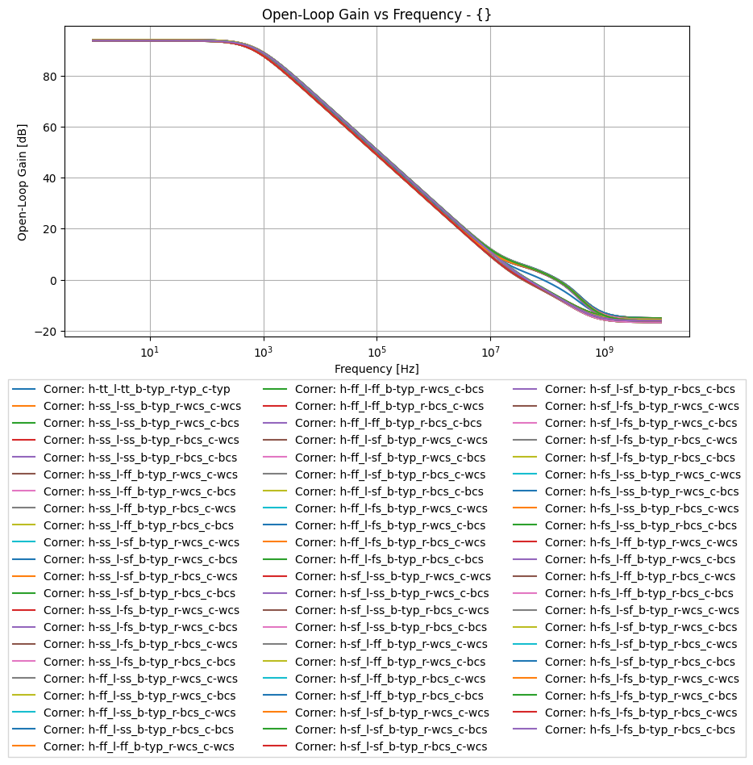
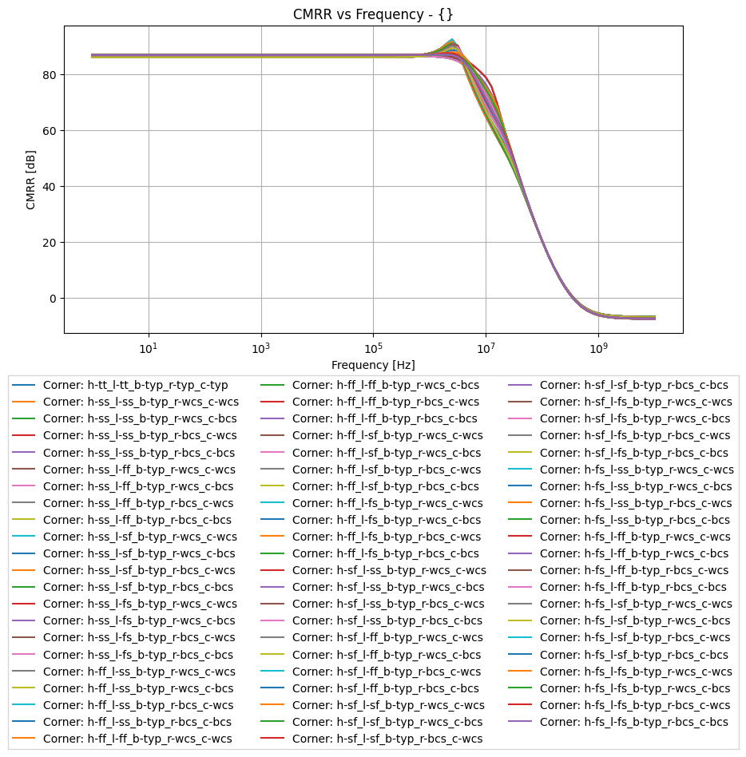
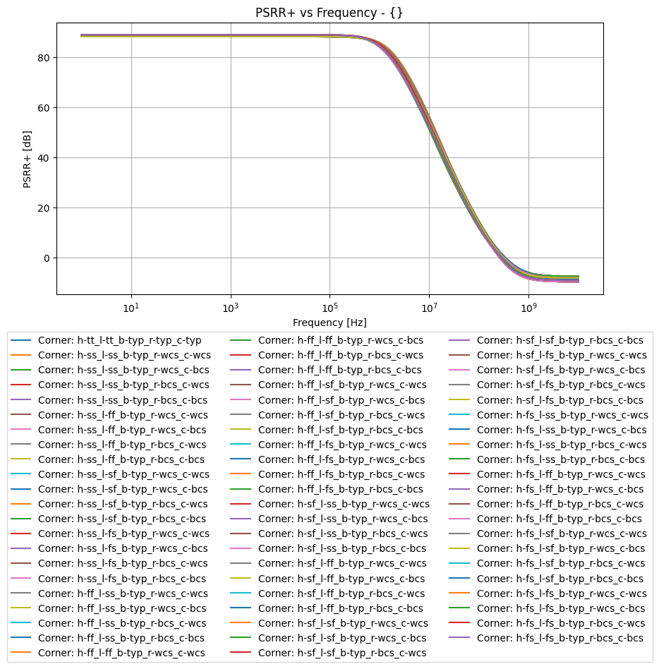
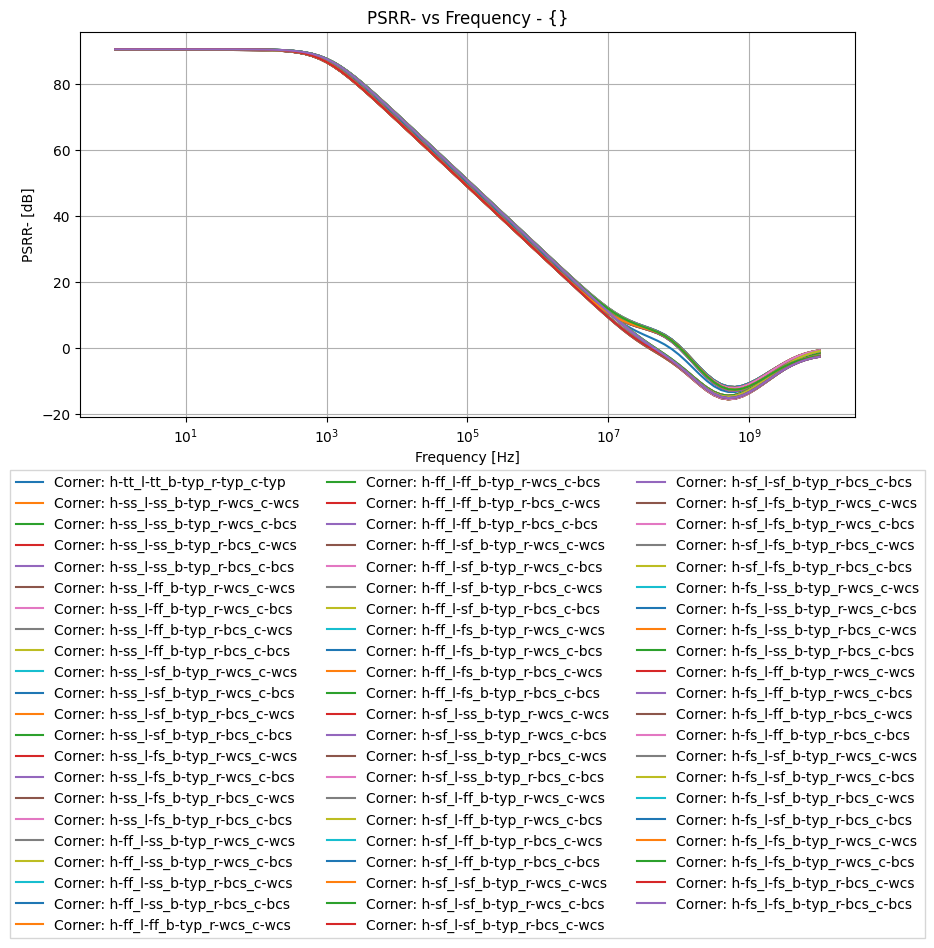
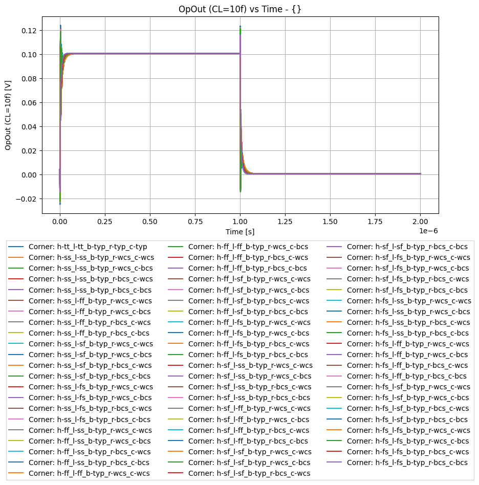
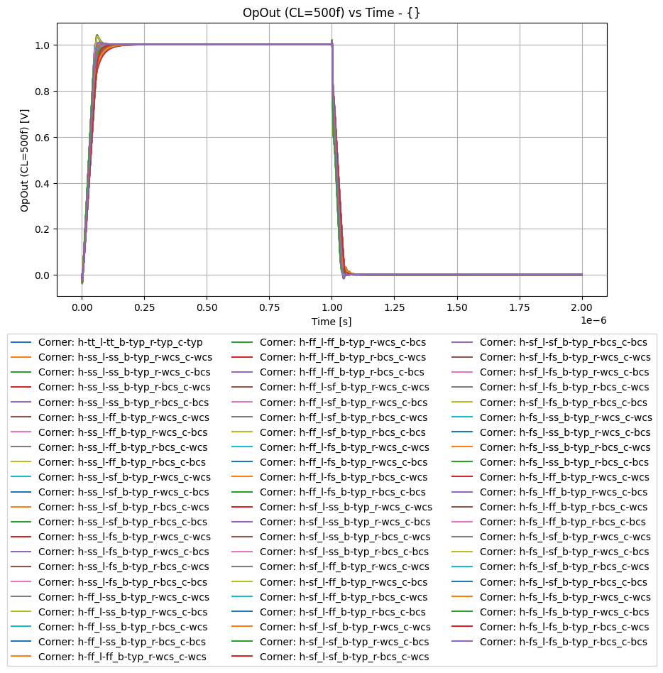
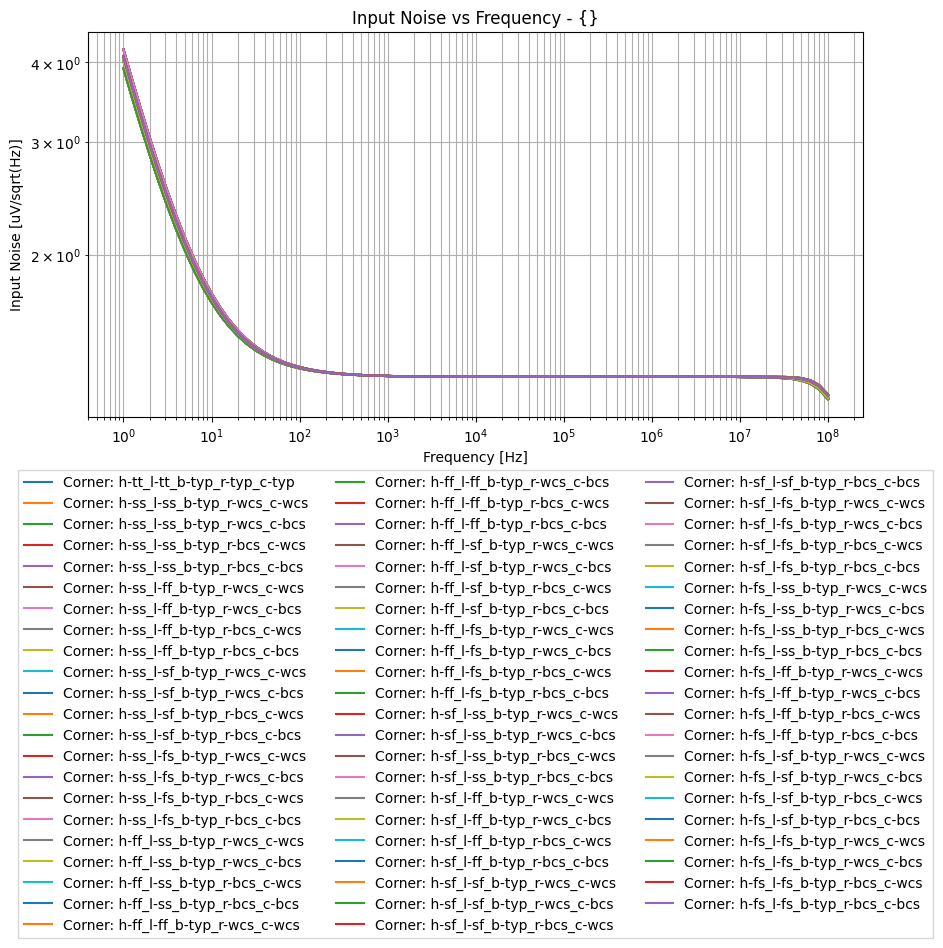

# AC Open-Loop Performance 

|  |
| :-- |
|  |

# AC Open-Loop Performance (Monte Carlo) 

| ,_('tt_typ_mismatch_mc',_-2)__26608f8b8d119360b4305fcdf2dd6a89.png "") |
| :-- |
|  |

| ,_('tt_typ_mismatch_mc',_-2)__26608f8b8d119360b4305fcdf2dd6a89.png "") |
| :-- |
|  |

| ,_('tt_typ_mismatch_mc',_-2)__26608f8b8d119360b4305fcdf2dd6a89.png "") |
| :-- |
|  |

| ,_('tt_typ_mismatch_mc',_-2)__26608f8b8d119360b4305fcdf2dd6a89.png "") |
| :-- |
|  |

# CMRR/PSRR Performance 

|  |
| :-- |
|  |

|  |
| :-- |
|  |

|  |
| :-- |
|  |

# CMRR/PSRR Performance (Monte Carlo) 

| ,_('tt_typ_mismatch_mc',_-2)__cefdfae308b77e5d161e2ed50957b407.png "") |
| :-- |
|  |

| ,_('tt_typ_mismatch_mc',_-2)__cefdfae308b77e5d161e2ed50957b407.png "") |
| :-- |
|  |

| ,_('tt_typ_mismatch_mc',_-2)__cefdfae308b77e5d161e2ed50957b407.png "") |
| :-- |
|  |

| ,_('tt_typ_mismatch_mc',_-2)__cefdfae308b77e5d161e2ed50957b407.png "") |
| :-- |
|  |

| ,_('tt_typ_mismatch_mc',_-2)__cefdfae308b77e5d161e2ed50957b407.png "") |
| :-- |
|  |

| ,_('tt_typ_mismatch_mc',_-2)__cefdfae308b77e5d161e2ed50957b407.png "") |
| :-- |
|  |

# Output Range Performance (Monte Carlo) 

| ,_('tt_typ_mismatch_mc',_-2)__1caa2ca035209559d5481d84b0ef6ab4.png "") |
| :-- |
|  |

| ,_('tt_typ_mismatch_mc',_-2)__1caa2ca035209559d5481d84b0ef6ab4.png "") |
| :-- |
|  |

# Input Range Performance (Monte Carlo) 

| ,_('tt_typ_mismatch_mc',_-2)__822be2f28a46b74434b056b38fc4deb0.png "") |
| :-- |
|  |

# Slew-Rate/Offset Performance 

|  |
| :-- |
|  |

|  |
| :-- |
|  |

# Slew-Rate/Offset Performance (Monte Carlo) 

| ,_('tt_typ_mismatch_mc',_-2)__d896591e5420b398e61253096aa48ab8.png "") |
| :-- |
|  |

| ,_('tt_typ_mismatch_mc',_-2)__d896591e5420b398e61253096aa48ab8.png "") |
| :-- |
|  |

| ,_('tt_typ_mismatch_mc',_-2)__d896591e5420b398e61253096aa48ab8.png "") |
| :-- |
|  |

# Noise Performance 

|  |
| :-- |
|  |

# THD Performance (Monte Carlo) 

| ,_('tt_typ_mismatch_mc',_-2)__fca0bc36e68017a09aa56a6785620c30.png "") |
| :-- |
|  |

