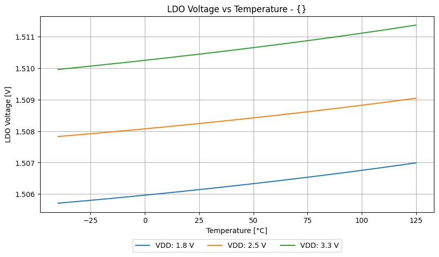
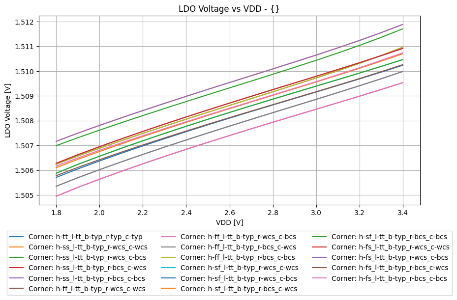
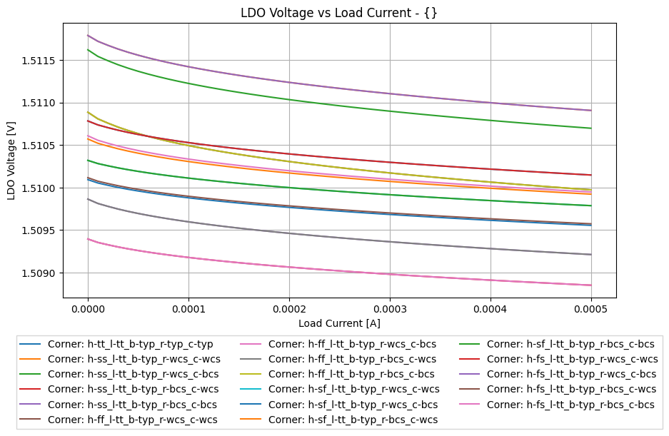
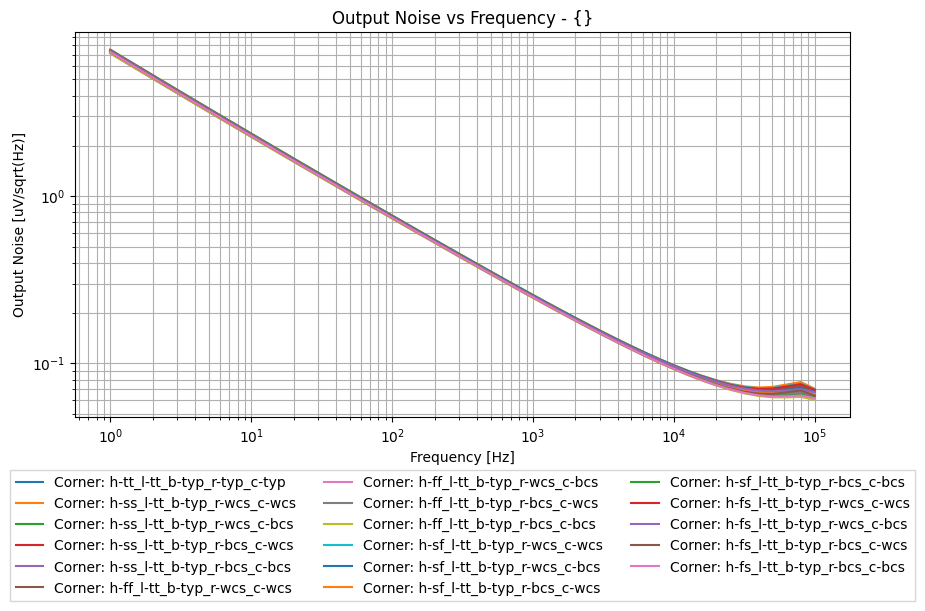
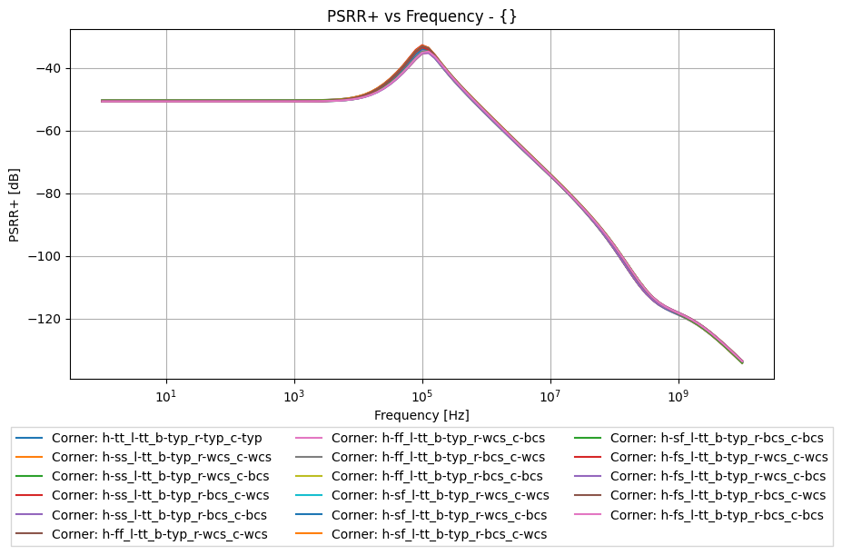
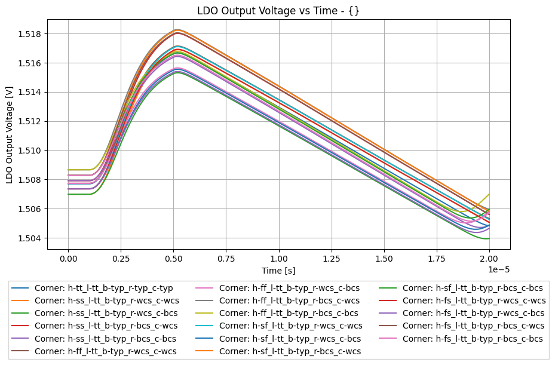
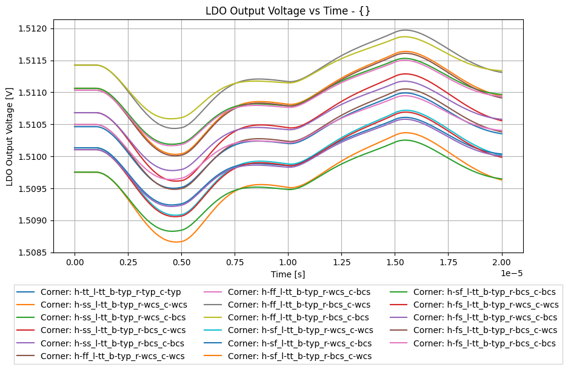

14.09.2025, 22:49:32

# 1.8 V LDO

1.8 V linear regulator.

 

[🔗 Schematics](ldo_sch.pdf) 

Show Tool Versions...

> xschem: 3.4.6 
> ngspice: 44.2 
> magic: 8.3.541 
> netgen: 1.5.293 
> ihpopenpdk: dev 

 

# LVS
LVS-state: Netlists match uniquely. 

[🔗 LVS-report](ldo_lvs_ldo_netgen_comp.out) 

# SPECIFICATIONS

## LDO Voltage Curvature vs Temperature  

| Parameter | Min (Spec. / Sim.) |      | Max (Sim. / Spec.) | Unit | Checks (total/pass/fail/NaN) | Comment |
| :-------- | -----------------: | :--: | :----------------- | :--- | :--------------------------- | ------- |
| Mean LDO Voltage | 1.4 / 1.506 | <svg height="20" width="150"><polyline points="3.0,3,3.0,17,147.0,17,147.0,3" style="fill:none;stroke:gray;stroke-width:1" /><polyline points="75.0,10.0,75.0,17" style="fill:none;stroke:gray;stroke-width:1" /><polyline points="78.99456000000006,10.0,83.33903999999997,10.0" style="stroke:green;stroke-width:2" /><circle cx="78.99456000000006" cy="10.0" r="3" style="fill:green;stroke:green;stroke-width:0" /><circle cx="83.33903999999997" cy="10.0" r="3" style="fill:green;stroke:green;stroke-width:0" /></svg> | 1.512 / 1.6 | V | 51/100.0%/0.0%/0.0% |  |
| LDO Voltage Curvature | 0.0 / 1.205 | <svg height="20" width="150"><polyline points="3.0,3,3.0,17,147.0,17,147.0,3" style="fill:none;stroke:gray;stroke-width:1" /><polyline points="75.0,10.0,75.0,17" style="fill:none;stroke:gray;stroke-width:1" /><polyline points="3.694119168,10.0,5.840404736,10.0" style="stroke:green;stroke-width:2" /><circle cx="3.694119168" cy="10.0" r="3" style="fill:green;stroke:green;stroke-width:0" /><circle cx="5.840404736" cy="10.0" r="3" style="fill:green;stroke:green;stroke-width:0" /></svg> | 1.459 / 250.0 | mV | 51/100.0%/0.0%/0.0% |  |
| LDO Voltage at 20°C | 1.4 / 1.505 | <svg height="20" width="150"><polyline points="3.0,3,3.0,17,147.0,17,147.0,3" style="fill:none;stroke:gray;stroke-width:1" /><polyline points="75.0,10.0,75.0,17" style="fill:none;stroke:gray;stroke-width:1" /><polyline points="78.85415999999995,10.0,83.18423999999992,10.0" style="stroke:green;stroke-width:2" /><circle cx="78.85415999999995" cy="10.0" r="3" style="fill:green;stroke:green;stroke-width:0" /><circle cx="83.18423999999992" cy="10.0" r="3" style="fill:green;stroke:green;stroke-width:0" /></svg> | 1.511 / 1.6 | V | 51/100.0%/0.0%/0.0% |  |
| LDO Voltage Sensitivity at 20°C | -50.0 / 6.793 | <svg height="20" width="150"><polyline points="3.0,3,3.0,17,147.0,17,147.0,3" style="fill:none;stroke:gray;stroke-width:1" /><polyline points="75.0,10.0,75.0,17" style="fill:none;stroke:gray;stroke-width:1" /><polyline points="82.7823376,10.0,86.76347664000001,10.0" style="stroke:green;stroke-width:2" /><circle cx="82.7823376" cy="10.0" r="3" style="fill:green;stroke:green;stroke-width:0" /><circle cx="86.76347664000001" cy="10.0" r="3" style="fill:green;stroke:green;stroke-width:0" /></svg> | 8.169 / 50.0 | uV/°C | 51/100.0%/0.0%/0.0% |  |

 

## LDO Voltage Curvature vs Temperature (Monte Carlo)  

| Parameter | Min (Spec. / Sim.) |      | Max (Sim. / Spec.) | Unit | Checks (total/pass/fail/NaN) | Comment |
| :-------- | -----------------: | :--: | :----------------- | :--- | :--------------------------- | ------- |
| Mean LDO Voltage | 1.4 / 1.491 | <svg height="20" width="150"><polyline points="3.0,3,3.0,17,147.0,17,147.0,3" style="fill:none;stroke:gray;stroke-width:1" /><polyline points="75.0,10.0,75.0,17" style="fill:none;stroke:gray;stroke-width:1" /><polyline points="68.76983999999999,10.0,98.15951999999992,10.0" style="stroke:green;stroke-width:2" /><circle cx="68.76983999999999" cy="10.0" r="3" style="fill:green;stroke:green;stroke-width:0" /><circle cx="98.15951999999992" cy="10.0" r="3" style="fill:green;stroke:green;stroke-width:0" /></svg> | 1.532 / 1.6 | V | 200/100.0%/0.0%/0.0% |  |
| LDO Voltage Curvature | 0.0 / 0.063 | <svg height="20" width="150"><polyline points="3.0,3,3.0,17,147.0,17,147.0,3" style="fill:none;stroke:gray;stroke-width:1" /><polyline points="75.0,10.0,75.0,17" style="fill:none;stroke:gray;stroke-width:1" /><polyline points="3.03639633408,10.0,6.586285568,10.0" style="stroke:green;stroke-width:2" /><circle cx="3.03639633408" cy="10.0" r="3" style="fill:green;stroke:green;stroke-width:0" /><circle cx="6.586285568" cy="10.0" r="3" style="fill:green;stroke:green;stroke-width:0" /></svg> | 2.754 / 250.0 | mV | 200/100.0%/0.0%/0.0% |  |
| LDO Voltage at 20°C | 1.4 / 1.491 | <svg height="20" width="150"><polyline points="3.0,3,3.0,17,147.0,17,147.0,3" style="fill:none;stroke:gray;stroke-width:1" /><polyline points="75.0,10.0,75.0,17" style="fill:none;stroke:gray;stroke-width:1" /><polyline points="68.70431999999994,10.0,97.98455999999992,10.0" style="stroke:green;stroke-width:2" /><circle cx="68.70431999999994" cy="10.0" r="3" style="fill:green;stroke:green;stroke-width:0" /><circle cx="97.98455999999992" cy="10.0" r="3" style="fill:green;stroke:green;stroke-width:0" /></svg> | 1.532 / 1.6 | V | 200/100.0%/0.0%/0.0% |  |
| LDO Voltage Sensitivity at 20°C | -50.0 / -2.025 | <svg height="20" width="150"><polyline points="3.0,3,3.0,17,147.0,17,147.0,3" style="fill:none;stroke:gray;stroke-width:1" /><polyline points="75.0,10.0,75.0,17" style="fill:none;stroke:gray;stroke-width:1" /><polyline points="72.0841872,10.0,98.4311184,10.0" style="stroke:green;stroke-width:2" /><circle cx="72.0841872" cy="10.0" r="3" style="fill:green;stroke:green;stroke-width:0" /><circle cx="98.4311184" cy="10.0" r="3" style="fill:green;stroke:green;stroke-width:0" /></svg> | 16.272 / 50.0 | uV/°C | 200/100.0%/0.0%/0.0% |  |

 

## LDO Voltage Curvature vs VDD  

| Parameter | Min (Spec. / Sim.) |      | Max (Sim. / Spec.) | Unit | Checks (total/pass/fail/NaN) | Comment |
| :-------- | -----------------: | :--: | :----------------- | :--- | :--------------------------- | ------- |
| Mean LDO Voltage | 1.4 / 1.507 | <svg height="20" width="150"><polyline points="3.0,3,3.0,17,147.0,17,147.0,3" style="fill:none;stroke:gray;stroke-width:1" /><polyline points="75.0,10.0,75.0,17" style="fill:none;stroke:gray;stroke-width:1" /><polyline points="80.28552000000002,10.0,82.41599999999997,10.0" style="stroke:green;stroke-width:2" /><circle cx="80.28552000000002" cy="10.0" r="3" style="fill:green;stroke:green;stroke-width:0" /><circle cx="82.41599999999997" cy="10.0" r="3" style="fill:green;stroke:green;stroke-width:0" /></svg> | 1.51 / 1.6 | V | 51/100.0%/0.0%/0.0% |  |
| LDO Voltage Curvature | 0.0 / 4.479 | <svg height="20" width="150"><polyline points="3.0,3,3.0,17,147.0,17,147.0,3" style="fill:none;stroke:gray;stroke-width:1" /><polyline points="75.0,10.0,75.0,17" style="fill:none;stroke:gray;stroke-width:1" /><polyline points="5.57981472,10.0,7.734383168,10.0" style="stroke:green;stroke-width:2" /><circle cx="5.57981472" cy="10.0" r="3" style="fill:green;stroke:green;stroke-width:0" /><circle cx="7.734383168" cy="10.0" r="3" style="fill:green;stroke:green;stroke-width:0" /></svg> | 4.747 / 250.0 | mV | 51/100.0%/0.0%/0.0% |  |
| LDO Voltage at 3.3V | 1.4 / 1.509 | <svg height="20" width="150"><polyline points="3.0,3,3.0,17,147.0,17,147.0,3" style="fill:none;stroke:gray;stroke-width:1" /><polyline points="75.0,10.0,75.0,17" style="fill:none;stroke:gray;stroke-width:1" /><polyline points="81.66504000000005,10.0,83.89271999999998,10.0" style="stroke:green;stroke-width:2" /><circle cx="81.66504000000005" cy="10.0" r="3" style="fill:green;stroke:green;stroke-width:0" /><circle cx="83.89271999999998" cy="10.0" r="3" style="fill:green;stroke:green;stroke-width:0" /></svg> | 1.512 / 1.6 | V | 51/100.0%/0.0%/0.0% |  |
| LDO Voltage Sensitivity at 3.3V | -10.0 / 2.719 | <svg height="20" width="150"><polyline points="3.0,3,3.0,17,147.0,17,147.0,3" style="fill:none;stroke:gray;stroke-width:1" /><polyline points="75.0,10.0,75.0,17" style="fill:none;stroke:gray;stroke-width:1" /><polyline points="94.577016,10.0,100.041672,10.0" style="stroke:green;stroke-width:2" /><circle cx="94.577016" cy="10.0" r="3" style="fill:green;stroke:green;stroke-width:0" /><circle cx="100.041672" cy="10.0" r="3" style="fill:green;stroke:green;stroke-width:0" /></svg> | 3.478 / 10.0 | mV/V | 51/100.0%/0.0%/0.0% |  |

 

## LDO Voltage Curvature vs VDD (Monte Carlo)  

| Parameter | Min (Spec. / Sim.) |      | Max (Sim. / Spec.) | Unit | Checks (total/pass/fail/NaN) | Comment |
| :-------- | -----------------: | :--: | :----------------- | :--- | :--------------------------- | ------- |
| Mean LDO Voltage | 1.4 / 1.491 | <svg height="20" width="150"><polyline points="3.0,3,3.0,17,147.0,17,147.0,3" style="fill:none;stroke:gray;stroke-width:1" /><polyline points="75.0,10.0,75.0,17" style="fill:none;stroke:gray;stroke-width:1" /><polyline points="68.27952000000003,10.0,99.46919999999993,10.0" style="stroke:green;stroke-width:2" /><circle cx="68.27952000000003" cy="10.0" r="3" style="fill:green;stroke:green;stroke-width:0" /><circle cx="99.46919999999993" cy="10.0" r="3" style="fill:green;stroke:green;stroke-width:0" /></svg> | 1.534 / 1.6 | V | 200/100.0%/0.0%/0.0% |  |
| LDO Voltage Curvature | 0.0 / 4.49 | <svg height="20" width="150"><polyline points="3.0,3,3.0,17,147.0,17,147.0,3" style="fill:none;stroke:gray;stroke-width:1" /><polyline points="75.0,10.0,75.0,17" style="fill:none;stroke:gray;stroke-width:1" /><polyline points="5.586207168,10.0,7.759812416,10.0" style="stroke:green;stroke-width:2" /><circle cx="5.586207168" cy="10.0" r="3" style="fill:green;stroke:green;stroke-width:0" /><circle cx="7.759812416" cy="10.0" r="3" style="fill:green;stroke:green;stroke-width:0" /></svg> | 4.791 / 250.0 | mV | 200/100.0%/0.0%/0.0% |  |
| LDO Voltage at 3.3V | 1.4 / 1.493 | <svg height="20" width="150"><polyline points="3.0,3,3.0,17,147.0,17,147.0,3" style="fill:none;stroke:gray;stroke-width:1" /><polyline points="75.0,10.0,75.0,17" style="fill:none;stroke:gray;stroke-width:1" /><polyline points="69.68208000000008,10.0,100.8803999999999,10.0" style="stroke:green;stroke-width:2" /><circle cx="69.68208000000008" cy="10.0" r="3" style="fill:green;stroke:green;stroke-width:0" /><circle cx="100.8803999999999" cy="10.0" r="3" style="fill:green;stroke:green;stroke-width:0" /></svg> | 1.536 / 1.6 | V | 200/100.0%/0.0%/0.0% |  |
| LDO Voltage Sensitivity at 3.3V | -10.0 / 2.894 | <svg height="20" width="150"><polyline points="3.0,3,3.0,17,147.0,17,147.0,3" style="fill:none;stroke:gray;stroke-width:1" /><polyline points="75.0,10.0,75.0,17" style="fill:none;stroke:gray;stroke-width:1" /><polyline points="93.8370448,10.0,96.7229112,10.0" style="stroke:green;stroke-width:2" /><circle cx="93.8370448" cy="10.0" r="3" style="fill:green;stroke:green;stroke-width:0" /><circle cx="96.7229112" cy="10.0" r="3" style="fill:green;stroke:green;stroke-width:0" /></svg> | 3.017 / 10.0 | mV/V | 200/100.0%/0.0%/0.0% |  |

 

## LDO Voltage Curvature vs Load  

| Parameter | Min (Spec. / Sim.) |      | Max (Sim. / Spec.) | Unit | Checks (total/pass/fail/NaN) | Comment |
| :-------- | -----------------: | :--: | :----------------- | :--- | :--------------------------- | ------- |
| Mean LDO Voltage | 1.4 / 1.509 | <svg height="20" width="150"><polyline points="3.0,3,3.0,17,147.0,17,147.0,3" style="fill:none;stroke:gray;stroke-width:1" /><polyline points="75.0,10.0,75.0,17" style="fill:none;stroke:gray;stroke-width:1" /><polyline points="81.51384000000002,10.0,83.64071999999993,10.0" style="stroke:green;stroke-width:2" /><circle cx="81.51384000000002" cy="10.0" r="3" style="fill:green;stroke:green;stroke-width:0" /><circle cx="83.64071999999993" cy="10.0" r="3" style="fill:green;stroke:green;stroke-width:0" /></svg> | 1.512 / 1.6 | V | 51/100.0%/0.0%/0.0% |  |
| LDO Voltage Curvature | 0.0 / 0.53 | <svg height="20" width="150"><polyline points="3.0,3,3.0,17,147.0,17,147.0,3" style="fill:none;stroke:gray;stroke-width:1" /><polyline points="75.0,10.0,75.0,17" style="fill:none;stroke:gray;stroke-width:1" /><polyline points="3.3052113984,10.0,5.5565263616,10.0" style="stroke:green;stroke-width:2" /><circle cx="3.3052113984" cy="10.0" r="3" style="fill:green;stroke:green;stroke-width:0" /><circle cx="5.5565263616" cy="10.0" r="3" style="fill:green;stroke:green;stroke-width:0" /></svg> | 0.966 / 250.0 | mV | 51/100.0%/0.0%/0.0% |  |
| LDO Voltage at 100uA | 1.4 / 1.509 | <svg height="20" width="150"><polyline points="3.0,3,3.0,17,147.0,17,147.0,3" style="fill:none;stroke:gray;stroke-width:1" /><polyline points="75.0,10.0,75.0,17" style="fill:none;stroke:gray;stroke-width:1" /><polyline points="81.60815999999993,10.0,83.79480000000005,10.0" style="stroke:green;stroke-width:2" /><circle cx="81.60815999999993" cy="10.0" r="3" style="fill:green;stroke:green;stroke-width:0" /><circle cx="83.79480000000005" cy="10.0" r="3" style="fill:green;stroke:green;stroke-width:0" /></svg> | 1.512 / 1.6 | V | 51/100.0%/0.0%/0.0% |  |
| LDO Voltage Sensitivity at 100uA | -10 / -2.501 | <svg height="20" width="150"><polyline points="3.0,3,3.0,17,147.0,17,147.0,3" style="fill:none;stroke:gray;stroke-width:1" /><polyline points="75.0,10.0,75.0,17" style="fill:none;stroke:gray;stroke-width:1" /><polyline points="56.990856,10.0,65.21952,10.0" style="stroke:green;stroke-width:2" /><circle cx="56.990856" cy="10.0" r="3" style="fill:green;stroke:green;stroke-width:0" /><circle cx="65.21952" cy="10.0" r="3" style="fill:green;stroke:green;stroke-width:0" /></svg> | -1.358 / 10 | V/A | 51/100.0%/0.0%/0.0% |  |

 

## LDO Voltage Curvature vs Load (Monte Carlo)  

| Parameter | Min (Spec. / Sim.) |      | Max (Sim. / Spec.) | Unit | Checks (total/pass/fail/NaN) | Comment |
| :-------- | -----------------: | :--: | :----------------- | :--- | :--------------------------- | ------- |
| Mean LDO Voltage | 1.4 / 1.489 | <svg height="20" width="150"><polyline points="3.0,3,3.0,17,147.0,17,147.0,3" style="fill:none;stroke:gray;stroke-width:1" /><polyline points="75.0,10.0,75.0,17" style="fill:none;stroke:gray;stroke-width:1" /><polyline points="67.42416000000006,10.0,95.47535999999995,10.0" style="stroke:green;stroke-width:2" /><circle cx="67.42416000000006" cy="10.0" r="3" style="fill:green;stroke:green;stroke-width:0" /><circle cx="95.47535999999995" cy="10.0" r="3" style="fill:green;stroke:green;stroke-width:0" /></svg> | 1.528 / 1.6 | V | 200/100.0%/0.0%/0.0% |  |
| LDO Voltage Curvature | 0.0 / 0.638 | <svg height="20" width="150"><polyline points="3.0,3,3.0,17,147.0,17,147.0,3" style="fill:none;stroke:gray;stroke-width:1" /><polyline points="75.0,10.0,75.0,17" style="fill:none;stroke:gray;stroke-width:1" /><polyline points="3.3675091968,10.0,5.3808956672,10.0" style="stroke:green;stroke-width:2" /><circle cx="3.3675091968" cy="10.0" r="3" style="fill:green;stroke:green;stroke-width:0" /><circle cx="5.3808956672" cy="10.0" r="3" style="fill:green;stroke:green;stroke-width:0" /></svg> | 0.661 / 250.0 | mV | 200/100.0%/0.0%/0.0% |  |
| LDO Voltage at 100uA | 1.4 / 1.49 | <svg height="20" width="150"><polyline points="3.0,3,3.0,17,147.0,17,147.0,3" style="fill:none;stroke:gray;stroke-width:1" /><polyline points="75.0,10.0,75.0,17" style="fill:none;stroke:gray;stroke-width:1" /><polyline points="67.5336,10.0,95.58696000000005,10.0" style="stroke:green;stroke-width:2" /><circle cx="67.5336" cy="10.0" r="3" style="fill:green;stroke:green;stroke-width:0" /><circle cx="95.58696000000005" cy="10.0" r="3" style="fill:green;stroke:green;stroke-width:0" /></svg> | 1.529 / 1.6 | V | 200/100.0%/0.0%/0.0% |  |
| LDO Voltage Sensitivity at 100uA | -10 / -1.699 | <svg height="20" width="150"><polyline points="3.0,3,3.0,17,147.0,17,147.0,3" style="fill:none;stroke:gray;stroke-width:1" /><polyline points="75.0,10.0,75.0,17" style="fill:none;stroke:gray;stroke-width:1" /><polyline points="62.770439999999994,10.0,65.16816800000001,10.0" style="stroke:green;stroke-width:2" /><circle cx="62.770439999999994" cy="10.0" r="3" style="fill:green;stroke:green;stroke-width:0" /><circle cx="65.16816800000001" cy="10.0" r="3" style="fill:green;stroke:green;stroke-width:0" /></svg> | -1.643 / 10 | V/A | 200/100.0%/0.0%/0.0% |  |

 

## LDO Voltage Noise Specification  

| Parameter | Min (Spec. / Sim.) |      | Max (Sim. / Spec.) | Unit | Checks (total/pass/fail/NaN) | Comment |
| :-------- | -----------------: | :--: | :----------------- | :--- | :--------------------------- | ------- |
| Output Noise at 10 Hz | 0.0 / 2.267 | <svg height="20" width="150"><polyline points="3.0,3,3.0,17,147.0,17,147.0,3" style="fill:none;stroke:gray;stroke-width:1" /><polyline points="75.0,10.0,75.0,17" style="fill:none;stroke:gray;stroke-width:1" /><polyline points="9.527666880000002,10.0,11.8287824,10.0" style="stroke:green;stroke-width:2" /><circle cx="9.527666880000002" cy="10.0" r="3" style="fill:green;stroke:green;stroke-width:0" /><circle cx="11.8287824" cy="10.0" r="3" style="fill:green;stroke:green;stroke-width:0" /></svg> | 2.371 / 50.0 | uV/sqrt(Hz) | 17/100.0%/0.0%/0.0% |  |
| Output Noise at 10 kHz | 0.0 / 0.092 | <svg height="20" width="150"><polyline points="3.0,3,3.0,17,147.0,17,147.0,3" style="fill:none;stroke:gray;stroke-width:1" /><polyline points="75.0,10.0,75.0,17" style="fill:none;stroke:gray;stroke-width:1" /><polyline points="3.5313746304,10.0,5.561609216,10.0" style="stroke:green;stroke-width:2" /><circle cx="3.5313746304" cy="10.0" r="3" style="fill:green;stroke:green;stroke-width:0" /><circle cx="5.561609216" cy="10.0" r="3" style="fill:green;stroke:green;stroke-width:0" /></svg> | 0.098 / 25.0 | uV/sqrt(Hz) | 17/100.0%/0.0%/0.0% |  |

 

## PSRR+ Specification  

| Parameter | Min (Spec. / Sim.) |      | Max (Sim. / Spec.) | Unit | Checks (total/pass/fail/NaN) | Comment |
| :-------- | -----------------: | :--: | :----------------- | :--- | :--------------------------- | ------- |
| PSRR+ at 10 Hz | -80 / -50.714 | <svg height="20" width="150"><polyline points="3.0,3,3.0,17,147.0,17,147.0,3" style="fill:none;stroke:gray;stroke-width:1" /><polyline points="75.0,10.0,75.0,17" style="fill:none;stroke:gray;stroke-width:1" /><polyline points="106.42888,10.0,109.84944,10.0" style="stroke:green;stroke-width:2" /><circle cx="106.42888" cy="10.0" r="3" style="fill:green;stroke:green;stroke-width:0" /><circle cx="109.84944" cy="10.0" r="3" style="fill:green;stroke:green;stroke-width:0" /></svg> | -50.32 / -40 | dB | 17/100.0%/0.0%/0.0% |  |
| PSRR+ at 10 MHz | -100 / -74.47 | <svg height="20" width="150"><polyline points="3.0,3,3.0,17,147.0,17,147.0,3" style="fill:none;stroke:gray;stroke-width:1" /><polyline points="75.0,10.0,75.0,17" style="fill:none;stroke:gray;stroke-width:1" /><polyline points="33.63575999999999,10.0,36.47144,10.0" style="stroke:green;stroke-width:2" /><circle cx="33.63575999999999" cy="10.0" r="3" style="fill:green;stroke:green;stroke-width:0" /><circle cx="36.47144" cy="10.0" r="3" style="fill:green;stroke:green;stroke-width:0" /></svg> | -73.774 / 20 | dB | 17/100.0%/0.0%/0.0% |  |

 

## PSRR+ Specification (Monte Carlo)  

| Parameter | Min (Spec. / Sim.) |      | Max (Sim. / Spec.) | Unit | Checks (total/pass/fail/NaN) | Comment |
| :-------- | -----------------: | :--: | :----------------- | :--- | :--------------------------- | ------- |
| PSRR+ at 10 Hz | -120 / -50.71 | <svg height="20" width="150"><polyline points="3.0,3,3.0,17,147.0,17,147.0,3" style="fill:none;stroke:gray;stroke-width:1" /><polyline points="75.0,10.0,75.0,17" style="fill:none;stroke:gray;stroke-width:1" /><polyline points="77.75233230769231,10.0,80.13648,10.0" style="stroke:green;stroke-width:2" /><circle cx="77.75233230769231" cy="10.0" r="3" style="fill:green;stroke:green;stroke-width:0" /><circle cx="80.13648" cy="10.0" r="3" style="fill:green;stroke:green;stroke-width:0" /></svg> | -50.363 / 10 | dB | 200/100.0%/0.0%/0.0% |  |
| PSRR+ at 10 MHz | -100 / -74.344 | <svg height="20" width="150"><polyline points="3.0,3,3.0,17,147.0,17,147.0,3" style="fill:none;stroke:gray;stroke-width:1" /><polyline points="75.0,10.0,75.0,17" style="fill:none;stroke:gray;stroke-width:1" /><polyline points="33.78768000000001,10.0,36.31496,10.0" style="stroke:green;stroke-width:2" /><circle cx="33.78768000000001" cy="10.0" r="3" style="fill:green;stroke:green;stroke-width:0" /><circle cx="36.31496" cy="10.0" r="3" style="fill:green;stroke:green;stroke-width:0" /></svg> | -73.904 / 20 | dB | 200/100.0%/0.0%/0.0% |  |

 

## Line Transient Specification  

| Parameter | Min (Spec. / Sim.) |      | Max (Sim. / Spec.) | Unit | Checks (total/pass/fail/NaN) | Comment |
| :-------- | -----------------: | :--: | :----------------- | :--- | :--------------------------- | ------- |
| Output Ripple | 0.0 / 10.626 | <svg height="20" width="150"><polyline points="3.0,3,3.0,17,147.0,17,147.0,3" style="fill:none;stroke:gray;stroke-width:1" /><polyline points="75.0,10.0,75.0,17" style="fill:none;stroke:gray;stroke-width:1" /><polyline points="33.6036864,10.0,38.805484799999995,10.0" style="stroke:green;stroke-width:2" /><circle cx="33.6036864" cy="10.0" r="3" style="fill:green;stroke:green;stroke-width:0" /><circle cx="38.805484799999995" cy="10.0" r="3" style="fill:green;stroke:green;stroke-width:0" /></svg> | 12.432 / 50.0 | mV | 17/100.0%/0.0%/0.0% | Ripple from 1V Input Voltage Step |

 

## Line Transient Specification (Monte Carlo)  

| Parameter | Min (Spec. / Sim.) |      | Max (Sim. / Spec.) | Unit | Checks (total/pass/fail/NaN) | Comment |
| :-------- | -----------------: | :--: | :----------------- | :--- | :--------------------------- | ------- |
| Output Ripple | 0.0 / 11.322 | <svg height="20" width="150"><polyline points="3.0,3,3.0,17,147.0,17,147.0,3" style="fill:none;stroke:gray;stroke-width:1" /><polyline points="75.0,10.0,75.0,17" style="fill:none;stroke:gray;stroke-width:1" /><polyline points="35.6076192,10.0,38.3527488,10.0" style="stroke:green;stroke-width:2" /><circle cx="35.6076192" cy="10.0" r="3" style="fill:green;stroke:green;stroke-width:0" /><circle cx="38.3527488" cy="10.0" r="3" style="fill:green;stroke:green;stroke-width:0" /></svg> | 12.275 / 50.0 | mV | 200/100.0%/0.0%/0.0% | Ripple from 1V Input Voltage Step |

 

## Load Transient Specification  

| Parameter | Min (Spec. / Sim.) |      | Max (Sim. / Spec.) | Unit | Checks (total/pass/fail/NaN) | Comment |
| :-------- | -----------------: | :--: | :----------------- | :--- | :--------------------------- | ------- |
| Output Ripple | 0.0 / 1.282 | <svg height="20" width="150"><polyline points="3.0,3,3.0,17,147.0,17,147.0,3" style="fill:none;stroke:gray;stroke-width:1" /><polyline points="75.0,10.0,75.0,17" style="fill:none;stroke:gray;stroke-width:1" /><polyline points="6.692903040000001,10.0,9.91976576,10.0" style="stroke:green;stroke-width:2" /><circle cx="6.692903040000001" cy="10.0" r="3" style="fill:green;stroke:green;stroke-width:0" /><circle cx="9.91976576" cy="10.0" r="3" style="fill:green;stroke:green;stroke-width:0" /></svg> | 1.708 / 50.0 | mV | 17/100.0%/0.0%/0.0% | Ripple from 50->250 uA Load Step |

 

## Load Transient Specification (Monte Carlo)  

| Parameter | Min (Spec. / Sim.) |      | Max (Sim. / Spec.) | Unit | Checks (total/pass/fail/NaN) | Comment |
| :-------- | -----------------: | :--: | :----------------- | :--- | :--------------------------- | ------- |
| Output Ripple | 0.0 / 1.356 | <svg height="20" width="150"><polyline points="3.0,3,3.0,17,147.0,17,147.0,3" style="fill:none;stroke:gray;stroke-width:1" /><polyline points="75.0,10.0,75.0,17" style="fill:none;stroke:gray;stroke-width:1" /><polyline points="6.90446208,10.0,9.71141792,10.0" style="stroke:green;stroke-width:2" /><circle cx="6.90446208" cy="10.0" r="3" style="fill:green;stroke:green;stroke-width:0" /><circle cx="9.71141792" cy="10.0" r="3" style="fill:green;stroke:green;stroke-width:0" /></svg> | 1.636 / 50.0 | mV | 200/100.0%/0.0%/0.0% | Ripple from 50->250 uA Load Step |

 

## AC Loopgain PM Specification  

| Parameter | Min (Spec. / Sim.) |      | Max (Sim. / Spec.) | Unit | Checks (total/pass/fail/NaN) | Comment |
| :-------- | -----------------: | :--: | :----------------- | :--- | :--------------------------- | ------- |
| Loopgain PM | 45 / 43.379 | <svg height="20" width="150"><polyline points="4.708134790800219,3,4.708134790800219,17,147.0,17,147.0,3" style="fill:none;stroke:gray;stroke-width:1" /><polyline points="75.85406739540011,10.0,75.85406739540011,17" style="fill:none;stroke:gray;stroke-width:1" /><polyline points="3.0,10.0,8.788749280855157,10.0" style="stroke:red;stroke-width:2" /><circle cx="3.0" cy="10.0" r="3" style="fill:red;stroke:red;stroke-width:0" /><circle cx="8.788749280855157" cy="10.0" r="3" style="fill:red;stroke:red;stroke-width:0" /></svg> | 48.872 / 180 | deg | 17/64.7059%/35.2941%/0.0% |  |

Show specification violation details...

> **FAIL:** Specification violation for parameter "Loopgain PM": 
> **FAIL:** group:h-ss_l-tt_b-typ_r-wcs_c-wcs file:work/sim/ldo/ldo_tb.8_ldo/batch_0/h-ss_l-tt_b-typ_r-wcs_c-wcs/ldo_ac_loop.csv Index:0  
> **FAIL:** group:h-ss_l-tt_b-typ_r-bcs_c-wcs file:work/sim/ldo/ldo_tb.8_ldo/batch_0/h-ss_l-tt_b-typ_r-bcs_c-wcs/ldo_ac_loop.csv Index:0  
> **FAIL:** group:h-sf_l-tt_b-typ_r-wcs_c-wcs file:work/sim/ldo/ldo_tb.8_ldo/batch_0/h-sf_l-tt_b-typ_r-wcs_c-wcs/ldo_ac_loop.csv Index:0  
> **FAIL:** group:h-sf_l-tt_b-typ_r-bcs_c-wcs file:work/sim/ldo/ldo_tb.8_ldo/batch_0/h-sf_l-tt_b-typ_r-bcs_c-wcs/ldo_ac_loop.csv Index:0  
> **FAIL:** group:h-fs_l-tt_b-typ_r-wcs_c-wcs file:work/sim/ldo/ldo_tb.8_ldo/batch_0/h-fs_l-tt_b-typ_r-wcs_c-wcs/ldo_ac_loop.csv Index:0  
> **FAIL:** group:h-fs_l-tt_b-typ_r-bcs_c-wcs file:work/sim/ldo/ldo_tb.8_ldo/batch_0/h-fs_l-tt_b-typ_r-bcs_c-wcs/ldo_ac_loop.csv Index:0  

 

## AC Loopgain PM Specification (Monte Carlo)  

| Parameter | Min (Spec. / Sim.) |      | Max (Sim. / Spec.) | Unit | Checks (total/pass/fail/NaN) | Comment |
| :-------- | -----------------: | :--: | :----------------- | :--- | :--------------------------- | ------- |
| Loopgain PM | 45 / 44.95 | <svg height="20" width="150"><polyline points="3.0538465240780295,3,3.0538465240780295,17,147.0,17,147.0,3" style="fill:none;stroke:gray;stroke-width:1" /><polyline points="75.026923262039,10.0,75.026923262039,17" style="fill:none;stroke:gray;stroke-width:1" /><polyline points="3.0,10.0,6.704748964276323,10.0" style="stroke:red;stroke-width:2" /><circle cx="3.0" cy="10.0" r="3" style="fill:red;stroke:red;stroke-width:0" /><circle cx="6.704748964276323" cy="10.0" r="3" style="fill:red;stroke:red;stroke-width:0" /></svg> | 46.548 / 180 | deg | 200/80.0%/20.0%/0.0% |  |

Show specification violation details...

> **FAIL:** Specification violation for parameter "Loopgain PM": 
> **FAIL:** group:tt_typ_stat_mc file:work/sim/ldo/ldo_tb.8_ldo/batch_4/tt_typ_stat_mc/ldo_ac_loop.csv Index:0  
> **FAIL:** group:tt_typ_stat_mc file:work/sim/ldo/ldo_tb.8_ldo/batch_4/tt_typ_stat_mc/ldo_ac_loop.csv Index:1  
> **FAIL:** group:tt_typ_stat_mc file:work/sim/ldo/ldo_tb.8_ldo/batch_4/tt_typ_stat_mc/ldo_ac_loop.csv Index:2  
> **FAIL:** group:tt_typ_stat_mc file:work/sim/ldo/ldo_tb.8_ldo/batch_4/tt_typ_stat_mc/ldo_ac_loop.csv Index:3  
> **FAIL:** group:tt_typ_stat_mc file:work/sim/ldo/ldo_tb.8_ldo/batch_4/tt_typ_stat_mc/ldo_ac_loop.csv Index:4  
> **FAIL:** group:tt_typ_stat_mc file:work/sim/ldo/ldo_tb.8_ldo/batch_4/tt_typ_stat_mc/ldo_ac_loop.csv Index:5  
> **FAIL:** group:tt_typ_stat_mc file:work/sim/ldo/ldo_tb.8_ldo/batch_4/tt_typ_stat_mc/ldo_ac_loop.csv Index:6  
> **FAIL:** group:tt_typ_stat_mc file:work/sim/ldo/ldo_tb.8_ldo/batch_4/tt_typ_stat_mc/ldo_ac_loop.csv Index:7  
> **FAIL:** group:tt_typ_stat_mc file:work/sim/ldo/ldo_tb.8_ldo/batch_4/tt_typ_stat_mc/ldo_ac_loop.csv Index:8  
> **FAIL:** group:tt_typ_stat_mc file:work/sim/ldo/ldo_tb.8_ldo/batch_4/tt_typ_stat_mc/ldo_ac_loop.csv Index:9  
> **FAIL:** group:tt_typ_stat_mc file:work/sim/ldo/ldo_tb.8_ldo/batch_4/tt_typ_stat_mc/ldo_ac_loop.csv Index:10  
> **FAIL:** group:tt_typ_stat_mc file:work/sim/ldo/ldo_tb.8_ldo/batch_4/tt_typ_stat_mc/ldo_ac_loop.csv Index:11  
> **FAIL:** group:tt_typ_stat_mc file:work/sim/ldo/ldo_tb.8_ldo/batch_4/tt_typ_stat_mc/ldo_ac_loop.csv Index:12  
> **FAIL:** group:tt_typ_stat_mc file:work/sim/ldo/ldo_tb.8_ldo/batch_4/tt_typ_stat_mc/ldo_ac_loop.csv Index:13  
> **FAIL:** group:tt_typ_stat_mc file:work/sim/ldo/ldo_tb.8_ldo/batch_4/tt_typ_stat_mc/ldo_ac_loop.csv Index:14  
> **FAIL:** group:tt_typ_stat_mc file:work/sim/ldo/ldo_tb.8_ldo/batch_4/tt_typ_stat_mc/ldo_ac_loop.csv Index:15  
> **FAIL:** group:tt_typ_stat_mc file:work/sim/ldo/ldo_tb.8_ldo/batch_4/tt_typ_stat_mc/ldo_ac_loop.csv Index:16  
> **FAIL:** group:tt_typ_stat_mc file:work/sim/ldo/ldo_tb.8_ldo/batch_4/tt_typ_stat_mc/ldo_ac_loop.csv Index:17  
> **FAIL:** group:tt_typ_stat_mc file:work/sim/ldo/ldo_tb.8_ldo/batch_4/tt_typ_stat_mc/ldo_ac_loop.csv Index:18  
> **FAIL:** group:tt_typ_stat_mc file:work/sim/ldo/ldo_tb.8_ldo/batch_4/tt_typ_stat_mc/ldo_ac_loop.csv Index:19  
> **FAIL:** group:tt_typ_mismatch_mc file:work/sim/ldo/ldo_tb.8_ldo/batch_0/tt_typ_mismatch_mc/ldo_ac_loop.csv Index:0  
> **FAIL:** group:tt_typ_mismatch_mc file:work/sim/ldo/ldo_tb.8_ldo/batch_0/tt_typ_mismatch_mc/ldo_ac_loop.csv Index:1  
> **FAIL:** group:tt_typ_mismatch_mc file:work/sim/ldo/ldo_tb.8_ldo/batch_0/tt_typ_mismatch_mc/ldo_ac_loop.csv Index:2  
> **FAIL:** group:tt_typ_mismatch_mc file:work/sim/ldo/ldo_tb.8_ldo/batch_0/tt_typ_mismatch_mc/ldo_ac_loop.csv Index:3  
> **FAIL:** group:tt_typ_mismatch_mc file:work/sim/ldo/ldo_tb.8_ldo/batch_0/tt_typ_mismatch_mc/ldo_ac_loop.csv Index:4  
> **FAIL:** group:tt_typ_mismatch_mc file:work/sim/ldo/ldo_tb.8_ldo/batch_0/tt_typ_mismatch_mc/ldo_ac_loop.csv Index:5  
> **FAIL:** group:tt_typ_mismatch_mc file:work/sim/ldo/ldo_tb.8_ldo/batch_0/tt_typ_mismatch_mc/ldo_ac_loop.csv Index:6  
> **FAIL:** group:tt_typ_mismatch_mc file:work/sim/ldo/ldo_tb.8_ldo/batch_0/tt_typ_mismatch_mc/ldo_ac_loop.csv Index:7  
> **FAIL:** group:tt_typ_mismatch_mc file:work/sim/ldo/ldo_tb.8_ldo/batch_0/tt_typ_mismatch_mc/ldo_ac_loop.csv Index:8  
> **FAIL:** group:tt_typ_mismatch_mc file:work/sim/ldo/ldo_tb.8_ldo/batch_0/tt_typ_mismatch_mc/ldo_ac_loop.csv Index:9  
> **FAIL:** group:tt_typ_mismatch_mc file:work/sim/ldo/ldo_tb.8_ldo/batch_0/tt_typ_mismatch_mc/ldo_ac_loop.csv Index:10  
> **FAIL:** group:tt_typ_mismatch_mc file:work/sim/ldo/ldo_tb.8_ldo/batch_0/tt_typ_mismatch_mc/ldo_ac_loop.csv Index:11  
> **FAIL:** group:tt_typ_mismatch_mc file:work/sim/ldo/ldo_tb.8_ldo/batch_0/tt_typ_mismatch_mc/ldo_ac_loop.csv Index:12  
> **FAIL:** group:tt_typ_mismatch_mc file:work/sim/ldo/ldo_tb.8_ldo/batch_0/tt_typ_mismatch_mc/ldo_ac_loop.csv Index:13  
> **FAIL:** group:tt_typ_mismatch_mc file:work/sim/ldo/ldo_tb.8_ldo/batch_0/tt_typ_mismatch_mc/ldo_ac_loop.csv Index:14  
> **FAIL:** group:tt_typ_mismatch_mc file:work/sim/ldo/ldo_tb.8_ldo/batch_0/tt_typ_mismatch_mc/ldo_ac_loop.csv Index:15  
> **FAIL:** group:tt_typ_mismatch_mc file:work/sim/ldo/ldo_tb.8_ldo/batch_0/tt_typ_mismatch_mc/ldo_ac_loop.csv Index:16  
> **FAIL:** group:tt_typ_mismatch_mc file:work/sim/ldo/ldo_tb.8_ldo/batch_0/tt_typ_mismatch_mc/ldo_ac_loop.csv Index:17  
> **FAIL:** group:tt_typ_mismatch_mc file:work/sim/ldo/ldo_tb.8_ldo/batch_0/tt_typ_mismatch_mc/ldo_ac_loop.csv Index:18  
> **FAIL:** group:tt_typ_mismatch_mc file:work/sim/ldo/ldo_tb.8_ldo/batch_0/tt_typ_mismatch_mc/ldo_ac_loop.csv Index:19  

 

## LDO Voltage Curvature vs Temperature [PEX] 

| Parameter | Min (Spec. / Sim.) |      | Max (Sim. / Spec.) | Unit | Checks (total/pass/fail/NaN) | Comment |
| :-------- | -----------------: | :--: | :----------------- | :--- | :--------------------------- | ------- |
| Mean LDO Voltage | 1.4 / 1.257 | <svg height="20" width="150"><polyline points="63.134499296752765,3,63.134499296752765,17,147.0,17,147.0,3" style="fill:none;stroke:gray;stroke-width:1" /><polyline points="105.06724964837639,10.0,105.06724964837639,17" style="fill:none;stroke:gray;stroke-width:1" /><polyline points="3.0,10.0,107.59202054704767,10.0" style="stroke:red;stroke-width:2" /><circle cx="3.0" cy="10.0" r="3" style="fill:red;stroke:red;stroke-width:0" /><circle cx="107.59202054704767" cy="10.0" r="3" style="fill:red;stroke:red;stroke-width:0" /></svg> | 1.506 / 1.6 | V | 51/96.0784%/3.9216%/0.0% |  |
| LDO Voltage Curvature | 0.0 / 1.298 | <svg height="20" width="150"><polyline points="3.0,3,3.0,17,147.0,17,147.0,3" style="fill:none;stroke:gray;stroke-width:1" /><polyline points="75.0,10.0,75.0,17" style="fill:none;stroke:gray;stroke-width:1" /><polyline points="3.747819072,10.0,145.8300864,10.0" style="stroke:green;stroke-width:2" /><circle cx="3.747819072" cy="10.0" r="3" style="fill:green;stroke:green;stroke-width:0" /><circle cx="145.8300864" cy="10.0" r="3" style="fill:green;stroke:green;stroke-width:0" /></svg> | 247.969 / 250.0 | mV | 51/100.0%/0.0%/0.0% |  |
| LDO Voltage at 20°C | 1.4 / 1.278 | <svg height="20" width="150"><polyline points="57.445533470981815,3,57.445533470981815,17,147.0,17,147.0,3" style="fill:none;stroke:gray;stroke-width:1" /><polyline points="102.22276673549091,10.0,102.22276673549091,17" style="fill:none;stroke:gray;stroke-width:1" /><polyline points="3.0,10.0,104.81357745217544,10.0" style="stroke:red;stroke-width:2" /><circle cx="3.0" cy="10.0" r="3" style="fill:red;stroke:red;stroke-width:0" /><circle cx="104.81357745217544" cy="10.0" r="3" style="fill:red;stroke:red;stroke-width:0" /></svg> | 1.506 / 1.6 | V | 51/94.1176%/5.8824%/0.0% |  |
| LDO Voltage Sensitivity at 20°C | -50.0 / -1156.39 | <svg height="20" width="150"><polyline points="135.06356153482707,3,135.06356153482707,17,147.0,17,147.0,3" style="fill:none;stroke:gray;stroke-width:1" /><polyline points="141.03178076741352,10.0,141.03178076741352,17" style="fill:none;stroke:gray;stroke-width:1" /><polyline points="3.0,10.0,142.11200708228685,10.0" style="stroke:red;stroke-width:2" /><circle cx="3.0" cy="10.0" r="3" style="fill:red;stroke:red;stroke-width:0" /><circle cx="142.11200708228685" cy="10.0" r="3" style="fill:red;stroke:red;stroke-width:0" /></svg> | 9.05 / 50.0 | uV/°C | 51/94.1176%/5.8824%/0.0% |  |

Show specification violation details...

> **FAIL:** Specification violation for parameter "Mean LDO Voltage": 
> **FAIL:** group:h-ss_l-tt_b-typ_r-wcs_c-bcs file:work/sim/ldo/ldo_tb.1_ldo_ext/batch_0/h-ss_l-tt_b-typ_r-wcs_c-bcs/ldo_tran_temp.csv Index:0  
> **FAIL:** group:h-ss_l-tt_b-typ_r-bcs_c-bcs file:work/sim/ldo/ldo_tb.1_ldo_ext/batch_0/h-ss_l-tt_b-typ_r-bcs_c-bcs/ldo_tran_temp.csv Index:0  

> **FAIL:** Specification violation for parameter "LDO Voltage at 20°C": 
> **FAIL:** group:h-ss_l-tt_b-typ_r-wcs_c-bcs file:work/sim/ldo/ldo_tb.1_ldo_ext/batch_0/h-ss_l-tt_b-typ_r-wcs_c-bcs/ldo_tran_temp.csv Index:0  
> **FAIL:** group:h-ss_l-tt_b-typ_r-bcs_c-wcs file:work/sim/ldo/ldo_tb.1_ldo_ext/batch_0/h-ss_l-tt_b-typ_r-bcs_c-wcs/ldo_tran_temp.csv Index:0  
> **FAIL:** group:h-ss_l-tt_b-typ_r-bcs_c-bcs file:work/sim/ldo/ldo_tb.1_ldo_ext/batch_0/h-ss_l-tt_b-typ_r-bcs_c-bcs/ldo_tran_temp.csv Index:0  

> **FAIL:** Specification violation for parameter "LDO Voltage Sensitivity at 20°C": 
> **FAIL:** group:h-ss_l-tt_b-typ_r-wcs_c-bcs file:work/sim/ldo/ldo_tb.1_ldo_ext/batch_0/h-ss_l-tt_b-typ_r-wcs_c-bcs/ldo_tran_temp.csv Index:0  
> **FAIL:** group:h-ss_l-tt_b-typ_r-bcs_c-wcs file:work/sim/ldo/ldo_tb.1_ldo_ext/batch_0/h-ss_l-tt_b-typ_r-bcs_c-wcs/ldo_tran_temp.csv Index:0  
> **FAIL:** group:h-ss_l-tt_b-typ_r-bcs_c-bcs file:work/sim/ldo/ldo_tb.1_ldo_ext/batch_0/h-ss_l-tt_b-typ_r-bcs_c-bcs/ldo_tran_temp.csv Index:0  

 

## LDO Voltage Curvature vs Temperature (Monte Carlo) [PEX] 

| Parameter | Min (Spec. / Sim.) |      | Max (Sim. / Spec.) | Unit | Checks (total/pass/fail/NaN) | Comment |
| :-------- | -----------------: | :--: | :----------------- | :--- | :--------------------------- | ------- |
| Mean LDO Voltage | 1.4 / 1.481 | <svg height="20" width="150"><polyline points="3.0,3,3.0,17,147.0,17,147.0,3" style="fill:none;stroke:gray;stroke-width:1" /><polyline points="75.0,10.0,75.0,17" style="fill:none;stroke:gray;stroke-width:1" /><polyline points="61.51367999999997,10.0,89.31359999999991,10.0" style="stroke:green;stroke-width:2" /><circle cx="61.51367999999997" cy="10.0" r="3" style="fill:green;stroke:green;stroke-width:0" /><circle cx="89.31359999999991" cy="10.0" r="3" style="fill:green;stroke:green;stroke-width:0" /></svg> | 1.52 / 1.6 | V | 200/100.0%/0.0%/0.0% |  |
| LDO Voltage Curvature | 0.0 / 0.633 | <svg height="20" width="150"><polyline points="3.0,3,3.0,17,147.0,17,147.0,3" style="fill:none;stroke:gray;stroke-width:1" /><polyline points="75.0,10.0,75.0,17" style="fill:none;stroke:gray;stroke-width:1" /><polyline points="3.3645465408,10.0,6.347319296,10.0" style="stroke:green;stroke-width:2" /><circle cx="3.3645465408" cy="10.0" r="3" style="fill:green;stroke:green;stroke-width:0" /><circle cx="6.347319296" cy="10.0" r="3" style="fill:green;stroke:green;stroke-width:0" /></svg> | 2.339 / 250.0 | mV | 200/100.0%/0.0%/0.0% |  |
| LDO Voltage at 20°C | 1.4 / 1.481 | <svg height="20" width="150"><polyline points="3.0,3,3.0,17,147.0,17,147.0,3" style="fill:none;stroke:gray;stroke-width:1" /><polyline points="75.0,10.0,75.0,17" style="fill:none;stroke:gray;stroke-width:1" /><polyline points="61.34232,10.0,89.1523199999999,10.0" style="stroke:green;stroke-width:2" /><circle cx="61.34232" cy="10.0" r="3" style="fill:green;stroke:green;stroke-width:0" /><circle cx="89.1523199999999" cy="10.0" r="3" style="fill:green;stroke:green;stroke-width:0" /></svg> | 1.52 / 1.6 | V | 200/100.0%/0.0%/0.0% |  |
| LDO Voltage Sensitivity at 20°C | -50.0 / 3.112 | <svg height="20" width="150"><polyline points="3.0,3,3.0,17,147.0,17,147.0,3" style="fill:none;stroke:gray;stroke-width:1" /><polyline points="75.0,10.0,75.0,17" style="fill:none;stroke:gray;stroke-width:1" /><polyline points="79.48081488000001,10.0,94.6480512,10.0" style="stroke:green;stroke-width:2" /><circle cx="79.48081488000001" cy="10.0" r="3" style="fill:green;stroke:green;stroke-width:0" /><circle cx="94.6480512" cy="10.0" r="3" style="fill:green;stroke:green;stroke-width:0" /></svg> | 13.644 / 50.0 | uV/°C | 200/100.0%/0.0%/0.0% |  |

 

## LDO Voltage Curvature vs VDD [PEX] 

| Parameter | Min (Spec. / Sim.) |      | Max (Sim. / Spec.) | Unit | Checks (total/pass/fail/NaN) | Comment |
| :-------- | -----------------: | :--: | :----------------- | :--- | :--------------------------- | ------- |
| Mean LDO Voltage | 1.4 / 1.47 | <svg height="20" width="150"><polyline points="3.0,3,3.0,17,147.0,17,147.0,3" style="fill:none;stroke:gray;stroke-width:1" /><polyline points="75.0,10.0,75.0,17" style="fill:none;stroke:gray;stroke-width:1" /><polyline points="53.66208000000002,10.0,77.11392000000004,10.0" style="stroke:green;stroke-width:2" /><circle cx="53.66208000000002" cy="10.0" r="3" style="fill:green;stroke:green;stroke-width:0" /><circle cx="77.11392000000004" cy="10.0" r="3" style="fill:green;stroke:green;stroke-width:0" /></svg> | 1.503 / 1.6 | V | 51/100.0%/0.0%/0.0% |  |
| LDO Voltage Curvature | 0.0 / 12.466 | <svg height="20" width="150"><polyline points="3.0,3,3.0,17,111.04065569873943,17,111.04065569873943,3" style="fill:none;stroke:gray;stroke-width:1" /><polyline points="57.020327849369714,10.0,57.020327849369714,17" style="fill:none;stroke:gray;stroke-width:1" /><polyline points="8.387200963722648,10.0,147.0,10.0" style="stroke:red;stroke-width:2" /><circle cx="8.387200963722648" cy="10.0" r="3" style="fill:red;stroke:red;stroke-width:0" /><circle cx="147.0" cy="10.0" r="3" style="fill:red;stroke:red;stroke-width:0" /></svg> | 333.208 / 250.0 | mV | 51/84.3137%/15.6863%/0.0% |  |
| LDO Voltage at 3.3V | 1.4 / 1.504 | <svg height="20" width="150"><polyline points="3.0,3,3.0,17,147.0,17,147.0,3" style="fill:none;stroke:gray;stroke-width:1" /><polyline points="75.0,10.0,75.0,17" style="fill:none;stroke:gray;stroke-width:1" /><polyline points="76.17736,10.0,79.92911999999993,10.0" style="stroke:green;stroke-width:2" /><circle cx="76.17736" cy="10.0" r="3" style="fill:green;stroke:green;stroke-width:0" /><circle cx="79.92911999999993" cy="10.0" r="3" style="fill:green;stroke:green;stroke-width:0" /></svg> | 1.507 / 1.6 | V | 51/100.0%/0.0%/0.0% |  |
| LDO Voltage Sensitivity at 3.3V | -10.0 / 2.71 | <svg height="20" width="150"><polyline points="3.0,3,3.0,17,147.0,17,147.0,3" style="fill:none;stroke:gray;stroke-width:1" /><polyline points="75.0,10.0,75.0,17" style="fill:none;stroke:gray;stroke-width:1" /><polyline points="94.51430400000001,10.0,99.9874344,10.0" style="stroke:green;stroke-width:2" /><circle cx="94.51430400000001" cy="10.0" r="3" style="fill:green;stroke:green;stroke-width:0" /><circle cx="99.9874344" cy="10.0" r="3" style="fill:green;stroke:green;stroke-width:0" /></svg> | 3.47 / 10.0 | mV/V | 51/100.0%/0.0%/0.0% |  |

Show specification violation details...

> **FAIL:** Specification violation for parameter "LDO Voltage Curvature": 
> **FAIL:** group:h-ss_l-tt_b-typ_r-wcs_c-wcs file:work/sim/ldo/ldo_tb.2_ldo_ext/batch_0/h-ss_l-tt_b-typ_r-wcs_c-wcs/ldo_tran_vdd.csv Index:2  
> **FAIL:** group:h-ss_l-tt_b-typ_r-wcs_c-bcs file:work/sim/ldo/ldo_tb.2_ldo_ext/batch_0/h-ss_l-tt_b-typ_r-wcs_c-bcs/ldo_tran_vdd.csv Index:2  
> **FAIL:** group:h-ss_l-tt_b-typ_r-bcs_c-wcs file:work/sim/ldo/ldo_tb.2_ldo_ext/batch_0/h-ss_l-tt_b-typ_r-bcs_c-wcs/ldo_tran_vdd.csv Index:2  
> **FAIL:** group:h-ss_l-tt_b-typ_r-bcs_c-bcs file:work/sim/ldo/ldo_tb.2_ldo_ext/batch_0/h-ss_l-tt_b-typ_r-bcs_c-bcs/ldo_tran_vdd.csv Index:2  
> **FAIL:** group:h-fs_l-tt_b-typ_r-wcs_c-wcs file:work/sim/ldo/ldo_tb.2_ldo_ext/batch_0/h-fs_l-tt_b-typ_r-wcs_c-wcs/ldo_tran_vdd.csv Index:2  
> **FAIL:** group:h-fs_l-tt_b-typ_r-wcs_c-bcs file:work/sim/ldo/ldo_tb.2_ldo_ext/batch_0/h-fs_l-tt_b-typ_r-wcs_c-bcs/ldo_tran_vdd.csv Index:2  
> **FAIL:** group:h-fs_l-tt_b-typ_r-bcs_c-wcs file:work/sim/ldo/ldo_tb.2_ldo_ext/batch_0/h-fs_l-tt_b-typ_r-bcs_c-wcs/ldo_tran_vdd.csv Index:2  
> **FAIL:** group:h-fs_l-tt_b-typ_r-bcs_c-bcs file:work/sim/ldo/ldo_tb.2_ldo_ext/batch_0/h-fs_l-tt_b-typ_r-bcs_c-bcs/ldo_tran_vdd.csv Index:2  

 

## LDO Voltage Curvature vs VDD (Monte Carlo) [PEX] 

| Parameter | Min (Spec. / Sim.) |      | Max (Sim. / Spec.) | Unit | Checks (total/pass/fail/NaN) | Comment |
| :-------- | -----------------: | :--: | :----------------- | :--- | :--------------------------- | ------- |
| Mean LDO Voltage | 1.4 / 1.481 | <svg height="20" width="150"><polyline points="3.0,3,3.0,17,147.0,17,147.0,3" style="fill:none;stroke:gray;stroke-width:1" /><polyline points="75.0,10.0,75.0,17" style="fill:none;stroke:gray;stroke-width:1" /><polyline points="61.317119999999996,10.0,87.73824000000002,10.0" style="stroke:green;stroke-width:2" /><circle cx="61.317119999999996" cy="10.0" r="3" style="fill:green;stroke:green;stroke-width:0" /><circle cx="87.73824000000002" cy="10.0" r="3" style="fill:green;stroke:green;stroke-width:0" /></svg> | 1.518 / 1.6 | V | 200/100.0%/0.0%/0.0% |  |
| LDO Voltage Curvature | 0.0 / 36.204 | <svg height="20" width="150"><polyline points="3.0,3,3.0,17,147.0,17,147.0,3" style="fill:none;stroke:gray;stroke-width:1" /><polyline points="75.0,10.0,75.0,17" style="fill:none;stroke:gray;stroke-width:1" /><polyline points="23.85336,10.0,91.4833344,10.0" style="stroke:green;stroke-width:2" /><circle cx="23.85336" cy="10.0" r="3" style="fill:green;stroke:green;stroke-width:0" /><circle cx="91.4833344" cy="10.0" r="3" style="fill:green;stroke:green;stroke-width:0" /></svg> | 153.617 / 250.0 | mV | 200/100.0%/0.0%/0.0% |  |
| LDO Voltage at 3.3V | 1.4 / 1.487 | <svg height="20" width="150"><polyline points="3.0,3,3.0,17,147.0,17,147.0,3" style="fill:none;stroke:gray;stroke-width:1" /><polyline points="75.0,10.0,75.0,17" style="fill:none;stroke:gray;stroke-width:1" /><polyline points="65.83007999999995,10.0,94.47384000000001,10.0" style="stroke:green;stroke-width:2" /><circle cx="65.83007999999995" cy="10.0" r="3" style="fill:green;stroke:green;stroke-width:0" /><circle cx="94.47384000000001" cy="10.0" r="3" style="fill:green;stroke:green;stroke-width:0" /></svg> | 1.527 / 1.6 | V | 200/100.0%/0.0%/0.0% |  |
| LDO Voltage Sensitivity at 3.3V | -10.0 / 2.888 | <svg height="20" width="150"><polyline points="3.0,3,3.0,17,147.0,17,147.0,3" style="fill:none;stroke:gray;stroke-width:1" /><polyline points="75.0,10.0,75.0,17" style="fill:none;stroke:gray;stroke-width:1" /><polyline points="93.7947808,10.0,96.45051360000001,10.0" style="stroke:green;stroke-width:2" /><circle cx="93.7947808" cy="10.0" r="3" style="fill:green;stroke:green;stroke-width:0" /><circle cx="96.45051360000001" cy="10.0" r="3" style="fill:green;stroke:green;stroke-width:0" /></svg> | 2.979 / 10.0 | mV/V | 200/100.0%/0.0%/0.0% |  |

 

## LDO Voltage Curvature vs Load [PEX] 

| Parameter | Min (Spec. / Sim.) |      | Max (Sim. / Spec.) | Unit | Checks (total/pass/fail/NaN) | Comment |
| :-------- | -----------------: | :--: | :----------------- | :--- | :--------------------------- | ------- |
| Mean LDO Voltage | 1.4 / 1.504 | <svg height="20" width="150"><polyline points="3.0,3,3.0,17,147.0,17,147.0,3" style="fill:none;stroke:gray;stroke-width:1" /><polyline points="75.0,10.0,75.0,17" style="fill:none;stroke:gray;stroke-width:1" /><polyline points="75.92968000000006,10.0,79.60944,10.0" style="stroke:green;stroke-width:2" /><circle cx="75.92968000000006" cy="10.0" r="3" style="fill:green;stroke:green;stroke-width:0" /><circle cx="79.60944" cy="10.0" r="3" style="fill:green;stroke:green;stroke-width:0" /></svg> | 1.506 / 1.6 | V | 51/100.0%/0.0%/0.0% |  |
| LDO Voltage Curvature | 0.0 / 1.431 | <svg height="20" width="150"><polyline points="3.0,3,3.0,17,147.0,17,147.0,3" style="fill:none;stroke:gray;stroke-width:1" /><polyline points="75.0,10.0,75.0,17" style="fill:none;stroke:gray;stroke-width:1" /><polyline points="3.82398816,10.0,6.048989184,10.0" style="stroke:green;stroke-width:2" /><circle cx="3.82398816" cy="10.0" r="3" style="fill:green;stroke:green;stroke-width:0" /><circle cx="6.048989184" cy="10.0" r="3" style="fill:green;stroke:green;stroke-width:0" /></svg> | 5.293 / 250.0 | mV | 51/100.0%/0.0%/0.0% |  |
| LDO Voltage at 100uA | 1.4 / 1.504 | <svg height="20" width="150"><polyline points="3.0,3,3.0,17,147.0,17,147.0,3" style="fill:none;stroke:gray;stroke-width:1" /><polyline points="75.0,10.0,75.0,17" style="fill:none;stroke:gray;stroke-width:1" /><polyline points="76.09455999999993,10.0,79.80095999999992,10.0" style="stroke:green;stroke-width:2" /><circle cx="76.09455999999993" cy="10.0" r="3" style="fill:green;stroke:green;stroke-width:0" /><circle cx="79.80095999999992" cy="10.0" r="3" style="fill:green;stroke:green;stroke-width:0" /></svg> | 1.507 / 1.6 | V | 51/100.0%/0.0%/0.0% |  |
| LDO Voltage Sensitivity at 100uA | -10 / -3.236 | <svg height="20" width="150"><polyline points="3.0,3,3.0,17,147.0,17,147.0,3" style="fill:none;stroke:gray;stroke-width:1" /><polyline points="75.0,10.0,75.0,17" style="fill:none;stroke:gray;stroke-width:1" /><polyline points="51.702744,10.0,59.802168,10.0" style="stroke:green;stroke-width:2" /><circle cx="51.702744" cy="10.0" r="3" style="fill:green;stroke:green;stroke-width:0" /><circle cx="59.802168" cy="10.0" r="3" style="fill:green;stroke:green;stroke-width:0" /></svg> | -2.111 / 10 | V/A | 51/100.0%/0.0%/0.0% |  |

 

## LDO Voltage Curvature vs Load (Monte Carlo) [PEX] 

| Parameter | Min (Spec. / Sim.) |      | Max (Sim. / Spec.) | Unit | Checks (total/pass/fail/NaN) | Comment |
| :-------- | -----------------: | :--: | :----------------- | :--- | :--------------------------- | ------- |
| Mean LDO Voltage | 1.4 / 1.489 | <svg height="20" width="150"><polyline points="3.0,3,3.0,17,147.0,17,147.0,3" style="fill:none;stroke:gray;stroke-width:1" /><polyline points="75.0,10.0,75.0,17" style="fill:none;stroke:gray;stroke-width:1" /><polyline points="67.1664,10.0,91.10784000000002,10.0" style="stroke:green;stroke-width:2" /><circle cx="67.1664" cy="10.0" r="3" style="fill:green;stroke:green;stroke-width:0" /><circle cx="91.10784000000002" cy="10.0" r="3" style="fill:green;stroke:green;stroke-width:0" /></svg> | 1.522 / 1.6 | V | 200/100.0%/0.0%/0.0% |  |
| LDO Voltage Curvature | 0.0 / 2.07 | <svg height="20" width="150"><polyline points="3.0,3,3.0,17,147.0,17,147.0,3" style="fill:none;stroke:gray;stroke-width:1" /><polyline points="75.0,10.0,75.0,17" style="fill:none;stroke:gray;stroke-width:1" /><polyline points="4.192122432,10.0,6.411359552,10.0" style="stroke:green;stroke-width:2" /><circle cx="4.192122432" cy="10.0" r="3" style="fill:green;stroke:green;stroke-width:0" /><circle cx="6.411359552" cy="10.0" r="3" style="fill:green;stroke:green;stroke-width:0" /></svg> | 2.45 / 250.0 | mV | 200/100.0%/0.0%/0.0% |  |
| LDO Voltage at 100uA | 1.4 / 1.489 | <svg height="20" width="150"><polyline points="3.0,3,3.0,17,147.0,17,147.0,3" style="fill:none;stroke:gray;stroke-width:1" /><polyline points="75.0,10.0,75.0,17" style="fill:none;stroke:gray;stroke-width:1" /><polyline points="67.34064000000005,10.0,91.28135999999998,10.0" style="stroke:green;stroke-width:2" /><circle cx="67.34064000000005" cy="10.0" r="3" style="fill:green;stroke:green;stroke-width:0" /><circle cx="91.28135999999998" cy="10.0" r="3" style="fill:green;stroke:green;stroke-width:0" /></svg> | 1.523 / 1.6 | V | 200/100.0%/0.0%/0.0% |  |
| LDO Voltage Sensitivity at 100uA | -10 / -2.444 | <svg height="20" width="150"><polyline points="3.0,3,3.0,17,147.0,17,147.0,3" style="fill:none;stroke:gray;stroke-width:1" /><polyline points="75.0,10.0,75.0,17" style="fill:none;stroke:gray;stroke-width:1" /><polyline points="57.400248000000005,10.0,59.796968,10.0" style="stroke:green;stroke-width:2" /><circle cx="57.400248000000005" cy="10.0" r="3" style="fill:green;stroke:green;stroke-width:0" /><circle cx="59.796968" cy="10.0" r="3" style="fill:green;stroke:green;stroke-width:0" /></svg> | -2.389 / 10 | V/A | 200/100.0%/0.0%/0.0% |  |

 

## LDO Voltage Noise Specification [PEX] 

| Parameter | Min (Spec. / Sim.) |      | Max (Sim. / Spec.) | Unit | Checks (total/pass/fail/NaN) | Comment |
| :-------- | -----------------: | :--: | :----------------- | :--- | :--------------------------- | ------- |
| Output Noise at 10 Hz | 0.0 / 2.237 | <svg height="20" width="150"><polyline points="3.0,3,3.0,17,147.0,17,147.0,3" style="fill:none;stroke:gray;stroke-width:1" /><polyline points="75.0,10.0,75.0,17" style="fill:none;stroke:gray;stroke-width:1" /><polyline points="9.44287104,10.0,11.75962496,10.0" style="stroke:green;stroke-width:2" /><circle cx="9.44287104" cy="10.0" r="3" style="fill:green;stroke:green;stroke-width:0" /><circle cx="11.75962496" cy="10.0" r="3" style="fill:green;stroke:green;stroke-width:0" /></svg> | 2.347 / 50.0 | uV/sqrt(Hz) | 17/100.0%/0.0%/0.0% |  |
| Output Noise at 10 kHz | 0.0 / 0.091 | <svg height="20" width="150"><polyline points="3.0,3,3.0,17,147.0,17,147.0,3" style="fill:none;stroke:gray;stroke-width:1" /><polyline points="75.0,10.0,75.0,17" style="fill:none;stroke:gray;stroke-width:1" /><polyline points="3.5253956351999998,10.0,5.561018816,10.0" style="stroke:green;stroke-width:2" /><circle cx="3.5253956351999998" cy="10.0" r="3" style="fill:green;stroke:green;stroke-width:0" /><circle cx="5.561018816" cy="10.0" r="3" style="fill:green;stroke:green;stroke-width:0" /></svg> | 0.097 / 25.0 | uV/sqrt(Hz) | 17/100.0%/0.0%/0.0% |  |

 

## PSRR+ Specification [PEX] 

| Parameter | Min (Spec. / Sim.) |      | Max (Sim. / Spec.) | Unit | Checks (total/pass/fail/NaN) | Comment |
| :-------- | -----------------: | :--: | :----------------- | :--- | :--------------------------- | ------- |
| PSRR+ at 10 Hz | -80 / -50.666 | <svg height="20" width="150"><polyline points="3.0,3,3.0,17,147.0,17,147.0,3" style="fill:none;stroke:gray;stroke-width:1" /><polyline points="75.0,10.0,75.0,17" style="fill:none;stroke:gray;stroke-width:1" /><polyline points="106.60384,10.0,110.35632,10.0" style="stroke:green;stroke-width:2" /><circle cx="106.60384" cy="10.0" r="3" style="fill:green;stroke:green;stroke-width:0" /><circle cx="110.35632" cy="10.0" r="3" style="fill:green;stroke:green;stroke-width:0" /></svg> | -50.179 / -40 | dB | 17/100.0%/0.0%/0.0% |  |
| PSRR+ at 10 MHz | -100 / -80.709 | <svg height="20" width="150"><polyline points="3.0,3,3.0,17,147.0,17,147.0,3" style="fill:none;stroke:gray;stroke-width:1" /><polyline points="75.0,10.0,75.0,17" style="fill:none;stroke:gray;stroke-width:1" /><polyline points="26.14884,10.0,30.658200000000004,10.0" style="stroke:green;stroke-width:2" /><circle cx="26.14884" cy="10.0" r="3" style="fill:green;stroke:green;stroke-width:0" /><circle cx="30.658200000000004" cy="10.0" r="3" style="fill:green;stroke:green;stroke-width:0" /></svg> | -76.952 / 20 | dB | 17/100.0%/0.0%/0.0% |  |

 

## PSRR+ Specification (Monte Carlo) [PEX] 

| Parameter | Min (Spec. / Sim.) |      | Max (Sim. / Spec.) | Unit | Checks (total/pass/fail/NaN) | Comment |
| :-------- | -----------------: | :--: | :----------------- | :--- | :--------------------------- | ------- |
| PSRR+ at 10 Hz | -120 / -50.578 | <svg height="20" width="150"><polyline points="3.0,3,3.0,17,147.0,17,147.0,3" style="fill:none;stroke:gray;stroke-width:1" /><polyline points="75.0,10.0,75.0,17" style="fill:none;stroke:gray;stroke-width:1" /><polyline points="77.89832615384616,10.0,80.30540307692308,10.0" style="stroke:green;stroke-width:2" /><circle cx="77.89832615384616" cy="10.0" r="3" style="fill:green;stroke:green;stroke-width:0" /><circle cx="80.30540307692308" cy="10.0" r="3" style="fill:green;stroke:green;stroke-width:0" /></svg> | -50.21 / 10 | dB | 200/100.0%/0.0%/0.0% |  |
| PSRR+ at 10 MHz | -100 / -79.858 | <svg height="20" width="150"><polyline points="3.0,3,3.0,17,147.0,17,147.0,3" style="fill:none;stroke:gray;stroke-width:1" /><polyline points="75.0,10.0,75.0,17" style="fill:none;stroke:gray;stroke-width:1" /><polyline points="27.170760000000005,10.0,29.495399999999993,10.0" style="stroke:green;stroke-width:2" /><circle cx="27.170760000000005" cy="10.0" r="3" style="fill:green;stroke:green;stroke-width:0" /><circle cx="29.495399999999993" cy="10.0" r="3" style="fill:green;stroke:green;stroke-width:0" /></svg> | -77.92 / 20 | dB | 200/100.0%/0.0%/0.0% |  |

 

## Line Transient Specification [PEX] 

| Parameter | Min (Spec. / Sim.) |      | Max (Sim. / Spec.) | Unit | Checks (total/pass/fail/NaN) | Comment |
| :-------- | -----------------: | :--: | :----------------- | :--- | :--------------------------- | ------- |
| Output Ripple | 0.0 / 10.761 | <svg height="20" width="150"><polyline points="3.0,3,3.0,17,147.0,17,147.0,3" style="fill:none;stroke:gray;stroke-width:1" /><polyline points="75.0,10.0,75.0,17" style="fill:none;stroke:gray;stroke-width:1" /><polyline points="33.9909888,10.0,38.609788800000004,10.0" style="stroke:green;stroke-width:2" /><circle cx="33.9909888" cy="10.0" r="3" style="fill:green;stroke:green;stroke-width:0" /><circle cx="38.609788800000004" cy="10.0" r="3" style="fill:green;stroke:green;stroke-width:0" /></svg> | 12.365 / 50.0 | mV | 17/100.0%/0.0%/0.0% | Ripple from 1V Input Voltage Step |

 

## Line Transient Specification (Monte Carlo) [PEX] 

| Parameter | Min (Spec. / Sim.) |      | Max (Sim. / Spec.) | Unit | Checks (total/pass/fail/NaN) | Comment |
| :-------- | -----------------: | :--: | :----------------- | :--- | :--------------------------- | ------- |
| Output Ripple | 0.0 / 11.298 | <svg height="20" width="150"><polyline points="3.0,3,3.0,17,147.0,17,147.0,3" style="fill:none;stroke:gray;stroke-width:1" /><polyline points="75.0,10.0,75.0,17" style="fill:none;stroke:gray;stroke-width:1" /><polyline points="35.5384416,10.0,38.0300448,10.0" style="stroke:green;stroke-width:2" /><circle cx="35.5384416" cy="10.0" r="3" style="fill:green;stroke:green;stroke-width:0" /><circle cx="38.0300448" cy="10.0" r="3" style="fill:green;stroke:green;stroke-width:0" /></svg> | 12.163 / 50.0 | mV | 200/100.0%/0.0%/0.0% | Ripple from 1V Input Voltage Step |

 

## Load Transient Specification [PEX] 

| Parameter | Min (Spec. / Sim.) |      | Max (Sim. / Spec.) | Unit | Checks (total/pass/fail/NaN) | Comment |
| :-------- | -----------------: | :--: | :----------------- | :--- | :--------------------------- | ------- |
| Output Ripple | 0.0 / 1.641 | <svg height="20" width="150"><polyline points="3.0,3,3.0,17,147.0,17,147.0,3" style="fill:none;stroke:gray;stroke-width:1" /><polyline points="75.0,10.0,75.0,17" style="fill:none;stroke:gray;stroke-width:1" /><polyline points="7.7261577599999995,10.0,11.33191488,10.0" style="stroke:green;stroke-width:2" /><circle cx="7.7261577599999995" cy="10.0" r="3" style="fill:green;stroke:green;stroke-width:0" /><circle cx="11.33191488" cy="10.0" r="3" style="fill:green;stroke:green;stroke-width:0" /></svg> | 2.893 / 50.0 | mV | 17/100.0%/0.0%/0.0% | Ripple from 50->250 uA Load Step |

 

## Load Transient Specification (Monte Carlo) [PEX] 

| Parameter | Min (Spec. / Sim.) |      | Max (Sim. / Spec.) | Unit | Checks (total/pass/fail/NaN) | Comment |
| :-------- | -----------------: | :--: | :----------------- | :--- | :--------------------------- | ------- |
| Output Ripple | 0.0 / 1.907 | <svg height="20" width="150"><polyline points="3.0,3,3.0,17,147.0,17,147.0,3" style="fill:none;stroke:gray;stroke-width:1" /><polyline points="75.0,10.0,75.0,17" style="fill:none;stroke:gray;stroke-width:1" /><polyline points="8.49186912,10.0,12.32274272,10.0" style="stroke:green;stroke-width:2" /><circle cx="8.49186912" cy="10.0" r="3" style="fill:green;stroke:green;stroke-width:0" /><circle cx="12.32274272" cy="10.0" r="3" style="fill:green;stroke:green;stroke-width:0" /></svg> | 2.543 / 50.0 | mV | 200/100.0%/0.0%/0.0% | Ripple from 50->250 uA Load Step |

 

## AC Loopgain PM Specification [PEX] 

| Parameter | Min (Spec. / Sim.) |      | Max (Sim. / Spec.) | Unit | Checks (total/pass/fail/NaN) | Comment |
| :-------- | -----------------: | :--: | :----------------- | :--- | :--------------------------- | ------- |
| Loopgain PM | 45 / 38.089 | <svg height="20" width="150"><polyline points="10.013022923474027,3,10.013022923474027,17,147.0,17,147.0,3" style="fill:none;stroke:gray;stroke-width:1" /><polyline points="78.506511461737,10.0,78.506511461737,17" style="fill:none;stroke:gray;stroke-width:1" /><polyline points="3.0,10.0,11.119167395408256,10.0" style="stroke:red;stroke-width:2" /><circle cx="3.0" cy="10.0" r="3" style="fill:red;stroke:red;stroke-width:0" /><circle cx="11.119167395408256" cy="10.0" r="3" style="fill:red;stroke:red;stroke-width:0" /></svg> | 46.09 / 180 | deg | 17/11.7647%/88.2353%/0.0% |  |

Show specification violation details...

> **FAIL:** Specification violation for parameter "Loopgain PM": 
> **FAIL:** group:h-tt_l-tt_b-typ_r-typ_c-typ file:work/sim/ldo/ldo_tb.8_ldo_ext/batch_0/h-tt_l-tt_b-typ_r-typ_c-typ/ldo_ac_loop.csv Index:0  
> **FAIL:** group:h-ss_l-tt_b-typ_r-wcs_c-wcs file:work/sim/ldo/ldo_tb.8_ldo_ext/batch_0/h-ss_l-tt_b-typ_r-wcs_c-wcs/ldo_ac_loop.csv Index:0  
> **FAIL:** group:h-ss_l-tt_b-typ_r-wcs_c-bcs file:work/sim/ldo/ldo_tb.8_ldo_ext/batch_0/h-ss_l-tt_b-typ_r-wcs_c-bcs/ldo_ac_loop.csv Index:0  
> **FAIL:** group:h-ss_l-tt_b-typ_r-bcs_c-wcs file:work/sim/ldo/ldo_tb.8_ldo_ext/batch_0/h-ss_l-tt_b-typ_r-bcs_c-wcs/ldo_ac_loop.csv Index:0  
> **FAIL:** group:h-ss_l-tt_b-typ_r-bcs_c-bcs file:work/sim/ldo/ldo_tb.8_ldo_ext/batch_0/h-ss_l-tt_b-typ_r-bcs_c-bcs/ldo_ac_loop.csv Index:0  
> **FAIL:** group:h-ff_l-tt_b-typ_r-wcs_c-wcs file:work/sim/ldo/ldo_tb.8_ldo_ext/batch_0/h-ff_l-tt_b-typ_r-wcs_c-wcs/ldo_ac_loop.csv Index:0  
> **FAIL:** group:h-ff_l-tt_b-typ_r-bcs_c-wcs file:work/sim/ldo/ldo_tb.8_ldo_ext/batch_0/h-ff_l-tt_b-typ_r-bcs_c-wcs/ldo_ac_loop.csv Index:0  
> **FAIL:** group:h-sf_l-tt_b-typ_r-wcs_c-wcs file:work/sim/ldo/ldo_tb.8_ldo_ext/batch_0/h-sf_l-tt_b-typ_r-wcs_c-wcs/ldo_ac_loop.csv Index:0  
> **FAIL:** group:h-sf_l-tt_b-typ_r-wcs_c-bcs file:work/sim/ldo/ldo_tb.8_ldo_ext/batch_0/h-sf_l-tt_b-typ_r-wcs_c-bcs/ldo_ac_loop.csv Index:0  
> **FAIL:** group:h-sf_l-tt_b-typ_r-bcs_c-wcs file:work/sim/ldo/ldo_tb.8_ldo_ext/batch_0/h-sf_l-tt_b-typ_r-bcs_c-wcs/ldo_ac_loop.csv Index:0  
> **FAIL:** group:h-sf_l-tt_b-typ_r-bcs_c-bcs file:work/sim/ldo/ldo_tb.8_ldo_ext/batch_0/h-sf_l-tt_b-typ_r-bcs_c-bcs/ldo_ac_loop.csv Index:0  
> **FAIL:** group:h-fs_l-tt_b-typ_r-wcs_c-wcs file:work/sim/ldo/ldo_tb.8_ldo_ext/batch_0/h-fs_l-tt_b-typ_r-wcs_c-wcs/ldo_ac_loop.csv Index:0  
> **FAIL:** group:h-fs_l-tt_b-typ_r-wcs_c-bcs file:work/sim/ldo/ldo_tb.8_ldo_ext/batch_0/h-fs_l-tt_b-typ_r-wcs_c-bcs/ldo_ac_loop.csv Index:0  
> **FAIL:** group:h-fs_l-tt_b-typ_r-bcs_c-wcs file:work/sim/ldo/ldo_tb.8_ldo_ext/batch_0/h-fs_l-tt_b-typ_r-bcs_c-wcs/ldo_ac_loop.csv Index:0  
> **FAIL:** group:h-fs_l-tt_b-typ_r-bcs_c-bcs file:work/sim/ldo/ldo_tb.8_ldo_ext/batch_0/h-fs_l-tt_b-typ_r-bcs_c-bcs/ldo_ac_loop.csv Index:0  

 

## AC Loopgain PM Specification (Monte Carlo) [PEX] 

| Parameter | Min (Spec. / Sim.) |      | Max (Sim. / Spec.) | Unit | Checks (total/pass/fail/NaN) | Comment |
| :-------- | -----------------: | :--: | :----------------- | :--- | :--------------------------- | ------- |
| Loopgain PM | 45 / 41.342 | <svg height="20" width="150"><polyline points="6.7991319662306315,3,6.7991319662306315,17,147.0,17,147.0,3" style="fill:none;stroke:gray;stroke-width:1" /><polyline points="76.89956598311532,10.0,76.89956598311532,17" style="fill:none;stroke:gray;stroke-width:1" /><polyline points="3.0,10.0,5.29919038325898,10.0" style="stroke:red;stroke-width:2" /><circle cx="3.0" cy="10.0" r="3" style="fill:red;stroke:red;stroke-width:0" /><circle cx="5.29919038325898" cy="10.0" r="3" style="fill:red;stroke:red;stroke-width:0" /></svg> | 43.556 / 180 | deg | 200/0.0%/100.0%/0.0% |  |

Show specification violation details...

> **FAIL:** Specification violation for parameter "Loopgain PM": 
> **FAIL:** group:tt_typ_mismatch_mc file:work/sim/ldo/ldo_tb.8_ldo_ext/batch_3/tt_typ_mismatch_mc/ldo_ac_loop.csv Index:0  
> **FAIL:** group:tt_typ_mismatch_mc file:work/sim/ldo/ldo_tb.8_ldo_ext/batch_3/tt_typ_mismatch_mc/ldo_ac_loop.csv Index:1  
> **FAIL:** group:tt_typ_mismatch_mc file:work/sim/ldo/ldo_tb.8_ldo_ext/batch_3/tt_typ_mismatch_mc/ldo_ac_loop.csv Index:2  
> **FAIL:** group:tt_typ_mismatch_mc file:work/sim/ldo/ldo_tb.8_ldo_ext/batch_3/tt_typ_mismatch_mc/ldo_ac_loop.csv Index:3  
> **FAIL:** group:tt_typ_mismatch_mc file:work/sim/ldo/ldo_tb.8_ldo_ext/batch_3/tt_typ_mismatch_mc/ldo_ac_loop.csv Index:4  
> **FAIL:** group:tt_typ_mismatch_mc file:work/sim/ldo/ldo_tb.8_ldo_ext/batch_3/tt_typ_mismatch_mc/ldo_ac_loop.csv Index:5  
> **FAIL:** group:tt_typ_mismatch_mc file:work/sim/ldo/ldo_tb.8_ldo_ext/batch_3/tt_typ_mismatch_mc/ldo_ac_loop.csv Index:6  
> **FAIL:** group:tt_typ_mismatch_mc file:work/sim/ldo/ldo_tb.8_ldo_ext/batch_3/tt_typ_mismatch_mc/ldo_ac_loop.csv Index:7  
> **FAIL:** group:tt_typ_mismatch_mc file:work/sim/ldo/ldo_tb.8_ldo_ext/batch_3/tt_typ_mismatch_mc/ldo_ac_loop.csv Index:8  
> **FAIL:** group:tt_typ_mismatch_mc file:work/sim/ldo/ldo_tb.8_ldo_ext/batch_3/tt_typ_mismatch_mc/ldo_ac_loop.csv Index:9  
> **FAIL:** group:tt_typ_mismatch_mc file:work/sim/ldo/ldo_tb.8_ldo_ext/batch_3/tt_typ_mismatch_mc/ldo_ac_loop.csv Index:10  
> **FAIL:** group:tt_typ_mismatch_mc file:work/sim/ldo/ldo_tb.8_ldo_ext/batch_3/tt_typ_mismatch_mc/ldo_ac_loop.csv Index:11  
> **FAIL:** group:tt_typ_mismatch_mc file:work/sim/ldo/ldo_tb.8_ldo_ext/batch_3/tt_typ_mismatch_mc/ldo_ac_loop.csv Index:12  
> **FAIL:** group:tt_typ_mismatch_mc file:work/sim/ldo/ldo_tb.8_ldo_ext/batch_3/tt_typ_mismatch_mc/ldo_ac_loop.csv Index:13  
> **FAIL:** group:tt_typ_mismatch_mc file:work/sim/ldo/ldo_tb.8_ldo_ext/batch_3/tt_typ_mismatch_mc/ldo_ac_loop.csv Index:14  
> **FAIL:** group:tt_typ_mismatch_mc file:work/sim/ldo/ldo_tb.8_ldo_ext/batch_3/tt_typ_mismatch_mc/ldo_ac_loop.csv Index:15  
> **FAIL:** group:tt_typ_mismatch_mc file:work/sim/ldo/ldo_tb.8_ldo_ext/batch_3/tt_typ_mismatch_mc/ldo_ac_loop.csv Index:16  
> **FAIL:** group:tt_typ_mismatch_mc file:work/sim/ldo/ldo_tb.8_ldo_ext/batch_3/tt_typ_mismatch_mc/ldo_ac_loop.csv Index:17  
> **FAIL:** group:tt_typ_mismatch_mc file:work/sim/ldo/ldo_tb.8_ldo_ext/batch_3/tt_typ_mismatch_mc/ldo_ac_loop.csv Index:18  
> **FAIL:** group:tt_typ_mismatch_mc file:work/sim/ldo/ldo_tb.8_ldo_ext/batch_3/tt_typ_mismatch_mc/ldo_ac_loop.csv Index:19  
> **FAIL:** group:tt_typ_stat_mc file:work/sim/ldo/ldo_tb.8_ldo_ext/batch_3/tt_typ_stat_mc/ldo_ac_loop.csv Index:0  
> **FAIL:** group:tt_typ_stat_mc file:work/sim/ldo/ldo_tb.8_ldo_ext/batch_3/tt_typ_stat_mc/ldo_ac_loop.csv Index:1  
> **FAIL:** group:tt_typ_stat_mc file:work/sim/ldo/ldo_tb.8_ldo_ext/batch_3/tt_typ_stat_mc/ldo_ac_loop.csv Index:2  
> **FAIL:** group:tt_typ_stat_mc file:work/sim/ldo/ldo_tb.8_ldo_ext/batch_3/tt_typ_stat_mc/ldo_ac_loop.csv Index:3  
> **FAIL:** group:tt_typ_stat_mc file:work/sim/ldo/ldo_tb.8_ldo_ext/batch_3/tt_typ_stat_mc/ldo_ac_loop.csv Index:4  
> **FAIL:** group:tt_typ_stat_mc file:work/sim/ldo/ldo_tb.8_ldo_ext/batch_3/tt_typ_stat_mc/ldo_ac_loop.csv Index:5  
> **FAIL:** group:tt_typ_stat_mc file:work/sim/ldo/ldo_tb.8_ldo_ext/batch_3/tt_typ_stat_mc/ldo_ac_loop.csv Index:6  
> **FAIL:** group:tt_typ_stat_mc file:work/sim/ldo/ldo_tb.8_ldo_ext/batch_3/tt_typ_stat_mc/ldo_ac_loop.csv Index:7  
> **FAIL:** group:tt_typ_stat_mc file:work/sim/ldo/ldo_tb.8_ldo_ext/batch_3/tt_typ_stat_mc/ldo_ac_loop.csv Index:8  
> **FAIL:** group:tt_typ_stat_mc file:work/sim/ldo/ldo_tb.8_ldo_ext/batch_3/tt_typ_stat_mc/ldo_ac_loop.csv Index:9  
> **FAIL:** group:tt_typ_stat_mc file:work/sim/ldo/ldo_tb.8_ldo_ext/batch_3/tt_typ_stat_mc/ldo_ac_loop.csv Index:10  
> **FAIL:** group:tt_typ_stat_mc file:work/sim/ldo/ldo_tb.8_ldo_ext/batch_3/tt_typ_stat_mc/ldo_ac_loop.csv Index:11  
> **FAIL:** group:tt_typ_stat_mc file:work/sim/ldo/ldo_tb.8_ldo_ext/batch_3/tt_typ_stat_mc/ldo_ac_loop.csv Index:12  
> **FAIL:** group:tt_typ_stat_mc file:work/sim/ldo/ldo_tb.8_ldo_ext/batch_3/tt_typ_stat_mc/ldo_ac_loop.csv Index:13  
> **FAIL:** group:tt_typ_stat_mc file:work/sim/ldo/ldo_tb.8_ldo_ext/batch_3/tt_typ_stat_mc/ldo_ac_loop.csv Index:14  
> **FAIL:** group:tt_typ_stat_mc file:work/sim/ldo/ldo_tb.8_ldo_ext/batch_3/tt_typ_stat_mc/ldo_ac_loop.csv Index:15  
> **FAIL:** group:tt_typ_stat_mc file:work/sim/ldo/ldo_tb.8_ldo_ext/batch_3/tt_typ_stat_mc/ldo_ac_loop.csv Index:16  
> **FAIL:** group:tt_typ_stat_mc file:work/sim/ldo/ldo_tb.8_ldo_ext/batch_3/tt_typ_stat_mc/ldo_ac_loop.csv Index:17  
> **FAIL:** group:tt_typ_stat_mc file:work/sim/ldo/ldo_tb.8_ldo_ext/batch_3/tt_typ_stat_mc/ldo_ac_loop.csv Index:18  
> **FAIL:** group:tt_typ_stat_mc file:work/sim/ldo/ldo_tb.8_ldo_ext/batch_3/tt_typ_stat_mc/ldo_ac_loop.csv Index:19  
> **FAIL:** group:tt_typ_mismatch_mc file:work/sim/ldo/ldo_tb.8_ldo_ext/batch_4/tt_typ_mismatch_mc/ldo_ac_loop.csv Index:0  
> **FAIL:** group:tt_typ_mismatch_mc file:work/sim/ldo/ldo_tb.8_ldo_ext/batch_4/tt_typ_mismatch_mc/ldo_ac_loop.csv Index:1  
> **FAIL:** group:tt_typ_mismatch_mc file:work/sim/ldo/ldo_tb.8_ldo_ext/batch_4/tt_typ_mismatch_mc/ldo_ac_loop.csv Index:2  
> **FAIL:** group:tt_typ_mismatch_mc file:work/sim/ldo/ldo_tb.8_ldo_ext/batch_4/tt_typ_mismatch_mc/ldo_ac_loop.csv Index:3  
> **FAIL:** group:tt_typ_mismatch_mc file:work/sim/ldo/ldo_tb.8_ldo_ext/batch_4/tt_typ_mismatch_mc/ldo_ac_loop.csv Index:4  
> **FAIL:** group:tt_typ_mismatch_mc file:work/sim/ldo/ldo_tb.8_ldo_ext/batch_4/tt_typ_mismatch_mc/ldo_ac_loop.csv Index:5  
> **FAIL:** group:tt_typ_mismatch_mc file:work/sim/ldo/ldo_tb.8_ldo_ext/batch_4/tt_typ_mismatch_mc/ldo_ac_loop.csv Index:6  
> **FAIL:** group:tt_typ_mismatch_mc file:work/sim/ldo/ldo_tb.8_ldo_ext/batch_4/tt_typ_mismatch_mc/ldo_ac_loop.csv Index:7  
> **FAIL:** group:tt_typ_mismatch_mc file:work/sim/ldo/ldo_tb.8_ldo_ext/batch_4/tt_typ_mismatch_mc/ldo_ac_loop.csv Index:8  
> **FAIL:** group:tt_typ_mismatch_mc file:work/sim/ldo/ldo_tb.8_ldo_ext/batch_4/tt_typ_mismatch_mc/ldo_ac_loop.csv Index:9  
> **FAIL:** group:tt_typ_mismatch_mc file:work/sim/ldo/ldo_tb.8_ldo_ext/batch_4/tt_typ_mismatch_mc/ldo_ac_loop.csv Index:10  
> **FAIL:** group:tt_typ_mismatch_mc file:work/sim/ldo/ldo_tb.8_ldo_ext/batch_4/tt_typ_mismatch_mc/ldo_ac_loop.csv Index:11  
> **FAIL:** group:tt_typ_mismatch_mc file:work/sim/ldo/ldo_tb.8_ldo_ext/batch_4/tt_typ_mismatch_mc/ldo_ac_loop.csv Index:12  
> **FAIL:** group:tt_typ_mismatch_mc file:work/sim/ldo/ldo_tb.8_ldo_ext/batch_4/tt_typ_mismatch_mc/ldo_ac_loop.csv Index:13  
> **FAIL:** group:tt_typ_mismatch_mc file:work/sim/ldo/ldo_tb.8_ldo_ext/batch_4/tt_typ_mismatch_mc/ldo_ac_loop.csv Index:14  
> **FAIL:** group:tt_typ_mismatch_mc file:work/sim/ldo/ldo_tb.8_ldo_ext/batch_4/tt_typ_mismatch_mc/ldo_ac_loop.csv Index:15  
> **FAIL:** group:tt_typ_mismatch_mc file:work/sim/ldo/ldo_tb.8_ldo_ext/batch_4/tt_typ_mismatch_mc/ldo_ac_loop.csv Index:16  
> **FAIL:** group:tt_typ_mismatch_mc file:work/sim/ldo/ldo_tb.8_ldo_ext/batch_4/tt_typ_mismatch_mc/ldo_ac_loop.csv Index:17  
> **FAIL:** group:tt_typ_mismatch_mc file:work/sim/ldo/ldo_tb.8_ldo_ext/batch_4/tt_typ_mismatch_mc/ldo_ac_loop.csv Index:18  
> **FAIL:** group:tt_typ_mismatch_mc file:work/sim/ldo/ldo_tb.8_ldo_ext/batch_4/tt_typ_mismatch_mc/ldo_ac_loop.csv Index:19  
> **FAIL:** group:tt_typ_stat_mc file:work/sim/ldo/ldo_tb.8_ldo_ext/batch_4/tt_typ_stat_mc/ldo_ac_loop.csv Index:0  
> **FAIL:** group:tt_typ_stat_mc file:work/sim/ldo/ldo_tb.8_ldo_ext/batch_4/tt_typ_stat_mc/ldo_ac_loop.csv Index:1  
> **FAIL:** group:tt_typ_stat_mc file:work/sim/ldo/ldo_tb.8_ldo_ext/batch_4/tt_typ_stat_mc/ldo_ac_loop.csv Index:2  
> **FAIL:** group:tt_typ_stat_mc file:work/sim/ldo/ldo_tb.8_ldo_ext/batch_4/tt_typ_stat_mc/ldo_ac_loop.csv Index:3  
> **FAIL:** group:tt_typ_stat_mc file:work/sim/ldo/ldo_tb.8_ldo_ext/batch_4/tt_typ_stat_mc/ldo_ac_loop.csv Index:4  
> **FAIL:** group:tt_typ_stat_mc file:work/sim/ldo/ldo_tb.8_ldo_ext/batch_4/tt_typ_stat_mc/ldo_ac_loop.csv Index:5  
> **FAIL:** group:tt_typ_stat_mc file:work/sim/ldo/ldo_tb.8_ldo_ext/batch_4/tt_typ_stat_mc/ldo_ac_loop.csv Index:6  
> **FAIL:** group:tt_typ_stat_mc file:work/sim/ldo/ldo_tb.8_ldo_ext/batch_4/tt_typ_stat_mc/ldo_ac_loop.csv Index:7  
> **FAIL:** group:tt_typ_stat_mc file:work/sim/ldo/ldo_tb.8_ldo_ext/batch_4/tt_typ_stat_mc/ldo_ac_loop.csv Index:8  
> **FAIL:** group:tt_typ_stat_mc file:work/sim/ldo/ldo_tb.8_ldo_ext/batch_4/tt_typ_stat_mc/ldo_ac_loop.csv Index:9  
> **FAIL:** group:tt_typ_stat_mc file:work/sim/ldo/ldo_tb.8_ldo_ext/batch_4/tt_typ_stat_mc/ldo_ac_loop.csv Index:10  
> **FAIL:** group:tt_typ_stat_mc file:work/sim/ldo/ldo_tb.8_ldo_ext/batch_4/tt_typ_stat_mc/ldo_ac_loop.csv Index:11  
> **FAIL:** group:tt_typ_stat_mc file:work/sim/ldo/ldo_tb.8_ldo_ext/batch_4/tt_typ_stat_mc/ldo_ac_loop.csv Index:12  
> **FAIL:** group:tt_typ_stat_mc file:work/sim/ldo/ldo_tb.8_ldo_ext/batch_4/tt_typ_stat_mc/ldo_ac_loop.csv Index:13  
> **FAIL:** group:tt_typ_stat_mc file:work/sim/ldo/ldo_tb.8_ldo_ext/batch_4/tt_typ_stat_mc/ldo_ac_loop.csv Index:14  
> **FAIL:** group:tt_typ_stat_mc file:work/sim/ldo/ldo_tb.8_ldo_ext/batch_4/tt_typ_stat_mc/ldo_ac_loop.csv Index:15  
> **FAIL:** group:tt_typ_stat_mc file:work/sim/ldo/ldo_tb.8_ldo_ext/batch_4/tt_typ_stat_mc/ldo_ac_loop.csv Index:16  
> **FAIL:** group:tt_typ_stat_mc file:work/sim/ldo/ldo_tb.8_ldo_ext/batch_4/tt_typ_stat_mc/ldo_ac_loop.csv Index:17  
> **FAIL:** group:tt_typ_stat_mc file:work/sim/ldo/ldo_tb.8_ldo_ext/batch_4/tt_typ_stat_mc/ldo_ac_loop.csv Index:18  
> **FAIL:** group:tt_typ_stat_mc file:work/sim/ldo/ldo_tb.8_ldo_ext/batch_4/tt_typ_stat_mc/ldo_ac_loop.csv Index:19  
> **FAIL:** group:tt_typ_mismatch_mc file:work/sim/ldo/ldo_tb.8_ldo_ext/batch_0/tt_typ_mismatch_mc/ldo_ac_loop.csv Index:0  
> **FAIL:** group:tt_typ_mismatch_mc file:work/sim/ldo/ldo_tb.8_ldo_ext/batch_0/tt_typ_mismatch_mc/ldo_ac_loop.csv Index:1  
> **FAIL:** group:tt_typ_mismatch_mc file:work/sim/ldo/ldo_tb.8_ldo_ext/batch_0/tt_typ_mismatch_mc/ldo_ac_loop.csv Index:2  
> **FAIL:** group:tt_typ_mismatch_mc file:work/sim/ldo/ldo_tb.8_ldo_ext/batch_0/tt_typ_mismatch_mc/ldo_ac_loop.csv Index:3  
> **FAIL:** group:tt_typ_mismatch_mc file:work/sim/ldo/ldo_tb.8_ldo_ext/batch_0/tt_typ_mismatch_mc/ldo_ac_loop.csv Index:4  
> **FAIL:** group:tt_typ_mismatch_mc file:work/sim/ldo/ldo_tb.8_ldo_ext/batch_0/tt_typ_mismatch_mc/ldo_ac_loop.csv Index:5  
> **FAIL:** group:tt_typ_mismatch_mc file:work/sim/ldo/ldo_tb.8_ldo_ext/batch_0/tt_typ_mismatch_mc/ldo_ac_loop.csv Index:6  
> **FAIL:** group:tt_typ_mismatch_mc file:work/sim/ldo/ldo_tb.8_ldo_ext/batch_0/tt_typ_mismatch_mc/ldo_ac_loop.csv Index:7  
> **FAIL:** group:tt_typ_mismatch_mc file:work/sim/ldo/ldo_tb.8_ldo_ext/batch_0/tt_typ_mismatch_mc/ldo_ac_loop.csv Index:8  
> **FAIL:** group:tt_typ_mismatch_mc file:work/sim/ldo/ldo_tb.8_ldo_ext/batch_0/tt_typ_mismatch_mc/ldo_ac_loop.csv Index:9  
> **FAIL:** group:tt_typ_mismatch_mc file:work/sim/ldo/ldo_tb.8_ldo_ext/batch_0/tt_typ_mismatch_mc/ldo_ac_loop.csv Index:10  
> **FAIL:** group:tt_typ_mismatch_mc file:work/sim/ldo/ldo_tb.8_ldo_ext/batch_0/tt_typ_mismatch_mc/ldo_ac_loop.csv Index:11  
> **FAIL:** group:tt_typ_mismatch_mc file:work/sim/ldo/ldo_tb.8_ldo_ext/batch_0/tt_typ_mismatch_mc/ldo_ac_loop.csv Index:12  
> **FAIL:** group:tt_typ_mismatch_mc file:work/sim/ldo/ldo_tb.8_ldo_ext/batch_0/tt_typ_mismatch_mc/ldo_ac_loop.csv Index:13  
> **FAIL:** group:tt_typ_mismatch_mc file:work/sim/ldo/ldo_tb.8_ldo_ext/batch_0/tt_typ_mismatch_mc/ldo_ac_loop.csv Index:14  
> **FAIL:** group:tt_typ_mismatch_mc file:work/sim/ldo/ldo_tb.8_ldo_ext/batch_0/tt_typ_mismatch_mc/ldo_ac_loop.csv Index:15  
> **FAIL:** group:tt_typ_mismatch_mc file:work/sim/ldo/ldo_tb.8_ldo_ext/batch_0/tt_typ_mismatch_mc/ldo_ac_loop.csv Index:16  
> **FAIL:** group:tt_typ_mismatch_mc file:work/sim/ldo/ldo_tb.8_ldo_ext/batch_0/tt_typ_mismatch_mc/ldo_ac_loop.csv Index:17  
> **FAIL:** group:tt_typ_mismatch_mc file:work/sim/ldo/ldo_tb.8_ldo_ext/batch_0/tt_typ_mismatch_mc/ldo_ac_loop.csv Index:18  
> **FAIL:** group:tt_typ_mismatch_mc file:work/sim/ldo/ldo_tb.8_ldo_ext/batch_0/tt_typ_mismatch_mc/ldo_ac_loop.csv Index:19  

 

# PERFORMANCE CHARACTERISTICS

## LDO Output Voltage vs Temperature 

|  |
| :-- |
|  |

## LDO Output Voltage vs Temperature (Monte Carlo) 

| ,_('tt_typ_mismatch_mc',_-2)__1e1e1dc36ea2b070910eed1e861b1132.png "") |
| :-- |
|  |

| ,_('tt_typ_mismatch_mc',_-2)__1e1e1dc36ea2b070910eed1e861b1132.png "") |
| :-- |
|  |

| ,_('tt_typ_mismatch_mc',_-2)__1e1e1dc36ea2b070910eed1e861b1132.png "") |
| :-- |
|  |

| ,_('tt_typ_mismatch_mc',_-2)__1e1e1dc36ea2b070910eed1e861b1132.png "") |
| :-- |
|  |

## LDO Output Voltage vs VDD 

|  |
| :-- |
|  |

## LDO Output Voltage vs VDD (Monte Carlo) 

| ,_('tt_typ_mismatch_mc',_-2)__ec72d360d8a1412bec3c6192f42a55d5.png "") |
| :-- |
|  |

| ,_('tt_typ_mismatch_mc',_-2)__ec72d360d8a1412bec3c6192f42a55d5.png "") |
| :-- |
|  |

| ,_('tt_typ_mismatch_mc',_-2)__ec72d360d8a1412bec3c6192f42a55d5.png "") |
| :-- |
|  |

| ,_('tt_typ_mismatch_mc',_-2)__ec72d360d8a1412bec3c6192f42a55d5.png "") |
| :-- |
|  |

## LDO Output Voltage vs Load Current 

|  |
| :-- |
|  |

## LDO Output Voltage vs Load Current (Monte Carlo) 

| ,_('tt_typ_mismatch_mc',_-2)__45979851e8523732f7a76f16bcb28321.png "") |
| :-- |
|  |

| ,_('tt_typ_mismatch_mc',_-2)__45979851e8523732f7a76f16bcb28321.png "") |
| :-- |
|  |

| ,_('tt_typ_mismatch_mc',_-2)__45979851e8523732f7a76f16bcb28321.png "") |
| :-- |
|  |

| ,_('tt_typ_mismatch_mc',_-2)__45979851e8523732f7a76f16bcb28321.png "") |
| :-- |
|  |

## Noise Performance 

|  |
| :-- |
|  |

## PSRR+ Performance 

|  |
| :-- |
|  |

## PSRR+ Performance (Monte Carlo) 

| ,_('tt_typ_mismatch_mc',_-2)__a2014494ed514549f55ac848af4c983b.png "") |
| :-- |
|  |

| ,_('tt_typ_mismatch_mc',_-2)__a2014494ed514549f55ac848af4c983b.png "") |
| :-- |
|  |

## Line Transient Performance 

|  |
| :-- |
| 1V Line Transient |

## Line Transient Performance (Monte Carlo) 

| ,_('tt_typ_mismatch_mc',_-2)__2a6334b4ac5c4f58aa3e622cc8e893a2.png "") |
| :-- |
|  |

## Load Transient Performance 

|  |
| :-- |
| 200uA Load Transient |

## Load Transient Performance (Monte Carlo) 

| ,_('tt_typ_mismatch_mc',_-2)__9182e6e6885a79ee4feba477a28f4ae1.png "") |
| :-- |
|  |

## AC Loopgain PM (Monte Carlo) 

| ,_('tt_typ_mismatch_mc',_-2)__000bcc4a43f21bbb154baecc01e288d5.png "") |
| :-- |
|  |

