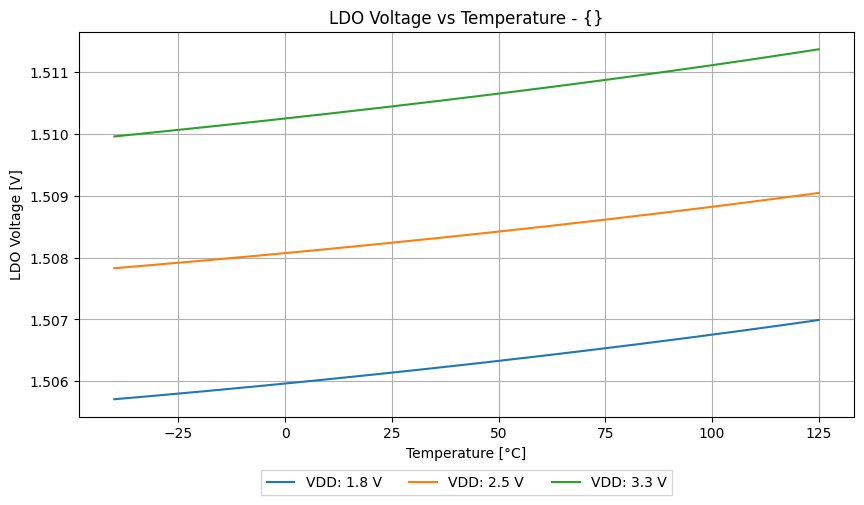
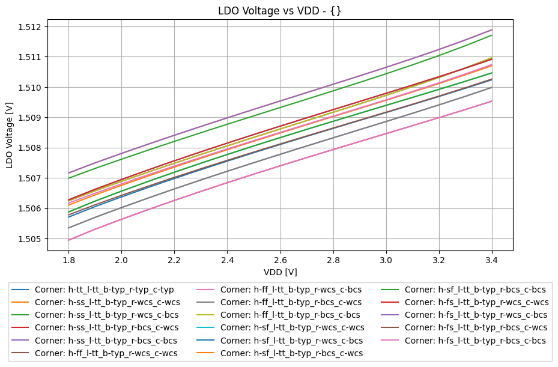
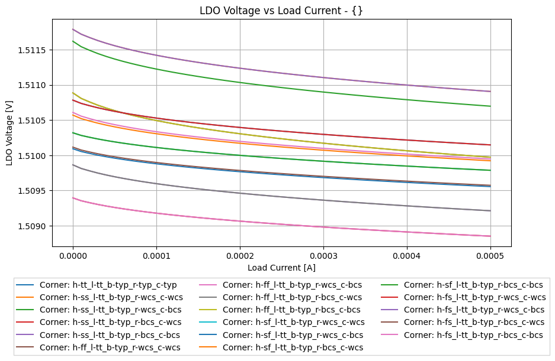
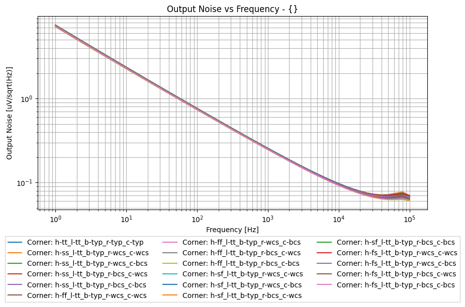
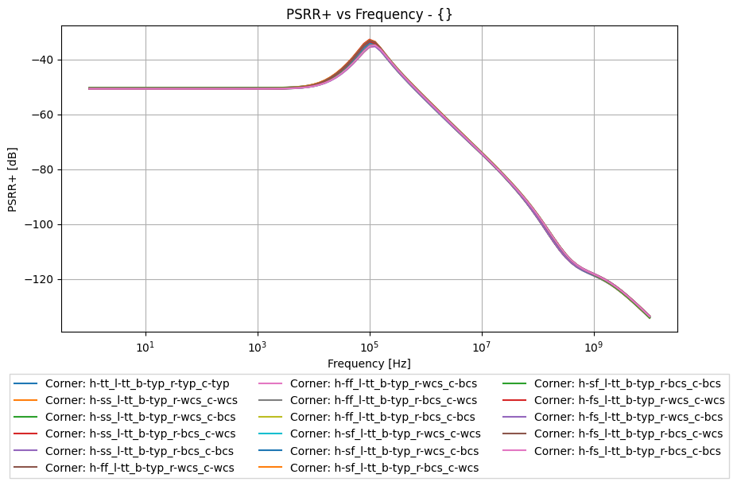
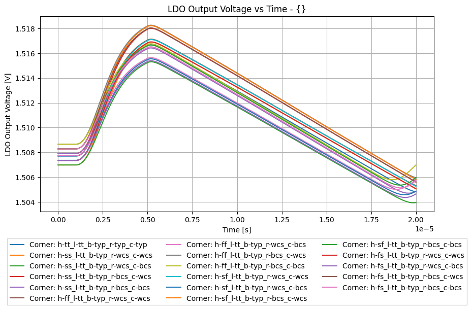
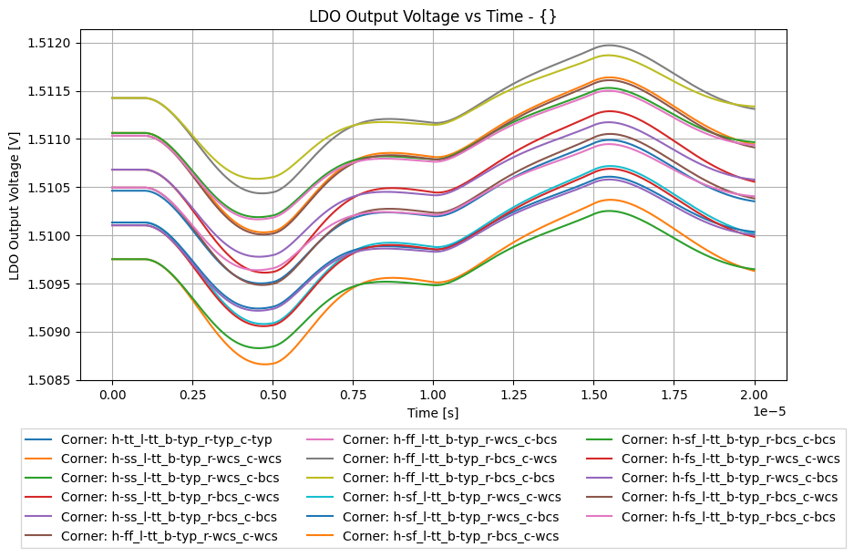

# LDO Output Voltage vs Temperature 

|  |
| :-- |
|  |

# LDO Output Voltage vs Temperature (Monte Carlo) 

| ,_('tt_typ_mismatch_mc',_-2)__1e1e1dc36ea2b070910eed1e861b1132.png "") |
| :-- |
|  |

| ,_('tt_typ_mismatch_mc',_-2)__1e1e1dc36ea2b070910eed1e861b1132.png "") |
| :-- |
|  |

| ,_('tt_typ_mismatch_mc',_-2)__1e1e1dc36ea2b070910eed1e861b1132.png "") |
| :-- |
|  |

| ,_('tt_typ_mismatch_mc',_-2)__1e1e1dc36ea2b070910eed1e861b1132.png "") |
| :-- |
|  |

# LDO Output Voltage vs VDD 

|  |
| :-- |
|  |

# LDO Output Voltage vs VDD (Monte Carlo) 

| ,_('tt_typ_mismatch_mc',_-2)__ec72d360d8a1412bec3c6192f42a55d5.png "") |
| :-- |
|  |

| ,_('tt_typ_mismatch_mc',_-2)__ec72d360d8a1412bec3c6192f42a55d5.png "") |
| :-- |
|  |

| ,_('tt_typ_mismatch_mc',_-2)__ec72d360d8a1412bec3c6192f42a55d5.png "") |
| :-- |
|  |

| ,_('tt_typ_mismatch_mc',_-2)__ec72d360d8a1412bec3c6192f42a55d5.png "") |
| :-- |
|  |

# LDO Output Voltage vs Load Current 

|  |
| :-- |
|  |

# LDO Output Voltage vs Load Current (Monte Carlo) 

| ,_('tt_typ_mismatch_mc',_-2)__45979851e8523732f7a76f16bcb28321.png "") |
| :-- |
|  |

| ,_('tt_typ_mismatch_mc',_-2)__45979851e8523732f7a76f16bcb28321.png "") |
| :-- |
|  |

| ,_('tt_typ_mismatch_mc',_-2)__45979851e8523732f7a76f16bcb28321.png "") |
| :-- |
|  |

| ,_('tt_typ_mismatch_mc',_-2)__45979851e8523732f7a76f16bcb28321.png "") |
| :-- |
|  |

# Noise Performance 

|  |
| :-- |
|  |

# PSRR+ Performance 

|  |
| :-- |
|  |

# PSRR+ Performance (Monte Carlo) 

| ,_('tt_typ_mismatch_mc',_-2)__a2014494ed514549f55ac848af4c983b.png "") |
| :-- |
|  |

| ,_('tt_typ_mismatch_mc',_-2)__a2014494ed514549f55ac848af4c983b.png "") |
| :-- |
|  |

# Line Transient Performance 

|  |
| :-- |
| 1V Line Transient |

# Line Transient Performance (Monte Carlo) 

| ,_('tt_typ_mismatch_mc',_-2)__2a6334b4ac5c4f58aa3e622cc8e893a2.png "") |
| :-- |
|  |

# Load Transient Performance 

|  |
| :-- |
| 200uA Load Transient |

# Load Transient Performance (Monte Carlo) 

| ,_('tt_typ_mismatch_mc',_-2)__9182e6e6885a79ee4feba477a28f4ae1.png "") |
| :-- |
|  |

# AC Loopgain PM (Monte Carlo) 

| ,_('tt_typ_mismatch_mc',_-2)__000bcc4a43f21bbb154baecc01e288d5.png "") |
| :-- |
|  |

