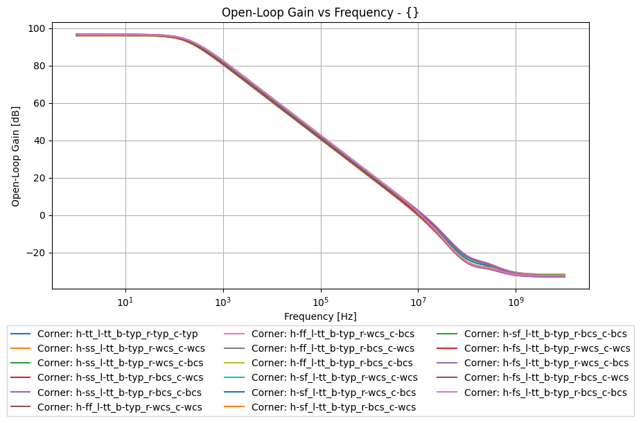
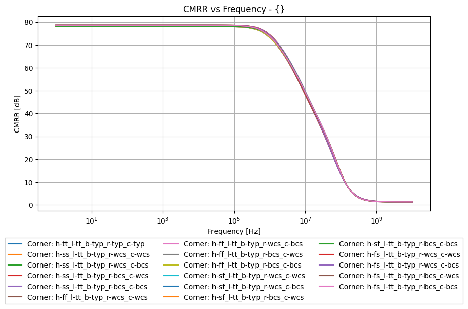
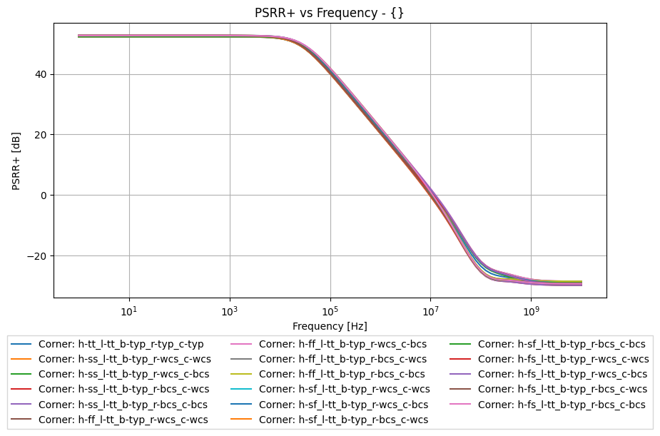
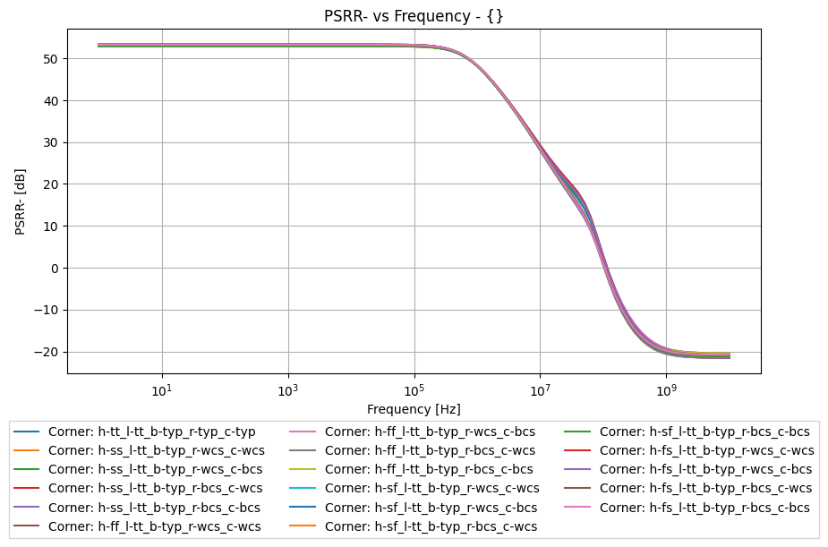
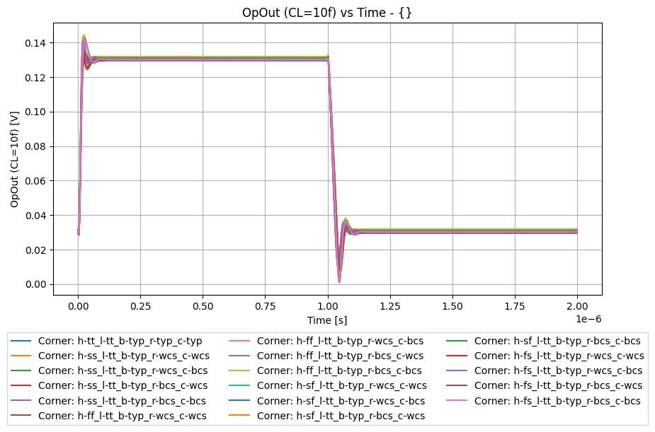
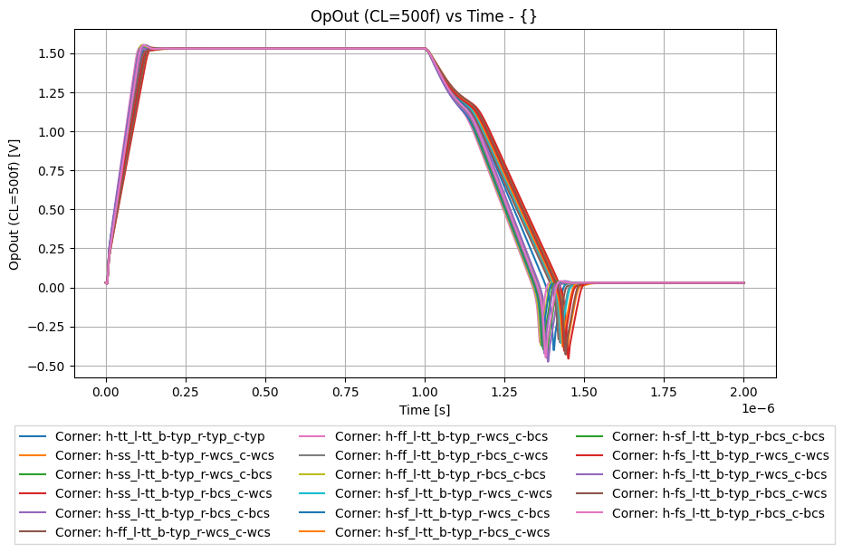
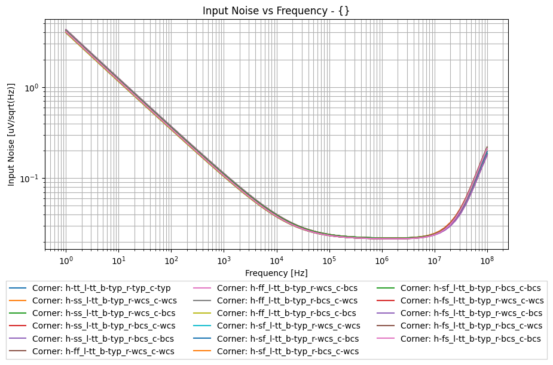

# AC Open-Loop Performance 

|  |
| :-- |
|  |

# AC Open-Loop Performance (Monte Carlo) 

| ,_('tt_typ_mismatch_mc',_-2)__9a5db47ab9aba3bb4e26aa89c1792547.png "") |
| :-- |
|  |

| ,_('tt_typ_mismatch_mc',_-2)__9a5db47ab9aba3bb4e26aa89c1792547.png "") |
| :-- |
|  |

| ,_('tt_typ_mismatch_mc',_-2)__9a5db47ab9aba3bb4e26aa89c1792547.png "") |
| :-- |
|  |

| ,_('tt_typ_mismatch_mc',_-2)__9a5db47ab9aba3bb4e26aa89c1792547.png "") |
| :-- |
|  |

# CMRR/PSRR Performance 

|  |
| :-- |
|  |

|  |
| :-- |
|  |

|  |
| :-- |
|  |

# CMRR/PSRR Performance (Monte Carlo) 

| ,_('tt_typ_mismatch_mc',_-2)__92a075e5ac40469fba2aee58b2723854.png "") |
| :-- |
|  |

| ,_('tt_typ_mismatch_mc',_-2)__92a075e5ac40469fba2aee58b2723854.png "") |
| :-- |
|  |

| ,_('tt_typ_mismatch_mc',_-2)__92a075e5ac40469fba2aee58b2723854.png "") |
| :-- |
|  |

| ,_('tt_typ_mismatch_mc',_-2)__92a075e5ac40469fba2aee58b2723854.png "") |
| :-- |
|  |

| ,_('tt_typ_mismatch_mc',_-2)__92a075e5ac40469fba2aee58b2723854.png "") |
| :-- |
|  |

| ,_('tt_typ_mismatch_mc',_-2)__92a075e5ac40469fba2aee58b2723854.png "") |
| :-- |
|  |

# Output Range Performance (Monte Carlo) 

| ,_('tt_typ_mismatch_mc',_-2)__b39434883180237cad8ff66e469b8ae4.png "") |
| :-- |
|  |

| ,_('tt_typ_mismatch_mc',_-2)__b39434883180237cad8ff66e469b8ae4.png "") |
| :-- |
|  |

# Input Range Performance (Monte Carlo) 

| ,_('tt_typ_mismatch_mc',_-2)__c3ef339970d360a980e264425d85bd59.png "") |
| :-- |
|  |

# Slew-Rate/Offset Performance 

|  |
| :-- |
|  |

|  |
| :-- |
|  |

# Slew-Rate/Offset Performance (Monte Carlo) 

| ,_('tt_typ_mismatch_mc',_-2)__22ab7f64ab47c9c34d8c7b572f5ab958.png "") |
| :-- |
|  |

| ,_('tt_typ_mismatch_mc',_-2)__22ab7f64ab47c9c34d8c7b572f5ab958.png "") |
| :-- |
|  |

| ,_('tt_typ_mismatch_mc',_-2)__22ab7f64ab47c9c34d8c7b572f5ab958.png "") |
| :-- |
|  |

# Noise Performance 

|  |
| :-- |
|  |

