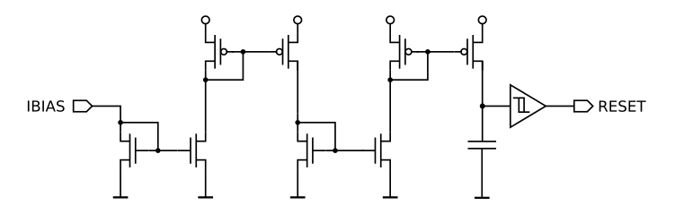
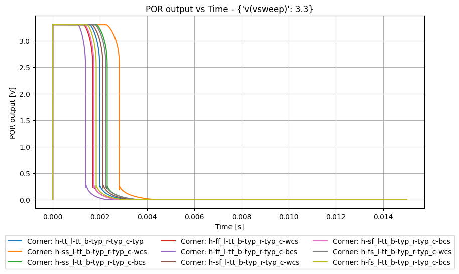
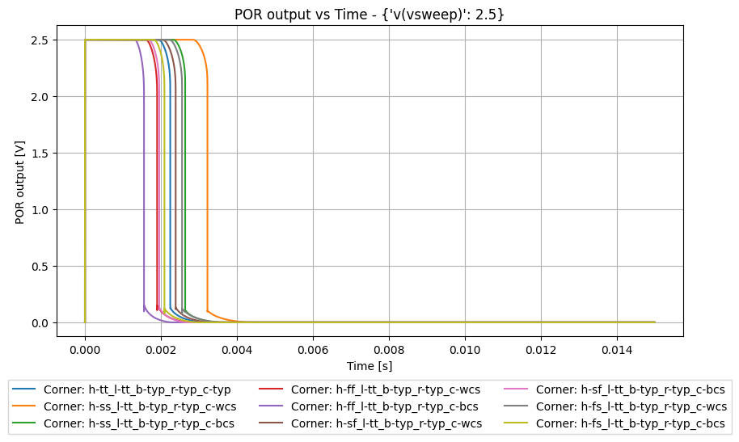
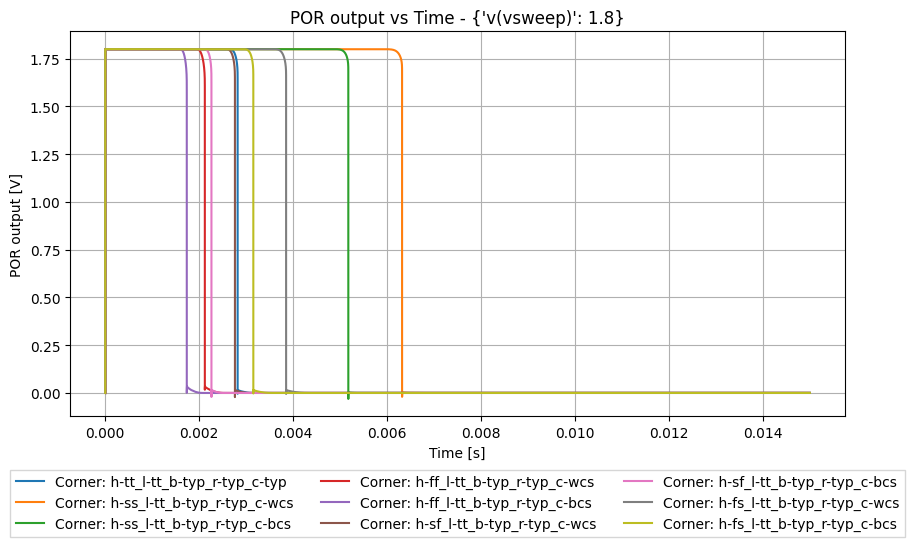
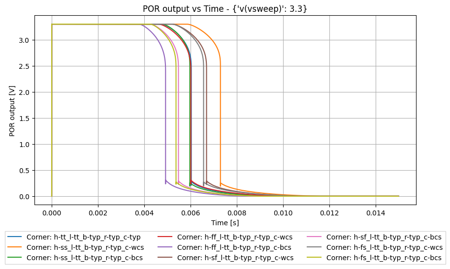
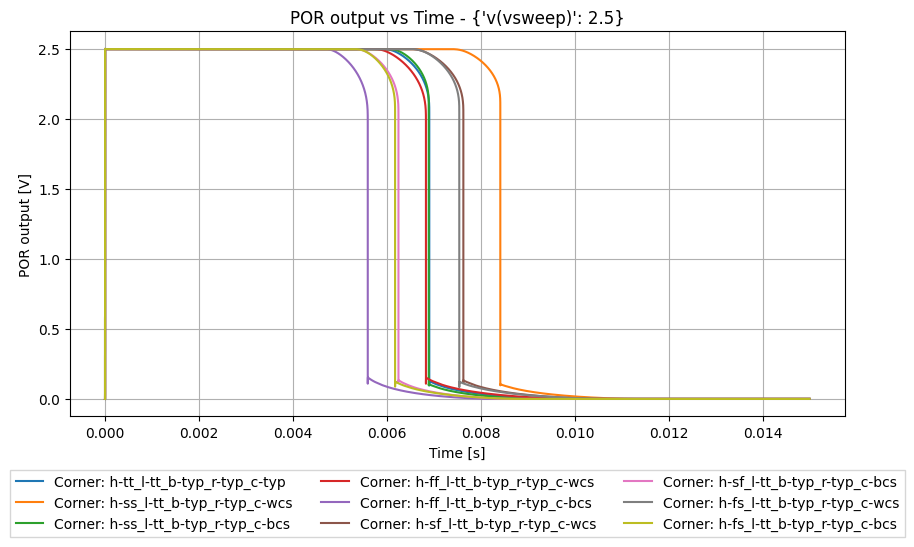
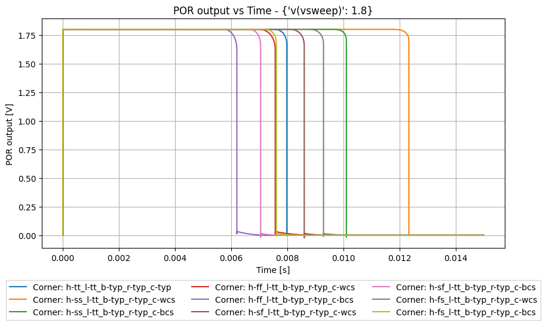

30.08.2025, 00:16:14

# Vth Current Reference

3 uA current reference with source- and sink-port.

 

[🔗 Schematics](por_sch.pdf) 

Show Tool Versions...

> xschem: 3.4.6 
> ngspice: 44.2 
> magic: 8.3.539 
> netgen: 1.5.293 
> ihpopenpdk: dev 

 

# LVS
LVS-state: Netlists match uniquely. 

[🔗 LVS-report](por_por_netgen_comp.out) 

# SPECIFICATIONS

## Transient Specification  

| Parameter | Min (Spec. / Sim.) |      | Max (Sim. / Spec.) | Unit | Checks (total/pass/fail/NaN) | Comment |
| :-------- | -----------------: | :--: | :----------------- | :--- | :--------------------------- | ------- |
| POR Time | 0.5 / 1.391 | <svg height="20" width="150"><polyline points="3.0,3,3.0,17,147.0,17,147.0,3" style="fill:none;stroke:gray;stroke-width:1" /><polyline points="75.0,10.0,75.0,17" style="fill:none;stroke:gray;stroke-width:1" /><polyline points="16.512156631578947,10.0,91.21208084210525,10.0" style="stroke:green;stroke-width:2" /><circle cx="16.512156631578947" cy="10.0" r="3" style="fill:green;stroke:green;stroke-width:0" /><circle cx="91.21208084210525" cy="10.0" r="3" style="fill:green;stroke:green;stroke-width:0" /></svg> | 6.32 / 10.0 | ms | 27/100.0%/0.0%/0.0% |  |

 

## Transient Specification (Monte-Carlo)  

| Parameter | Min (Spec. / Sim.) |      | Max (Sim. / Spec.) | Unit | Checks (total/pass/fail/NaN) | Comment |
| :-------- | -----------------: | :--: | :----------------- | :--- | :--------------------------- | ------- |
| POR Time | 0.5 / 1.805 | <svg height="20" width="150"><polyline points="3.0,3,3.0,17,147.0,17,147.0,3" style="fill:none;stroke:gray;stroke-width:1" /><polyline points="75.0,10.0,75.0,17" style="fill:none;stroke:gray;stroke-width:1" /><polyline points="22.78766147368421,10.0,36.94957642105263,10.0" style="stroke:green;stroke-width:2" /><circle cx="22.78766147368421" cy="10.0" r="3" style="fill:green;stroke:green;stroke-width:0" /><circle cx="36.94957642105263" cy="10.0" r="3" style="fill:green;stroke:green;stroke-width:0" /></svg> | 2.74 / 10.0 | ms | 20/100.0%/0.0%/0.0% |  |

 

## Transient Specification [PEX] 

| Parameter | Min (Spec. / Sim.) |      | Max (Sim. / Spec.) | Unit | Checks (total/pass/fail/NaN) | Comment |
| :-------- | -----------------: | :--: | :----------------- | :--- | :--------------------------- | ------- |
| POR Time | 0.5 / 4.924 | <svg height="20" width="150"><polyline points="3.0,3,3.0,17,118.6274564495271,17,118.6274564495271,3" style="fill:none;stroke:gray;stroke-width:1" /><polyline points="60.81372822476355,10.0,60.81372822476355,17" style="fill:none;stroke:gray;stroke-width:1" /><polyline points="56.84014808428635,10.0,147.0,10.0" style="stroke:red;stroke-width:2" /><circle cx="56.84014808428635" cy="10.0" r="3" style="fill:red;stroke:red;stroke-width:0" /><circle cx="147.0" cy="10.0" r="3" style="fill:red;stroke:red;stroke-width:0" /></svg> | 12.331 / 10.0 | ms | 27/92.5926%/7.4074%/0.0% |  |

Show specification violation details...

> **FAIL:** Specification violation for parameter "POR Time": 
> **FAIL:** group:h-ss_l-tt_b-typ_r-typ_c-wcs file:work/sim/por/por_tb.1_tranext/batch_0/h-ss_l-tt_b-typ_r-typ_c-wcs/tran.csv Index:0  
> **FAIL:** group:h-ss_l-tt_b-typ_r-typ_c-bcs file:work/sim/por/por_tb.1_tranext/batch_0/h-ss_l-tt_b-typ_r-typ_c-bcs/tran.csv Index:0  

 

## Transient Specification (Monte-Carlo) [PEX] 

| Parameter | Min (Spec. / Sim.) |      | Max (Sim. / Spec.) | Unit | Checks (total/pass/fail/NaN) | Comment |
| :-------- | -----------------: | :--: | :----------------- | :--- | :--------------------------- | ------- |
| POR Time | 0.5 / 2.919 | <svg height="20" width="150"><polyline points="3.0,3,3.0,17,147.0,17,147.0,3" style="fill:none;stroke:gray;stroke-width:1" /><polyline points="75.0,10.0,75.0,17" style="fill:none;stroke:gray;stroke-width:1" /><polyline points="39.66744757894737,10.0,117.14723873684211,10.0" style="stroke:green;stroke-width:2" /><circle cx="39.66744757894737" cy="10.0" r="3" style="fill:green;stroke:green;stroke-width:0" /><circle cx="117.14723873684211" cy="10.0" r="3" style="fill:green;stroke:green;stroke-width:0" /></svg> | 8.031 / 10.0 | ms | 20/100.0%/0.0%/0.0% |  |

 

# PERFORMANCE CHARACTERISTICS

## Transient Performance  

|  |
| :-- |
|  |

...

|  |
| :-- |
|  |

 

...

|  |
| :-- |
|  |

 

## Transient Performance [PEX] 

|  |
| :-- |
|  |

...

|  |
| :-- |
|  |

 

...

|  |
| :-- |
|  |

 
