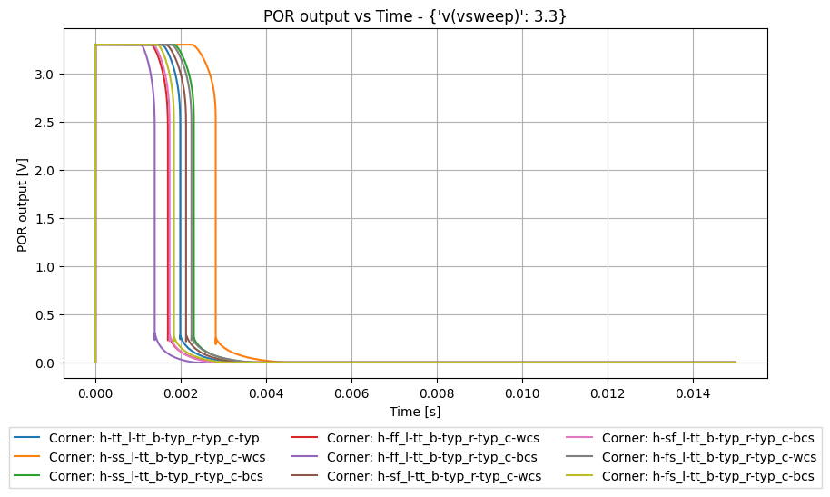
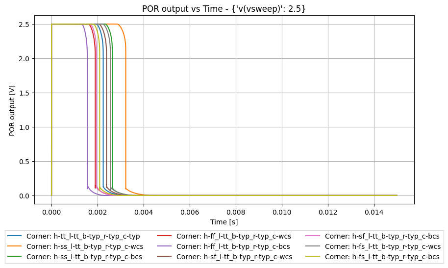
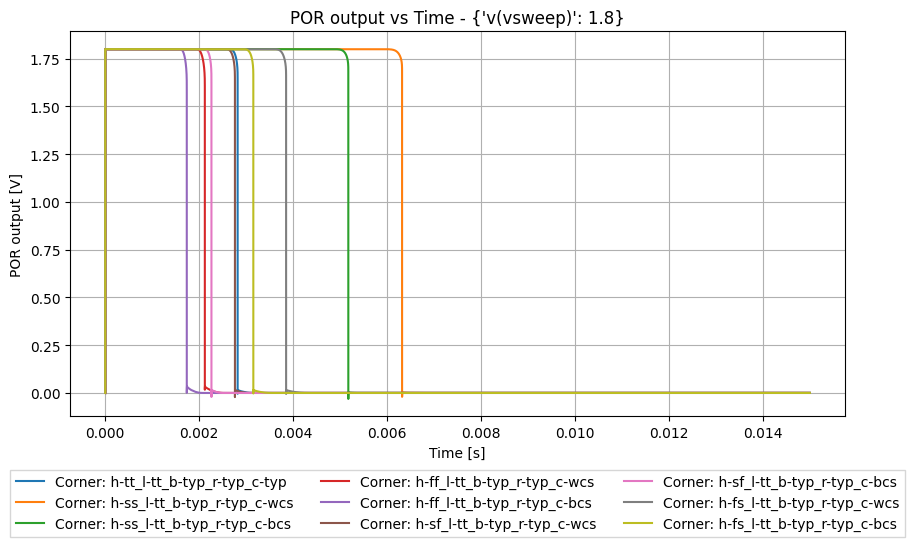
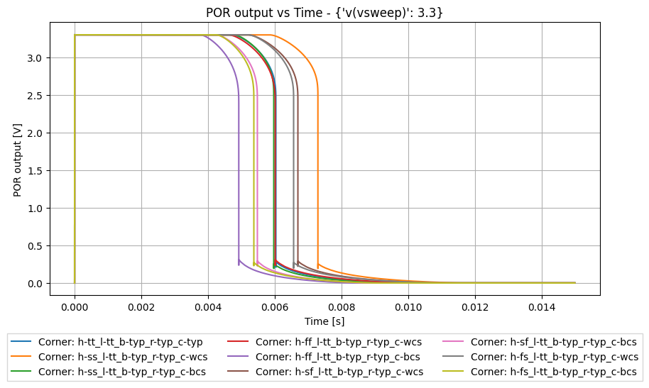
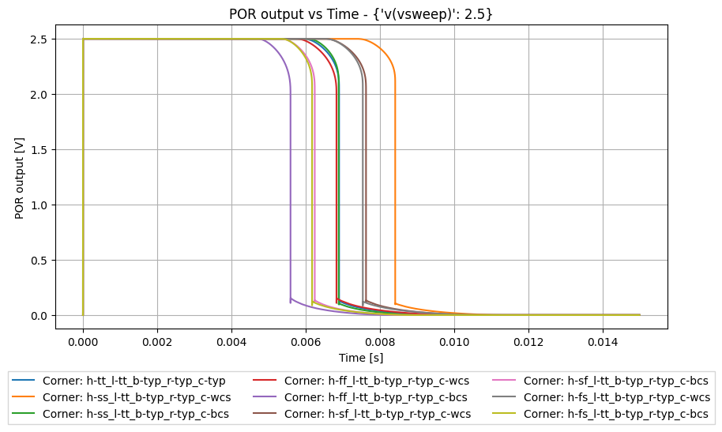
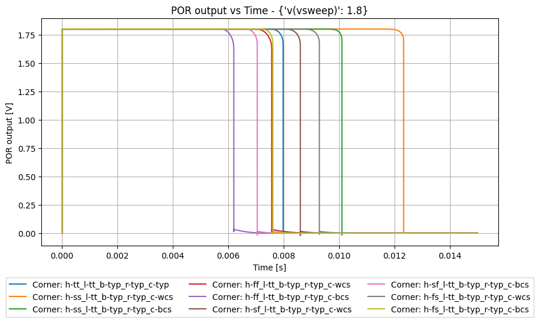

# Transient Performance  

|  |
| :-- |
|  |

...

|  |
| :-- |
|  |

 

...

|  |
| :-- |
|  |

 

# Transient Performance [PEX] 

|  |
| :-- |
|  |

...

|  |
| :-- |
|  |

 

...

|  |
| :-- |
|  |

 
