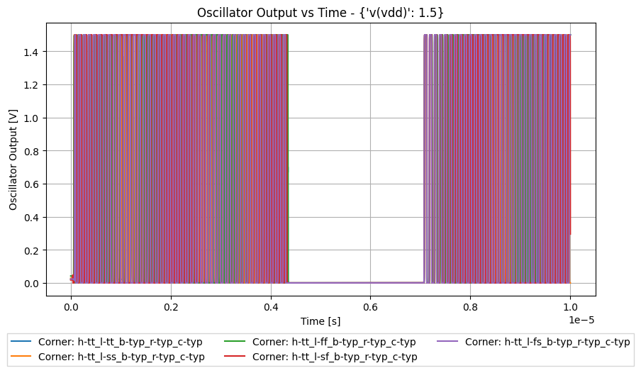
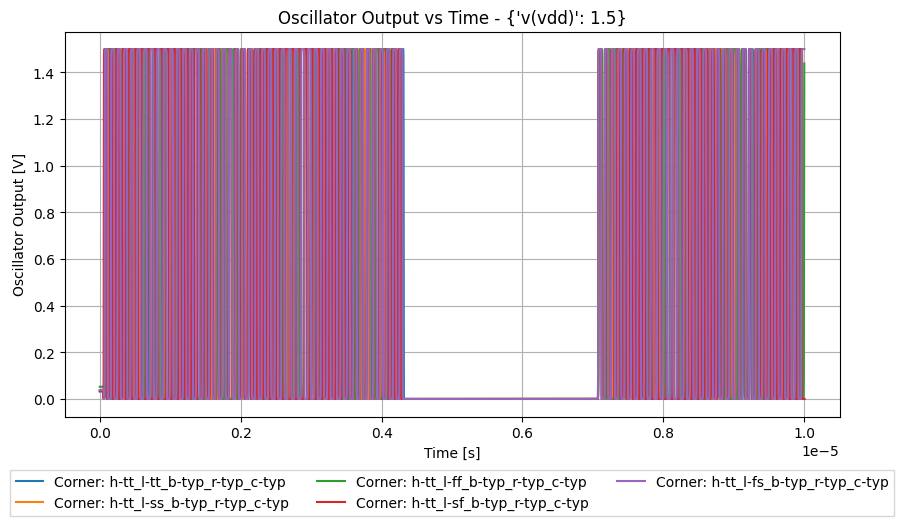

14.09.2025, 22:58:57

# Ring Oscillator

Ring oscillator with enable pin.

 

[🔗 Schematics](riosc_sch.pdf) 

Show Tool Versions...

> xschem: 3.4.6 
> ngspice: 44.2 
> magic: 8.3.541 
> netgen: 1.5.293 
> ihpopenpdk: dev 

 

# LVS
LVS-state: Netlists match uniquely. 

[🔗 LVS-report](riosc_riosc_netgen_comp.out) 

# SPECIFICATIONS

## Tranisent Specification 

| Parameter | Min (Spec. / Sim.) |      | Max (Sim. / Spec.) | Unit | Checks (total/pass/fail/NaN) | Comment |
| :-------- | -----------------: | :--: | :----------------- | :--- | :--------------------------- | ------- |
| High Duration | 10.0 / 47.096 | <svg height="20" width="150"><polyline points="3.0,3,3.0,17,147.0,17,147.0,3" style="fill:none;stroke:gray;stroke-width:1" /><polyline points="75.0,10.0,75.0,17" style="fill:none;stroke:gray;stroke-width:1" /><polyline points="62.35360000000001,10.0,92.2288,10.0" style="stroke:green;stroke-width:2" /><circle cx="62.35360000000001" cy="10.0" r="3" style="fill:green;stroke:green;stroke-width:0" /><circle cx="92.2288" cy="10.0" r="3" style="fill:green;stroke:green;stroke-width:0" /></svg> | 65.768 / 100.0 | ns | 45/100.0%/0.0%/0.0% | Last period before oscillator disable |
| Period Duration | 10.0 / 100.052 | <svg height="20" width="150"><polyline points="3.0,3,3.0,17,147.0,17,147.0,3" style="fill:none;stroke:gray;stroke-width:1" /><polyline points="75.0,10.0,75.0,17" style="fill:none;stroke:gray;stroke-width:1" /><polyline points="71.24970947368422,10.0,101.4149052631579,10.0" style="stroke:green;stroke-width:2" /><circle cx="71.24970947368422" cy="10.0" r="3" style="fill:green;stroke:green;stroke-width:0" /><circle cx="101.4149052631579" cy="10.0" r="3" style="fill:green;stroke:green;stroke-width:0" /></svg> | 139.853 / 200.0 | ns | 45/100.0%/0.0%/0.0% | First period after oscillator enable |
| Duty-Cycle | 40 / 44.745 | <svg height="20" width="150"><polyline points="3.0,3,3.0,17,147.0,17,147.0,3" style="fill:none;stroke:gray;stroke-width:1" /><polyline points="75.0,10.0,75.0,17" style="fill:none;stroke:gray;stroke-width:1" /><polyline points="37.16263200000001,10.0,63.51074399999998,10.0" style="stroke:green;stroke-width:2" /><circle cx="37.16263200000001" cy="10.0" r="3" style="fill:green;stroke:green;stroke-width:0" /><circle cx="63.51074399999998" cy="10.0" r="3" style="fill:green;stroke:green;stroke-width:0" /></svg> | 48.404 / 60 | % | 45/100.0%/0.0%/0.0% | First period after oscillator enable |

 

## Transient Specification (Monte Carlo) 

| Parameter | Min (Spec. / Sim.) |      | Max (Sim. / Spec.) | Unit | Checks (total/pass/fail/NaN) | Comment |
| :-------- | -----------------: | :--: | :----------------- | :--- | :--------------------------- | ------- |
| High Duration | 10.0 / 48.392 | <svg height="20" width="150"><polyline points="3.0,3,3.0,17,147.0,17,147.0,3" style="fill:none;stroke:gray;stroke-width:1" /><polyline points="75.0,10.0,75.0,17" style="fill:none;stroke:gray;stroke-width:1" /><polyline points="64.4272,10.0,92.01760000000002,10.0" style="stroke:green;stroke-width:2" /><circle cx="64.4272" cy="10.0" r="3" style="fill:green;stroke:green;stroke-width:0" /><circle cx="92.01760000000002" cy="10.0" r="3" style="fill:green;stroke:green;stroke-width:0" /></svg> | 65.636 / 100.0 | ns | 200/100.0%/0.0%/0.0% | Last period before oscillator disable |
| Period Duration | 20.0 / 102.801 | <svg height="20" width="150"><polyline points="3.0,3,3.0,17,147.0,17,147.0,3" style="fill:none;stroke:gray;stroke-width:1" /><polyline points="75.0,10.0,75.0,17" style="fill:none;stroke:gray;stroke-width:1" /><polyline points="69.24064,10.0,97.3956,10.0" style="stroke:green;stroke-width:2" /><circle cx="69.24064" cy="10.0" r="3" style="fill:green;stroke:green;stroke-width:0" /><circle cx="97.3956" cy="10.0" r="3" style="fill:green;stroke:green;stroke-width:0" /></svg> | 137.994 / 200.0 | ns | 200/100.0%/0.0%/0.0% | First period after oscillator enable |
| Duty-Cycle | 40 / 44.593 | <svg height="20" width="150"><polyline points="3.0,3,3.0,17,147.0,17,147.0,3" style="fill:none;stroke:gray;stroke-width:1" /><polyline points="75.0,10.0,75.0,17" style="fill:none;stroke:gray;stroke-width:1" /><polyline points="36.071040000000025,10.0,64.444152,10.0" style="stroke:green;stroke-width:2" /><circle cx="36.071040000000025" cy="10.0" r="3" style="fill:green;stroke:green;stroke-width:0" /><circle cx="64.444152" cy="10.0" r="3" style="fill:green;stroke:green;stroke-width:0" /></svg> | 48.534 / 60 | % | 200/100.0%/0.0%/0.0% | First period after oscillator enable |

 

## Tranisent Specification (PEX) 

| Parameter | Min (Spec. / Sim.) |      | Max (Sim. / Spec.) | Unit | Checks (total/pass/fail/NaN) | Comment |
| :-------- | -----------------: | :--: | :----------------- | :--- | :--------------------------- | ------- |
| High Duration | 10.0 / 42.202 | <svg height="20" width="150"><polyline points="3.0,3,3.0,17,147.0,17,147.0,3" style="fill:none;stroke:gray;stroke-width:1" /><polyline points="75.0,10.0,75.0,17" style="fill:none;stroke:gray;stroke-width:1" /><polyline points="54.523199999999996,10.0,101.7152,10.0" style="stroke:green;stroke-width:2" /><circle cx="54.523199999999996" cy="10.0" r="3" style="fill:green;stroke:green;stroke-width:0" /><circle cx="101.7152" cy="10.0" r="3" style="fill:green;stroke:green;stroke-width:0" /></svg> | 71.697 / 100.0 | ns | 45/100.0%/0.0%/0.0% | Last period before oscillator disable |
| Period Duration | 20.0 / 88.953 | <svg height="20" width="150"><polyline points="3.0,3,3.0,17,147.0,17,147.0,3" style="fill:none;stroke:gray;stroke-width:1" /><polyline points="75.0,10.0,75.0,17" style="fill:none;stroke:gray;stroke-width:1" /><polyline points="58.162119999999994,10.0,108.81352000000001,10.0" style="stroke:green;stroke-width:2" /><circle cx="58.162119999999994" cy="10.0" r="3" style="fill:green;stroke:green;stroke-width:0" /><circle cx="108.81352000000001" cy="10.0" r="3" style="fill:green;stroke:green;stroke-width:0" /></svg> | 152.267 / 200.0 | ns | 45/100.0%/0.0%/0.0% | First period after oscillator enable |
| Duty-Cycle | 40 / 45.517 | <svg height="20" width="150"><polyline points="3.0,3,3.0,17,147.0,17,147.0,3" style="fill:none;stroke:gray;stroke-width:1" /><polyline points="75.0,10.0,75.0,17" style="fill:none;stroke:gray;stroke-width:1" /><polyline points="42.725207999999995,10.0,66.30002400000004,10.0" style="stroke:green;stroke-width:2" /><circle cx="42.725207999999995" cy="10.0" r="3" style="fill:green;stroke:green;stroke-width:0" /><circle cx="66.30002400000004" cy="10.0" r="3" style="fill:green;stroke:green;stroke-width:0" /></svg> | 48.792 / 60 | % | 45/100.0%/0.0%/0.0% | First period after oscillator enable |

 

## Transient Specification (Monte Carlo, PEX) 

| Parameter | Min (Spec. / Sim.) |      | Max (Sim. / Spec.) | Unit | Checks (total/pass/fail/NaN) | Comment |
| :-------- | -----------------: | :--: | :----------------- | :--- | :--------------------------- | ------- |
| High Duration | 10.0 / 45.721 | <svg height="20" width="150"><polyline points="3.0,3,3.0,17,147.0,17,147.0,3" style="fill:none;stroke:gray;stroke-width:1" /><polyline points="75.0,10.0,75.0,17" style="fill:none;stroke:gray;stroke-width:1" /><polyline points="60.15360000000001,10.0,84.30400000000002,10.0" style="stroke:green;stroke-width:2" /><circle cx="60.15360000000001" cy="10.0" r="3" style="fill:green;stroke:green;stroke-width:0" /><circle cx="84.30400000000002" cy="10.0" r="3" style="fill:green;stroke:green;stroke-width:0" /></svg> | 60.815 / 100.0 | ns | 200/100.0%/0.0%/0.0% | Last period before oscillator disable |
| Period Duration | 20.0 / 96.236 | <svg height="20" width="150"><polyline points="3.0,3,3.0,17,147.0,17,147.0,3" style="fill:none;stroke:gray;stroke-width:1" /><polyline points="75.0,10.0,75.0,17" style="fill:none;stroke:gray;stroke-width:1" /><polyline points="63.98840799999999,10.0,89.12320000000001,10.0" style="stroke:green;stroke-width:2" /><circle cx="63.98840799999999" cy="10.0" r="3" style="fill:green;stroke:green;stroke-width:0" /><circle cx="89.12320000000001" cy="10.0" r="3" style="fill:green;stroke:green;stroke-width:0" /></svg> | 127.654 / 200.0 | ns | 200/100.0%/0.0%/0.0% | First period after oscillator enable |
| Duty-Cycle | 40 / 45.959 | <svg height="20" width="150"><polyline points="3.0,3,3.0,17,147.0,17,147.0,3" style="fill:none;stroke:gray;stroke-width:1" /><polyline points="75.0,10.0,75.0,17" style="fill:none;stroke:gray;stroke-width:1" /><polyline points="45.90220800000002,10.0,66.74174400000001,10.0" style="stroke:green;stroke-width:2" /><circle cx="45.90220800000002" cy="10.0" r="3" style="fill:green;stroke:green;stroke-width:0" /><circle cx="66.74174400000001" cy="10.0" r="3" style="fill:green;stroke:green;stroke-width:0" /></svg> | 48.853 / 60 | % | 200/100.0%/0.0%/0.0% | First period after oscillator enable |

 

# PERFORMANCE CHARACTERISTICS

## Transient Performance 

|  |
| :-- |
|  |

## Transient Performance [PEX] 

|  |
| :-- |
|  |

## Transient Performance (Monte Carlo) 

| ,_('tt_typ_mismatch_mc',_-2)__7f45d0bfa404f1962df747c50f0fff84.png "") |
| :-- |
|  |

| ,_('tt_typ_mismatch_mc',_-2)__7f45d0bfa404f1962df747c50f0fff84.png "") |
| :-- |
|  |

| ,_('tt_typ_mismatch_mc',_-2)__7f45d0bfa404f1962df747c50f0fff84.png "") |
| :-- |
|  |

