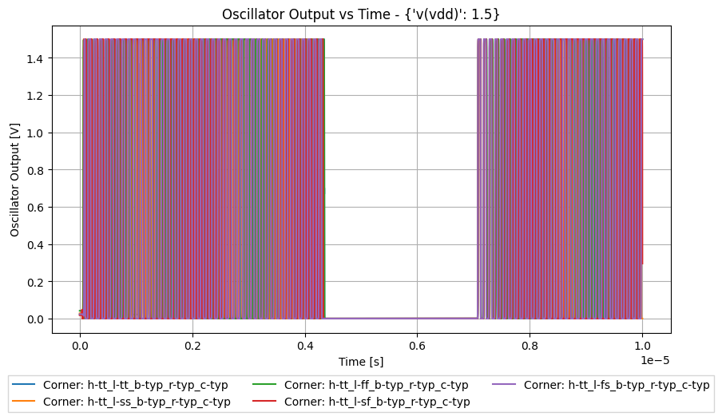
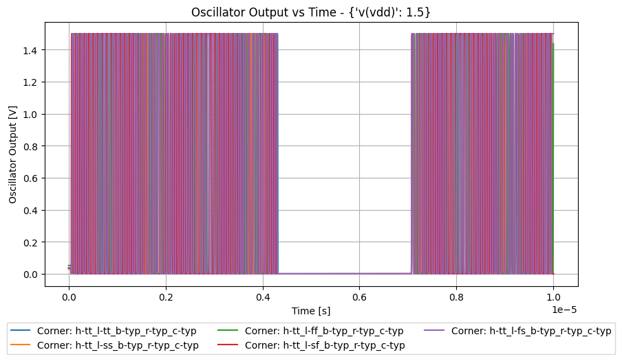

# Transient Performance 

|  |
| :-- |
|  |

# Transient Performance [PEX] 

|  |
| :-- |
|  |

# Transient Performance (Monte Carlo) 

| ,_('tt_typ_mismatch_mc',_-2)__7f45d0bfa404f1962df747c50f0fff84.png "") |
| :-- |
|  |

| ,_('tt_typ_mismatch_mc',_-2)__7f45d0bfa404f1962df747c50f0fff84.png "") |
| :-- |
|  |

| ,_('tt_typ_mismatch_mc',_-2)__7f45d0bfa404f1962df747c50f0fff84.png "") |
| :-- |
|  |

